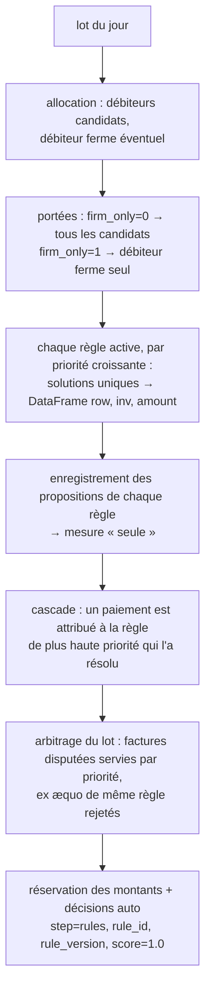

# Ajouter une règle de réconciliation (étape 4)

> **Résumé.** Une règle se déclare dans `config/rules.yaml` et s'implémente comme une méthode de
> `RulesMatcher` ([src/reconcile_rules/matcher.py](../src/reconcile_rules/matcher.py)). Elle reçoit
> les paiements du lot et leur **portée** (débiteurs autorisés). Elle renvoie, pour chaque paiement
> où elle trouve une **solution unique**, les factures et montants à imputer. Tout le reste est
> automatique et commun à toutes les règles :
> - priorité et cascade ;
> - arbitrage des factures disputées ;
> - réservations ;
> - traçabilité de la règle et de sa version ;
> - mesures par règle et interface.
>
> Il faut toucher quatre endroits (constante, méthode, aiguillage, configuration), puis tester et
> mesurer.

---

## 1. Comment les règles s'exécutent

Chaque jour du rejeu, `RulesMatcher.process` (`src/reconcile_rules/matcher.py:228`) :



Conséquences pour une nouvelle règle :
- **Elle ne décide pas seule.** Si une règle plus prioritaire résout le même paiement, c'est elle qui
  l'emporte. Si une autre règle prend la même facture le même jour, l'arbitrage sert la plus
  prioritaire, et la nouvelle règle cède.
- **Elle doit être prudente.** Une solution n'est renvoyée que si elle est **unique**. Une ambiguïté
  laisse le paiement à l'étape 5 (ML).

---

## 2. Le contrat d'une règle

### Entrées disponibles dans `process`

| Variable | Contenu |
|---|---|
| `pos` | positions des paiements du lot dans la table `payment` |
| `amount` | montant de chaque paiement du lot, en **centimes** (`np.ndarray`, indexé par ligne `row`) |
| `as_of` | instant de l'état : minuit du jour D. **Toute lecture de l'état doit le passer** |
| `scope` | DataFrame des couples (`row`, `debtor`) autorisés, plus `rank`. `debtor` est une **position** de débiteur |
| `alloc` | sortie de l'allocation : `alloc.payments` (statut, débiteur ferme, `client_file_id`…) et `alloc.candidates` |
| `rule.params` | paramètres de la règle lus dans `rules.yaml` (**valeurs numériques uniquement**) |

### Sortie attendue

Un DataFrame aux colonnes `row`, `inv`, `amount` (`_PROPOSAL_COLUMNS`,
`src/reconcile_rules/matcher.py:36`) :

| Colonne | Contenu |
|---|---|
| `row` | ligne du paiement dans le lot |
| `inv` | **position** de la facture (pas son identifiant) |
| `amount` | montant à imputer sur cette facture, en centimes |

- **Un paiement** = une ou plusieurs lignes (une par facture de la solution).
- **N'y mettre que les paiements à solution unique.**
- **Rien à proposer** : renvoyer `_no_proposal()` (`src/reconcile_rules/matcher.py:39`).

### Outils à disposition

| Outil | Usage |
|---|---|
| `self._effective(inv, balance)` (`:89`) | restant dû **net des réservations du moteur**, à toujours utiliser à la place du restant dû brut |
| `_unique_per_row(pairs)` (`:50`) | ne garde que les paiements pour lesquels une seule facture distincte ressort |
| `_first_two(frame, by)` (`:43`) | au plus deux lignes par groupe : suffisant pour constater une ambiguïté, sans développer des milliers de factures |
| `self._referenced(pos, as_of, scope)` (`:112`) | factures ouvertes de la portée **citées par le libellé** (row, inv, balance), comme pour R2 et R5 |
| `self.state.debtor_open_invoices_at(debtors, as_of)` | factures ouvertes de débiteurs donnés : (index du débiteur, facture, restant dû) |
| `self.state.open_invoice_positions(as_of)` | toutes les factures ouvertes et leur restant dû |
| `self.state.open_balance_at(inv, as_of)` | restant dû de factures données |
| `exact_subset` (`src/reconcile_rules/subset.py:28`) | recherche bornée d'un sous-ensemble de somme exacte, comme R4 |

---

## 3. Exemple complet : `R6_DISCOUNT_UNIQUE`, l'escompte unique

**Objectif métier.** Le débiteur paie une facture en déduisant un escompte de 0,5 % à 3 %. Aujourd'hui,
R2 exige l'égalité des montants et R5 traite l'écart comme un paiement partiel. La règle R6 solde la
facture quand **une seule** facture ouverte du débiteur ferme correspond à un tel escompte.

Cet exemple a été vérifié sur les données de test du dépôt :
- un paiement de 980 € face à une facture de 1 000 € est auto-validé par R6 ;
- un paiement de 900 € (écart de 10 %) ne l'est pas ;
- les cas figés existants sont inchangés.

### Étape 1 — la constante (`src/reconcile_rules/matcher.py:35`)

```python
R1, R2, R3, R4, R5 = "R1_CLIENT_FILE", "R2_REFERENCE_UNIQUE", "R3_AMOUNT_UNIQUE", "R4_EXACT_SUM", "R5_PARTIAL_REFERENCED"
R6 = "R6_DISCOUNT_UNIQUE"
```

### Étape 2 — la méthode, dans `RulesMatcher`, à côté de `_r3` et `_r4`

```python
    def _r6(self, amount: np.ndarray, as_of, scope: pd.DataFrame, params) -> pd.DataFrame:
        """Une seule facture ouverte du débiteur dont le restant dû dépasse le paiement d'un escompte
        compris entre `min_rel` et `max_rel` : la facture est soldée (escompte passé en perte)."""
        lo, hi = params.get("min_rel", 0.005), params.get("max_rel", 0.03)
        max_open = int(params.get("max_open_invoices", 50))
        if scope.empty:
            return _no_proposal()
        debtors = np.unique(scope["debtor"].to_numpy())
        owner, inv, balance = self.state.debtor_open_invoices_at(debtors, as_of)
        eff = self._effective(inv, balance)
        # Borne mémoire : les débiteurs à trop de factures ouvertes sont ignorés (comme R4).
        n_open = np.bincount(owner, minlength=len(debtors))
        ok = (eff > 0) & (n_open[owner] <= max_open)
        open_ = pd.DataFrame({"debtor": debtors[owner[ok]], "inv": inv[ok], "balance": eff[ok]})
        pairs = scope[["row", "debtor"]].drop_duplicates().merge(open_, on="debtor")
        paid = amount[pairs["row"].to_numpy()]
        gap = (pairs["balance"].to_numpy() - paid) / pairs["balance"].to_numpy()
        pairs = pairs[(paid > 0) & (gap >= lo) & (gap <= hi)]
        u = _unique_per_row(pairs).sort_values("row", kind="stable")
        return pd.DataFrame({"row": u["row"].to_numpy(), "inv": u["inv"].to_numpy(),
                             "amount": u["balance"].to_numpy()})
```

Points de conception, à reproduire dans toute règle :
- **Lectures datées.** `as_of` est passé à chaque accès à l'état. Aucune lecture de colonne qui
  porte le futur.
- **Réservations.** `self._effective` retire les montants déjà pris par le moteur.
- **Unicité.** `_unique_per_row` écarte un paiement compatible avec deux factures.
- **Mémoire bornée.** La jointure se fait sur la portée (quelques débiteurs par paiement), jamais
  sur le seul montant. Les gros débiteurs sont plafonnés par `max_open_invoices`.
- **Déterminisme.** Tri stable par `row`.
- **Montant imputé.** Ici le restant dû, car la facture est soldée et l'escompte passé en perte. Un
  partiel imputerait le montant payé (voir `_r5`).

### Étape 3 — l'aiguillage dans `process` (`src/reconcile_rules/matcher.py:244-256`)

Ajouter une branche avant le `else` final, qui lève une erreur pour toute règle inconnue :

```python
            elif rule.id == R4:
                found = self._r4(np.flatnonzero(~decided), amount, as_of, scope, rule.params)
            elif rule.id == R6:
                found = self._r6(amount, as_of, scope, rule.params)
            else:
                raise ValueError(f"règle inconnue : {rule.id}")
```

### Étape 4 — la configuration

**`config/rules.yaml`** : ajouter la règle et **incrémenter `version`**. La version est tracée dans
chaque décision (`rule_version`).

```yaml
version: 3
...
  - id: R6_DISCOUNT_UNIQUE
    name: Escompte unique
    description: Une seule facture ouverte du débiteur dont le restant dû dépasse le paiement d'un escompte de 0,5 à 3 % ; facture soldée.
    enabled: true
    priority: 6
    params:
      min_rel: 0.005
      max_rel: 0.03
      max_open_invoices: 50
      firm_only: 1
```

| Champ | Règle |
|---|---|
| `id` | unique, identique à la constante de l'étape 1 |
| `priority` | unique ; la cascade suit l'ordre croissant |
| `params` | **nombres uniquement** : type `dict[str, int \| float]` (`src/settings.py:250`) |
| `firm_only` | `1` = débiteur ferme seul (prudent) ; `0` = tous les débiteurs candidats |

**Valeurs par défaut (facultatif mais recommandé)** : ajouter la même règle dans `_default_rules`
(`src/settings.py:253`). C'est la configuration utilisée par `RulesConfig()`, donc par les tests et
par une installation neuve. Penser alors à monter la version par défaut si la règle doit y être
tracée.

---

## 4. Ce qui devient automatique

Une fois les étapes 1 à 4 faites, sans autre code :

| Fonctionnalité | Où |
|---|---|
| exécution par priorité, cascade, arbitrage des factures disputées | `process`, `_arbitrate` |
| réservation des montants jusqu'à l'imputation réelle | `process`, `_release_realised` |
| décisions tracées `rule_id = R6_DISCOUNT_UNIQUE`, `rule_version = 3` | `process` |
| propositions de la règle seule (`by_rule_alone`) | `_record`, `rule_alone_metrics` |
| ligne `R6_DISCOUNT_UNIQUE` dans `by_rule`, cascade « règles seules » | `src/evaluation/metrics.py` |
| affichage dans la page Règles de l'interface (activation, priorité, paramètres numériques) | `src/ui/views/rules.py` |
| exécution dans le rapprocheur complet, avant le ML | `PipelineMatcher` hérite de `RulesMatcher` |

---

## 5. Tester

**Cas figés** (`tests/test_rules.py`) : `CASES` liste des paiements et la décision attendue, sous la
forme `(règle, factures)` ou `None` si le paiement doit partir à l'étape 5. Ajouter au moins :
- un cas que la règle doit résoudre ;
- un cas **ambigu** qu'elle ne doit pas résoudre (deux factures compatibles) ;
- un cas hors bornes (écart trop grand).

Les factures de test sont dans `INVOICES`, construites avec `inv(...)`.

Exemple pour R6, avec une nouvelle facture `inv("I10", "D5", "FA0000010", 2000)` (le débiteur `D5`
a l'IBAN `FR76 5555`) :

```python
    (pay("P8", "VIREMENT", 1960, "FR76 5555"), (R6, ("I10",))),   # escompte de 2 % : R6
```

Vérifier aussi que les cas existants ne changent pas. Une nouvelle règle de faible priorité ne doit
pas modifier les décisions des règles plus prioritaires.

Lancer :

```bash
python -m pytest tests/test_rules.py -q        # règles
python -m pytest                               # tout, avant de pousser
```

---

## 6. Mesurer, puis garder ou désactiver

1. `project.backtest("validation", "rules")`, puis `by_rule_alone` : la règle seule doit tenir
   `min_precision` (99,5 %). Sa `couverture` dit combien de paiements elle sait résoudre.
2. `by_rule` : son apport réel dans la cascade, une fois les règles prioritaires passées.
3. Le taux « règles seules » de la cascade doit monter sans faire baisser la précision.
4. Si la précision est insuffisante, il faut régler les paramètres (bornes de l'écart,
   `firm_only: 1`) ou désactiver la règle (`enabled: false`). La désactivation **n'est pas
   automatique** : la page Règles de l'interface propose seulement un bouton.
5. Après une modification des règles, **relancer `project.train()`**. Le jeu d'entraînement du ML
   est le résiduel des règles : il change, et le jeu enregistré est refusé à la reprise (son empreinte
   inclut les règles).

---

## 7. Pièges à éviter

| Piège | Conséquence | Parade |
|---|---|---|
| Lire `invoice.current_amount` ou une colonne du futur | fuite temporelle | n'utiliser que les accesseurs de `LedgerState` avec `as_of` |
| Restant dû brut au lieu de `_effective` | double imputation d'une facture déjà prise par le moteur | toujours `self._effective(inv, balance)` |
| Renvoyer plusieurs solutions pour un paiement | décision arbitraire, précision en baisse | `_unique_per_row`, ou un DFS qui distingue unique / ambigu (`exact_subset`) |
| Jointure sur une clé non sélective (montant seul, référence fréquente) | explosion mémoire sur données réelles | joindre d'abord sur la portée ; `_first_two` ; plafonner les gros débiteurs |
| Renvoyer des identifiants au lieu de positions dans `inv` | décisions sur de mauvaises factures | `inv` = position ; l'identifiant est retrouvé par `self._inv_ids` |
| Paramètre texte dans `params` | refusé par la validation pydantic | coder les options en nombres (0/1, seuils) |
| Priorité dupliquée | `rules.yaml` refusé au chargement | priorités uniques |
| Oublier d'incrémenter `version` | décisions de deux jeux de règles indiscernables | `version` + 1 à chaque modification |

---

## 8. Version portable et pod

- **`single/reconciliation.py`** contient une copie de `src/reconcile_rules/matcher.py`. Elle ne se
  met pas à jour toute seule : il faut la régénérer (outil hors dépôt) ou y reporter la méthode et
  la branche d'aiguillage.
- **Sur un environnement existant**, `config/rules.yaml` n'est **jamais écrasé** : la version
  portable n'écrit sa configuration embarquée que si le fichier manque. Il faut y ajouter la règle
  à la main, ou par la page Règles de l'interface une fois le code à jour.

Pour aller plus loin : [docs/codebase/05_modules/reconcile_rules.md](codebase/05_modules/reconcile_rules.md)
(détail de R1–R5, arbitrage, réservations) et `RESULTATS.md` §6.4–6.5 (lecture de `by_rule` et
`by_rule_alone`).
