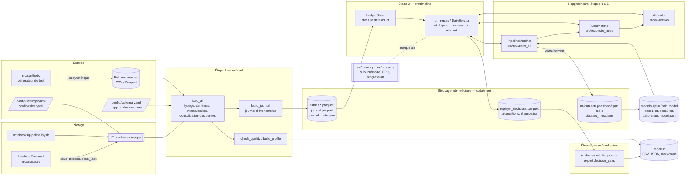
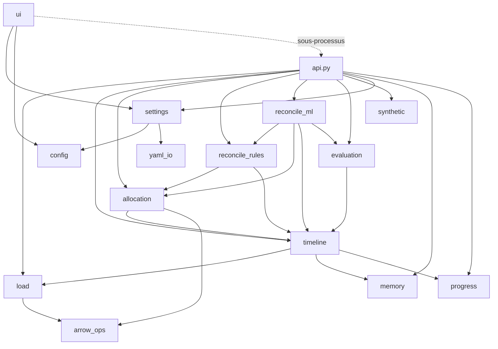
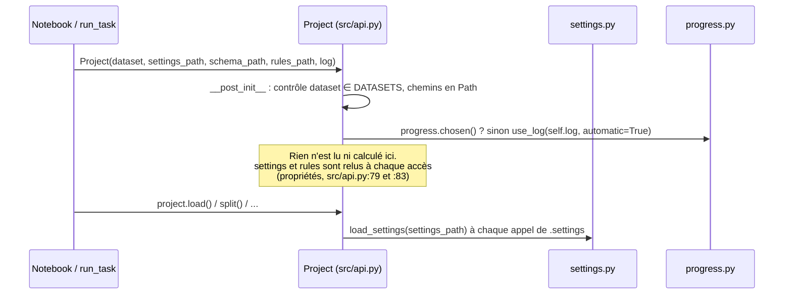

# 01 — Architecture

> **Résumé.** Le projet est une bibliothèque Python (`src/`), pilotée par une seule façade,
> `Project` ([src/api.py](../../src/api.py)). Le notebook, l'interface Streamlit et la version portable
> l'appellent tous. Il n'y a ni service, ni base de données, ni réseau : tout passe par des fichiers
> (CSV/Parquet en entrée ; Parquet, JSON, CSV, markdown et modèles LightGBM en sortie). Le cœur est
> une **boucle de rejeu quotidienne** (`run_replay`) dans laquelle on branche des « rapprocheurs »
> interchangeables : rien, allocation seule, règles, règles + ML.

---

## 1. Diagramme d'architecture global

Lecture :
- **Flux principal** (de gauche à droite) : les sources sont chargées et normalisées une fois
  (étape 1), puis enregistrées dans `data/interim/`. Chaque étape suivante relit ces fichiers,
  reconstruit un `LedgerState` et rejoue la période voulue.
- **Imbrication des rapprocheurs** : `PipelineMatcher` (`src/reconcile_ml/pipeline.py:125`) hérite
  de `RulesMatcher` (`src/reconcile_rules/matcher.py:57`), qui crée son `Allocator`
  (`src/reconcile_rules/matcher.py:63`). Un backtest complet exécute donc chaque jour l'allocation, puis les règles, puis le ML.
- **L'interface** ne calcule rien elle-même : elle lance `Project.<méthode>` dans un sous-processus
  Python (`run_task`, `src/ui/common.py:230` ; point d'entrée `src/api.py:388`).

---

## 2. Rôle de chaque dossier

| Dossier / fichier | Rôle | Fiche |
|---|---|---|
| `src/api.py` | façade `Project` : une méthode par étape, chemins, écriture des rapports ; `run_task` pour l'interface | [api.md](05_modules/api.md) |
| `src/config.py` | racine du dépôt (`REPO_ROOT`), lecture YAML, résolution des chemins relatifs | [config_et_reglages.md](05_modules/config_et_reglages.md) |
| `src/settings.py` | modèles pydantic de tous les réglages (`Settings`, `RulesConfig`) ; lecture / écriture commentée | idem |
| `src/yaml_io.py` | écriture d'un YAML commenté à partir des descriptions pydantic | idem |
| `src/arrow_ops.py` | jointures et listes vectorisées via pyarrow (`isin`, `lookup`, `flatten_lists`…) | idem |
| `src/load/` | étape 1 : modèle canonique, lecture des sources, normalisation, journal, qualité, profil, relecture | [load.md](05_modules/load.md) |
| `src/timeline/` | étape 2 : `LedgerState`, découpage des périodes, `DailyIterator`, `run_replay` | [timeline.md](05_modules/timeline.md) |
| `src/allocation/` | étape 3 : index (références, noms, IBAN), `Allocator`, mesure du rappel | [allocation.md](05_modules/allocation.md) |
| `src/reconcile_rules/` | étape 4 : DFS de sommes exactes ou proches, `RulesMatcher` (R1–R5) | [reconcile_rules.md](05_modules/reconcile_rules.md) |
| `src/reconcile_ml/` | étape 5 : `Featurizer`, `PairModel`, propositions et seuils, `PipelineMatcher`, `fit_ml` | [reconcile_ml.md](05_modules/reconcile_ml.md) |
| `src/evaluation/` | étape 6 : vérité terrain, métriques, courbe, rapport markdown, export des couples | [evaluation.md](05_modules/evaluation.md) |
| `src/memory.py`, `src/progress.py` | suivi mémoire (RSS, cgroup, phases), CPU utilisables, barres de progression | [memory_et_progress.md](05_modules/memory_et_progress.md) |
| `src/synthetic/` | générateur déterministe d'un jeu complet (tests, démonstration) | [synthetic.md](05_modules/synthetic.md) |
| `src/ui/` | interface Streamlit : navigation, une vue par étape | [ui.md](05_modules/ui.md) |
| `config/` | `schema.yaml` (mapping réel, à remplir), `schema.synthetic.yaml`, `settings.yaml`, `rules.yaml` | [06](06_configuration_et_execution.md) |
| `notebooks/pipeline.ipynb` | notebook de bout en bout, **généré** par `tools/make_notebook.py` | [outils_et_livrables.md](05_modules/outils_et_livrables.md) |
| `tools/` | `make_notebook.py` (génère le notebook), `build_bundle.py` (zip dans `dist/`) | idem |
| `single/` | version portable : tout le code en 4 fichiers à copier-coller, sans mode synthétique | idem |
| `tests/` | 155 fonctions de test pytest (166 cas à l'exécution, sur 16 fichiers) | [07](07_tests_et_qualite.md) |
| `data/`, `reports/`, `models/`, `dist/` | sorties générées, ignorées par git (`.gitignore:2-5`) | [03](03_gestion_des_donnees.md) |
| `CLAUDE.md`, `spec_rapprochement_automatique.md` | brief (fait foi) et spécification détaillée | — |
| `GUIDE.md`, `RESULTATS.md`, `README.md` | guide pédagogique, lecture des résultats, installation | — |

### Dépendances entre packages

Graphe des imports internes (relevé par `grep "from src"` sur chaque module) :

Les couches vont de bas en haut : `load` → `timeline` → `allocation` → `reconcile_rules` →
`reconcile_ml` → `api`. `evaluation` ne dépend que des constantes de `timeline.loop`
(`src/evaluation/metrics.py:21`). Aucun module bas ne remonte vers `api`.

---

## 3. Points d'entrée

| Point d'entrée | Comment il démarre | Code |
|---|---|---|
| **Notebook** | `jupyter lab`, puis `notebooks/pipeline.ipynb` : imports, suivi mémoire et progression, `Project(...)`, puis une cellule par étape | généré par `tools/make_notebook.py:8` (`CELLS`) |
| **API Python** | `from src.api import Project` ; `Project(dataset="synthetic" \| "real")` | `src/api.py:60` |
| **Interface** | `python -m streamlit run src/ui/app.py` ; chaque bouton appelle `run_task`, qui exécute `python -c "... run_task(task, json)"` | `src/ui/app.py:1-5`, `src/ui/common.py:230`, `src/api.py:388` |
| **Version portable** | `import reconciliation` dans `single/` ; écrit la configuration manquante au premier import (`ensure_config()`) | `single/reconciliation.py` (fin du fichier) |
| **Tests** | `python -m pytest` (configuration `pyproject.toml:22-24`) | `tests/` |
| **Outils** | `python tools/make_notebook.py`, `python tools/build_bundle.py` | `tools/` |

Il n'y a **ni CLI** (retirée à la demande, voir `GUIDE.md`), ni Dockerfile, ni CI, ni tâche
planifiée dans le dépôt. Il n'y a pas non plus de mode « production » distinct : le brief demande
qu'un seul code serve au rejeu et à la production (`CLAUDE.md:35`). En pratique, seul le rejeu
existe ; aucun connecteur ne reçoit des paiements au fil de l'eau (voir
[08](08_zones_dombre_et_dette.md)).

---

## 4. Ordre d'initialisation

### 4.1 Création d'un `Project`

Points à retenir :
- `Project` est une `dataclass` sans état calculé (`src/api.py:59-66`). Les réglages sont **relus à
  chaque appel** de la propriété `settings` (`src/api.py:79-81`). Une modification de
  `config/settings.yaml` est donc prise en compte sans recréer l'objet.
- Chaque méthode d'étape **relit les données depuis le disque**. `_state()` (`src/api.py:180`) appelle
  `load_interim` puis construit un `LedgerState` neuf : aucun objet lourd ne survit entre deux
  méthodes, ce qui borne la mémoire du notebook.
- Les imports lourds (LightGBM, scipy…) sont faits **dans** les méthodes (par exemple
  `src/api.py:136-140`). `import src.api` reste donc rapide.

### 4.2 Une méthode d'étape type : `measure_allocation`

1. `self.settings` relit `config/settings.yaml`.
2. `_state()` relit `data/interim/*.parquet` et `journal.parquet`. Il vérifie l'empreinte du journal
   (`load_interim`, `src/load/interim.py:48`), puis construit `LedgerState`
   (`src/timeline/state.py:90`).
3. Construction du rapprocheur, ici `AllocationProbe(Allocator(state, settings.allocation))` : les
   index sont construits une fois pour toute la période.
4. `_period()` calcule les bornes de la période demandée (`src/api.py:194`).
5. `run_replay(...)` (`src/timeline/loop.py:169`) : boucle quotidienne, suivi de progression et
   marqueurs mémoire.
6. Calcul des métriques, écriture des rapports dans `reports/`, retour d'un `dict` de DataFrames.

### 4.3 Version portable

À l'import de `single/reconciliation.py`, toutes les sections de modules sont définies dans un seul
espace de noms. `memory` et `progress` sont exposés comme `SimpleNamespace` pour que les appels
`memory.mark(...)` fonctionnent comme dans le dépôt. Enfin, `ensure_config()` écrit
`config/settings.yaml`, `config/rules.yaml`, `config/schema.yaml` et `.streamlit/config.toml` s'ils
n'existent pas (jamais d'écrasement). Détails : [outils_et_livrables.md](05_modules/outils_et_livrables.md).

---

## 5. Stack technique

| Bibliothèque | Version minimale (`pyproject.toml`) | Usage dans le code |
|---|---|---|
| **pandas** | 2.2 déclaré, **3.x requis en pratique** | tables, jointures, groupby. La normalisation dépend du moteur de chaînes Arrow de pandas 3 (voir [08](08_zones_dombre_et_dette.md), F27) ; `uv.lock` fixe pandas 3.0.6 |
| **pyarrow** | 15 | lecture/écriture Parquet ; opérations vectorisées sur chaînes (`src/arrow_ops.py`) ; colonnes de listes en Arrow (`src/load/interim.py:31`) |
| **numpy** | 1.26 | tout l'état du grand livre (`LedgerState`), index CSR (`Postings`), réductions par segments |
| **PyYAML** | 6 | configuration (`src/config.py:15`) |
| **pydantic** | 2.6 | validation des réglages (`src/settings.py`, `extra="forbid"`, `src/settings.py:26`) |
| **scipy** | 1.11 | composantes connexes paiements–factures pour typer les groupes (`ground_truth`, `src/evaluation/metrics.py:52`) |
| **scikit-learn** | 1.4 | `IsotonicRegression` (calibration), `roc_auc_score` (`src/reconcile_ml/model.py`) |
| **lightgbm** | 4.3 | modèle de paires, passes 1 et 2 (`src/reconcile_ml/model.py:69`) |
| jupyterlab, ipykernel, altair | extra `notebook` | notebook, graphiques (courbe, mémoire) |
| streamlit, altair | extra `ui` | interface |
| pytest | extra `dev` | tests |
| psutil | **non déclaré** | utilisé s'il est présent par `process_rss` (`src/memory.py:47`), avec repli sur `/proc` |

Python ≥ 3.11 (`pyproject.toml:5`). Installation par `pip install -r requirements.txt` ou
`uv sync --extra notebook --extra ui` (`README.md`, `uv.lock` présent). Aucun appel réseau : le
seul prévu est un endpoint LLM on-premise, non implémenté (`LLMLabelSettings`,
`src/settings.py:201`).

### Choix de conception déductibles du code

- **Fichiers plutôt que base de données.** L'environnement cible est un notebook sur un pod, sans
  service. Parquet donne un stockage typé, compact et rapide à relire.
- **Numpy indexé par position plutôt que pandas.** `LedgerState` stocke chaque attribut dans un
  tableau aligné sur la position de l'entité (`_Positions`, `src/timeline/state.py:61`). Une
  lecture à une date devient une indexation de tableau, pas une jointure.
- **Pydantic `extra="forbid"`.** Une faute de frappe dans `settings.yaml` lève une erreur au lieu
  d'être ignorée.
- **Imports paresseux dans `api.py`.** L'interface lance chaque tâche dans un processus séparé, dont
  le démarrage doit rester rapide.
