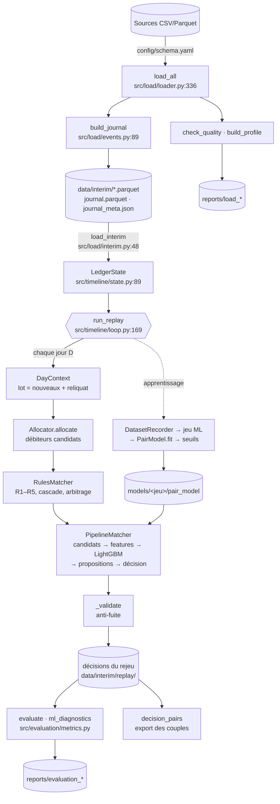
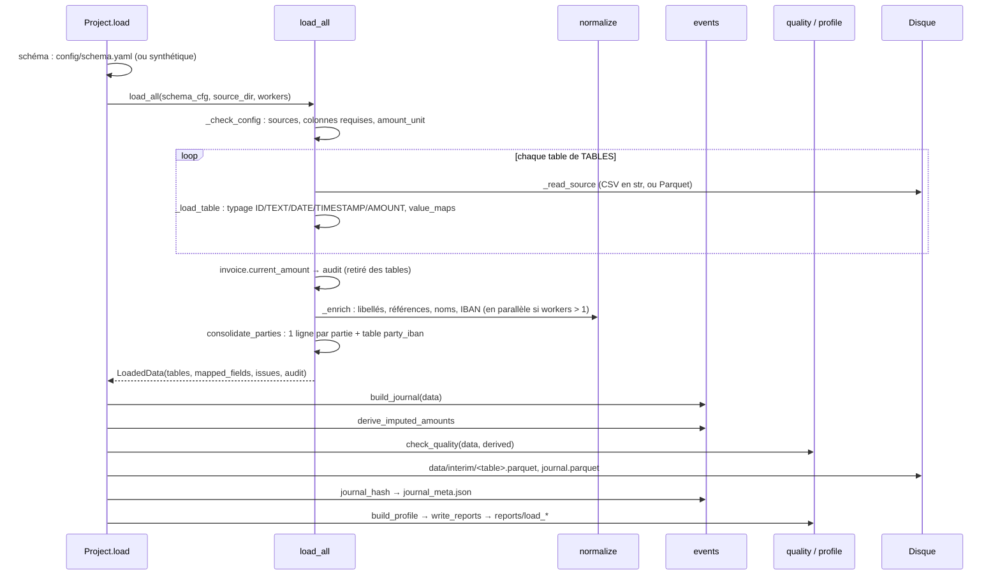
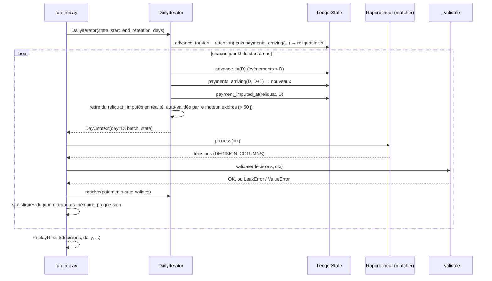
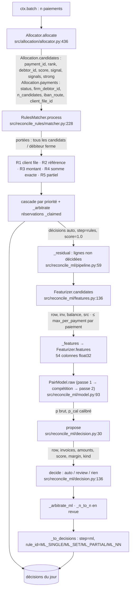
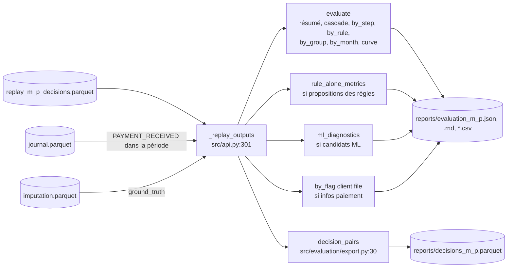

# 02 — Flux de données de bout en bout

> **Résumé.** Les données suivent un seul chemin. Fichiers sources → tables canoniques typées et
> normalisées → **journal d'événements** daté → `data/interim/` (Parquet). Chaque étape relit ces
> fichiers, reconstruit l'état du grand livre et **rejoue** une période jour par jour. Chaque jour,
> le lot de paiements traverse allocation → règles → ML et produit des **décisions**. Celles-ci sont
> enfin comparées aux imputations réelles. L'entraînement suit le même rejeu, avec un rapprocheur
> qui enregistre des paires (paiement, facture) au lieu de décider.

Ce document suit les flux dans l'ordre d'exécution. Pour chaque étape : la fonction responsable,
le format en entrée et en sortie, les validations et la gestion d'erreurs. Le §7 suit un paiement
concret de bout en bout.

---

## Vue d'ensemble



---

## 1. Flux F1 — chargement (étape 1)

**Déclenchement** : `Project.load()` (`src/api.py:134`).



### 1.1 Lecture et typage — `load_all` (`src/load/loader.py:336`)

| | Détail |
|---|---|
| **Entrée** | `schema_cfg` (YAML de mapping), dossier des sources, `workers` |
| **Validation préalable** | `_check_config` (`src/load/loader.py:158`) : `amount_unit` ∈ {`cents`, `units`}, chaque table requise a une source qui existe, chaque champ requis a une colonne réelle, aucun champ canonique inconnu. Les problèmes sont **tous** rassemblés dans une `SchemaConfigError` (`src/load/loader.py:31`) |
| **Lecture** | `_read_source` (`src/load/loader.py:148`) : `.parquet` ou `.csv/.txt/.tsv` lus **en chaînes** (`dtype=str`). Les montants ne passent jamais par des flottants |
| **Typage par champ** | `_load_table` (`src/load/loader.py:182`) applique `_to_id`, `_to_text`, `_to_date`, `_to_timestamp` (conversion du fuseau `source_timezone` vers UTC naïf) ou `_to_cents` (`src/load/loader.py:102`), puis les `value_maps` (ex. statuts réels → `FULL`/`PARTIAL`) |
| **Erreurs** | colonne mappée absente du fichier → `SchemaConfigError` ; valeur non convertible → mise à NA et `Issue(..., "valeur_invalide")` |
| **Champ optionnel non mappé** | ajouté vide au bon type (`_empty`, `src/load/loader.py:242`) |
| **Fuite évitée** | `invoice.current_amount` (restant dû final) part dans `audit` puis est **retiré** de la table (`src/load/loader.py:360-366`) |
| **Sortie** | `LoadedData(tables, mapped_fields, issues, audit)` (`src/load/loader.py:49`) |

### 1.2 Normalisation — `_enrich` (`src/load/loader.py:250`), `src/load/normalize.py`

Colonnes ajoutées (fonctions de [src/load/normalize.py](../../src/load/normalize.py)) :

| Table | Colonnes ajoutées | Fonction |
|---|---|---|
| `payment` | `label_norm`, `label_tokens`, `label_numbers` ; `iban_debtor`, `iban_creditor` normalisés | `enrich_label` (`:178`), `normalize_iban` (`:207`) |
| `invoice` | `client_reference_norm`, `client_reference_keys`, `internal_reference_norm`, `internal_reference_keys` | `enrich_reference` (`:190`) |
| `assignor`, `debtor` | `name_norm`, `name_tokens` ; `iban` normalisé | `enrich_name` (`:199`) |
| `client_file` | `payment_reference_norm`, `_tokens`, `_numbers` ; `iban` | `enrich_label` |
| `client_file_line` | `invoice_reference_norm`, `invoice_reference_keys` | `enrich_reference` |

Principe : **un match de référence est une intersection non vide** entre les `label_numbers` d'un
libellé et les `*_keys` d'une référence (docstring, `src/load/normalize.py:13-15`). Les deux côtés
passent par les mêmes variantes : sans préfixe alphabétique, sans zéros de tête, inversion lettres /
chiffres, concaténation de 2 ou 3 tokens adjacents (`MAX_JOIN_WINDOW`).

### 1.3 Consolidation des parties — `consolidate_parties` (`src/load/loader.py:295`)

Les sources réelles peuvent avoir **plusieurs lignes par débiteur**. Le code produit :
- une ligne par partie : premier nom non vide, ouverture la plus ancienne, fermeture seulement si
  toutes les lignes sont fermées, et `name_variants` (toutes les variantes de nom normalisées) ;
- une table `party_iban` (rôle, partie, IBAN, bankroll), qui garde **tous** les IBAN ;
- un `Issue` `lignes_multiples_par_partie`, qui liste les colonnes qui varient.

### 1.4 Journal — `build_journal` (`src/load/events.py:89`)

| | Détail |
|---|---|
| **Entrée** | `LoadedData` |
| **Sortie** | DataFrame `seq, ts, event_type, entity_id, related_id, amount` (`JOURNAL_COLUMNS`, `src/load/events.py:43`) + liste d'`Issue` |
| **Événements** | `PARTY_OPENED/CLOSED` (date d'ouverture / fermeture), `AGREEMENT_CREATED/DISABLED`, `INVOICE_CREATED` (`creation_date`), `CLIENT_FILE_RECEIVED` (`received_at`), `PAYMENT_RECEIVED` (`booking_date` sinon `value_date`, `payment_event_time`, `src/load/events.py:84`), `IMPUTATION_APPLIED` (`updated_at`, montant imputé) |
| **Montant imputé** | `derive_imputed_amounts` (`src/load/events.py:45`) : solde avant − `residual_amount`, chaîné par facture (le solde avant est le résidu de la ligne précédente, ou `initial_amount`) |
| **Ordre** | `ts`, puis rang du type (`EVENT_RANK`, ordre de déclaration de `EventType`, `src/load/events.py:29`), puis `entity_id`, puis `related_id`. À horodatage égal, ce qui ouvre passe avant ce qui l'utilise, et ce qui ferme passe en dernier |
| **Empreinte** | `journal_hash` (`src/load/events.py:135`) : SHA-256 sur une représentation binaire explicite, stable entre versions de pandas. Elle est recopiée dans tous les artefacts et vérifiée à chaque relecture. **Limite** : elle couvre les événements (dates, types, identifiants, montants imputés), pas le contenu des tables (libellés, références, montants des factures) ; voir [08](08_zones_dombre_et_dette.md) F17 |

### 1.5 Contrôles et écriture

- `check_quality` (`src/load/quality.py:25`) produit des `Issue` : clés dupliquées, orphelins,
  montants nuls ou négatifs, dates incohérentes, statuts `FULL` avec résidu non nul… Il compare
  aussi le solde reconstruit à l'audit `current_amount` (`solde_reconstruit_different`).
- Écritures (`src/api.py:161-173`) : `data/interim/<table>.parquet` pour chaque table (y compris
  `party_iban`), `journal.parquet`, et `journal_meta.json`, qui contient la version de normalisation,
  l'empreinte, le nombre d'événements, la source, les champs mappés et les durées.
- `build_profile` (`src/load/profile.py:16`) puis `write_reports` (`src/load/profile.py:82`) : `reports/load_*.csv` et
  `load_profile.md`.

---

## 2. Flux F2 — relecture et état daté

**Déclenchement** : chaque méthode qui rejoue (`Project._state`, `src/api.py:180`).

### 2.1 Relecture — `load_interim` (`src/load/interim.py:48`)

1. Lit `journal_meta.json`. S'il est absent : `InterimError` (« lancer d'abord le chargement »).
2. Lit chaque table avec `read_table` (`src/load/interim.py:31`) :
   - les colonnes inutilisées (`UNUSED_COLUMNS`, par exemple `label_tokens`) ne sont **pas** relues ;
   - pour `payment`, `invoice`, `client_file` et `client_file_line`, les colonnes de listes restent
     en **Arrow** (`ArrowExtensionArray`), environ 8 fois plus compactes que des listes Python.
3. Relit le journal et **vérifie son empreinte** contre `journal_meta.json` : en cas d'écart,
   `InterimError` (« relancer l'étape 1 »).

### 2.2 Construction de l'état — `LedgerState.__init__` (`src/timeline/state.py:90`)

| Élément | Contenu |
|---|---|
| Tables statiques | `_inv`, `_pay`, `_agr`, `_parties`, `_cf`, `_cfl`, `_tech`, `_party_iban` (index remis à 0..n-1) |
| Positions | `inv_pos`, `pay_pos`, `agr_pos`, `party_pos[role]`, `cf_pos` : identifiant → position (`_Positions`, `src/timeline/state.py:61`) |
| Index débiteur → factures | tri des factures par débiteur + offsets (CSR), pour les lectures « factures ouvertes d'un débiteur » |
| État mutable (numpy) | facture créée, restant dû (`_balance`), paiement reçu / imputé, contrat actif, partie active / connue, client file reçu, factures ouvertes et montant ouvert par débiteur, agrégats glissants (`_win`, 8 colonnes) |
| Journal encodé | `_encode` (`src/timeline/state.py:142`) : horodatages en µs, type en entier, positions des entités. Lève `ValueError` si le journal n'est pas trié |

### 2.3 Avance — `advance_to(as_of)` (`src/timeline/state.py:178`)

- Applique tous les événements d'horodatage **strictement antérieur** à `as_of`, **jour par jour**
  (`_apply`, `src/timeline/state.py:194`). Le résultat ne dépend donc pas de la taille des sauts.
- Refuse de reculer : `TemporalError`.
- Expire les contributions des agrégats comportementaux plus vieilles que `window_days`
  (`_expire`, `src/timeline/state.py:267`).
- Toute lecture appelle `_check(as_of)` (`src/timeline/state.py:274`) : l'instant demandé doit être
  exactement celui de l'état, sinon `TemporalError`.

---

## 3. Flux F3 — la boucle quotidienne

**Déclenchement** : `run_replay(state, matcher, start, end, retention_days, on_day, label)`
(`src/timeline/loop.py:169`).



### 3.1 Le lot du jour — `DailyIterator.__iter__` (`src/timeline/loop.py:101`)

| | Détail |
|---|---|
| **Reliquat initial** | paiements arrivés dans les `retention_days` jours avant `start` (chauffe) |
| **Nouveaux** | `payments_arriving(D, D+1)` (`src/timeline/state.py:443`), lus dans le journal |
| **Sorties du reliquat** | imputé en réalité avant D (`payment_imputed_at`) ; auto-validé par le moteur (`resolve`, `src/timeline/loop.py:96`) ; plus vieux que `retention_days` |
| **`ctx.batch`** | lignes de la table `payment` (`payments_frame`) + `is_new`, `first_day`, `days_pending` |
| **`ctx.as_of`** | minuit du jour D (`src/timeline/loop.py:52`) |

### 3.2 Contrôle des décisions — `_validate` (`src/timeline/loop.py:147`)

Colonnes obligatoires `DECISION_COLUMNS` (`src/timeline/loop.py:38`) :
`payment_id, invoice_id, amount, action, step, rule_id, rule_version, score`. Le contrôle lève :
- `ValueError` pour une action inconnue (autres que `auto`, `review`, `reject`) ;
- `LeakError` pour une décision sur un paiement **hors du lot du jour** ;
- `LeakError` pour une facture **inconnue à D** (pas encore créée).

### 3.3 Sortie — `ReplayResult` (`src/timeline/loop.py:137`)

`decisions` (toutes les décisions + colonne `day`) et `daily` (une ligne par jour : `batch`, `new`,
`carried`, `left_imputed`, `left_engine`, `expired`, `auto`, `review`, `seconds`). `Project.replay`
écrit `data/interim/replay/replay_<m>_<p>_decisions.parquet`,
`reports/replay_<m>_<p>_daily.csv` et `reports/replay_<m>_<p>.json`, plus les sorties annexes du
rapprocheur : propositions des règles, candidats ML, infos paiement.

---

## 4. Flux F4 — une journée dans le rapprocheur complet

`PipelineMatcher.process` (`src/reconcile_ml/pipeline.py:145`) enchaîne, pour un `DayContext` :



### 4.1 Allocation — sortie `Allocation` (`src/allocation/allocator.py:57`)

- **Signaux**, du plus fort au plus faible :
  1. client file rattaché (score 1,0) ;
  2. référence trouvée dans le libellé (0,95) ;
  3. IBAN routé `DEBTOR_DIRECT` (0,9) ;
  4. nom du débiteur dans le libellé (0,7) ;
  5. montant exact d'une facture ouverte (0,5).

  Les poids sont dans `WEIGHTS` (`src/allocation/allocator.py:41`).
- **Combinaison** par « ou » probabiliste, 1 − Π(1 − sᵢ), dans `_combine` (`src/allocation/allocator.py:489`).
- **Allocation ferme** : un seul débiteur porte un signal fort. La liste est tronquée à
  `allocation.max_candidates` (10) débiteurs.
- **Mémoire bornée** : lots traités par blocs de `CHUNK_ROWS` ; jointures non sélectives remplacées
  par des recherches dichotomiques. Détails dans [allocation.md](05_modules/allocation.md).

### 4.2 Règles — décisions `step="rules"`

- **Portée de chaque règle** (`_scopes`, `src/reconcile_rules/matcher.py:94`) : soit tous les
  débiteurs candidats (`firm_only: 0`), soit le seul débiteur ferme (`firm_only: 1`), selon
  `config/rules.yaml`.
- **Cascade** : le paiement est attribué à la règle de plus haute priorité qui a une **solution
  unique** (`src/reconcile_rules/matcher.py:261-268`).
- **Arbitrage** (`_arbitrate`, `src/reconcile_rules/matcher.py:283`) : les factures disputées sont
  servies par priorité. Les ex æquo de même règle sont tous rejetés.
- **Réservation** : chaque auto-validation réserve son montant (`_claimed`) jusqu'à l'imputation
  réelle (`_release_realised`, `src/reconcile_rules/matcher.py:80`). Cela empêche de solder deux
  fois la même facture.

### 4.3 ML — décisions `step="ml"`

- **Résiduel** : en inférence, tous les paiements du lot non décidés par les règles, **reliquat
  compris**. Ils sont donc re-scorés chaque jour.
- **Candidats** : union de quatre sources (débiteurs alloués, référence, montant exact, client
  file), filtrée (devise, facture ouverte nette des réservations, contrat actif), puis plafonnée à
  `candidates.max_per_payment` par paiement : 50 dans `config/settings.yaml`, 60 par défaut dans le code
  (`_cap`, `src/reconcile_ml/features.py:234`).
- **Score, propositions et décision** : voir [04_modeles_ml.md](04_modeles_ml.md).

---

## 5. Flux F5 — apprentissage (`train`)

**Déclenchement** : `Project.train(reuse_dataset=False)` (`src/api.py:284`) → `fit_ml`
(`src/reconcile_ml/pipeline.py:359`).

```mermaid
sequenceDiagram
    participant P as fit_ml
    participant S as LedgerState
    participant D as DatasetRecorder
    participant FS as data/interim/ml
    participant M as PairModel
    participant O as online_thresholds
    P->>S: load_interim + LedgerState ; split → train_p, valid_p
    P->>D: DatasetRecorder(state, settings, rules) (règles + Featurizer)
    alt reuse_dataset et jeu valide
        P->>FS: _saved_dataset : relit dataset/ (refus si dataset_meta.json diffère)
    else
        P->>D: run_replay(train_p.start → valid_p.end)
        Note over D: chaque jour : règles, puis paires du résiduel<br/>des paiements NOUVEAUX et échantillonnés
        D-->>P: dataset() : features + payment_id, invoice_id, balance, payment_amount, day
        P->>P: label_pairs (2e passe, à partir d'imputation) ; group, period, month
        P->>FS: dataset/ partitionné par mois + dataset_meta.json
    end
    P->>M: PairModel.fit(train, valid, features, training, second_pass, calibration)
    P->>P: seuils hors boucle (offline_proposals, calibrate_thresholds), indicatifs
    P->>O: rejeu de la validation, propositions quotidiennes, calibrate_online → τ_high par type
    P->>FS: models/<jeu>/pair_model : pass1.txt, pass2.txt, calibrateur, model.json,<br/>feature_importance.csv, calibration_validation.csv
```

Points d'attention :
- **Features et étiquettes séparées.** Les features sont calculées pendant le rejeu, sur l'état de
  la veille. Les étiquettes viennent d'une passe séparée (`label_pairs`,
  `src/reconcile_ml/pipeline.py:290`), comme le demande le brief (`CLAUDE.md:173`).
- **Un paiement n'entre dans le jeu qu'à son jour d'arrivée** (`is_new`), et seulement s'il est
  tiré dans l'échantillon (`_sampled`, `src/reconcile_ml/pipeline.py:43`, déterministe par
  hachage de l'identifiant).
- **Les seuils viennent de la boucle réelle.** `online_thresholds` (`src/reconcile_ml/pipeline.py:451`)
  rejoue toute la validation avec `PipelineMatcher(record_proposals=True)` : aucune
  auto-validation ML, toutes les propositions enregistrées. Les seuils sont choisis sur ces
  propositions.

---

## 6. Flux F6 — évaluation et export

**Déclenchement** : `Project.evaluate(p, m)` (`src/api.py:341`), `backtest` (`src/api.py:374`),
`export_decisions` (`src/api.py:322`).



- **Périmètre** : paiements dont l'événement `PAYMENT_RECEIVED` tombe dans la période.
- **Vérité** : `ground_truth(imputation)` (`src/evaluation/metrics.py:52`), qui donne l'ensemble des
  factures imputées et le type de groupe (composantes connexes).
- **Une décision par paiement** : la première auto-validation, sinon la première revue (`_proposals`,
  `src/evaluation/metrics.py:79`).
- **Contrôle** : `_replay_outputs` refuse un rejeu calculé sur un autre journal
  (`src/api.py:301-320`).

La signification de chaque métrique est détaillée dans `RESULTATS.md` et dans
[evaluation.md](05_modules/evaluation.md).

---

## 7. Exemple fil rouge : un paiement de bout en bout

> Exemple **construit** pour l'illustration. Les sorties de normalisation ci-dessous ont été
> obtenues en exécutant les fonctions du dépôt (`normalize_text`, `label_numbers`,
> `reference_keys`, `name_terms`).

**Données sources**
- Débiteur `D1`, nom « Dupont Bâtiment SARL », IBAN `fr76 3000 4000 0312 3456 7890 143`.
- Facture `I1` : référence client `FA-2024-0012345`, 1 200,00 €, créée le 2024-02-01, échéance le
  2024-03-01, débiteur `D1`.
- Paiement `P1` : 1 200,00 €, date de valeur 2024-03-05, libellé
  `VIR SEPA Dupont Bâtiment fact. FA-2024-0012345`, IBAN débiteur celui de `D1`.
- Imputation réelle : `P1` → `I1`, `FULL`, résidu 0, le 2024-03-08.

**Étape 1 — chargement**

| Donnée | Après chargement |
|---|---|
| montants | `120000` (centimes, `Int64`) si `amount_unit: units` |
| `P1.label_norm` | `VIR SEPA DUPONT BATIMENT FACT FA 2024 0012345` |
| `P1.label_numbers` | `0012345, 00123452024, 12345, 123452024, 2024, 20240012345, 2024FA, FA2024, FA20240012345` |
| `I1.client_reference_keys` | `20240012345, FA20240012345` |
| intersection | `{20240012345, FA20240012345}` : match de référence |
| `D1.iban` | `FR7630004000031234567890143` |
| termes du nom de `D1` | `DUPONT, BATIMENT, SARL, DUPONT BATIMENT, BATIMENT SARL` |

Journal : `INVOICE_CREATED I1` le 2024-02-01, `PAYMENT_RECEIVED P1` le 2024-03-05,
`IMPUTATION_APPLIED P1/I1 (120000)` le 2024-03-08.

**Étape 2 — rejeu du 2024-03-05**
- `advance_to(2024-03-05 00:00)` : `I1` est créée et ouverte, avec un restant dû de 120000. `P1`
  n'est pas encore « reçu » dans l'état : son événement est le 05, donc pas strictement antérieur.
- `payments_arriving(05, 06)` renvoie `P1` : il est dans le lot comme **nouveau** (`is_new=True`).

**Étape 3 — allocation**
- Référence : les clés de longueur ≥ 4 du libellé désignent `I1`, ouverte, de débiteur `D1` ; le
  restant dû égale le montant. Signal `reference` à 0,95, fort, puisque la clé désigne un seul
  débiteur et fait au moins 6 caractères.
- IBAN : `DEBTOR_DIRECT` vers `D1`, unique ; signal `iban` à 0,9, fort.
- Nom : `DUPONT BATIMENT` est retrouvé ; signal `name` (non fort).
- Montant : `I1` a exactement le restant dû de 120000 ; signal `amount` à 0,5 s'il est partagé par
  peu de débiteurs.
- Combinaison pour `D1` : 1 − (1−0,95)(1−0,9)(…) ≈ 1. Un seul débiteur porte des signaux forts :
  allocation **ferme** sur `D1`.

**Étape 4 — règles**
- R1 : pas de client file.
- R2 : une seule facture ouverte dans la portée est référencée par le libellé (`I1`), et
  |120000 − 120000| ≤ 0 : solution unique. R3 en trouverait aussi une, mais R2 est prioritaire.
- Décision : `(P1, I1, 120000, auto, rules, R2_REFERENCE_UNIQUE, version 2, score 1.0)`.
  L'auto-validation réserve 120000 sur `I1`.
- `_validate` passe : `P1` est dans le lot, `I1` est connue à D. `resolve` retire `P1` des lots
  suivants.

**Jours suivants** : le 2024-03-09, l'imputation réelle du 08 est appliquée. Le restant dû de `I1`
tombe à 0 et la réservation est libérée (`_release_realised`).

**Étape 6 — évaluation**
- `P1` est dans le périmètre s'il arrive pendant la période évaluée.
- Vérité : `{I1}`, groupe `1↔1`. Décision retenue : auto `{I1}`, exacte. `P1` compte dans `auto`,
  `auto_corrects`, `by_rule[R2_REFERENCE_UNIQUE]` et `by_group[1↔1]`.

**Variante : passage par le ML.** Si le paiement n'avait été que de 117 600 € (escompte de 2 %),
R2 aurait échoué, faute d'égalité des montants à tolérance 0. R5 (partiel sur facture référencée)
aurait trouvé une solution unique, puisque le montant est inférieur au restant dû. Avec R5
désactivée, `P1` passerait au ML :
- candidats `I1` (sources débiteur + référence) et d'autres factures ouvertes de `D1` ;
- features : `amount_diff_rel ≈ 0,02`, `is_typical_discount = 1`, `ref_full_in_label = 1`,
  `alloc_is_firm_debtor = 1`… ;
- score de passe 2, puis `propose` : `I1` absorbe le paiement à la tolérance (5 € ou 3 %) près, donc
  proposition `single` ;
- `decide` : auto-validation si le score ≥ τ_high(`single`) et la marge ≥ δ, sinon revue.
