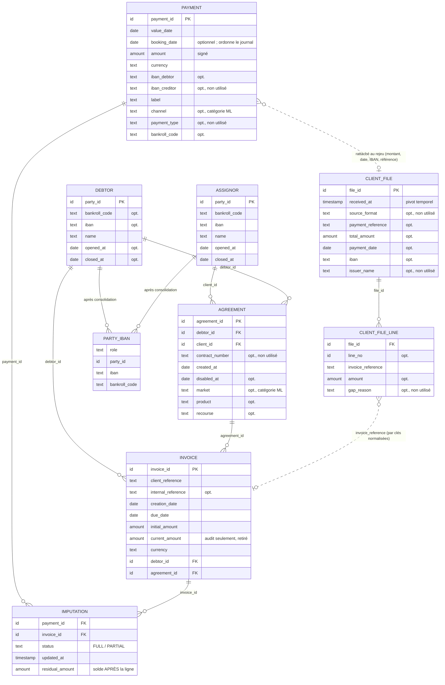
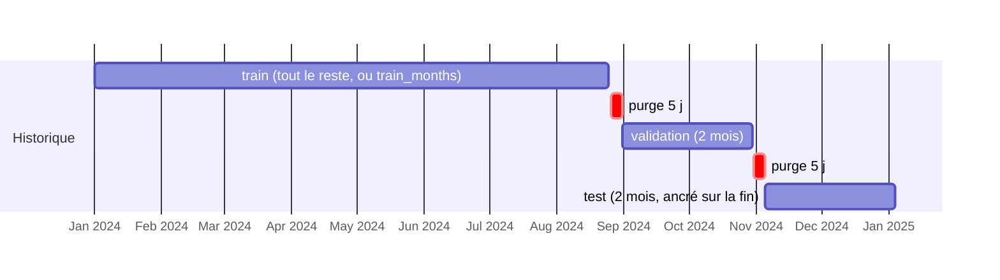

# 03 — Gestion des données

> **Résumé.** Les données entrent par des fichiers CSV ou Parquet. Un **mapping déclaratif**
> (`config/schema.yaml`) les relie à un **modèle canonique** de 9 tables
> (`src/load/canonical.py`) : rien n'est deviné. Elles sont typées (montants en centimes, dates
> UTC), normalisées, puis converties en un **journal d'événements** dont l'empreinte SHA-256
> identifie la version des données dans les artefacts dérivés (elle ne couvre pas le contenu
> des tables : voir [08](08_zones_dombre_et_dette.md), F17). Le découpage train / validation / test est temporel. Les
> fuites sont empêchées par construction : état daté, `current_amount` retiré, contrôle des
> décisions, étiquetage séparé.

---

## 1. Sources et modèle canonique

### 1.1 Le mapping `config/schema.yaml`

Ce fichier, à remplir par l'équipe, relie chaque champ canonique à une colonne réelle. Le gabarit
du dépôt contient des `null` partout. Clés globales :

| Clé | Effet | Lu par |
|---|---|---|
| `amount_unit` | `cents` (entiers) ou `units` (ex. `1234.56`) ; **obligatoire** | `_check_config` (`src/load/loader.py:158`), `_to_cents` (`src/load/loader.py:102`) |
| `decimal_separator` | `.` ou `,` pour les montants lus en texte | `_load_table` (`src/load/loader.py:182`) |
| `source_timezone` | fuseau des horodatages sans fuseau ; `null` = UTC | `_to_timestamp` (`src/load/loader.py:86`) |
| `date_format`, `timestamp_format` | format `strptime` (global ou par table) ; `null` = inférence pandas | `_to_date`, `_to_timestamp` |
| `base_dir` | dossier des fichiers sources | `load_all` (`src/load/loader.py:336`) |
| `tables.<t>.source` | fichier de la table | `_read_source` (`src/load/loader.py:148`) |
| `tables.<t>.read_options` | options passées telles quelles à `read_csv` / `read_parquet` (séparateur, encodage…) | idem |
| `tables.<t>.columns` | champ canonique → colonne réelle | `_load_table` |
| `tables.<t>.value_maps` | valeurs réelles → valeurs canoniques (ex. statuts `FULL`/`PARTIAL`) | `_load_table` |

Le jeu synthétique a son propre mapping, `config/schema.synthetic.yaml`. L'interface édite
`schema.yaml` via `src/load/schema_io.py` (`normalize_schema`, `dump_schema`).

### 1.2 Les tables canoniques

Types (`FieldType`, `src/load/canonical.py:17`) :
- `ID` et `TEXT` : chaînes ;
- `DATE` : date à minuit ;
- `TIMESTAMP` : horodatage UTC naïf ;
- `AMOUNT` : entier de centimes (`Int64`).

`required=True` : le chargement échoue si le champ n'est pas mappé.

Tables optionnelles : `technical_account` (référentiel des IBAN de comptes techniques),
`client_file` et `client_file_line` (`required=False`, `src/load/canonical.py:134-172`). `party_iban`
n'est pas une source : elle est produite par `consolidate_parties` (`src/load/loader.py:295`).

**Particularités à connaître**

- **Le restant dû n'est jamais une colonne.** Il est reconstruit à chaque date à partir de
  `initial_amount` et des imputations antérieures (`LedgerState._apply`,
  `src/timeline/state.py:194`).
- **`imputation` n'a pas de montant imputé.** Il est déduit de la chaîne des `residual_amount` par
  facture (`derive_imputed_amounts`, `src/load/events.py:45`). Si deux lignes d'une même facture ont
  le même horodatage, l'ordre de chaînage les départage par résidu décroissant, puis par
  `payment_id`.
- **Sens de l'IBAN.** `iban_debtor` est l'IBAN émetteur du paiement ; c'est lui que l'allocation
  route. `iban_creditor` est chargé mais n'est utilisé nulle part (voir [08](08_zones_dombre_et_dette.md)).
- **`bankroll_code` du paiement**, souvent absent, sert seulement à arbitrer un IBAN à la fois
  débiteur et cédant (`Allocator._iban`, `src/allocation/allocator.py:165`).

---

## 2. Chargement, nettoyage et normalisation

### 2.1 Conversions

| Conversion | Règle | Code |
|---|---|---|
| Identifiants | chaîne nettoyée ; vide → NA | `_to_id` (`src/load/loader.py:64`) |
| Montants | **jamais via des flottants** : texte → décimal exact → centimes `Int64` ; unité et séparateur pris dans le schéma ; valeur illisible → NA + `Issue` | `_to_cents` (`src/load/loader.py:102`) |
| Dates | `date_format` ou inférence ; minuit | `_to_date` (`src/load/loader.py:79`) |
| Horodatages | `timestamp_format` ; fuseau `source_timezone` converti en UTC naïf | `_to_timestamp` (`src/load/loader.py:86`) |
| Statuts | `value_maps` → `FULL` / `PARTIAL` | `_load_table` |

### 2.2 Normalisation des textes (`src/load/normalize.py`, version `NORMALIZATION_VERSION = "1.1.0"`)

- **Texte** : majuscules, suppression des accents (NFKD), lettres spéciales (`ß`, `Œ`…),
  non-alphanumérique → espace, espaces compressés (`normalize_series`, `:53`).
- **Tokens alphabétiques** : `label_tokens` (`:121`).
- **Clés de référence d'un libellé** (`label_numbers`, `:125`) : tokens contenant des chiffres,
  concaténations de 2 ou 3 tokens adjacents, inversion lettres / chiffres, variantes sans préfixe
  alphabétique et sans zéros de tête (`number_variants`, `:100`).
- **Clés d'une référence de facture** (`reference_keys`, `:170`) : la référence compactée et ses
  variantes, produites par la même fonction.
- **IBAN** : sans espaces, majuscules (`normalize_iban`, `:207`).
- **Performance** : les vues à base de tokens sont calculées une fois par valeur distincte
  (`_map_unique`, `:85`), éventuellement sur plusieurs processus (`load.workers`). Le résultat ne
  dépend pas du nombre de processus (test `test_parallel_normalization_matches_sequential`).

**Règle de versionnement** : toute modification de comportement doit incrémenter
`NORMALIZATION_VERSION` et relancer la chaîne depuis l'étape 1 (docstring `src/load/normalize.py:3-4`).

### 2.3 Consolidation des parties

`consolidate_parties` (`src/load/loader.py:295`) : voir [02](02_flux_de_donnees.md) §1.3. Les lignes
sans identifiant sont **écartées** (`Issue identifiant_manquant`).

### 2.4 Contrôles qualité

`check_quality` (`src/load/quality.py:25`) produit des `Issue(table, field, kind, count, detail)`
(`src/load/loader.py:40`). Codes rencontrés dans le code : `cle_dupliquee`, `orphelin`,
`montant_nul`, `montant_non_positif`, `montant_negatif_hors_perimetre`, `echeance_avant_creation`,
`fermeture_avant_ouverture`, `desactivation_avant_creation`, `debiteur_different_du_contrat`,
`statut_inconnu`, `full_avec_residu_non_nul`, `partial_avec_residu_nul`, `montant_impute_nul`,
`montant_impute_negatif`, `avant_creation_facture`, `avant_date_de_valeur_du_paiement`,
`avant_connaissance_du_paiement`, `lignes_multiples_meme_paire`, `solde_reconstruit_different`,
`devise_minoritaire`. Le chargement ajoute `valeur_invalide`, `table_non_configuree`,
`identifiant_manquant`, `lignes_multiples_par_partie` ; le journal ajoute
`sans_evenement_ouverture` et `repli_sur_value_date`.

**Les anomalies sont signalées, pas corrigées.** Seules les lignes de partie sans identifiant sont
retirées. Le reste est chargé tel quel et reporté dans `reports/load_issues.csv`.

---

## 3. Feature engineering (vue données)

Les features sont calculées **par paire (paiement, facture candidate)**, sur l'état à D, au moment
du rejeu. Le détail des 54 features (57 avec la passe 2) est dans [04_modeles_ml.md](04_modeles_ml.md) §3. Côté données,
trois sources :

1. **Attributs statiques** pré-calculés une fois (`Featurizer.__init__`,
   `src/reconcile_ml/features.py:81`) : échéance, création, montant initial, contrat, devise,
   longueur du libellé, clés de référence.
2. **État daté** : restant dû net des réservations, contrat actif, agrégats comportementaux du
   débiteur (`LedgerState.debtor_stats`, `src/timeline/state.py:348`). Ces agrégats portent sur la
   fenêtre glissante `[as_of − 180 j, as_of)`, **strictement antérieure**.
3. **Sorties de l'allocation du jour** : rang, score et signaux du débiteur de la facture, route
   IBAN, client file rattaché.

---

## 4. Découpage train / validation / test

`compute_split` (`src/timeline/split.py:53`), réglages `split` (`SplitSettings`, `src/settings.py:47`) :

Exemple avec les réglages par défaut sur le jeu synthétique (historique 2024-01 → 2025-01) :

- **Ancrage sur la fin** : le test couvre les `test_months` derniers mois jusqu'à `anchor_end`
  (par défaut, le dernier jour de paiement). La validation couvre les `validation_months`
  précédents, le reste va à l'entraînement. Toutes les bornes sont **inclusives**.
- **Purge** : `purge_days` jours exclus entre deux blocs, pour qu'un groupe d'imputations ne
  chevauche pas deux périodes.
- **Unité** : le jour d'**arrivée** du paiement (`booking_date`, sinon `value_date`). La plage des
  données vient de `LedgerState.payment_day_range` (`src/timeline/state.py:453`).
- **Erreurs** : historique trop court → `SplitError` ; `train_months` non couvert → simple
  avertissement (`warnings`).
- **`assign_period`** (`src/timeline/split.py:82`) étiquette chaque jour : `train`, `validation`,
  `test`, `purge` ou `hors période`. Il sert à répartir le jeu d'entraînement : les paires des jours
  de purge sont écartées.

**Usage par étape** : `measure_allocation` → validation ; jeu d'entraînement → train + validation ;
seuils → validation ; backtest final → test. **Le reliquat déborde des bornes** : un rejeu qui
commence au jour S traite aussi les paiements des 60 jours précédents encore non résolus. Ils sont
traités, mais exclus de la mesure (voir `RESULTATS.md`, §1.5).

---

## 5. Stockage, cache, versioning et persistance

| Artefact | Chemin | Producteur | Version / contrôle |
|---|---|---|---|
| Tables normalisées | `data/interim/<table>.parquet` (dont `party_iban`) | `Project.load` (`src/api.py:134`) | `normalization_version` dans `journal_meta.json` |
| Journal | `data/interim/journal.parquet` | idem | **SHA-256** (`journal_hash`), vérifié à chaque relecture (`src/load/interim.py:48`) |
| Métadonnées | `data/interim/journal_meta.json` | idem | empreinte, version de normalisation, source, champs mappés, durées |
| Décisions d'un rejeu | `data/interim/replay/replay_<m>_
_decisions.parquet` (+ propositions, candidats ML, infos paiement) | `Project.replay` (`src/api.py:217`) | `replay_<m>_
.json` garde l'empreinte ; `evaluate` refuse un autre journal |
| Jeu d'entraînement | `data/interim/ml/dataset/month=AAAA-MM/*.parquet` | `fit_ml` | `dataset_meta.json` : empreinte du journal, `FEATURIZATION_VERSION`, empreinte des réglages dont il dépend (`dataset_key`, `src/reconcile_ml/pipeline.py:323`) |
| Propositions de calibration | `data/interim/ml/validation_daily_proposals.parquet` | `online_thresholds` | — |
| Modèle | `models/<jeu>/pair_model/` : `pass1.txt`, `pass2.txt`, calibrateur, `model.json`, `feature_importance.csv`, `calibration_validation.csv` | `fit_ml`, `PairModel.save` (`src/reconcile_ml/model.py:138`) | `model.json` : empreinte du journal, version de featurisation, version des règles, empreinte des réglages ML, catégories figées, seuils |
| Rapports | `reports/` (sous-dossier `synthetic/` pour le jeu synthétique) | `load`, `measure_allocation`, `evaluate`, `export_decisions` | `context` dans chaque JSON |
| Suivi mémoire | `reports/memory.csv` (chemin choisi dans le notebook) | `MemoryMonitor` (`src/memory.py:171`) | sessions séparées par une ligne de démarrage |

Tout ce qui est sous `data/`, `reports/`, `models/` et `dist/` est ignoré par git (`.gitignore:2-5`)
et régénérable. **Il n'y a pas de cache implicite** : chaque méthode relit les Parquet. La seule
reprise explicite est celle du jeu d'entraînement (`train(reuse_dataset=True)`).

**Séparation synthétique / réel.** `Project._dir` (`src/api.py:87`) ajoute un sous-dossier
`synthetic/` aux chemins `interim` et `reports` pour le jeu synthétique. Les modèles sont rangés
sous `models/synthetic/` ou `models/real/`.

---

## 6. Risques identifiés

### 6.1 Fuites de données : garde-fous en place

| Risque | Garde-fou | Code |
|---|---|---|
| Lire le restant dû final | `current_amount` retiré des tables, conservé seulement pour l'audit | `src/load/loader.py:360-366` |
| Lire l'état à une autre date | toute lecture exige `as_of` égal à l'instant de l'état | `LedgerState._check` (`src/timeline/state.py:274`) |
| Remonter le temps | `advance_to` refuse un instant passé | `src/timeline/state.py:178` |
| Citer une facture future | `LeakError` dans `_validate` | `src/timeline/loop.py:147` |
| Décider sur un paiement non arrivé | `LeakError` (paiement hors du lot) | idem |
| Utiliser un client file pas encore reçu | visible seulement après `CLIENT_FILE_RECEIVED` | `client_files_received_at` (`src/timeline/state.py:427`) |
| Agrégats comportementaux | fenêtre strictement antérieure, expirée au fil de l'avance | `_add_window` (`src/timeline/state.py:237`), `_expire` (`src/timeline/state.py:267`) |
| Étiquettes dans les features | étiquetage dans une passe séparée, après le rejeu | `label_pairs` (`src/reconcile_ml/pipeline.py:290`) |
| Indices construits sur tout l'historique | les index sont statiques ; l'existence à D est filtrée à la requête | docstring `src/allocation/indexes.py:1-8` |
| Choix des seuils sur le test | seuils calibrés sur la validation uniquement | `online_thresholds` (`src/reconcile_ml/pipeline.py:451`) |

Ces garanties sont **testées** :
- `test_removing_events_after_d_changes_nothing_computed_up_to_d` (`tests/test_timeline.py:231`) ;
- `test_allocation_does_not_leak` (`tests/test_allocation.py:202`) ;
- `test_pipeline_runs_without_leak` (`tests/test_ml.py:134`).

Ces trois tests tronquent le journal après une date et vérifient que tout ce qui est calculé
jusqu'à cette date est identique.

### 6.2 Risques résiduels (déduits du code)

- **Catégories construites sur toutes les données.** À l'entraînement, les vocabulaires de
  `channel`, `bankroll_code`, `market`, `product` et `recourse` viennent de toute la table, période
  de test comprise (`src/reconcile_ml/features.py:99-106`). C'est une fuite de **liste de
  valeurs**, sans étiquette : impact attendu faible. Les catégories sont ensuite figées dans le
  modèle.
- **La vérité est l'historique.** Les erreurs de l'algorithme actuel ou des gestionnaires sont
  apprises et comptées comme justes.
- **Paiements jamais imputés.** Ils comptent dans le périmètre ; une auto-validation sur eux est une
  erreur. Sur données réelles, la part de paiements sans imputation (remboursements, rejets,
  imputations hors système) fait varier le taux.
- **Dates manquantes.** Un événement sans date est **ignoré** par le journal (`_events` filtre
  `ts` non nul, `src/load/events.py:68-81`). Par exemple, une imputation sans `updated_at`
  n'existe pas pour le rejeu, alors qu'elle compte dans la vérité (`ground_truth` lit la table
  `imputation`). Le moteur peut alors laisser ouverte une facture déjà soldée en réalité.
- **Parties sans date d'ouverture.** Elles sont actives depuis toujours (`Issue
  sans_evenement_ouverture`). Un débiteur créé tardivement mais sans date pourrait être proposé
  trop tôt.
- **Collisions d'empreintes.** Les vocabulaires de clés, de termes et d'IBAN stockent des
  empreintes 64 bits (`Vocabulary`, `src/allocation/indexes.py:87`). Deux chaînes de même empreinte
  seraient confondues (probabilité ~10⁻⁵ pour 30 M de clés, docstring du même fichier).

### 6.3 Valeurs manquantes

| Cas | Traitement |
|---|---|
| Champ optionnel non mappé | colonne vide typée, signalée dans `load_missing_fields.csv` |
| Valeur illisible | NA + `Issue valeur_invalide` |
| Montant de paiement manquant | remplacé par −1 dans les tableaux numpy (`fillna(-1)`) : aucun montant ne correspond |
| Feature numérique indisponible (agrégat sans historique…) | `NaN`, géré nativement par LightGBM |
| Catégorie inconnue | code −1, converti en `NaN` (`src/reconcile_ml/features.py`, fin de `features`) |
