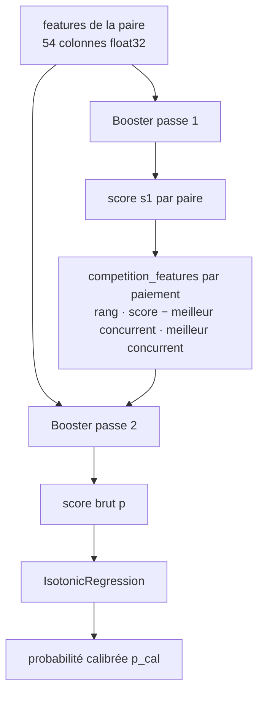

# 04 — Modèles de ML

> **Résumé.** Le projet apprend **un seul modèle** : un classifieur binaire de **paires
> (paiement, facture candidate)**, `PairModel` ([src/reconcile_ml/model.py](../../src/reconcile_ml/model.py)).
> Il est construit en deux passes LightGBM (la seconde ajoute des features de « compétition » entre
> candidats d'un même paiement) et calibré par une régression isotonique. Autour de lui, deux
> couches **non apprises** produisent les décisions :
> - la résolution des ensembles (`propose`), qui transforme les scores de paires en une proposition
>   par paiement ;
> - les seuils (`decide`), choisis sur la boucle de validation pour viser 99,5 % de précision.
>
> L'allocation et les règles sont des heuristiques à poids fixes, sans apprentissage.

---

## 0. Vue d'ensemble

```mermaid
flowchart LR
    subgraph Apprentissage["Apprentissage — fit_ml (src/reconcile_ml/pipeline.py:359)"]
        A[Rejeu train + validation<br/>DatasetRecorder] --> B[(paires + features<br/>+ étiquettes)]
        B --> C[Passe 1 LightGBM<br/>early stopping sur validation]
        C --> D[3 plis hors échantillon<br/>scores de passe 1 sur le train]
        D --> E[Features de compétition<br/>rang, marge, meilleur concurrent]
        E --> F[Passe 2 LightGBM]
        F --> G[Isotonique sur la validation]
        G --> H[Rejeu validation sans auto-validation ML<br/>propositions quotidiennes]
        H --> I[calibrate_online<br/>τ_high par type]
    end
    subgraph Inference["Inférence — PipelineMatcher.process (src/reconcile_ml/pipeline.py:145)"]
        J[candidats + features du jour] --> K[passe 1] --> L[compétition] --> M[passe 2 = score brut]
        M --> N[propose : single / partial / set + marge]
        N --> O[decide : auto si score ≥ τ_high(type) et marge ≥ δ<br/>revue si score ≥ τ_low]
    end
    I -. model.json .-> O
    F -. pass2.txt .-> M
    C -. pass1.txt .-> K
```

| Composant | Appris ? | Où | Rôle |
|---|---|---|---|
| Scores d'allocation | non (poids fixes `WEIGHTS`) | `src/allocation/allocator.py:41` | classer les débiteurs candidats |
| Règles R1–R5 | non | `src/reconcile_rules/matcher.py` | rapprochements sûrs, baseline |
| **Passe 1** | **oui** (LightGBM) | `PairModel.pass1` | probabilité qu'une paire soit une vraie imputation |
| **Passe 2** | **oui** (LightGBM) | `PairModel.pass2` | idem, en tenant compte des concurrents |
| **Calibrateur** | **oui** (isotonique) | `PairModel.calibrator` | transformer le score brut en probabilité calibrée |
| Résolution des ensembles | non (DFS) | `propose`, `src/reconcile_ml/decision.py:30` | une proposition par paiement |
| Seuils τ_high par type | **ajustés** (recherche de seuil) | `calibrate_online`, `src/reconcile_ml/decision.py:154` | auto-validation à précision ≥ 99,5 % |

---

## 1. Le modèle de paires `PairModel`

### 1.1 Objectif

- **Problème** : pour un paiement non résolu par les règles, trouver la ou les factures qu'il règle
  parmi des dizaines de candidates.
- **Type de tâche** : **classification binaire de paires**, utilisée comme un **classement** au sein
  de chaque paiement (le « groupe »).
- **Étiquette** : 1 si la facture figure parmi les imputations réelles du paiement
  (`label_pairs`, `src/reconcile_ml/pipeline.py:290`), sinon 0.
- **Négatifs** : tous les autres candidats du même paiement, **sans échantillonnage**
  (`CLAUDE.md:166`, docstring de `payment_sample`, `src/settings.py:178-180`).

### 1.2 Entrées et sorties exactes

| | Contenu |
|---|---|
| **Entrée** | `X` : DataFrame `float32`, une ligne par paire, colonnes = `model.features` (liste figée à l'apprentissage). `group` : identifiant de ligne du paiement, pour les features de compétition |
| **Sortie de `raw`** (`src/reconcile_ml/model.py:93`) | score de passe 2 dans [0, 1], ou de passe 1 si la passe 2 est désactivée |
| **Sortie de `calibrate`** (`:101`) / `predict` (`:104`) | probabilité calibrée par l'isotonique |
| **Usage du score** | les **décisions** utilisent le score **brut** (`p`) ; le score calibré (`p_cal`) sert aux diagnostics. La docstring de `decision.py` l'explique : même ordre, mais sans les paliers de l'isotonique (`src/reconcile_ml/decision.py:3-5`) |

### 1.3 Architecture

Deux boosters LightGBM indépendants, de même configuration (`_params`, `src/reconcile_ml/model.py:57`) :

| Hyperparamètre | Valeur | Origine |
|---|---|---|
| `objective` | `binary` (perte : log-loss binaire) | codé en dur |
| `learning_rate` | 0,05 | `reconcile_ml.training.learning_rate` |
| `num_leaves` | 63 | `reconcile_ml.training.num_leaves` |
| `min_data_in_leaf` | 50 | `reconcile_ml.training.min_data_in_leaf` |
| `feature_fraction` | 0,9 | codé en dur |
| `seed` | 42 | `reconcile_ml.training.seed` |
| `deterministic`, `force_row_wise` | `True` | codé en dur (reproductibilité) |
| `num_threads` | CPU utilisables du pod (quota cgroup) ou `training.num_threads` | `threads` (`src/reconcile_ml/model.py:63`) |
| `num_boost_round` | 400 au plus | `reconcile_ml.training.num_boost_round` |
| Arrêt anticipé | 30 itérations sans amélioration de la perte de validation | `lgb.early_stopping(30)` (`src/reconcile_ml/model.py:77`) |
| Catégorielles | `iban_route`, `channel`, `bankroll_code`, `market`, `product`, `recourse` | `CATEGORICAL` (`src/reconcile_ml/features.py:47`) |

L'« optimiseur » est le gradient boosting d'arbres de LightGBM, sans optimiseur séparé.



### 1.4 Features de compétition (`competition_features`, `src/reconcile_ml/model.py:37`)

Pour chaque paiement (groupe), à partir des scores de passe 1 :

| Feature | Définition |
|---|---|
| `rank_in_payment` | rang de la paire par score décroissant (1 = meilleure) |
| `score_margin` | score − meilleur concurrent : écart au second pour le premier, écart au premier (négatif) pour les autres |
| `score_best_other` | score du meilleur concurrent (le second pour le premier, le premier pour les autres) |

**Pourquoi** : un score de 0,9 n'a pas le même sens si un autre candidat a 0,88. Le brief demande
ces features (`CLAUDE.md:170`).

### 1.5 Pipeline d'entraînement (`PairModel.fit`, `src/reconcile_ml/model.py:111`)

1. **Passe 1** : `_train(X, y, Xv, yv)` sur le train, avec la validation pour l'arrêt anticipé.
2. **Scores hors échantillon** : les paiements du train sont répartis en 3 plis par hachage de leur
   identifiant (`pd.util.hash_array(...) % folds`). Pour chaque pli, un booster est réentraîné
   sur les deux autres, sans validation et avec `num_boost_round = max(best_iteration de la passe 1, 10)`.
   Il score le pli exclu. **Pourquoi** : les features de compétition du train doivent venir de
   scores que le modèle n'a pas vus à l'apprentissage. Sinon elles seraient trop optimistes par
   rapport à l'inférence.
3. **Passe 2** : entraînée sur `X` + compétition (scores hors échantillon). La validation est
   enrichie de la compétition calculée avec la passe 1 complète, puisque la validation est hors
   échantillon pour elle.
4. **Calibration** : `IsotonicRegression(out_of_bounds="clip", y_min=0, y_max=1)` ajustée sur le
   score brut de passe 2 de la validation (`src/reconcile_ml/model.py:131-133`).

Chaque entraînement s'affiche comme une tâche de progression : itération courante et perte de
validation (`progress.lightgbm_callback`).

**Seeds et déterminisme** :
- `seed` fixe et `deterministic=True` ;
- plis tirés par hachage déterministe ;
- échantillonnage des paiements par hachage (`_sampled`, `src/reconcile_ml/pipeline.py:43`).

Le multi-threading peut introduire de petites variations numériques selon le nombre de threads ;
LightGBM le documente, et ce n'est pas testé ici (voir [07](07_tests_et_qualite.md)).

### 1.6 Données d'entraînement (`fit_ml`, `src/reconcile_ml/pipeline.py:359`)

| | Détail |
|---|---|
| **Rejeu** | de `train.start` à `validation.end` avec `DatasetRecorder` (`src/reconcile_ml/pipeline.py:92`) : règles actives, ML inactif |
| **Paires enregistrées** | pour chaque jour, les paiements **nouveaux** (`is_new`), **non résolus par les règles**, **tirés dans l'échantillon** (`payment_sample` = 0,5), avec **tous** leurs candidats |
| **Colonnes** | features actives + `payment_id`, `invoice_id`, `balance`, `payment_amount`, `day` ; puis `label`, `group` (= `payment_id`), `period`, `month` |
| **Répartition** | `period` par `assign_period` sur le jour : train / validation ; les jours de purge sont écartés |
| **Persistance** | `data/interim/ml/dataset/` (Parquet partitionné par mois) + `dataset_meta.json` |
| **Reprise** | `train(reuse_dataset=True)` relit le jeu si `dataset_meta.json` correspond au journal, à la featurisation et aux réglages dont il dépend (`dataset_key`, `src/reconcile_ml/pipeline.py:323`) |

### 1.7 Sauvegarde

`PairModel.save` (`src/reconcile_ml/model.py:138`) écrit dans `models/<jeu>/pair_model/` :
- `pass1.txt`, `pass2.txt` : boosters au format texte LightGBM ;
- `calibrator.pkl` : isotonique, en **pickle** ;
- `model.json` : `features`, plus `meta`. `meta` contient l'empreinte du journal, la version de
  featurisation, la version des règles, l'empreinte et le contenu des réglages ML, les périodes,
  les seuils, les métriques, les durées et les catégories figées.

`fit_ml` ajoute `feature_importance.csv` (gain de la **passe 1**) et `calibration_validation.csv`.
Il n'y a pas de points de sauvegarde intermédiaires : un apprentissage interrompu reprend seulement
au niveau du jeu de données.

### 1.8 Évaluation

| Mesure | Où | Calcul |
|---|---|---|
| `metrics.validation` : `auc`, `precision_at_1`, `mrr`, `groupes_avec_positif` | `model.json` | `pair_metrics` (`src/reconcile_ml/model.py:158`) sur les paires de validation, score calibré ; precision@1 et MRR sur les paiements qui ont au moins une vraie facture candidate |
| `rappel_candidats_validation` | `model.json` | part des paiements de validation dont **toutes** les vraies factures sont candidates (`candidate_recall`, `src/reconcile_ml/pipeline.py:297`) |
| `auto_validation`, `précision_auto_validation` | `model.json` | estimation **hors boucle**, avec les seuils hors boucle (indicatif) |
| Calibration | `calibration_validation.csv` | `calibration_table` (`src/reconcile_ml/model.py:173`), 10 tranches |
| **Mesure finale** | `reports/evaluation_pipeline_test.*` | backtest complet sur le **test** (`Project.backtest`), dont `ml_rappel_candidats`, `ml_precision_at_1`, `ml_mrr`, `ml_calibration` |

### 1.9 Inférence

1. `Project._matcher("pipeline")` (`src/api.py:202`) vérifie que `model.json` existe, puis appelle
   `PairModel.load` (`src/reconcile_ml/model.py:150`).
2. `PipelineMatcher.__init__` (`src/reconcile_ml/pipeline.py:130`) reconstruit le `Featurizer` avec
   les **catégories figées** du modèle (`model.meta["categories"]`) et fixe le nombre de threads.
   Il charge aussi les seuils (`model.meta["thresholds"]`).
3. Chaque jour, `PipelineMatcher.process` (`src/reconcile_ml/pipeline.py:145`) :
   - **Résiduel** : les paiements du lot non décidés par les règles, reliquat compris.
   - **Candidats** : `Featurizer.candidates`. Le lot est découpé en blocs de charge bornée
     (`CANDIDATE_PAIR_BUDGET`).
   - **Features** : `_features`, par blocs de paiements entiers (`FEATURE_BLOCK_PAIRS`).
   - **Score** : `model.raw(X, row)`, puis `calibrate`.
   - **Proposition et décision** : `propose`, puis `decide`.
   - **Arbitrage** : `_arbitrate_ml` (une facture déjà soldée par une auto-validation plus forte
     ramène la proposition en revue).
   - **Paiements groupés** : `_n_to_n` (propositions en revue).
   - **Sortie** : `_to_decisions`.

Pré-traitements : ceux du `Featurizer` (§3). Post-traitement : `propose` et `decide` (§2).

### 1.10 Où modifier les hyperparamètres

Section `reconcile_ml` de `config/settings.yaml`, modèles pydantic `MLSettings` (`src/settings.py:208`) et
`TrainingSettings` (`src/settings.py:175`). Modifiables à la main, depuis le notebook
(`save_settings`) ou depuis la page ML de l'interface. `feature_fraction`, `objective`, la patience
de l'arrêt anticipé (30) et le nombre de plis (3) sont **codés en dur** dans `src/reconcile_ml/model.py`.

---

## 2. Couche de décision

### 2.1 Résolution des ensembles — `propose` (`src/reconcile_ml/decision.py:30`)

Pour chaque paiement, à partir des candidats triés par score brut décroissant :

| Proposition | Construction | Type |
|---|---|---|
| Facture seule | les 2 meilleurs candidats qui **absorbent** le paiement (montant ≤ restant dû + tolérance) | `single` si le restant dû est soldé à la tolérance près, sinon `partial` |
| Ensemble | sous-ensembles des 25 meilleurs candidats dont la somme approche le paiement à la tolérance près (`near_subsets`, 5 factures au plus, budget de nœuds) ; cardinalité minimale préférée | `set` ; score = moyenne des scores des factures |

- **Tolérance** : `max(tolerance_abs_cents, tolerance_rel × montant)`, soit 5 € ou 3 %
  (`SetSettings`, `src/settings.py:162`).
- **Choix** : la proposition au meilleur score l'emporte. **Marge** = son score − celui de la
  meilleure proposition **différente**.
- **Cas particulier** : une facture seule qui n'explique le paiement qu'à un escompte près, face à
  un ensemble qui l'explique exactement, reçoit une marge de **0** (ambiguïté, donc revue).

### 2.2 Décision — `decide` (`src/reconcile_ml/decision.py:136`)

- `auto` si score ≥ τ_high **du type de proposition** (`thresholds["kinds"]`) **et** marge ≥ δ
  (`decision.min_margin` = 0,05) ;
- `review` si score ≥ τ_low (`decision.review_min_score` = 0,3) ;
- sinon rien : le paiement reste en attente et sera re-scoré le lendemain.

### 2.3 Choix de τ_high — `calibrate_online` (`src/reconcile_ml/decision.py:154`)

1. `online_thresholds` (`src/reconcile_ml/pipeline.py:451`) rejoue toute la validation avec
   `PipelineMatcher(record_proposals=True)`. Les seuils y sont neutralisés (`tau_high = 2.0` : jamais
   d'auto-validation ML) et chaque proposition quotidienne est enregistrée, avec son exactitude.
2. **Modélisation de la production** : un paiement en attente est re-scoré chaque jour, et il serait
   auto-validé **le premier jour** où son score franchit τ. Pour un τ donné, la proposition
   retenue est donc celle du jour qui porte, pour la première fois, le maximum courant au-dessus
   de τ.
3. Pour chaque type (`single`, `set`, `partial`), on retient le **plus petit τ** qui tient la
   précision cible sur au moins 20 cas (`MIN_KIND_VOLUME`, `src/reconcile_ml/decision.py:27`). Sans
   volume suffisant, τ = 1,01 : jamais d'auto-validation pour ce type.

**Pourquoi en ligne plutôt que sur le jeu de paires** : `GUIDE.md` explique qu'un paiement re-scoré
chaque jour a autant de chances d'être auto-validé qu'il passe de jours en attente. Un seuil choisi
sur une seule photo par paiement est donc biaisé. Les seuils **hors boucle** (`calibrate_thresholds`,
`src/reconcile_ml/decision.py:97`) restent calculés et stockés pour comparaison
(`thresholds.offline`).

`Project.calibrate()` → `recalibrate_ml` (`src/reconcile_ml/pipeline.py:470`) refait seulement
cette étape sur le modèle existant. Il refuse un modèle entraîné sur un autre journal.

---

## 3. Features

Liste exacte : `BASE` + familles actives de `FAMILIES` (`active_features`,
`src/reconcile_ml/features.py:50`) ; familles définies dans `src/reconcile_ml/features.py:29-44`.
Les features sont calculées dans `Featurizer.features` (`src/reconcile_ml/features.py:294`). Les
montants sont en centimes dans les données, mais convertis en euros pour certaines features.

| Famille (réglage) | Features | Construction |
|---|---|---|
| **base** (toujours) | `src_debtor`, `src_reference`, `src_amount`, `src_client_file` | source(s) qui ont proposé le candidat (bits `SRC_*`) |
| | `n_candidates`, `amount_rank_in_payment` | nombre de candidats du paiement ; rang de la facture par écart de montant |
| **amount** | `amount_diff` (€), `amount_diff_rel`, `amount_exact`, `payment_covers`, `amount_ratio` | écarts paiement − restant dû |
| | `is_typical_discount`, `is_bank_fee_gap`, `is_retention_gap` | écart relatif entre 0,5 % et 3 % ; écart absolu entre 5 et 40 € ; écart relatif entre 4 % et 6 % |
| | `ratio_to_initial`, `balance_is_partial` | paiement / montant initial ; facture déjà partiellement payée |
| **temporal** | `days_to_due`, `days_since_creation`, `is_before_creation` | date de valeur − échéance ; − création ; paiement antérieur à la création |
| | `days_to_due_zscore` | (`days_to_due` − délai moyen du débiteur) / écart-type |
| **textual** | `ref_full_in_label`, `ref_key_in_label`, `internal_ref_in_label` | référence complète, une clé, ou la référence interne retrouvée dans le libellé (`_text`, `src/reconcile_ml/features.py:393`) |
| | `label_length`, `label_has_no_alpha`, `n_label_numbers` | propriétés du libellé |
| **identity** | `iban_route` (cat.), `iban_matches_invoice_debtor`, `channel` (cat.), `bankroll_code` (cat.) | route IBAN de l'allocation ; IBAN direct du débiteur de la facture |
| **behavioral** | `debtor_mean_payment_delay`, `debtor_std_payment_delay`, `debtor_partial_payment_rate`, `debtor_grouping_rate`, `debtor_ref_citation_rate`, `debtor_payment_count` | agrégats du débiteur sur 180 jours **strictement antérieurs** (`debtor_stats`, `src/timeline/state.py:348`) |
| | `debtor_open_invoice_count`, `debtor_open_invoice_amount` (€) | encours du débiteur à D |
| **contract** | `market`, `product`, `recourse` (cat.) | attributs du contrat de la facture |
| **allocation** | `alloc_rank`, `alloc_score`, `alloc_is_firm_debtor`, `debtor_in_allocation`, `alloc_sig_<signal>` × 5 | position et signaux du débiteur de la facture dans l'allocation du paiement |
| **client_file** | `has_client_file`, `invoice_cited_in_client_file`, `client_file_line_amount_diff` (€), `client_file_total_matches_payment` | rattachement et lignes du client file |
| **compétition** (passe 2) | `rank_in_payment`, `score_margin`, `score_best_other` | §1.4 |

**Candidats** (`Featurizer.candidates`, `src/reconcile_ml/features.py:136`) :
- **Sources, réunies par union** :
  1. factures ouvertes des 3 premiers débiteurs de l'allocation, avec une échéance entre −180 et
     +30 jours de la date de valeur ;
  2. factures dont une clé de référence figure dans le libellé, sans fenêtre ;
  3. factures ouvertes de restant dû égal au paiement, créées à ±90 jours ;
  4. factures citées par le client file.
- **Filtres durs** : facture ouverte nette des réservations, même devise, contrat actif.
- **Plafond** de `max_per_payment` par paiement (50 dans `config/settings.yaml`, 60 par défaut dans
  le code ; `_cap`, `src/reconcile_ml/features.py:234`) : les sources
  précises d'abord, puis les factures du débiteur les plus proches en montant et en échéance.

---

## 4. Limites et hypothèses implicites

- **Le modèle ne voit qu'un paiement à la fois.** Les n↔n (plusieurs paiements pour plusieurs
  factures) ne sont traités que par une heuristique, et toujours en revue (`_n_to_n`,
  `src/reconcile_ml/pipeline.py:205`).
- **Plafond de rappel.** Une facture absente des candidats (débiteur hors des 3 premiers, échéance
  hors fenêtre, plafond par paiement) ne peut pas être trouvée : c'est le `rappel_candidats`, environ 80 %
  sur le synthétique.
- **Écart entre apprentissage et production.** Le jeu d'entraînement ne contient que des paiements
  au **jour de leur arrivée**, avec le ML inactif. En production, le modèle re-score aussi le
  reliquat, et les réservations du ML modifient les restants dus. La calibration en ligne compense
  pour les seuils, pas pour le modèle.
- **La validation sert à tout** : arrêt anticipé des deux passes, calibration isotonique, et choix
  des seuils hors boucle et en ligne. Les métriques de validation de `model.json` sont donc
  optimistes. Seul le backtest sur le **test** est une mesure propre.
- **Budget du DFS** : si `near_subsets` atteint `node_budget`, `propose` l'ignore. Un ensemble
  concurrent peut alors manquer et la marge être surestimée (voir [08](08_zones_dombre_et_dette.md), F18).
- **Étiquette = historique.** Les erreurs historiques sont apprises ; un paiement jamais imputé n'a
  que des négatifs.
- **Seuils par segment inopérants.** `decision.segmented_thresholds` produit des seuils par segment
  dans le calcul **hors boucle** seulement. Les seuils retenus viennent de `calibrate_online`, qui
  n'en calcule pas : le réglage n'a pas d'effet sur les décisions (voir [08](08_zones_dombre_et_dette.md)).
- **Pas de contrôle de cohérence à l'inférence.** `Project._matcher` charge le modèle sans comparer
  son empreinte de journal ni sa version de featurisation aux données courantes. Seul
  `recalibrate_ml` vérifie le journal.
- **`client_file_total_matches_payment` est une copie de `has_client_file`**
  (`src/reconcile_ml/features.py`, commentaire « Le rattachement du client file exige l'égalité du
  montant total »). La feature n'apporte rien de plus.
- **Extraction de références par LLM** (`CLAUDE.md` §7.6) : prévue dans les réglages
  (`LLMLabelSettings`), **non implémentée**.
