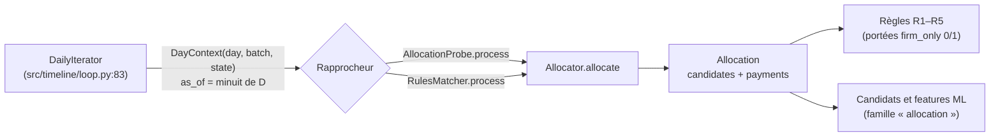
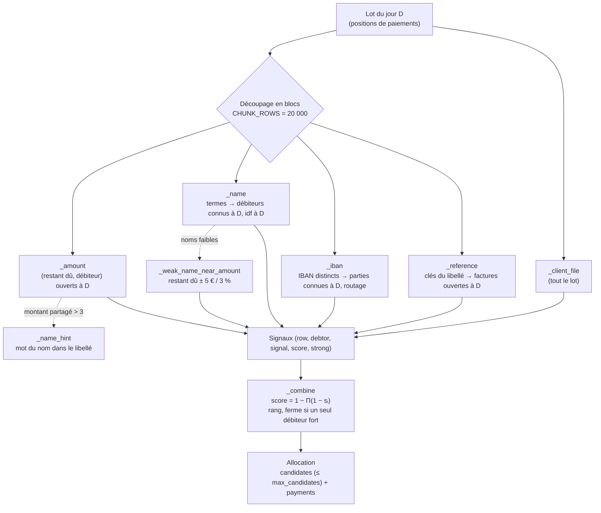

# Module `src/allocation/` — allocation des paiements aux débiteurs (étape 3)

> **Résumé.** Pour chaque paiement du lot du jour D, l'allocation produit une **liste classée de
> débiteurs candidats** (au plus `max_candidates`, 10 par défaut). Chaque candidat a un score et
> les signaux qui l'ont produit. L'allocation rend aussi le **client file** rattaché au paiement,
> s'il y en a un. Cinq signaux indépendants (client file, référence, IBAN, nom, montant) se
> combinent en « ou » probabiliste `1 − Π(1 − sᵢ)`. L'allocation est **ferme** quand un seul
> débiteur porte un signal fort. Les index sont statiques et construits une fois. Tout ce qui
> dépend du temps est filtré au moment de la requête via `LedgerState` à la date `as_of`. Toutes
> les jointures sont bornées : blocs de paiements, budgets de paires, tables dédoublonnées.

Fichiers couverts :

| Fichier | Lignes | Contenu |
|---|---|---|
| `src/allocation/indexes.py` | 253 | structures d'index : `Postings` (CSR), `Vocabulary` (empreintes 64 bits), `ReferenceIndex`, `NameIndex`, `IbanIndex`, construction par blocs |
| `src/allocation/allocator.py` | 536 | `Allocator` : les cinq signaux, leur combinaison, l'allocation ferme, le découpage en blocs |
| `src/allocation/evaluate.py` | 140 | `AllocationProbe` (sonde branchée dans la boucle), `truth_debtors`, `allocation_metrics` |
| `src/allocation/__init__.py` | 0 | vide |

Conventions du document : *certain* = lu dans le code (référence `fichier:ligne`) ; *déduit* =
interprétation raisonnée, signalée comme telle.

> Le dossier `single/` contient une copie « portable » du même code dans un seul fichier
> (`single/reconciliation.py`, ex. `CHUNK_ROWS` à `single/reconciliation.py:3448`, `Allocator.allocate`
> vers `single/reconciliation.py:3840`). Ce document décrit `src/`. Les numéros de ligne de `single/`
> diffèrent.

---

## 1. Rôle et responsabilités

Le brief (`CLAUDE.md` §5) demande de rattacher chaque paiement à **un débiteur** (pas à un
contrat). Le but est de restreindre la réconciliation aux factures de ce débiteur. Contraintes du
brief : aucune recherche sans index, jamais de boucle sur tous les débiteurs, rappel ≥ 99 %. Le
docstring du module (`src/allocation/allocator.py:1-20`) reprend ce contrat :

- signaux du plus fort au plus faible : client file, référence, IBAN, nom, et **montant**. Le montant
  est une extension du brief (clé K3 de la spec), désactivable (`src/allocation/allocator.py:11-12`) ;
- combinaison `1 − Π(1 − sᵢ)` (`src/allocation/allocator.py:14`) ;
- allocation **ferme** si un seul débiteur porte un signal fort (`src/allocation/allocator.py:15-16`) ;
- l'allocateur garde un état propre au moteur, les client files déjà rattachés. Il se crée au début
  d'un rejeu et **ne se partage pas entre deux rejeux** (`src/allocation/allocator.py:18-19`).

Le docstring de `indexes.py` (`src/allocation/indexes.py:1-8`) pose le principe anti-fuite :

> Aucun index ne porte d'information temporelle […] Ce qui dépend du temps — la facture existe-t-elle
> à D, le débiteur est-il connu à D, combien de débiteurs partagent une clé à D — est filtré à la
> requête par l'état daté. Aucune recherche ne parcourt tous les débiteurs : on part toujours du paiement.

### 1.1 Ce qui est exposé

| Nom | Où | Utilisé par |
|---|---|---|
| `Allocator` | `src/allocation/allocator.py:67` | `src/api.py:261` (via `AllocationProbe`), `src/reconcile_rules/matcher.py:63` (allocateur par défaut de `RulesMatcher`), `src/reconcile_ml/features.py:81` (le `Featurizer` reçoit l'allocateur et réutilise `allocator.ref`, `src/reconcile_ml/features.py:86`), tests |
| `Allocation` (dataclass) | `src/allocation/allocator.py:56` | `src/reconcile_ml/features.py:19` (typage), `RulesMatcher.last_allocation` |
| Constantes `SIGNALS`, `CLIENT_FILE`… `AMOUNT`, `DEBTOR_DIRECT`… `UNKNOWN`, `FIRM`/`MULTIPLE`/`NONE` | `src/allocation/allocator.py:35-38` | `evaluate.py`, `src/reconcile_ml/features.py:19`, tests |
| `WEIGHTS`, `CHUNK_ROWS`, `NAME_PAIR_BUDGET`, `CF_PAIR_BUDGET` | `src/allocation/allocator.py:41-48` | internes ; les trois derniers sont *monkeypatchés* par `tests/test_allocation.py:257-259` |
| `Postings`, `_flatten`, `chunked_postings` | `src/allocation/indexes.py:21, 35, 141` | `src/reconcile_ml/features.py:20` (index des clés de factures pour les candidats ML), `src/reconcile_rules/matcher.py:29` (`_flatten`) |
| `Vocabulary` | `src/allocation/indexes.py:87` | interne, `tests/test_allocation.py:245` |
| `ReferenceIndex`, `NameIndex`, `IbanIndex`, `party_ibans`, `terms_by_owner`, `name_terms` | `src/allocation/indexes.py` | `Allocator.__init__` uniquement (`name_terms` n'est appelé nulle part, voir §6) |
| `AllocationProbe`, `truth_debtors`, `allocation_metrics`, `signal_order` | `src/allocation/evaluate.py` | `src/api.py:255-268` (`Project.measure_allocation`), tests (`signal_order` n'est appelé nulle part) |

### 1.2 Où l'allocation s'insère dans la journée



`DayContext.as_of` vaut minuit du jour D. L'état contient donc les événements **strictement
antérieurs** à D (`src/timeline/loop.py:51-54`). Chaque lecture datée passe par
`LedgerState._check` (`src/timeline/state.py:274-278`). Elle lève `TemporalError` si l'`as_of`
demandé n'est pas exactement celui de l'état. L'allocateur ne peut donc pas lire le futur par
inadvertance.

---

## 2. `indexes.py` — structures d'index

### 2.1 `_flatten(values)` — `src/allocation/indexes.py:21`

Convertit une colonne de listes en `(longueurs, valeurs aplaties en objets)`. Si la colonne est en
Arrow (`pd.ArrowDtype`), la conversion passe par `src.arrow_ops.flatten_lists`
(`src/arrow_ops.py:69`) sans copie en listes Python. Sinon, repli `np.fromiter` sur les listes
Python (`src/allocation/indexes.py:26-31`). Une valeur `None` ou `float` (NaN) compte comme une
liste vide.

*Pourquoi* : GUIDE.md §8 indique que les colonnes de clés restent en Arrow à la relecture de
l'étape 1, soit ~8 fois moins de mémoire qu'en listes Python.

### 2.2 `Postings` — listes d'occurrences compactes (CSR) — `src/allocation/indexes.py:34-72`

```python
@dataclass
class Postings:
    offsets: np.ndarray
    values: np.ndarray
```

Représentation « Compressed Sparse Row » d'une relation clé entière → valeurs entières : les
valeurs de la clé `k` sont `values[offsets[k]:offsets[k+1]]`.

- **`build(cls, keys, values, n_keys)`** (`src/allocation/indexes.py:42`) :
  1. écarte les couples où la clé ou la valeur est négative (`-1` = inconnu) (`:43-44`) ;
  2. trie par (clé, valeur) avec `np.lexsort` (`:45-46`) ;
  3. **dédoublonne** les couples (clé, valeur) (`:47-50`) ;
  4. calcule les `offsets` par `np.searchsorted(keys, np.arange(n_keys + 1))` (`:51`).
- **`from_lists(cls, lengths, flat_ids)`** (`:55`) : propriétaire i → ses ids, depuis une colonne
  de listes aplatie. *Jamais appelé* (voir §6).
- **`lengths(keys)`** (`:60`) : nombre de valeurs par clé demandée.
- **`gather(keys)`** (`:63-72`) : pour chaque clé demandée, ses valeurs. Retour
  `(owner, value)`, où `owner` est l'**indice de la clé dans le tableau `keys` demandé** (pas la clé
  elle-même). `owner` est croissant, et les valeurs de chaque clé sont triées. La construction est
  entièrement vectorisée (`np.repeat` + `np.arange`), sans boucle Python.

Exemple vérifié :

```text
build(keys=[2,0,2,1,2], values=[7,3,5,3,7], n_keys=3)
  → offsets=[0,1,2,4], values=[3,3,5,7]      (le doublon (2,7) a disparu)
gather([2,0]) → owner=[0,0,1], value=[5,7,3]
```

Le dédoublonnage a une conséquence importante : pour un index terme → débiteurs, la longueur
d'une liste est le **nombre de débiteurs distincts** portant le terme. `_name` s'en sert comme
fréquence documentaire (§3.6).

### 2.3 Empreintes et `Vocabulary` — `src/allocation/indexes.py:75-133`

- `_str_lengths(values)` (`:75`) : longueur de chaque chaîne.
- `_hash(values)` (`:79-84`) : empreintes 64 bits **déterministes**
  (`pd.util.hash_array(values, categorize=False)`). Le docstring précise : « valeurs nulles : 0,
  jamais dans un vocabulaire ». En pratique, les appelants filtrent les nuls avant de hacher.

`class Vocabulary` (`:87`) associe une chaîne à un identifiant entier (−1 si inconnue). Son
docstring (`:88-93`) explique le choix : stocker **les empreintes triées, pas les chaînes**,
« quelques octets par entrée au lieu d'un objet Python et d'une table de hachage pandas ». Le risque
de collision est assumé : « probabilité ~ n² / 2⁶⁵, soit 10⁻⁵ pour 30 millions de clés ».

| Membre | Ligne | Rôle |
|---|---|---|
| `__init__(values)` | `:95` | vocabulaire depuis des chaînes. `codes[i]` = identifiant de `values[i]` (−1 si nul) |
| `from_hashes(hashes, lengths)` | `:104-110` | vocabulaire depuis des empreintes déjà calculées par blocs, sans `__init__` |
| `_build(hashes, lengths)` | `:112-115` | `np.unique(..., return_index, return_inverse)` : `hashes` (triées, uniques), `codes` (identifiant de chaque entrée), `lengths` (longueur de la chaîne de chaque identifiant) |
| `__len__` | `:117` | nombre de chaînes distinctes |
| `lookup(values)` | `:120-133` | identifiants de nouvelles chaînes (−1 si absentes ou nulles) |

`lookup` hache les requêtes, les **trie** et fait une recherche dichotomique dans `hashes`. Le
commentaire (`:127`) explique : « Requêtes triées : la recherche dichotomique parcourt alors le
vocabulaire dans l'ordre (cache) ». Le résultat est validé par égalité d'empreinte (`:132`).

`lengths` donne la longueur de la **chaîne** d'un identifiant sans conserver la chaîne. Les seuils
`min_key_length` et `strong_min_key_length` du signal référence en dépendent.

### 2.4 Construction par blocs — `_PAYMENT_CHUNK`, `chunked_postings` — `src/allocation/indexes.py:136-152`

```python
_PAYMENT_CHUNK = 200_000
def chunked_postings(n: int, ids_of_chunk) -> Postings:
```

Commentaire (`:136-137`) : « Les colonnes de listes […] sont traduites par blocs de lignes : jamais
de copie en objets Python de toute la colonne à la fois. » `ids_of_chunk(start, end)` rend
`(propriétaire relatif au bloc, identifiant)`. Les identifiants −1 (hors vocabulaire) sont écartés
avant la concaténation (`:149-151`). Le résultat est un `Postings` ligne → identifiants.

Appelants : `ReferenceIndex` (`:180`), `NameIndex` (`:224`), et `src/reconcile_ml/features.py:132`.

### 2.5 `ReferenceIndex` — `src/allocation/indexes.py:155-183`

```python
class ReferenceIndex:
    def __init__(self, invoices: pd.DataFrame, payments: pd.DataFrame):
```

Deux relations :

- **`key_invoices`** : clé de référence → positions de factures. Clés prises dans
  `client_reference_keys` **et** `internal_reference_keys` (`:161`), produites par
  `enrich_reference` (`src/load/normalize.py:190-196`, colonnes `<prefix>_keys`). Les factures sont
  parcourues par blocs de `_PAYMENT_CHUNK` lignes (`:163-170`). Seules les empreintes, les
  longueurs et les propriétaires sont accumulés. Le vocabulaire est construit par
  `Vocabulary.from_hashes` (`:171`), puis `key_invoices = Postings.build(vocab.codes, owners, …)`
  (`:172`). Ensuite `vocab.codes = None` (`:173`) libère les identifiants par occurrence.
- **`payment_keys`** : position de paiement → clés de son libellé (`label_numbers`, produit par
  `enrich_label`, `src/load/normalize.py:178-188`), **restreintes au vocabulaire des factures**
  (`self.vocab.lookup(flat)`, `:178`). Les nombres du libellé qui ne sont la clé d'aucune facture
  disparaissent dès la construction.
- `key_ids(keys)` (`:182`) : identifiants de clés. *Jamais appelé* (§6).

L'index est **statique**. Il contient toutes les factures, y compris celles créées après D. Le
filtrage « facture existante et ouverte à D » est fait à la requête par `open_balance_at(inv, as_of)`
(§3.3).

### 2.6 Termes de noms : `name_terms`, `terms_by_owner` — `src/allocation/indexes.py:186-201`

- `name_terms(tokens, min_length)` (`:186-189`) : version « liste Python » de la définition. Un
  terme est un mot alphabétique de longueur ≥ `min_length`, ou un **bigramme de mots retenus
  adjacents**. Pas d'appelant dans `src/` ni `tests/`. Elle sert de spécification lisible.
- `terms_by_owner(texts, min_length)` (`:192-201`) : version vectorisée sur une colonne de textes
  normalisés. Elle retourne `(propriétaire, terme)`. Le filtre porte sur la longueur et
  `str.isalpha()` (`:196`). Les bigrammes joignent deux mots retenus consécutifs **du même
  propriétaire** (`same = owner[1:] == owner[:-1]`, `:199`). Un mot court supprimé ne bloque donc
  pas le bigramme.

Exemple vérifié (`min_length=3`) :

```text
["DUPONT ET FILS TRANSPORTS", "SARL X"]
→ (0,DUPONT) (0,FILS) (0,TRANSPORTS) (1,SARL) (0,"DUPONT FILS") (0,"FILS TRANSPORTS")
```

« ET » et « X » sont trop courts. « DUPONT FILS » est un bigramme bien que « ET » les sépare dans
le texte.

### 2.7 `NameIndex` — `src/allocation/indexes.py:204-224`

```python
class NameIndex:
    def __init__(self, debtors: pd.DataFrame, payments: pd.DataFrame, min_length: int):
```

- Toutes les **variantes de nom** d'un débiteur sont indexées. Elles viennent de la colonne
  `name_variants`, produite par `consolidate_parties` (`src/load/loader.py:329-331`) quand la source
  a plusieurs lignes par partie. Sinon l'index prend `[name_norm]` (`:209-210`). Une liste vide
  devient `[""]` (`:211`) pour conserver la position.
- `vocab` : `Vocabulary` des termes (mots + bigrammes) des noms (`:214`).
- `term_debtors` : terme → positions de débiteurs (`:215`). Dédoublonné : une longueur de liste
  est un nombre de débiteurs distincts.
- `debtor_terms` : débiteur → termes (`:216`). Il sert au dénominateur de couverture et à l'indice
  de nom du signal montant.
- `payment_terms` : paiement → termes de son `label_norm`, **restreints au vocabulaire des noms**
  (`:218-224`), construit par blocs (`chunked_postings`).

### 2.8 IBAN : `party_ibans` et `IbanIndex` — `src/allocation/indexes.py:227-253`

`party_ibans(debtors, assignors, party_iban)` (`:227-233`) rend les couples
`(role, party_id, iban, bankroll_code)`. Elle prend la table `party_iban` du chargement si elle
existe. Cette table est construite par `consolidate_parties`, `src/load/loader.py:322, 333`, et
contient **tous** les comptes d'une partie à lignes multiples. Sinon, elle prend les colonnes `iban`
et `bankroll_code` des tables de parties.

`IbanIndex(debtors, assignors, technical, party_iban=None)` (`:236-253`) :

| Attribut | Contenu |
|---|---|
| `vocab` | `Vocabulary` des IBAN des parties **et** des comptes techniques (`:243`) |
| `debtors`, `assignors` | `Postings` IBAN → positions de parties, par rôle (`:245-249`) |
| `bankroll[role]` | `DataFrame(ib, pos, br)` : bankroll de chaque couple (IBAN, partie), dédoublonné, sans position inconnue (`:250-251`) |
| `technical` | tableau booléen indexé par identifiant d'IBAN : compte technique (`:252-253`) |

Les IBAN sont normalisés au chargement par `normalize_iban` (`src/load/loader.py:253-279`). Ils sont
donc comparés sous forme normalisée.

---

## 3. `allocator.py` — l'allocateur

### 3.1 Constantes — `src/allocation/allocator.py:35-53`

| Constante | Valeur | Sens |
|---|---|---|
| `SIGNALS` | `("client_file", "reference", "iban", "name", "amount")` | ordre canonique. Il fixe le code et le bit de chaque signal (`_SIGNAL_CODE`, `_SIGNAL_BIT`, `:51-52`) |
| routes IBAN | `DEBTOR_DIRECT`, `ASSIGNOR`, `TECHNICAL_ACCOUNT`, `UNKNOWN` | `:37` |
| statuts | `FIRM="ferme"`, `MULTIPLE="multiple"`, `NONE="aucun"` | `:38` |
| `WEIGHTS` | `client_file 1.0, reference 0.95, iban 0.9, name 0.7, amount 0.5` | « score maximal qu'un signal seul peut donner. Valeurs initiales, à calibrer » (`:40-41`) |
| `CHUNK_ROWS` | `20_000` | taille des blocs de paiements : « borne la mémoire des jointures d'une journée » (`:43-44`) |
| `NAME_PAIR_BUDGET` | `2_000_000` | paires (paiement, débiteur portant un mot du libellé) examinées ensemble (`:45-46`) |
| `CF_PAIR_BUDGET` | `2_000_000` | couples (paiement, client file de même montant) examinés ensemble (`:47-48`) |
| `_SIGNAL_LABEL` | masque → `"reference+amount"`… | libellé de la combinaison de signaux, précalculé pour les 32 masques (`:53`) |

Les signaux sont produits sous un format commun de colonnes
`_SIGNAL_COLUMNS = ["row", "debtor", "signal", "score", "strong"]` (`:50`). `row` est l'indice du
paiement dans le bloc et `debtor` la position du débiteur dans la table `debtor`. Le signal vide
est `_empty_signal()` (`:62-64`).

### 3.2 `Allocation` — le résultat — `src/allocation/allocator.py:56-59`

```python
@dataclass
class Allocation:
    candidates: pd.DataFrame   # payment_id, rank, debtor_id, score, signal, signals, strong
    payments: pd.DataFrame     # payment_id, status, firm_debtor_id, n_candidates, iban_route, client_file_id
```

**`candidates`** : une ligne par (paiement, débiteur candidat), triées par paiement puis rang.

| Colonne | Type | Sens |
|---|---|---|
| `payment_id` | objet | identifiant du paiement |
| `rank` | int | 1 = meilleur score combiné |
| `debtor_id` | objet | identifiant du débiteur |
| `score` | float | score combiné `1 − Π(1 − sᵢ)` |
| `signal` | str | signal au score individuel le plus élevé |
| `signals` | str | tous les signaux ayant contribué, joints par `+` dans l'ordre de `SIGNALS` |
| `strong` | bool | au moins un signal fort pour ce couple |

**`payments`** : une ligne par paiement du lot, dans l'ordre du lot.

| Colonne | Sens |
|---|---|
| `payment_id` | identifiant |
| `status` | `"ferme"` / `"multiple"` / `"aucun"` |
| `firm_debtor_id` | débiteur de l'allocation ferme, sinon `None` |
| `n_candidates` | nombre de candidats conservés (≤ `max_candidates`) |
| `iban_route` | `DEBTOR_DIRECT` / `ASSIGNOR` / `TECHNICAL_ACCOUNT` / `UNKNOWN` |
| `client_file_id` | client file rattaché, sinon `None` |

### 3.3 Construction — `Allocator.__init__(state, settings)` — `src/allocation/allocator.py:68-106`

```python
class Allocator:
    def __init__(self, state: LedgerState, settings: AllocationSettings):
```

`settings` est un `AllocationSettings` (`src/settings.py:120`), section `allocation` de
`config/settings.yaml:38-100`. Étapes :

1. Lecture des tables **statiques** via `state.table(...)` (`:72-73`). Le docstring de
   `LedgerState.table` (`src/timeline/state.py:432-433`) le dit : « Toute lecture d'existence passe
   par les accesseurs datés ». Les attributs de paiement (jour de valeur, montant, libellé) sont mis
   en tableaux numpy (`:76-78`).
2. **Index construits selon les signaux actifs** :
   - `ReferenceIndex` si `reference` **ou** `client_file` est actif (`:80`). Le client file réutilise
     son vocabulaire de clés ;
   - `NameIndex` si `name` est actif (`:81`) ;
   - `IbanIndex` si `iban` **ou** `client_file` est actif (`:83-86`). Pour chaque paiement, il
     précalcule l'identifiant de son IBAN (`_pay_iban`) et son `bankroll_code` (`_pay_bankroll`).
3. **Client files** (`:88-101`), si le signal est actif, la table présente et l'index de références
   construit. Tableaux par fichier : ids, `total_amount`, jour de `payment_date`, identifiant d'IBAN,
   `payment_reference_norm`. Ensuite `_file_keys` : `Postings` fichier → clés de référence de ses
   lignes (`invoice_reference_keys` de `client_file_line`), traduites dans le vocabulaire des
   factures (`:96-101`). Sinon `self._cf = None` (`:102-103`).
4. **État propre au moteur** (`:104-106`) :
   - `_attached: dict[int, int]` : paiement → client file (positions) ;
   - `_consumed: set[int]` : fichiers déjà rattachés, qui ne seront plus proposés ;
   - `_amounts_as_of` : cache du jour pour le signal montant (§3.8).

Coût : la construction des index est le gros du temps de préparation (« construction des index »
dans `src/api.py:260`).

### 3.4 Vue d'ensemble des signaux



Récapitulatif des scores (tous certains, lus dans le code) :

| Signal | Score émis | Fort (`strong`) si | Lecture datée |
|---|---|---|---|
| client file | `1.0 / n`, n = débiteurs distincts cités par le fichier (`:430-431`) | `n == 1` | `client_files_received_at`, `open_balance_at` |
| référence | `0.95 / n_deb` par (paiement, clé), max sur les clés (`:160-163`) | `n_deb == 1` **et** longueur de clé ≥ `strong_min_key_length` (6) | `open_balance_at` |
| IBAN | `0.9 / nd`, nd = débiteurs connus de l'IBAN (`:214-215`) | `nd == 1` et IBAN non conflictuel débiteur/cédant | `party_known_at` |
| nom | `0.7 × similarité` (`:274`) ; ou `0.7 × 0.8 / n` corroboré par un montant proche (`:303-304`) | jamais | `party_known_at`, `known_party_count`, `debtor_open_invoices_at` |
| montant | `0.5 / n` (`:335-336`) | jamais | `open_invoice_positions` |

### 3.5 Signal référence — `_reference` et `_debtors_of_keys` — `src/allocation/allocator.py:110-163`

```python
def _reference(self, pos: np.ndarray, as_of) -> pd.DataFrame:
def _debtors_of_keys(self, row: np.ndarray, keys: np.ndarray, as_of, signal: str, weight: float,
                     max_debtors: int, strong_min_length: int,
                     row_amount: np.ndarray | None = None) -> pd.DataFrame:
```

`_reference` (`:110-116`) récupère les clés du libellé des paiements du bloc
(`payment_keys.gather(pos)`). Il écarte les clés plus courtes que `min_key_length` (4 par défaut).
Le réglage explique : « les clés courtes sont du bruit : années, numéros de rue »
(`config/settings.yaml:53-55`). Il délègue ensuite à `_debtors_of_keys`, avec le montant de chaque
paiement comme `row_amount`.

`_debtors_of_keys`, pas à pas :

1. **Clés distinctes d'abord** (`:130`) : `np.unique(keys)`. Chaque clé est développée une seule
   fois, quel que soit le nombre de paiements qui la citent.
2. **Factures de la clé, ouvertes à D** (`:131-135`) : `key_invoices.gather` puis
   `state.open_balance_at(inv, as_of)`. Ce dernier rend 0 pour une facture **pas encore créée**
   (`src/timeline/state.py:397-400`). Seules les factures avec `balance > 0` et un débiteur connu sont
   gardées. C'est le **filtre anti-fuite** : une facture créée après D ne produit rien (test
   `test_future_invoice_is_never_used`).
3. **Table dédoublonnée clé → débiteurs** (`:140`). Le commentaire (`:137-139`) explique pourquoi on
   ne joint jamais (ligne × toutes les factures de la clé) : « une clé fréquente (numéro de commande
   générique, année) chez un gros débiteur porte des milliers de factures ». `n_key` (`:141`) compte
   les débiteurs distincts par clé.
4. **Préférence au montant exact** (`:143-151`, seulement si `row_amount` est fourni). On joint
   (ligne, clé, montant du paiement) avec (clé, restant dû, débiteur), dédoublonné. Pour les couples
   (ligne, clé) qui ont **au moins une** facture au restant dû exact, seules ces factures comptent.
   Ces couples sont retirés de `asked` (`:149-151`).
5. **Clés trop partagées écartées** (`:152`) : `light` ne garde que les clés portées par au plus
   `max_debtors_per_key` débiteurs (5). Les correspondances exactes de l'étape 4 échappent à ce
   filtre. Le docstring (`:124-126`) l'explique : « une référence partagée par plusieurs cédants reste
   exploitable quand une seule facture ouverte correspond ».
6. **Spécificité par (paiement, clé)** (`:156-161`). `n_deb` est le nombre de débiteurs restants
   pour ce (ligne, clé). Les couples avec `n_deb > max_debtors` sont retirés. Score =
   `weight / n_deb`, et fort = `n_deb == 1` et longueur de clé ≥ `strong_min_length`.
7. **Agrégation** (`:162-163`) par (ligne, débiteur, signal) : score **max** sur les clés, fort =
   **any**.

**Exemple chiffré.** GUIDE.md §4 (étape 3) décrit le cas : « à 2 000 cédants numérotant chacun de
leur côté, un même `FA0012345` existe chez une douzaine de débiteurs ».

- 12 débiteurs ont une facture ouverte portant `FA0012345`. Paiement de 1 250,00 € citant
  `FA0012345`. `n_key = 12 > 5` : la clé est ignorée…
- … sauf si une de ces factures a un restant dû exactement égal à 125 000 centimes. Avec un seul
  débiteur dans ce cas : `n_deb = 1`, score `0.95`, fort (clé de 9 caractères ≥ 6). Avec deux :
  `0.475` chacun, non fort.
- Si seuls 3 débiteurs portent la clé et qu'aucun montant ne correspond : 3 candidats à
  `0.95 / 3 ≈ 0.317`, non forts.

Le test `test_frequent_key_kept_only_through_exact_amount` (`tests/test_allocation.py:266-278`)
fige ce comportement : 6 débiteurs portent `CMD123456`. Le paiement P1 de 1003 ne trouve que D3, le
paiement P2 de 999 ne trouve rien.

### 3.6 Signal IBAN — `_iban` — `src/allocation/allocator.py:165-216`

```python
def _iban(self, pos: np.ndarray, as_of) -> tuple[pd.DataFrame, np.ndarray]:
```

Retourne `(signal, route)`. `route` est un tableau de longueur `len(pos)` initialisé à `UNKNOWN`
(`:168`).

1. **IBAN distincts du bloc** (`:174`). Le commentaire (`:172-173`) explique : « un IBAN partagé par
   des milliers de débiteurs (compte de centralisation) n'est développé qu'une fois ».
2. Débiteurs et cédants de chaque IBAN distinct (`gather`), **filtrés par
   `party_known_at(role, …, as_of)`** (`:176-181`). Une partie est connue à D si elle a été ouverte
   avant D, même fermée depuis (`src/timeline/state.py:388-391`). Une partie sans `opened_at` est
   connue depuis toujours (`src/timeline/state.py:129-131`). `n_d` et `n_a` comptent les parties par
   IBAN (`:182-183`).
3. **Conflit débiteur/cédant** (`:185-200`) : l'IBAN appartient à la fois à un débiteur et à un
   cédant. Arbitrage par le `bankroll_code` du paiement, s'il est renseigné. Pour chaque rôle, on
   cherche si ce bankroll figure parmi les bankrolls des couples (IBAN, partie) de ce rôle
   (`self.iban.bankroll[role]`). Le paiement va au cédant seulement si son bankroll correspond au
   cédant **et pas** au débiteur (`:200`).
4. **Routage** par `np.select`, dans cet ordre de priorité (`:202-204`) :
   1. compte technique → `TECHNICAL_ACCOUNT` ;
   2. conflit arbitré vers le cédant → `ASSIGNOR` ;
   3. au moins un débiteur connu → `DEBTOR_DIRECT` (y compris en cas de conflit non arbitré) ;
   4. au moins un cédant connu → `ASSIGNOR` ;
   5. sinon `UNKNOWN`. C'est aussi le cas d'un IBAN absent du référentiel : `lookup` = −1, la ligne
      n'est pas traitée.
5. **Candidats** (`:205-215`) : seulement pour la route `DEBTOR_DIRECT` et
   `nd ≤ max_debtors_per_iban` (20). Le réglage (`config/settings.yaml:66-68`) indique : « compte de
   centralisation ou IBAN générique. Le routage reste calculé ». Les couples (ligne, débiteur) sont
   développés par arithmétique d'offsets sur `d_owner`, trié car issu de `gather` (`:211-213`).
   Score `0.9 / nd`. Fort si `nd == 1` **et** pas de conflit (`:215`).

Une route `ASSIGNOR` ou `TECHNICAL_ACCOUNT` ne produit **aucun candidat IBAN**. C'est la
« jamais de jointure IBAN naïve » du brief : le compte d'un cédant ou d'un compte technique ne
désigne pas le débiteur. Les autres signaux (référence, nom, montant) prennent le relais. Voir
`test_iban_routes` (`tests/test_allocation.py:94-100`) et
`test_shared_iban_routes_but_proposes_no_candidate` (`tests/test_allocation.py:281-293`). GUIDE.md
§8 précise que `max_debtors_per_iban` est « le seul réglage qui change le résultat » parmi les
protections mémoire.

### 3.7 Signal nom — `_name` — `src/allocation/allocator.py:218-278`

```python
def _name(self, pos: np.ndarray, as_of) -> pd.DataFrame:
```

C'est un modèle de type tf-idf, recalculé **à la date D** : la fréquence documentaire ne compte que
les débiteurs connus à D.

1. Termes du libellé (`payment_terms.gather`, `:221`).
2. `n_known = max(known_party_count("debtor", as_of), 1)` (`:224`). Seuil d'élagage
   `limit = min(max_token_share × n_known, max_debtors_per_term)` (`:225`), soit par défaut
   `min(0.01 × n_known, 200)`.
3. `df_of(term_ids)` (`:227-232`) : débiteurs **connus à D** par terme, et fréquence documentaire
   `df` = nombre de ces débiteurs.
4. Terme **utilisable** si `0 < df ≤ limit`. Son poids est `idf = log1p(n_known / df)`
   (`:236-237`). Un mot trop fréquent (« NETTOYAGE », « TRANSPORTS ») a un poids nul et ne crée
   jamais de candidat.
5. **Jointure (paiement, terme) × débiteurs du terme, par paquets** (`:240-254`). La « charge »
   d'un paiement est la somme des `df` de ses termes utilisables (`:243-244`). Les paiements sont
   regroupés en paquets dont la charge cumulée reste sous `NAME_PAIR_BUDGET`
   (`block = (cumsum(load) − load) // NAME_PAIR_BUDGET`, `:245`). Pour chaque paquet, la somme des
   idf retrouvés et la spécificité maximale `1/df` sont agrégées par (ligne, débiteur) (`:251-254`).
6. **Dénominateur** (`:260-267`) : somme des idf de **tous** les termes utilisables à D du nom de
   chaque débiteur candidat. Elle passe par `debtor_terms.gather` sur les seuls candidats : pas de
   boucle sur tous les débiteurs.
7. **Similarité** (`:270-271`) : `max(couverture, spécificité)`, avec
   `couverture = min(Σ idf retrouvés / Σ idf du nom, 1)`. Le commentaire (`:268-269`) justifie la
   spécificité : « un mot porté par un seul débiteur connu à D (patronyme, marque) désigne ce
   débiteur même si le libellé tronque le nom ».
8. Si `similarité ≥ min_similarity` (0.5) : candidat, score `0.7 × similarité`, **jamais fort**
   (`:272-274`). Sinon le couple est « faible » (`:275`). Si le signal montant est actif, les couples
   faibles passent par `_weak_name_near_amount` (`:276-277`).

**Exemple chiffré** (calcul vérifié). `n_known = 10 000`, donc `limit = min(100, 200) = 100`.
Débiteur « DUPONT TRANSPORTS » :

| Terme | df à D | Utilisable | idf = ln(1 + 10 000/df) |
|---|---|---|---|
| DUPONT | 5 | oui | 7,601 |
| TRANSPORTS | 150 | non (> 100) | 0 |
| DUPONT TRANSPORTS | 1 | oui | 9,210 |

Dénominateur = 16,81.

- Libellé « VIR DUPONT » : couverture = 7,601 / 16,81 = **0,452**, spécificité = 1/5 = 0,2,
  similarité = 0,452 < 0,5. Le couple est faible et part en corroboration par montant.
- Libellé « VIR DUPONT TRANSPORTS » : le bigramme est retrouvé. Couverture = 16,81 / 16,81 = 1,
  score = 0,7.
- Libellé « VIR DUPONT » chez un seul débiteur « DUPONT » à D (df = 1) : spécificité = 1, score = 0,7.

**`_weak_name_near_amount(pos, weak, as_of)`** (`:280-304`). Il corrobore un nom peu spécifique
(homonymes) par une facture ouverte de restant dû **proche** du paiement : tolérance
`floor(max(500, 0.03 × montant))` centimes, soit 5 € ou 3 %, « tolérance d'escompte ou de frais »
(`:283`).

- Seuls les débiteurs faibles sont examinés (`debtor_open_invoices_at(debtors, as_of)`, `:287`).
  Le docstring le rappelle : « pas de recherche sur tous les débiteurs » (`:283-284`).
- Les restants dus sont encodés `débiteur × 2⁴⁰ + montant` puis triés (`:292-293`). Pour chaque
  couple (paiement, débiteur), deux `searchsorted` testent l'existence d'un restant dû dans
  `[montant − tol, montant + tol]` (`:297-298`). C'est une recherche par intervalle, sans jointure.
- Score `0.7 × 0.8 / n`, n = nombre de débiteurs faibles corroborés pour ce paiement (`:302-304`).
  Jamais fort.

Exemple : paiement de 1 000,00 €, tolérance `max(500, 3 000) = 3 000` centimes (30 €). Un débiteur
faible a une facture ouverte de 980,00 €. L'écart de 2 000 ≤ 3 000 corrobore le nom. S'il est le
seul, score 0,56.

### 3.8 Signal montant — `_amount`, `_open_amounts`, `_name_hint` — `src/allocation/allocator.py:306-367`

```python
def _amount(self, pos: np.ndarray, as_of) -> pd.DataFrame:
```

- **`_open_amounts(as_of)`** (`:338-350`) : couples (restant dû, débiteur) **distincts** des
  factures ouvertes à D (`state.open_invoice_positions(as_of)`, `src/timeline/state.py:421-425`),
  triés par montant puis débiteur. Le calcul est fait **une fois par jour** : il est mis en cache
  dans `_amounts_as_of`, invalidé quand `as_of` change (`:340`). Les blocs d'une même journée le
  partagent.
- Pour chaque paiement, deux `searchsorted` donnent la tranche de débiteurs ayant exactement ce
  restant dû (`:319-320`). Le commentaire (`:316-317`) précise qu'« un montant rond partagé par trop
  de débiteurs est écarté sans être développé ». Limite :
  `max(max_debtors_per_amount, max_debtors_with_name_hint)` = `max(3, 30)` si le signal nom est actif
  (`:321`). Un montant ≤ 0 ou partagé au-delà de cette limite donne 0 candidat (`:322`).
- Couples développés par arithmétique d'offsets (`:326-328`).
- **`_name_hint(pos, rows, debtors)`** (`:352-367`) répond à la question « un terme du nom du
  débiteur figure-t-il dans le libellé ? », **même un terme fréquent** (aucun filtre `df`). Les
  termes des débiteurs (quelques-uns) sont joints d'abord, puis leur présence dans les termes du
  libellé est vérifiée. Le commentaire (`:362-363`) précise : « pas de produit (couple × tous les
  mots du libellé) ».
- Conservation (`:331`) : tous les couples si le montant est partagé par au plus 3 débiteurs ;
  au-delà (jusqu'à 30), seulement les couples avec indice de nom.
- Score `0.5 / n` (`:334-336`). n = nombre de débiteurs partageant le montant, ou, au-delà de 3,
  nombre de débiteurs avec indice de nom. Jamais fort.

Exemple : un paiement de 1 200,00 € dont le montant est le restant dû exact de factures ouvertes
chez 2 débiteurs donne 2 candidats à 0,25. Chez 12 débiteurs dont un seul a un mot de son nom dans
le libellé (même « NETTOYAGE »), on obtient 1 candidat à 0,5. Chez 40 débiteurs : rien.

GUIDE.md §4 résume ces deux corroborations comme « indispensables à l'échelle ». GUIDE.md §7 lie le
5ᵉ signal et les corroborations au passage du rappel de 97 % à 99 %.

### 3.9 Signal client file — `_client_file_pairs`, `_client_file` — `src/allocation/allocator.py:369-432`

```python
def _client_file_pairs(self, pos: np.ndarray, free: np.ndarray, available: np.ndarray,
                       date_tolerance: int) -> pd.DataFrame:
def _client_file(self, pos: np.ndarray, as_of) -> tuple[pd.DataFrame, np.ndarray]:
```

**Rattachement** (`_client_file`, `:403-418`) :

1. Les paiements déjà rattachés lors d'un jour précédent gardent leur fichier (`_attached`, `:406`).
   Les autres sont « libres » (`:407`).
2. **Fichiers disponibles** = fichiers **reçus avant D**
   (`state.client_files_received_at(as_of)`, `src/timeline/state.py:427-430`), moins les fichiers
   déjà consommés (`:408-409`). Un client file n'est visible qu'à partir de son `received_at`. C'est
   le pivot temporel du brief §3.2, testé par `test_client_file_not_visible_before_reception`
   (`tests/test_allocation.py:140-144`).
3. `_client_file_pairs` (`:369-401`) : couples (paiement libre, fichier disponible) de **même
   montant** (`total_amount == amount`), trouvés par recherche dichotomique dans les montants des
   fichiers triés (`:376-382`). Ils sont développés **par paquets d'au plus ~`CF_PAIR_BUDGET`
   couples** (`:383`) et filtrés aussitôt (`:385-400`). Le docstring (`:373-374`) l'explique : « Les
   fichiers non rattachés s'accumulent et les montants ronds sont fréquents ». Un couple est gardé
   s'il est **corroboré** par :
   - `|jour du fichier − jour de valeur du paiement| ≤ date_tolerance_days` (5) (`:392`), ou
   - même IBAN, connu du référentiel (`:393-394`), ou
   - `payment_reference_norm` du fichier contenu dans le `label_norm` du paiement. Ce test de
     sous-chaîne en Python n'est fait que pour les couples encore non corroborés (`:395-398`).
4. **Sans ambiguïté** (`:414`) : on retire tout couple dont le paiement a plusieurs fichiers, ou dont
   le fichier a plusieurs paiements, sur l'ensemble du lot. Les couples restants sont enregistrés
   dans `_attached` et `_consumed` (`:415-418`). C'est un **effet de bord persistant** entre les
   jours.

**Signal** (`:419-432`) : les clés de toutes les lignes des fichiers rattachés (`_file_keys`), au
moins aussi longues que `min_key_length`, passent par `_debtors_of_keys` avec le poids 1.0,
`max_debtors_per_key` et **sans** préférence au montant (`row_amount` absent). Le score et la force
sont ensuite **réécrits** (`:430-431`) : `n` = nombre de débiteurs distincts désignés par le
fichier, score `1.0 / n`, fort si `n == 1` (« univoque si toutes les lignes du fichier désignent le
même débiteur », `:429`).

Le rattachement est fait **sur tout le lot**, pas par bloc, car l'unicité paiement ↔ fichier doit
être globale au lot (docstring de `allocate`, `:437-439`).

### 3.10 Allocation du lot — `allocate`, `_allocate_rows` — `src/allocation/allocator.py:436-487`

```python
def allocate(self, ctx: DayContext) -> Allocation:
def _allocate_rows(self, pos: np.ndarray, batch_ids: np.ndarray, attached: np.ndarray,
                   cf_signal: pd.DataFrame, as_of) -> Allocation:
```

`allocate` :

1. Positions des paiements du lot (`state.pay_pos`, `:441-442`).
2. Client files sur tout le lot (`:445-447`), avec la marque mémoire `"allocation · client files"`.
3. Boucle sur des blocs de `CHUNK_ROWS` lignes (`:451-457`). Le signal client file du bloc est
   réindexé localement (`:454-455`). `self._block` (`"bloc i/n"`) sert uniquement aux libellés de
   `memory.mark`. Un lot vide passe quand même une fois dans la boucle (`max(len(pos), 1)`) et rend
   une `Allocation` vide.
4. Concaténation des blocs avec `infer_objects()` (`:461-462`). Le commentaire (`:460`) précise :
   « mêmes types qu'en un seul bloc (un bloc sans aucun débiteur ferme reste en `object`) ».

`_allocate_rows` (`:464-487`) appelle les signaux actifs dans l'ordre référence, IBAN, nom, montant.
Chaque appel est précédé de `memory.mark(f"allocation · <signal> · {block}")` (`src/memory.py:141`).
Après un arrêt OOM, ces marques permettent de retrouver la sous-étape du pic (GUIDE.md §8). Les
signaux sont ensuite concaténés et `_combine` est appelé.

**Équivalence bloc / passage unique** : tous les signaux sauf le client file sont propres à chaque
paiement. Les calculs « par jour » (`_open_amounts`, `n_known`, `df`) ne dépendent pas du bloc. Le
résultat ne dépend donc pas de `CHUNK_ROWS`, ce que vérifie `test_chunked_allocation_matches_single_pass`
(`tests/test_allocation.py:253-263`, avec `CHUNK_ROWS=3`, budgets à 1, `_PAYMENT_CHUNK=2`).

### 3.11 Combinaison et allocation ferme — `_combine` — `src/allocation/allocator.py:489-536`

```python
def _combine(self, s: pd.DataFrame, batch_ids: np.ndarray, route: np.ndarray, attached: np.ndarray) -> Allocation:
```

Tout est fait par **réductions numpy par segments**, sans `groupby` pandas (commentaire `:501`) :

1. Tri par (ligne, débiteur, score décroissant) (`:507-508`).
2. Début de chaque segment (ligne, débiteur) (`:509`).
3. Score combiné `c_score = 1 − multiply.reduceat(1 − score)` (`:511`). Fort = `logical_or` des
   forts. Masque des signaux = `bitwise_or` des bits. Signal principal = celui du **premier**
   élément du segment, donc le score individuel le plus élevé (`:512-514`).
4. **Classement** (`:517-521`) : par ligne, score décroissant **arrondi à 10⁻⁹**, puis position du
   débiteur. Le commentaire (`:515-516`) explique : « deux scores égaux au bruit de sommation
   flottante près sont départagés par le débiteur ». Le classement est déterministe.
5. **Allocation ferme** (`:522-525`) : `n_strong` = nombre de débiteurs forts par ligne, compté sur
   **tous** les candidats avant troncature. Un débiteur est ferme s'il est fort et seul fort de sa
   ligne. Deux débiteurs forts donnent `multiple` (test `test_two_strong_debtors_are_not_firm`,
   `tests/test_allocation.py:128-131`).
6. Troncature à `max_candidates` (`:526-527`). Statut : `ferme` si débiteur ferme, sinon `multiple`
   s'il reste au moins un candidat, sinon `aucun` (`:528`).

**Exemple chiffré** (le paiement P1 du jeu de test, `tests/test_allocation.py:54`) : libellé
`VIR FA0012345`, montant 1 000.

| Débiteur | Signaux | Calcul | Score |
|---|---|---|---|
| D1 | référence 0,95 (fort, clé de 9 caractères) + montant 0,5 | 1 − (1 − 0,95)(1 − 0,5) = 1 − 0,05 × 0,5 | **0,975** |

Résultat : `signals = "reference+amount"`, `signal = "reference"`, statut `ferme`, débiteur D1
(test `test_reference_and_amount_give_firm_allocation`, `:87-91`).

Autre exemple : IBAN 0,9 + nom 0,7 × 0,6 = 0,42 donne `1 − 0,1 × 0,58 = 0,942`. Deux débiteurs
désignés par une même clé (0,475 chacun) et l'IBAN direct (0,9) pour l'un d'eux donnent
`1 − 0,525 × 0,1 = 0,9475` pour celui-là et 0,475 pour l'autre.

Le statut ferme est calculé indépendamment du rang (*déduit*, voir §6).

---

## 4. `evaluate.py` — mesure de l'allocation

### 4.1 `AllocationProbe` — `src/allocation/evaluate.py:24-58`

```python
class AllocationProbe:
    name = "allocation"
    def __init__(self, allocator: Allocator):
    def process(self, ctx: DayContext) -> pd.DataFrame:
    def first_pass(self) -> pd.DataFrame:
    def last_pass(self) -> pd.DataFrame:
```

C'est un rapprocheur qui **ne décide rien** : `process` rend `empty_decisions()` (`:50`). Il se
branche dans `run_replay` comme n'importe quel `Matcher`. Le docstring (`:3-5`) indique qu'il
enregistre l'allocation de chaque paiement « à son premier passage (jour d'arrivée) et à son dernier
passage dans le lot ».

`process` (`:32-50`) :

- appelle `allocator.allocate(ctx)` ;
- part de `alloc.payments` et ajoute `candidates` (tuple des `debtor_id` dans l'ordre des rangs)
  et `candidate_signals` (tuple des `signals`). Les regroupements sont faits par `_tuples_by_key`
  (`src/evaluation/metrics.py:43`), qui exige des clés contiguës, ce que garantit l'ordre de
  `_combine`. Ajoute aussi `day` ;
- remplace les paiements sans candidat par des tuples vides (`:41-44`) ;
- `_first` reçoit les lignes `is_new` (`:46`). `_last` reçoit tout le lot, **compacté tous les
  `_COMPACT_EVERY = 5` jours** (`:21`, `:48-49`). Le commentaire (`:19-20`) l'explique : « sans cela,
  les lots successifs (reliquat compris) s'accumulent en mémoire ».

`first_pass()` concatène `_first`. `last_pass()` concatène `_last` puis dédoublonne par
`payment_id` en gardant le dernier passage.

Appelant : `Project.measure_allocation` (`src/api.py:252-275`) construit
`AllocationProbe(Allocator(state, settings.allocation))` et rejoue la période. Il calcule ensuite
`allocation_metrics` et écrit `reports/allocation_<période>_{by_route,by_status,found_by,misses}.csv`
ainsi qu'un JSON. L'interface lance cette mesure depuis `src/ui/views/allocation.py:43`.

### 4.2 `truth_debtors(imputation, invoice)` — `src/allocation/evaluate.py:61-67`

Pour chaque paiement imputé, la vérité est le **tuple trié** des débiteurs des factures réellement
imputées. Jointure imputation × facture sur `invoice_id`. Retour : `DataFrame(payment_id, truth_debtors)`.
Un paiement qui solde des factures de deux débiteurs a une vérité à deux éléments (test
`test_truth_debtors`, `tests/test_allocation.py:165-169`).

### 4.3 `allocation_metrics(first, last, truth, target_recall, payments=None)` — `src/allocation/evaluate.py:74-136`

Le périmètre est celui des paiements **arrivés dans la période** (premier passage), restreint à ceux
qui ont une imputation réelle (`q = p[has_truth]`, `:96`).

- `_found(candidates, truth)` (`:70-71`) : **tous** les débiteurs vrais figurent dans la liste.
- `found_first` / `found_last` : rappel au premier passage (jour d'arrivée) et au dernier passage (le
  reliquat a pu gagner un client file ou une facture entre-temps).
- `top1` : vérité à un seul débiteur, en tête de liste.
- `firm_correct` : allocation ferme sur le bon débiteur (vérité à un seul débiteur).
- `found_by` (`:90-95`) : combinaison de signaux qui a produit le vrai débiteur, ou
  `"non trouvé"` / `"plusieurs débiteurs"`.

Retour : un `dict` avec

| Clé | Contenu |
|---|---|
| `summary` | `paiements_périmètre`, `avec_imputation_réelle`, `rappel_premier_passage`, `rappel_dernier_passage`, `rappel_cible`, `cible_atteinte`, `top1`, `taux_ferme`, `précision_ferme`, `sans_candidat`, `candidats_moyens`, `avec_client_file` (`:100-113`) |
| `by_route`, `by_status` | `rate_table` (`:115-123`) : `paiements`, `rappel`, `rappel_dernier_passage`, `top1`, `taux_ferme`, `précision_ferme`, `part`, par `iban_route` et par `status` |
| `found_by` | `signal`, `paiements`, `part` |
| `misses` | 200 premiers ratés : `payment_id`, `iban_route`, `status`, `candidates`, `truth_debtors` (5 premiers, joints par espace) et `label` si `payments` est fourni (`:129-134`) |
| `detail` | le DataFrame complet par paiement |

La cible du brief (rappel ≥ 99 %) correspond à `target_recall` (`config/settings.yaml:100`,
`AllocationSettings.target_recall`, `src/settings.py:125`). GUIDE.md §4 donne la mesure à 2 M :
rappel 99,16 %, vrai débiteur en tête 97,2 %, précision de l'allocation ferme 99,64 %.

---

## 5. Garanties transverses

### 5.1 Anti-fuite (filtrage à `as_of`)

| Information dépendant du temps | Accesseur daté utilisé | Ligne |
|---|---|---|
| facture créée et ouverte à D (référence, client file) | `open_balance_at(inv, as_of)` | `allocator.py:132` |
| restants dus ouverts (montant) | `open_invoice_positions(as_of)` | `allocator.py:341` |
| restants dus d'un débiteur (corroboration nom) | `debtor_open_invoices_at(debtors, as_of)` | `allocator.py:287` |
| parties connues à D (IBAN, nom) | `party_known_at(role, pos, as_of)` | `allocator.py:177, 180, 230` |
| taille de la population pour l'idf | `known_party_count("debtor", as_of)` | `allocator.py:224` |
| client files reçus | `client_files_received_at(as_of)` | `allocator.py:408` |

Tests : `test_allocation_does_not_leak` (`tests/test_allocation.py:202-210`) rejoue la même période
sur les données complètes et sur des données tronquées après un jour de coupure (`truncate`,
`tests/test_timeline.py:199-214`). Il vérifie que les empreintes SHA-256 de l'allocation sont
identiques jusqu'à la coupure et diffèrent juste après. `test_future_invoice_is_never_used`
(`:116-118`) et `test_client_file_not_visible_before_reception` (`:140-144`) complètent la
vérification.

### 5.2 Déterminisme

Empreintes `pd.util.hash_array` déterministes, tris stables ou `lexsort` explicites, départage par
position de débiteur, arrondi des scores avant tri. Test : `test_allocation_is_deterministic`
(`tests/test_allocation.py:213-215`).

### 5.3 Bornes mémoire (jointures non bornées évitées)

| Risque (GUIDE.md §8) | Mesure | Ligne |
|---|---|---|
| lot énorme (reliquat de 60 jours) | blocs de `CHUNK_ROWS` paiements | `allocator.py:451` |
| colonnes de listes en objets Python | traduction par blocs de `_PAYMENT_CHUNK`, Arrow | `indexes.py:138-152, 163-170` |
| vocabulaires de dizaines de millions de chaînes | empreintes 64 bits triées | `indexes.py:87-133` |
| clé fréquente chez un gros débiteur | clés distinctes, table clé → débiteurs dédoublonnée, plafond `max_debtors_per_key` | `allocator.py:130, 140, 152` |
| montant rond | tranche de débiteurs par `searchsorted`, plafond de 30 | `allocator.py:319-322` |
| IBAN de centralisation | IBAN distincts, pas de candidat au-delà de 20 débiteurs | `allocator.py:174, 206` |
| mot fréquent | élagage `limit`, paquets de `NAME_PAIR_BUDGET` paires | `allocator.py:225, 245` |
| fichiers non rattachés et montants ronds | paquets de `CF_PAIR_BUDGET` couples, filtrés aussitôt | `allocator.py:383` |
| corroboration nom + montant | recherche par intervalle (deux `searchsorted`) | `allocator.py:297-298` |

---

## 6. Tests

`tests/test_allocation.py` (37 tests au total avec `tests/test_rules.py`, tous verts :
`python -m pytest tests/test_allocation.py tests/test_rules.py -q` → `37 passed`).

| Test | Ligne | Ce qu'il vérifie |
|---|---|---|
| `test_reference_and_amount_give_firm_allocation` | `:87` | référence + montant → D1 ferme, `signals == "reference+amount"` |
| `test_iban_routes` | `:94` | routes `DEBTOR_DIRECT`, `TECHNICAL_ACCOUNT`, `ASSIGNOR`, `UNKNOWN` ; pas de candidat IBAN sur compte technique |
| `test_name_signal_is_not_firm` | `:103` | nom seul → candidat, statut `multiple` |
| `test_amount_alone` | `:110` | montant seul → D3, `multiple` |
| `test_future_invoice_is_never_used` | `:116` | facture créée après D → `aucun` |
| `test_client_file_attached_and_firm` | `:121` | fichier rattaché, D2 ferme |
| `test_two_strong_debtors_are_not_firm` | `:128` | deux références fortes → `multiple` |
| `test_disabled_signals_produce_nothing` | `:134` | tous signaux coupés → aucun candidat |
| `test_client_file_not_visible_before_reception` | `:140` | fichier reçu le jour même → invisible |
| `test_allocation_metrics`, `test_truth_debtors` | `:149`, `:165` | calcul des métriques et de la vérité |
| `test_allocation_does_not_leak`, `test_allocation_is_deterministic` | `:202`, `:213` | anti-fuite et déterminisme sur jeu synthétique |
| `test_synthetic_recall` | `:218` | rappel ≥ 99 % et précision ferme ≥ 99,5 % sur 2 mois synthétiques |
| `test_second_iban_of_a_debtor_routes_to_it` | `:228` | second IBAN d'un débiteur (via `party_iban`) → ferme |
| `test_vocabulary_lookup` | `:244` | `Vocabulary` : codes, nuls, `lookup`, `lengths` |
| `test_chunked_allocation_matches_single_pass` | `:253` | blocs et budgets minuscules = passage unique |
| `test_frequent_key_kept_only_through_exact_amount` | `:266` | clé partagée par 6 débiteurs, gardée seulement au montant exact |
| `test_shared_iban_routes_but_proposes_no_candidate` | `:281` | IBAN partagé au-delà du plafond : routage gardé, pas de candidat |

Le helper `settings()` (`tests/test_allocation.py:24-29`) **relâche** `max_token_share` à 1,0 :
« sur trois débiteurs, tout mot a une part de 33 % ». Sans cela, le signal nom ne produirait rien
(voir §7). Indirectement, `tests/test_memory.py:14` utilise le libellé de marque
`"allocation · référence · bloc 1/1"`, et `tests/test_ui.py:160-164` lance la mesure depuis
l'interface.

---

## 7. ⚠️ Zones d'ombre

1. **Le signal nom est muet sous 100 débiteurs connus (certain).** Avec les défauts,
   `limit = min(0.01 × n_known, 200)` (`allocator.py:225`) et un terme exige `df ≥ 1`. Il faut donc
   `n_known ≥ 100` pour qu'un terme, même unique, soit utilisable. Entre 100 et 199 débiteurs,
   seuls les termes portés par un seul débiteur comptent. Les tests contournent ce point en
   relâchant `max_token_share` (`tests/test_allocation.py:24-26`). Sur un petit périmètre réel
   (sous-échantillon), le nom disparaît silencieusement.
2. **Attributs « statiques » qui sont en réalité datés (déduit).** `party_iban`, `name_variants`
   (`src/load/loader.py:322-333`) et le référentiel de comptes techniques n'ont pas de date. Un IBAN
   ou une variante de nom ajoutés tardivement à une partie sont utilisés dès le début du rejeu, dès
   que la partie est « connue ». La troncature du test anti-fuite (`tests/test_timeline.py:199-214`)
   ne retire pas les lignes de `party_iban`. Ce cas n'est donc pas couvert.
3. **Rattachement des client files glouton et irréversible (certain sur le mécanisme, déduit sur
   l'effet).** L'unicité paiement ↔ fichier n'est vérifiée que dans le lot du jour (`:414`). Un
   fichier rattaché est consommé à vie (`_consumed`, `:417`), même si le paiement expire du reliquat
   ou si un meilleur paiement arrive le lendemain. À l'inverse, deux paiements candidats le même
   jour bloquent le fichier, qui pourra être rattaché plus tard à celui qui reste. Ce comportement
   dépend de l'ordre d'arrivée. L'allocateur garde cet état et ne peut pas être réutilisé entre deux
   rejeux (`:18-19`).
4. **Corroboration IBAN des client files limitée au référentiel (certain).** Un même IBAN inconnu
   des tables de parties et de comptes techniques (`lookup = −1`) ne corrobore pas
   (`(self._cf_iban[f] >= 0)`, `:394`). De plus, un `payment_date` manquant devient une sentinelle
   (`_days`, `src/timeline/state.py:53-58`) : la corroboration par date échoue alors toujours, sauf
   si le paiement a lui aussi une date manquante.
5. **Les montants vus par l'allocation ignorent les réservations du moteur (certain).**
   `_open_amounts` et `_debtors_of_keys` utilisent les restants dus de l'état
   (`open_invoice_positions`, `open_balance_at`), pas le restant dû effectif
   `balance − _claimed` des règles (`src/reconcile_rules/matcher.py:89-90`). Une facture déjà soldée
   par une auto-validation du moteur, mais pas encore imputée en réalité, peut encore produire un
   signal « montant exact ».
6. **Conflit IBAN débiteur/cédant non arbitré → `DEBTOR_DIRECT` (certain).** Sans `bankroll_code`
   sur le paiement, ou avec un bankroll présent des deux côtés, la route est `DEBTOR_DIRECT` et des
   candidats IBAN (non forts) sont émis (`:202`, `:215`). GUIDE.md §4 dit que ce point est « à
   confirmer avec le métier ».
7. **Le débiteur ferme n'est pas forcément au rang 1 (déduit).** `firm_mask` (`:523`) ne dépend que
   de la force, pas du score. Exemple : un débiteur A fort par référence (0,95) et un débiteur B non
   fort cumulant IBAN en conflit (0,9), nom (0,7) et montant (0,5), soit 0,985. B est alors classé
   devant le débiteur ferme A. Les règles `firm_only = 1` portent sur A.
8. **Dénominateur du nom gonflé par les variantes (déduit).** Le dénominateur somme les idf de
   **tous** les termes de **toutes** les variantes (`:260-265`). Un débiteur à plusieurs variantes
   de nom a une couverture plus faible pour un même libellé. Seule la spécificité (`spec`) compense.
9. **Plafond `max_debtors_per_key` décrit comme « factures existantes à D » (incohérence de
   documentation).** Le réglage (`config/settings.yaml:59`, `src/settings.py:78-79`) parle de
   factures **existantes**. Le code compte les débiteurs ayant une facture **ouverte** (`balance > 0`,
   `allocator.py:134`).
10. **Métriques : multi-débiteurs pénalisés dans `top1` et `précision_ferme` (certain).** `top1` et
    `firm_correct` ne valent vrai que pour une vérité à un seul débiteur (`evaluate.py:85-88`), mais
    les dénominateurs incluent tous les paiements avec vérité (`:107`) ou toutes les allocations
    fermes (`:109`).
11. **Code mort.** `Postings.from_lists` (`indexes.py:55`), `ReferenceIndex.key_ids`
    (`indexes.py:182`), `name_terms` (`indexes.py:186`) et `signal_order` (`evaluate.py:139`) n'ont
    aucun appelant dans `src/` ni `tests/`. `_hash` documente « valeurs nulles : 0 » alors que tous
    ses appelants filtrent les nuls en amont.
12. **Ligne fragile.** `allocator.py:330` contient l'expression conditionnelle de `hint` sur une
    seule ligne, avec une large plage d'espaces au milieu. C'est vraisemblablement une ancienne
    continuation `\` perdue. La ligne est correcte mais difficile à lire.
13. **Budgets « approximatifs » (certain).** `NAME_PAIR_BUDGET` et `CF_PAIR_BUDGET` découpent par
    paiement entier (`(cumsum − load) // budget`, `:245`, `:383`). Un seul paiement dont la charge
    dépasse le budget est traité en un paquet plus grand que le budget. Le test de sous-chaîne de
    référence des client files (`:396-398`) est une boucle Python sur les couples non corroborés
    d'un paquet.
14. **Plafond d'encodage `top = 2⁴⁰` (certain).** `_weak_name_near_amount` borne les
    restants dus à 2⁴⁰ − 1 centimes (~11 milliards d'euros) (`:292-293`). C'est sans effet pratique,
    mais un montant plus élevé serait tronqué silencieusement.
