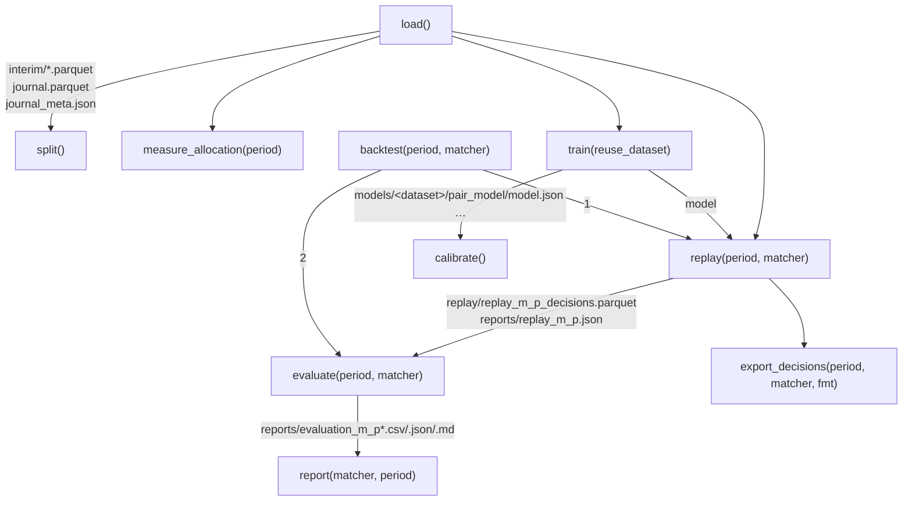
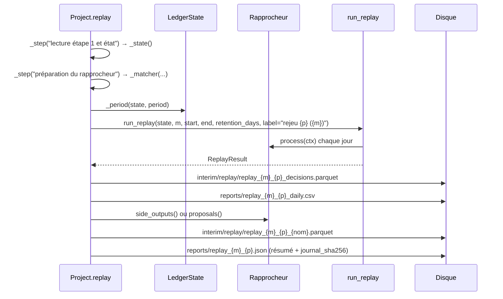
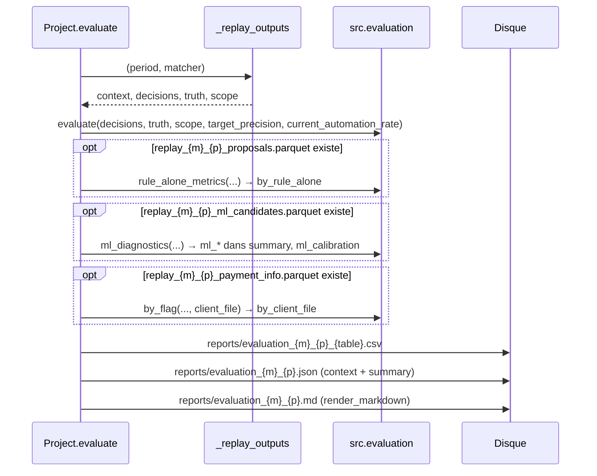

# Module `src/api.py` — point d'entrée `Project` et `run_task`

> **Résumé.** `src/api.py` est la façade unique de la pipeline, utilisée par le notebook
> (`notebooks/pipeline.ipynb`, généré par `tools/make_notebook.py`) et par l'interface Streamlit (via
> `run_task` dans un sous-processus). La dataclass `Project` associe un jeu de données (`"synthetic"` ou
> `"real"`) à ses fichiers de configuration ; chaque méthode correspond à une étape du brief, relit
> les sorties de l'étape précédente sur disque, écrit les siennes et renvoie des objets affichables.
> Les marqueurs `<synthétique>` / `portable:` délimitent le code retiré de la version portable `single/`.

Les imports lourds (`src.load.*`, `src.timeline.*`, `src.reconcile_*`, `src.evaluation.*`) sont faits
**à l'intérieur des méthodes** : importer `src.api` ne charge que `pandas`, `src.memory`, `src.progress`,
`src.config` et `src.settings` (`src/api.py:20-36`). Déduit : cela garde l'import rapide pour
l'interface et le sous-processus.

---

## 1. Rôle et responsabilités

Docstring du module (`src/api.py:1-18`), ordre d'appel attendu :

```python
project = Project(dataset="synthetic")          # ou "real" (sources de config/schema.yaml)
project.load(n_payments=50_000)                 # étape 1
project.split()                                 # étape 2 : périodes
project.measure_allocation("validation")        # étape 3
project.backtest("test", matcher="rules")       # étape 4 : baseline
project.train()                                 # étape 5 : modèle
project.backtest("test", matcher="pipeline")    # étapes 4 + 5 → étape 6
project.report("pipeline", "test")              # résultats
```

« Chaque méthode écrit ses sorties sur disque (paths de config/settings.yaml) et renvoie des objets
affichables (DataFrame, dict). » (`src/api.py:15-17`). Exception : `split()` n'écrit rien (§3.3).

### 1.1 Constantes du module

| Nom | Ligne | Valeur | Remarque |
|---|---|---|---|
| `SYNTHETIC, REAL` | `src/api.py:41` | `"synthetic"`, `"real"` | importés par l'interface |
| `DATASETS` | `src/api.py:42` | `(SYNTHETIC, REAL)` | marqueur `# portable: DATASETS = (REAL,)` |
| `DEFAULT_DATASET` | `src/api.py:43` | `SYNTHETIC` | marqueur `# portable: DEFAULT_DATASET = REAL` |
| `PERIOD_NAMES` | `src/api.py:44` | `("train", "validation", "test", "all")` | importé nulle part (Grep sur `src/`, `tests/`, `tools/`) |
| `MATCHERS` | `src/api.py:45` | `("null", "rules", "pipeline")` | message d'erreur de `_matcher` |

### 1.2 Fonctions utilitaires

- `_stderr(message: str) -> None` (`src/api.py:48-52`) : journal par défaut de `Project` ; écrit sur
  `stderr` avec `flush=True` ; en cas de `UnicodeEncodeError` (console Windows non UTF-8, commentaire
  `:51`), réécrit le message en ASCII avec remplacement.
- `_clean(value: Any) -> Any` (`src/api.py:55-56`) : `NaN` flottant → `None`, pour des JSON valides.
  Appelé par `measure_allocation` (`:274`) et `evaluate` (`:365`).

### 1.3 Dépendances entre méthodes (par fichiers)



---

## 2. La classe `Project` (`src/api.py:59-385`)

```python
@dataclass
class Project:
    dataset: str = DEFAULT_DATASET
    settings_path: Path = DEFAULT_SETTINGS_PATH
    schema_path: Path = DEFAULT_SCHEMA_PATH
    rules_path: Path = DEFAULT_RULES_PATH
    log: Callable[[str], None] = field(default=_stderr, repr=False)
```

Valeurs par défaut (`src/config.py:10-12`, `src/settings.py:22`) : `REPO_ROOT/config/settings.yaml`,
`REPO_ROOT/config/schema.yaml`, `REPO_ROOT/config/rules.yaml`, où `REPO_ROOT` est la racine du dépôt
(`Path(__file__).resolve().parent.parent`). Dans `single/reconciliation.py:69`, `REPO_ROOT` est le dossier
du fichier unique.

### 2.1 `__post_init__(self) -> None` (`src/api.py:69-75`)

1. `dataset` hors de `DATASETS` → `ValueError("dataset : 'synthetic' ou 'real'")`.
2. Convertit les trois chemins en `Path`.
3. **Branchement de la progression** : si aucun afficheur n'a été choisi explicitement
   (`progress.chosen()` faux), `progress.use_log(self.log, automatic=True)` (`:74-75`). Chaque nouveau
   `Project` remplace donc l'afficheur « automatique » par son propre journal, mais n'écrase jamais un
   `progress.use_notebook()` / `use_log(...)` explicite. Voir `memory_et_progress.md`.

### 2.2 Configuration et chemins

| Membre | Lignes | Comportement |
|---|---|---|
| `settings` (propriété) | `src/api.py:79-81` | `load_settings(self.settings_path)` — **relu à chaque accès**, sans cache |
| `rules` (propriété) | `src/api.py:83-85` | `load_rules(self.rules_path)` — idem |
| `_dir(self, base: str) -> Path` | `src/api.py:87-89` | `resolve_path(base)` (relatif à `REPO_ROOT`), suffixé de `/synthetic` si `dataset == "synthetic"` |
| `interim_dir` | `src/api.py:91-93` | `_dir(settings.paths.interim_dir)` → `data/interim[/synthetic]` |
| `reports_dir` | `src/api.py:95-97` | `_dir(settings.paths.reports_dir)` → `reports[/synthetic]` |
| `model_dir` | `src/api.py:99-102` | `resolve_path(settings.paths.models_dir) / dataset / MODEL_DIRNAME` → `models/<dataset>/pair_model` (`MODEL_DIRNAME = "pair_model"`, `src/reconcile_ml/pipeline.py:37`) |
| `meta(self) -> dict \| None` | `src/api.py:104-106` | contenu de `interim_dir/journal_meta.json`, `None` s'il n'existe pas |

Pourquoi le suffixe `synthetic` (déduit) : les sorties synthétiques et réelles cohabitent sans
s'écraser ; le modèle est toujours rangé par jeu (`models/synthetic/…`, `models/real/…`).

Chemins par défaut (`config/settings.yaml:7-13`) : `interim_dir: data/interim`, `reports_dir: reports`,
`synthetic_dir: data/synthetic`, `models_dir: models`.

### 2.3 `_step(self, name: str, timings: dict[str, float])` (`src/api.py:108-115`)

Gestionnaire de contexte : `memory.mark_step(name)` (phase du suivi mémoire), `self.log("… name")`,
exécution du bloc, puis `timings[name] = durée arrondie au dixième` et `self.log("  name : X s")`. Pas de
`try/finally` : si le bloc lève, ni le temps ni le message de fin ne sont produits (l'exception remonte).
Appelé par `_synthetic_source` (`:129`), `load` (`:154-167`), `replay` (`:221,223`),
`measure_allocation` (`:258,260`).

Le préfixe `"… "` n'est pas décoratif : `MemoryMonitor.log` reconnaît ce préfixe et en fait une
nouvelle phase (`src/memory.py:271-272`). Avec `log=monitor.log`, `mark_step` est donc appelé deux fois
avec le même nom (sans conséquence).

---

## 3. Méthodes par étape

### 3.1 Étape 1 — `load(...)` (`src/api.py:134-176`)

Signature dépôt : `def load(self, n_payments: int | None = None, seed: int = 42, regenerate: bool = False) -> dict`
— version portable : `def load(self) -> dict` (marqueur `portable:` en fin de ligne `:134`).

Séquence :

```mermaid
sequenceDiagram
    participant P as Project.load
    participant SY as _synthetic_source
    participant LD as src.load.*
    participant FS as Disque
    alt dataset == "synthetic"  (bloc synthétique)
        P->>SY: n_payments, seed, regenerate
        SY->>FS: write_synthetic(cfg, data/synthetic/{n}_seed{seed}/) si absent ou regenerate
        SY-->>P: schema.synthetic.yaml, source_dir, "synthetic/{dossier}"
    else dataset == "real"
        P->>FS: read_yaml(schema_path) ; base_dir
    end
    P->>LD: load_all(schema_cfg, source_dir, workers)
    P->>LD: build_journal(data)
    P->>LD: derive_imputed_amounts + check_quality
    P->>FS: interim/{table}.parquet, interim/journal.parquet
    P->>LD: journal_hash(journal)
    P->>FS: interim/journal_meta.json
    P->>LD: build_profile(...) puis write_reports(...)
    P->>FS: reports/load_*.csv, reports/load_profile.md
```

Détails :

- `_synthetic_source(self, n_payments, seed, regenerate, timings)` (`src/api.py:120-131`, bloc
  `# <synthétique>` `:119-132`) : `SyntheticConfig(seed=seed)`, remplacé par `n_payments` si fourni ;
  dossier source **par variante** `data/synthetic/<n_payments>_seed<seed>` (commentaire `:126` : « changer
  de volume n'écrase pas les autres jeux ») ; régénère si `regenerate` ou si `payment.csv` manque ;
  renvoie `read_yaml(REPO_ROOT/"config"/"schema.synthetic.yaml")`, le dossier, et l'étiquette
  `synthetic/<dossier>`.
- Données réelles (`:149-152`) : `schema_cfg = read_yaml(self.schema_path)`, `source_dir =
  resolve_path(schema_cfg.get("base_dir") or ".")`, `source = str(self.schema_path)`.
- Étapes chronométrées (`:154-168`) : « chargement et normalisation » (`load_all(..., workers=
  settings.load.workers)`), « journal » (`build_journal`), « contrôles qualité »
  (`derive_imputed_amounts` + `check_quality`, issues cumulées), « écriture parquet », « empreinte du
  journal » (`journal_hash`).
- Méta (`:169-173`) : `normalization_version`, `journal_sha256`, `journal_events`, `source` ; le JSON
  écrit ajoute `mapped_fields` et `timings_s`.
- Retour (`:176`) : `{"meta": {..., "timings_s"}, **profile}` où `profile` contient `volumes`,
  `missing_fields`, `date_ranges`, `issues`, `events` (`src/load/profile.py:47-53`).

**Fichiers écrits** :

| Fichier | Producteur |
|---|---|
| `data/synthetic/<n>_seed<seed>/*.csv` (synthétique seulement) | `write_synthetic` (`src/synthetic/generate.py:492`) |
| `<interim>/<table>.parquet` pour chaque table de `data.tables` | `src/api.py:164-165` |
| `<interim>/journal.parquet` | `src/api.py:166` |
| `<interim>/journal_meta.json` | `src/api.py:171-173` |
| `<reports>/load_{volumes,missing_fields,date_ranges,issues,events}.csv`, `<reports>/load_profile.md` | `write_reports` (`src/load/profile.py:82-88`) |

### 3.2 `_state(self)` (`src/api.py:180-185`)

`load_interim(self.interim_dir)` (qui revérifie l'empreinte du journal, `src/load/interim.py:58-59`) puis
`LedgerState(data, journal, settings.reconcile_ml.features.behavioral_window_days)`. Renvoie
`(data, state, meta)`. Appelé par `replay` (`:222`) et `measure_allocation` (`:259`). Chaque appel
reconstruit un état neuf (nécessaire : un `LedgerState` ne recule pas, voir `timeline.md`).

### 3.3 Étape 2 — `split(self)` (`src/api.py:187-192`)

Lit `payment.parquet` (colonnes `value_date`, `booking_date`), prend `booking_date` sinon `value_date`
(même règle que `payment_event_time`, `src/load/events.py:84-86`) et renvoie
`compute_split(settings.split, min, max)` — un objet `Split`, **sans rien écrire** sur disque.

### 3.4 `_period(self, state, period: str)` (`src/api.py:194-200`)

Bornes `(Timestamp, Timestamp)` d'une période : `"all"` → premier et dernier jour d'arrivée de paiement
(`state.payment_day_range()`), sinon `compute_split(...).period(period)`. Utilisé par `replay` (`:225`)
et `measure_allocation` (`:262`). La source des dates diffère de `split()` (journal vs table) mais
donne le même résultat en pratique (déduit : mêmes dates, `NaT` exclus dans les deux cas).

### 3.5 `_matcher(self, name: str, state, settings: Settings)` (`src/api.py:202-215`)

| `name` | Instance |
|---|---|
| `"null"` | `NullMatcher()` |
| `"rules"` | `RulesMatcher(state, settings, self.rules)` |
| `"pipeline"` | `PipelineMatcher(state, settings, self.rules, PairModel.load(self.model_dir))` ; `FileNotFoundError("aucun modèle entraîné : lancer d'abord project.train()")` si `model.json` manque |
| autre | `ValueError("rapprocheur inconnu : … (null, rules, pipeline)")` |

### 3.6 `replay(self, period: str = "test", matcher: str = "null") -> dict` (`src/api.py:217-248`)



Détails :

- `tag = f"replay_{matcher}_{period}"` (`:230`).
- Sorties annexes (`:236-241`) : `m.side_outputs()` si la méthode existe (`PipelineMatcher` :
  `proposals`, `ml_candidates`, `payment_info`, `src/reconcile_ml/pipeline.py:278-284`), sinon
  `{"proposals": m.proposals()}` (`RulesMatcher`, `src/reconcile_rules/matcher.py:329`), sinon rien
  (`NullMatcher`). Une colonne `invoices` (tuples) est convertie en listes pour le parquet.
- Résumé JSON (`:242-247`) : `matcher`, `period`, `start`, `end`, `days`, `journal_sha256`, `batch_rows`
  (Σ des tailles de lot), `new_payments`, `expired`, `auto_payments`, `decisions`, `timings_s`.
- Retour : `{"summary", "daily", "decisions"}`.

Le message `self.log(f"… rejeu {period} du … au … ({matcher})")` (`:226`) n'est pas dans un `_step` :
il ne devient une phase mémoire que si `log` est `MemoryMonitor.log`.

### 3.7 Étape 3 — `measure_allocation(self, period: str = "validation") -> dict` (`src/api.py:252-280`)

1. `_state()` ; `AllocationProbe(Allocator(state, settings.allocation))` (« construction des index »).
2. `run_replay(..., label=f"allocation {period}")` ; la sonde ne décide rien
   (`src/allocation/evaluate.py:32-50`).
3. `truth_debtors(imputation, invoice)` puis `allocation_metrics(probe.first_pass(), probe.last_pass(),
   truth, settings.allocation.target_recall, payment[["payment_id","label"]])`.
4. Écrit `reports/allocation_<p>_{by_route,by_status,found_by,misses}.csv` et
   `reports/allocation_<p>.json` (`context` : période, bornes, `journal_sha256`, réglages d'allocation,
   temps ; `summary` nettoyé par `_clean`).
5. Retour : `{"summary", "by_route", "by_status", "found_by", "misses"}`.

### 3.8 Étape 5 — `train(self, reuse_dataset: bool = False) -> dict` (`src/api.py:284-292`)

Délègue à `fit_ml(self.interim_dir, self.model_dir, self.settings, self.rules, log=self.log,
reuse_dataset=reuse_dataset)` (`src/reconcile_ml/pipeline.py:359-448`). Résumé de ce que fait `fit_ml`
(certain, par lecture) :

1. `load_interim`, nouvel état, `compute_split` sur `payment_day_range`.
2. Jeu d'entraînement : si `reuse_dataset` et que la clé (`dataset_key` : empreinte du journal,
   version de featurisation, réglages) correspond, reprise de `interim/ml/dataset` ; sinon **un seul
   rejeu** `train.start → validation.end` avec `DatasetRecorder`, étiquetage (`label_pairs`), colonne
   `period` via `assign_period`, écriture partitionnée par mois.
3. `PairModel.fit` (passe 1, plis hors échantillon, passe 2, calibration).
4. Seuils hors ligne puis **calibration en ligne** : nouveau rejeu de la validation avec
   `PipelineMatcher(record_proposals=True)` (`online_thresholds`, `:451-467`).
5. `model.save(model_dir)` + `calibration_validation.csv` + `feature_importance.csv`.
6. Retour : `model.meta` (pas de clé `summary`).

**Fichiers écrits** : `<interim>/ml/dataset/month=…/*.parquet`, `<interim>/ml/dataset_meta.json`,
`<interim>/ml/validation_daily_proposals.parquet`, `models/<dataset>/pair_model/{pass1.txt, pass2.txt,
calibrator.pkl, model.json}` (`src/reconcile_ml/model.py:138-147`, `pass2`/`calibrator` si présents),
`calibration_validation.csv`, `feature_importance.csv`.

### 3.9 `calibrate(self) -> dict` (`src/api.py:294-297`)

Délègue à `recalibrate_ml(interim_dir, model_dir, settings, rules, log)`
(`src/reconcile_ml/pipeline.py:470-488`) : refuse un modèle entraîné sur un autre journal
(`RuntimeError("modèle entraîné sur un autre journal : réentraîner")`), rejoue la validation pour
recalculer les seuils, réécrit le modèle. Écrit `<interim>/ml/validation_daily_proposals.parquet` et
`model_dir/*`.

### 3.10 Étape 6 — `_replay_outputs(self, period: str, matcher: str)` (`src/api.py:301-320`)

Charge le contexte d'un rejeu et sa vérité :

1. `reports/replay_<m>_<p>.json` absent → `FileNotFoundError("aucun rejeu m/p : lancer d'abord
   project.replay()")`.
2. `journal_sha256` du rejeu ≠ celui de `journal_meta.json` → `RuntimeError("le rejeu a été calculé sur
   un autre journal : le relancer")` (`:309-310`).
3. Lit `imputation.parquet` (`payment_id`, `invoice_id`) et `journal.parquet` (`ts`, `event_type`,
   `entity_id`).
4. **Périmètre** (`:313-318`) : paiements dont `PAYMENT_RECEIVED` tombe dans `[start, end + 1 jour)`,
   avec leur jour d'arrivée — les paiements du reliquat initial (arrivés avant la période) sont exclus.
5. Retour : `(context, decisions, ground_truth(imputation), scope)`.

Appelé par `export_decisions` (`:327`) et `evaluate` (`:348`).

### 3.11 `export_decisions(self, period: str = "test", matcher: str = "pipeline", fmt: str = "parquet") -> Path` (`src/api.py:322-339`)

`decision_pairs(decisions, truth, scope)` (`src/evaluation/export.py`) : une ligne par couple
(paiement, facture) proposé, plus les couples réellement imputés non proposés, avec `statut_paire`.
Écrit `reports/decisions_<m>_<p>.parquet` ou `.csv` ; `fmt` inconnu → `ValueError` **après** création
du dossier (`:330-336`). Journalise le décompte par `statut_paire`. Renvoie le chemin.

### 3.12 `evaluate(self, period: str = "test", matcher: str = "null") -> dict` (`src/api.py:341-372`)



Tables de base : `by_step`, `by_rule`, `by_group`, `by_month`, `curve`, `cascade`
(`src/evaluation/metrics.py:38-40`), plus les trois optionnelles. Le JSON est écrit avec
`default=lambda v: None` : toute valeur non sérialisable devient `null`. Retour :
`{"summary", **tables}`.

### 3.13 `backtest(self, period: str = "test", matcher: str = "pipeline") -> dict` (`src/api.py:374-377`)

`self.replay(period, matcher)` puis `return self.evaluate(period, matcher)`. Le retour de `replay`
est ignoré.

### 3.14 `report(self, matcher: str = "pipeline", period: str = "test") -> dict` (`src/api.py:379-385`)

Relit sans recalcul `reports/evaluation_<m>_<p>.json` (`summary`) et tous les
`evaluation_<m>_<p>_*.csv` (clé = nom du fichier sans le préfixe). **Attention à l'ordre des
arguments** : `report(matcher, period)`, alors que toutes les autres méthodes prennent
`(period, matcher)`.

### 3.15 Récapitulatif des fichiers par méthode

| Méthode | Lit | Écrit |
|---|---|---|
| `load` | sources (CSV synthétiques ou `schema.yaml`) | `<interim>/*.parquet`, `journal.parquet`, `journal_meta.json`, `<reports>/load_*.csv`, `load_profile.md` |
| `split` | `<interim>/payment.parquet` | — |
| `replay` | `<interim>/*`, modèle si `pipeline` | `<interim>/replay/replay_<m>_<p>_decisions.parquet`, `…_{proposals,ml_candidates,payment_info}.parquet`, `<reports>/replay_<m>_<p>_daily.csv`, `<reports>/replay_<m>_<p>.json` |
| `measure_allocation` | `<interim>/*` | `<reports>/allocation_<p>_*.csv`, `allocation_<p>.json` |
| `train` | `<interim>/*` | `<interim>/ml/*`, `models/<dataset>/pair_model/*` |
| `calibrate` | `<interim>/*`, modèle | `<interim>/ml/validation_daily_proposals.parquet`, modèle |
| `evaluate` | rejeu, `imputation.parquet`, `journal.parquet` | `<reports>/evaluation_<m>_<p>{_*.csv,.json,.md}` |
| `export_decisions` | idem | `<reports>/decisions_<m>_<p>.{parquet,csv}` |
| `backtest` | — | `replay` + `evaluate` |
| `report` | `<reports>/evaluation_<m>_<p>*` | — |

Avec `<interim>` = `data/interim/synthetic` ou `data/interim`, `<reports>` = `reports/synthetic` ou
`reports` selon le jeu.

---

## 4. `run_task(task: str, kwargs: dict) -> None` (`src/api.py:388-398`)

Exécute une méthode de `Project` dans un processus séparé (docstring `:389`).

1. Reconfigure `stdout` et `stderr` en UTF-8 (`:390-392`).
2. Extrait de `kwargs` (en le **mutant** par `pop`) les arguments du constructeur : `dataset`,
   `settings_path`, `schema_path`, `rules_path` (`:393`).
3. `Project(**project_args, log=lambda m: print(m, flush=True))` : le journal va sur `stdout`.
4. `getattr(project, task)(**kwargs)` ; si le résultat est un dict avec `summary`, l'imprime en JSON
   (`:396-398`).

Appelant : `src/ui/common.py:230-256`, qui lance
`python -c "import json, sys; from src.api import run_task; run_task(sys.argv[1], json.loads(sys.argv[2]))"`
avec `PYTHONIOENCODING=utf-8`, `PYTHONUNBUFFERED=1`, `cwd=REPO_ROOT`, et affiche les 30 dernières
lignes en direct. Pourquoi (docstring `src/ui/common.py:231-235`) : « le processus séparé garde
l'interface réactive et sa mémoire indépendante des 2 M de lignes traitées ». Tâches lancées par
l'interface : `load` (`src/ui/views/load.py:39`), `replay` (`src/ui/views/split.py:102`),
`measure_allocation` (`src/ui/views/allocation.py:43`), `backtest` (`src/ui/views/rules.py:77`,
`src/ui/views/evaluation.py:31`, `src/ui/views/ml.py:60`), `train` (`src/ui/views/ml.py:49`),
`calibrate` (`src/ui/views/ml.py:55`).

Comme le sous-processus crée un `Project` sans afficheur explicite, la progression est journalisée sur
`stdout` toutes les 30 s (`LogReporter`), donc visible dans l'interface.

---

## 5. Marqueurs « synthétique » et « portable: »

Commentaire de référence (`src/api.py:38-40`) :

> Code propre au jeu synthétique : entre les marqueurs « <synthétique> », ou ligne marquée
> « synthétique seulement ». La version portable (single/) le retire ; « portable: … » donne la ligne
> qui y remplace la ligne marquée.

| Marqueur | Emplacement | Effet dans `single/reconciliation.py` |
|---|---|---|
| `# portable: DATASETS = (REAL,)` | `src/api.py:42` | `single/reconciliation.py:6202` |
| `# portable: DEFAULT_DATASET = REAL` | `src/api.py:43` | `single/reconciliation.py:6203` |
| bloc `# <synthétique>` … `# </synthétique>` (`_synthetic_source`) | `src/api.py:119-132` | méthode absente |
| `# portable: def load(self) -> dict:` | `src/api.py:134` | `single/reconciliation.py:6279` |
| bloc `# <synthétique>` (branche `if self.dataset == SYNTHETIC`) | `src/api.py:145-148` | branche absente ; il reste `schema_cfg = None` / `if schema_cfg is None:` (`single/reconciliation.py:6284-6285`) |
| autres fichiers | `src/ui/common.py:105` (`# portable: return REAL`), `src/ui/views/load.py:7` (« synthétique seulement »), `src/ui/views/load.py:20` (`# <synthétique>`) | — |

**Raison** (message du commit `7dae7fd`, « Version portable (single/) sans mode synthétique ») : le
livrable portable ne contient que le mode données réelles — ni générateur, ni
`schema.synthetic.yaml`, ni `dataset="synthetic"`, ni paramètres de `load()`, ni options d'interface ou
de notebook synthétiques ; `Project()` y vaut « real ». La docstring de `single/reconciliation.py:1-16`
le confirme (« Version portable : données réelles uniquement »).

---

## 6. Tests

| Test | Ce qu'il couvre de `api.py` |
|---|---|
| `tests/test_ui.py:15-28` (fixture `ui_env`) | `Project(settings_path=…).load(n_payments=3000)` sur un jeu synthétique en dossier temporaire |
| `tests/test_ui.py` (pages) | les vues lancent `run_task` ; vérifient les rapports produits (ex. `reports/synthetic/evaluation_null_test.json`) |
| `tests/test_ui.py:130-151` `test_evaluation_page_with_decisions_shows_curve` | `Project.replay("validation", "null")` puis `Project.evaluate(...)` sur des décisions injectées |
| `tests/test_evaluation.py`, `tests/test_export.py` | fonctions appelées par `evaluate` / `export_decisions` (pas `Project` directement) |

Aucun test unitaire dédié à `api.py` : la classe est exercée de bout en bout par les tests de
l'interface.

---

## 7. ⚠️ Zones d'ombre

1. **Backtest `pipeline` sans contrôle d'empreinte du modèle.** `_matcher("pipeline")` charge le
   modèle (`src/api.py:210-214`) sans comparer `model.meta["journal_sha256"]` au journal courant, alors
   que `recalibrate_ml` le fait (`src/reconcile_ml/pipeline.py:475-476`). Après un `load()` de nouvelles
   données, `backtest(matcher="pipeline")` tourne avec un modèle entraîné sur un autre journal sans
   avertissement (le rejeu enregistre l'empreinte du **journal**, pas celle du modèle).
2. **Outil de génération de `single/` absent du dépôt.** Les marqueurs sont décrits, mais aucun script
   de `tools/` ne les applique (`tools/` ne contient que `build_bundle.py` et `make_notebook.py`, et
   `build_bundle.py` n'inclut pas `single/`). La synchronisation `src/` → `single/` est donc manuelle ou
   faite par un outil hors dépôt (déduit) ; rien ne garantit que `single/reconciliation.py` suit `src/`.
   Restes inoffensifs dans `single/` : `schema_cfg = None; if schema_cfg is None:`, et `_dir` qui teste
   encore `SYNTHETIC`.
3. **Fichiers de rapport périmés.** `evaluate` écrit les tables présentes mais ne supprime pas les
   anciens `evaluation_<m>_<p>_*.csv` ; `report()` relit tout ce qui correspond au motif
   (`src/api.py:384`) et peut donc renvoyer une table d'un calcul précédent (par exemple
   `by_rule_alone` si les `proposals` ont disparu). Même chose pour les `replay_*_<nom>.parquet` annexes
   lus par `evaluate` (`:352-364`) s'ils proviennent d'un rejeu antérieur sous le même tag.
4. **`settings` et `rules` relus à chaque accès** (`src/api.py:79-85`) : une méthode qui lit
   `self.settings` plusieurs fois (`interim_dir`, `reports_dir`, puis `settings` local) peut voir deux
   versions différentes si le YAML est modifié pendant l'exécution (depuis l'interface par exemple).
5. **Ordre d'arguments incohérent** : `report(matcher, period)` contre `(period, matcher)` partout
   ailleurs (`src/api.py:379`).
6. **Erreurs peu explicites** : une période inconnue dans `_period` remonte un `StopIteration`
   (`Split.period`, `src/timeline/split.py:44-45`) ; `_replay_outputs` plante en `TypeError` si
   `journal_meta.json` est absent (`self.meta()` renvoie `None`, `src/api.py:309`) ; `_matcher` n'est
   validé qu'après le chargement complet de l'état (`src/api.py:222-224`).
7. **`split()` n'écrit rien** malgré la docstring du module (`src/api.py:15`), et n'est utilisé que pour
   l'affichage : les autres méthodes recalculent le découpage elles-mêmes.
8. **`run_task` n'imprime rien d'utile pour `train` / `calibrate` / `export_decisions` / `split`** : seul
   un dict avec `summary` est imprimé (`src/api.py:396-398`) ; `model.meta` n'en a pas.
9. **`_step` sans `try/finally`** (`src/api.py:108-115`) : en cas d'échec, le dernier `mark_step` reste
   la phase mémoire courante (utile pour diagnostiquer, mais aucune trace de durée).
10. **`PERIOD_NAMES`** (`src/api.py:44`) n'est importé nulle part dans `src/`, `tests/` ni `tools/`
    (Grep) : constante morte, l'interface définit ses propres libellés de périodes.
