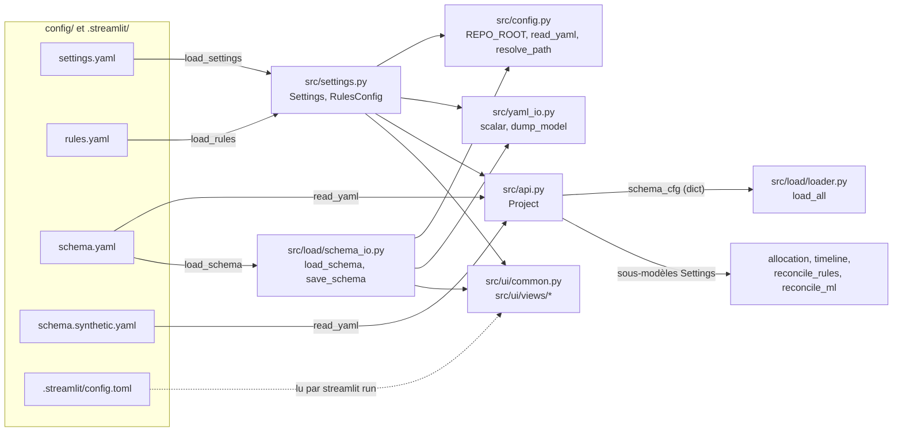
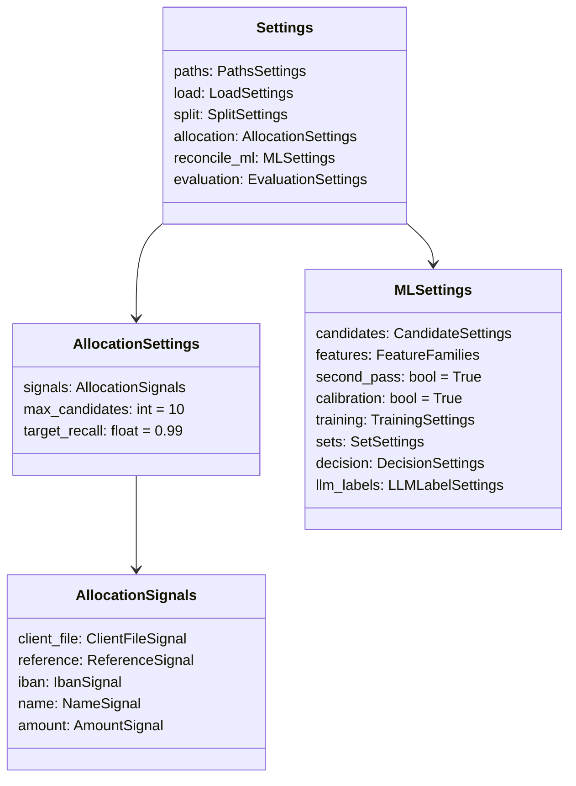

# Configuration et réglages : `src/config.py`, `src/settings.py`, `src/yaml_io.py`, `src/arrow_ops.py` et `config/`

> **Résumé.** Tous les paramètres de la pipeline vivent dans trois fichiers YAML.
> - `config/settings.yaml` : chemins et réglages des étapes 1, 2, 3, 5 et 6.
> - `config/rules.yaml` : les règles déterministes de l'étape 4.
> - `config/schema.yaml` : le mapping vers les noms réels des tables et colonnes.
>
> Les deux premiers sont décrits par des modèles **pydantic** (`src/settings.py`), source unique
> pour la pipeline et l'interface. Ces modèles sont validés strictement : une clé inconnue est
> refusée. Ils sont réécrits avec leurs commentaires par `src/yaml_io.py`. Le mapping de schéma est
> un simple dictionnaire, relu et réécrit par `src/load/schema_io.py` (voir [load.md](load.md)).
> `src/config.py` fournit la racine du dépôt et la lecture YAML. `src/arrow_ops.py` n'est pas de la
> configuration : c'est une petite boîte à outils de jointures vectorisées en pyarrow, partagée par
> le chargement, l'allocation, l'état et la featurisation. `.streamlit/config.toml` coupe la
> télémétrie de l'interface et la limite à `localhost`.

---

## 1. Vue d'ensemble

### 1.1 Rôle de chaque fichier

| Fichier | Rôle | API publique |
|---|---|---|
| `src/config.py` | Racine du dépôt, chemins par défaut, lecture YAML, résolution de chemins relatifs | `REPO_ROOT`, `DEFAULT_SCHEMA_PATH`, `DEFAULT_SETTINGS_PATH`, `read_yaml`, `resolve_path` |
| `src/settings.py` | Modèles pydantic de `settings.yaml` et `rules.yaml`, valeurs par défaut, lecture et écriture | `Settings` et ses sous-modèles, `RuleConfig`, `RulesConfig`, `DEFAULT_RULES_PATH`, `load_settings`, `save_settings`, `load_rules`, `save_rules` |
| `src/yaml_io.py` | Sérialise un modèle pydantic en YAML **commenté**, avec les `description` des champs | `scalar`, `model_lines`, `dump_model` |
| `src/arrow_ops.py` | Jointures et appartenance par clé vectorisées (pyarrow), colonnes de listes Arrow | `to_arrow`, `isin`, `lookup`, `list_lengths`, `flatten_lists`, `list_take` |
| `config/settings.yaml` | Valeurs courantes de `Settings` | — |
| `config/rules.yaml` | Valeurs courantes de `RulesConfig` (version 2) | — |
| `config/schema.yaml` | Mapping des sources **réelles**, entièrement à `null` (à remplir par l'équipe) | — |
| `config/schema.synthetic.yaml` | Mapping du jeu synthétique (`src/synthetic/generate.py`) | — |
| `.streamlit/config.toml` | Options du serveur Streamlit (UI locale, sans télémétrie) | — |

### 1.2 Dépendances et lecteurs



Deux familles de configuration coexistent :

- **Réglages typés** (`settings.yaml`, `rules.yaml`). Ils passent par les modèles pydantic de
  `src/settings.py`. `extra="forbid"` (`src/settings.py:26`) rejette toute clé inconnue : une faute
  de frappe dans le YAML lève une `ValidationError` au lieu d'être ignorée. `validate_assignment=True`
  valide aussi les affectations faites par l'UI ou le notebook (exemple dans
  `tools/make_notebook.py:88` : `settings.split.purge_days = 7`).
- **Mapping de schéma** (`schema.yaml`, `schema.synthetic.yaml`). C'est un `dict` brut, sans modèle
  pydantic. Le loader le valide lui-même (`_check_config`, `src/load/loader.py:158`), et
  `src/load/schema_io.py` le relit et le réécrit. Détails dans [load.md](load.md#9-schema_iopy).

---

## 2. `src/config.py`

Fichier de 24 lignes, sans dépendance interne.

| Élément | Ligne | Description |
|---|---|---|
| `REPO_ROOT` | `src/config.py:10` | `Path(__file__).resolve().parent.parent`. La racine du dépôt est déduite de l'emplacement du fichier, pas du répertoire courant. |
| `DEFAULT_SCHEMA_PATH` | `src/config.py:11` | `REPO_ROOT / "config" / "schema.yaml"` |
| `DEFAULT_SETTINGS_PATH` | `src/config.py:12` | `REPO_ROOT / "config" / "settings.yaml"` |
| `read_yaml(path: str \| Path) -> dict[str, Any]` | `src/config.py:15` | `yaml.safe_load` en UTF-8. Un fichier vide donne `{}` (`content or {}`). |
| `resolve_path(path: str \| Path, base: Path = REPO_ROOT) -> Path` | `src/config.py:21` | Rend un chemin absolu. Un chemin déjà absolu est rendu tel quel, un chemin relatif est rattaché à `base`, la racine du dépôt par défaut. |

**Appelants.**
- `read_yaml` :
  - `src/api.py:131`, qui lit `config/schema.synthetic.yaml` ;
  - `src/api.py:150`, qui lit `schema.yaml` pour les données réelles ;
  - `src/settings.py:315` et `src/settings.py:324` ;
  - `src/load/schema_io.py:126` ;
  - de nombreux tests (`tests/conftest.py:9`, `tests/test_loader.py:6`…).
- `resolve_path` :
  - dans `src/api.py` : `_dir` à la ligne 88, `model_dir` à la ligne 102, le dossier synthétique à la
    ligne 127 et le `base_dir` réel à la ligne 151 ;
  - dans l'UI : `src/ui/common.py:109`, `src/ui/common.py:114`, `src/ui/views/config.py:58`,
    `src/ui/views/load.py:30` et `src/ui/views/ml.py:46`.

Tous les chemins de `settings.paths` sont interprétés **par rapport à la racine du dépôt** (via
`resolve_path`), quel que soit le répertoire de lancement.

---

## 3. `src/yaml_io.py` : YAML commenté à partir de pydantic

**Pourquoi** (docstring, `src/yaml_io.py:1-6`) : les fichiers de config sont édités à la fois à la
main et par l'UI. Une écriture brute par `yaml.safe_dump` effacerait les commentaires. On régénère
donc le fichier entier, en écrivant la `description` de chaque champ pydantic en commentaire
au-dessus de la clé. La documentation des réglages vit ainsi dans le code (`Field(description=...)`)
et survit à chaque sauvegarde.

### 3.1 `scalar(value: Any) -> str` (`src/yaml_io.py:18`)

Représentation YAML **sur une ligne** d'une valeur :
- une `date` s'écrit en `isoformat()` (`src/yaml_io.py:20-21`), donc sans guillemets ;
- les autres valeurs passent par `yaml.safe_dump(..., default_flow_style=True, allow_unicode=True,
  sort_keys=False, width=10_000)`. Le marqueur de fin de document `\n...\n` que PyYAML ajoute aux
  scalaires est retiré (`src/yaml_io.py:22-23`).

Valeurs vérifiées par exécution : `None` donne `null`, `True` donne `true`, `[1, "a"]` donne `[1, a]`,
`{}` donne `{}`. `"a: b"` donne `'a: b'` : PyYAML ajoute les guillemets quand c'est nécessaire.
`"Référence"` reste `Référence` (unicode conservé) et `"01"` donne `'01'`, ce qui préserve le type
chaîne.

Appelants : `model_lines` (ci-dessous), `src/load/schema_io.py:100`, `:106-107`, `:110`, `:115` et
`:119`, et `src/ui/views/config.py:81`, pour afficher `read_options`.

### 3.2 `_comment(text, pad) -> list[str]` (`src/yaml_io.py:26`)

Découpe une description en lignes `# …` d'au plus `96 - len(pad)` caractères (`textwrap.wrap`). Si
la description est vide, la fonction ne produit rien.

### 3.3 `model_lines(model: BaseModel, indent: int = 0, comments: bool = True) -> list[str]` (`src/yaml_io.py:32`)

Parcourt `type(model).model_fields` **dans l'ordre de déclaration** et, pour chaque champ :
1. Si `comments` est vrai, la fonction écrit la description en commentaire, indentée
   (`src/yaml_io.py:37-38`).
2. Selon le type de la valeur :
   - **Sous-modèle** : `nom:` puis un appel récursif avec `indent + 2` (`src/yaml_io.py:39-41`).
   - **Liste non vide de modèles** (cas de `RulesConfig.rules`) : chaque élément est rendu à
     `indent + 4` **sans commentaires**. Sa première ligne est préfixée par `- `
     (`src/yaml_io.py:42-48`). D'où la forme `  - id: R1_CLIENT_FILE` de `config/rules.yaml:12`.
   - **Dict non vide** (cas de `RuleConfig.params`) : une ligne `clé: scalar(valeur)` par entrée
     (`src/yaml_io.py:49-51`).
   - **Autre cas**, y compris une liste de scalaires, un dict vide ou une liste vide :
     `nom: scalar(valeur)` (`src/yaml_io.py:52-53`). C'est le cas de
     `segments: [market, bankroll_code, amount_bucket, has_client_file]` (`config/settings.yaml:200`).
3. Au niveau 0, si `comments` est vrai, une ligne vide sépare les sections
   (`src/yaml_io.py:54-55`).

### 3.4 `dump_model(model: BaseModel, header: str = "") -> str` (`src/yaml_io.py:59`)

L'en-tête est préfixé ligne à ligne par `# ` (une ligne vide devient `#`). Viennent ensuite une ligne
vide, puis le corps produit par `model_lines`. Le texte finit par un seul `\n`. Appelée par
`save_settings` (`src/settings.py:319`) et `save_rules` (`src/settings.py:328`).

**Conséquence importante.** Chaque sauvegarde **réécrit tout le fichier** dans l'ordre de
déclaration des champs pydantic. Un commentaire ajouté à la main dans `settings.yaml` disparaît. Un
champ déplacé dans le code change de place dans le fichier : voir la zone d'ombre Z2.

---

## 4. `src/settings.py` : les modèles de réglages

La docstring (`src/settings.py:1-10`) précise que les valeurs marquées « à calibrer » sont des
points de départ, pas des résultats : elles se fixent sur la période de validation.

### 4.1 Base commune

`class _Model(BaseModel)` (`src/settings.py:25`) porte
`model_config = ConfigDict(extra="forbid", validate_assignment=True)`. Tous les modèles en héritent.

### 4.2 Arborescence de `Settings`



`Settings` est déclaré à `src/settings.py:232`. Chaque sous-modèle a un `default_factory` : un YAML
vide ou absent donne donc un `Settings()` complet avec les valeurs par défaut.

### 4.3 Référence complète des réglages de `settings.yaml`

Colonnes :
- **Défaut code** : valeur du `Field(...)` pydantic.
- **YAML** : valeur dans `config/settings.yaml`, si elle diffère du défaut.
- **Lu par** : lecteurs effectifs, trouvés par recherche dans `src/`.

#### `paths` : `PathsSettings` (`src/settings.py:32`, YAML `config/settings.yaml:5`)

| Clé | Défaut | Rôle | Lu par |
|---|---|---|---|
| `interim_dir` | `data/interim` | Tables normalisées et journal de l'étape 1 | `src/api.py:93`, `src/ui/common.py:109` |
| `reports_dir` | `reports` | Rapports CSV et markdown | `src/api.py:97`, `src/ui/common.py:114` |
| `synthetic_dir` | `data/synthetic` | Jeux synthétiques, un sous-dossier `<n>_seed<seed>` par variante | `src/api.py:127`, `src/ui/views/load.py:30` |
| `models_dir` | `models` | Modèles de l'étape 5 | `src/api.py:102`, `src/ui/views/ml.py:46` |

`Project._dir` (`src/api.py:87-89`) ajoute un sous-dossier `synthetic/` à `interim_dir` et
`reports_dir` pour le jeu synthétique, afin de séparer les sorties synthétiques et réelles.

#### `load` : `LoadSettings` (`src/settings.py:39`, YAML `config/settings.yaml:16`)

| Clé | Défaut | Contrainte | Rôle | Lu par |
|---|---|---|---|---|
| `workers` | `12` | `ge=1` | Nombre de processus pour la normalisation. `1` = séquentiel. Sans effet sur le résultat. | `src/api.py:155` → `load_all(..., workers=)` (`src/load/loader.py:369-373`) |

#### `split` : `SplitSettings` (`src/settings.py:47`, YAML `config/settings.yaml:21`)

| Clé | Défaut | Contrainte | Rôle | Lu par |
|---|---|---|---|---|
| `test_months` | `2` | `ge=1` | Durée du backtest : les derniers mois | `compute_split` (`src/timeline/split.py:53`) |
| `validation_months` | `2` | `ge=1` | Validation, juste avant le test | idem |
| `train_months` | `None` | `ge=1` | `null` = tout l'historique avant la validation | `src/timeline/split.py:66-76` |
| `purge_days` | `5` | `ge=0` | Jours exclus entre blocs, pour qu'un groupe d'imputations ne chevauche pas deux périodes | `src/timeline/split.py:59` |
| `anchor_end` | `None` | `date` | Dernier jour du test. `null` = dernier jour de paiement. | `src/timeline/split.py:56-58` |
| `retention_days` | `60` | `ge=1` | Durée de rétention d'un paiement non résolu dans le reliquat | `src/api.py:227`, `src/api.py:264`, `src/reconcile_ml/pipeline.py:387` et `:458`, puis `DailyIterator` (`src/timeline/loop.py:84-117`) |

#### `allocation` : `AllocationSettings` (`src/settings.py:120`, YAML `config/settings.yaml:38`)

Réglages consommés par `Allocator` (`src/allocation/allocator.py:67`), qui reçoit le sous-modèle
complet (`src/allocation/allocator.py:31`).

| Clé | Défaut | Contrainte | Rôle | Lecture vérifiée |
|---|---|---|---|---|
| `signals.client_file.enabled` | `True` | | Rattacher le paiement à son client file | `allocator.py:80`, `:83`, `:89`, `:445` |
| `signals.client_file.date_tolerance_days` | `5` | `ge=0` | Écart maximal entre la date du fichier et la date de valeur | `allocator.py:411` |
| `signals.reference.enabled` | `True` | | Débiteur de la facture citée dans le libellé | `allocator.py:80`, `:471` |
| `signals.reference.min_key_length` | `4` | `ge=1` | Longueur minimale d'une clé de référence : les clés courtes sont du bruit (années, numéros de rue) | `allocator.py:113`, `:424`, et aussi `src/reconcile_rules/matcher.py:67` (règles R1, R2, R5) et la featurisation ML |
| `signals.reference.strong_min_key_length` | `6` | `ge=1` | Longueur minimale pour qu'une clé désignant un seul débiteur donne une allocation **ferme** | `allocator.py:116` |
| `signals.reference.max_debtors_per_key` | `5` | `ge=1` | Une clé partagée par plus de débiteurs, comptés **à D**, est ignorée | `allocator.py:115`, `:426` |
| `signals.iban.enabled` | `True` | | Routage IBAN arbitré par `bankroll_code` | `allocator.py:83`, `:474` |
| `signals.iban.max_debtors_per_iban` | `20` | `ge=1` | Un IBAN de centralisation ne propose aucun candidat, mais le routage reste calculé | `allocator.py:206` |
| `signals.name.enabled` | `True` | | Similarité libellé / nom via un index inversé | `allocator.py:81`, `:478` |
| `signals.name.min_similarity` | `0.5` | `[0,1]` | Score de nom minimal. **À calibrer.** | `allocator.py:272` |
| `signals.name.max_token_share` | `0.01` | `]0,1]` | Élagage relatif des mots fréquents. **À calibrer.** | `allocator.py:225` |
| `signals.name.max_debtors_per_term` | `200` | `ge=1` | Élagage absolu | `allocator.py:225` |
| `signals.name.min_token_length` | `3` | `ge=1` | Longueur minimale d'un mot indexé | `allocator.py:81` |
| `signals.amount.enabled` | `True` | | 5ᵉ signal (montant exact ouvert à D). C'est une extension du brief. | `allocator.py:276`, `:481` |
| `signals.amount.max_debtors_per_amount` | `3` | `ge=1` | Un montant partagé par plus de débiteurs est ignoré, sauf si le nom confirme | `allocator.py:321`, `:331`, `:334` |
| `signals.amount.max_debtors_with_name_hint` | `30` | `ge=1` | Plafond de débiteurs examinés avec confirmation par le nom | `allocator.py:321` |
| `max_candidates` | `10` | `ge=1` | Taille maximale de la liste classée de débiteurs | `allocator.py:526` |
| `target_recall` | `0.99` | `]0,1]` | Rappel visé, **bloquant** pour passer à l'étape 4 (brief §5) | `src/api.py:268` → `allocation_metrics` (`src/allocation/evaluate.py:74`, `:105-106`) |

#### `reconcile_ml` : `MLSettings` (`src/settings.py:208`, YAML `config/settings.yaml:103`)

**`candidates`** (`CandidateSettings`, `src/settings.py:132`). Tous ces réglages sont lus dans
`Featurizer` (`src/reconcile_ml/features.py:159-232`).

| Clé | Défaut | YAML | Rôle |
|---|---|---|---|
| `allocated_debtors` | `True` | | Factures ouvertes des débiteurs candidats (`features.py:159`, `:184`) |
| `reference_no_window` | `True` | | Factures citées dans le libellé, sans fenêtre temporelle (`features.py:168`, `:197`) |
| `amount_exact` | `True` | | Factures dont le montant ouvert égale le paiement (`features.py:171`, `:208`) |
| `amount_window_days` | `90` | | Fenêtre ± jours de la clé montant (`features.py:214`) |
| `client_file_cited` | `True` | | Factures citées dans le client file (`features.py:217`) |
| `debtor_window_before_days` | `180` | | Clé débiteur : échéances jusqu'à N jours avant la date de valeur (`features.py:194`) |
| `debtor_window_after_days` | `30` | | Même clé, jusqu'à N jours après (`features.py:194`) |
| `max_debtors` | `3` | | Ne retenir que les N premiers débiteurs de l'allocation, car les gros débiteurs ont des milliers de factures (`features.py:162`, `:187`) |
| `max_per_payment` | **`60`** | **`50`** (`config/settings.yaml:125`) | Plafond de candidats par paiement (`features.py:232`) |

**`features`** (`FeatureFamilies`, `src/settings.py:150`). Chaque booléen active une famille de
colonnes définie dans `FAMILIES` (`src/reconcile_ml/features.py:29`). La sélection se fait par
`getattr(fam, name)` dans `active_features` (`src/reconcile_ml/features.py:50-53`). Familles :
`amount`, `temporal`, `textual`, `identity`, `behavioral`, `contract`, `allocation`, `client_file`,
toutes `True` par défaut. `behavioral_window_days` (défaut `180`, `ge=1`) est la fenêtre glissante
des agrégats comportementaux. Il est passé au constructeur de `LedgerState` (`src/api.py:184`,
`src/reconcile_ml/pipeline.py:370`, `:456`, `:477`).

**Réglages directs.**
- `second_pass` (`True`) : seconde passe avec features de compétition.
- `calibration` (`True`) : calibration isotonique.

Les deux sont transmis à `PairModel.fit` (`src/reconcile_ml/pipeline.py:407-408`,
`src/reconcile_ml/model.py:112-117`).

**`training`** (`TrainingSettings`, `src/settings.py:175`).

| Clé | Défaut | Contrainte | Lu par |
|---|---|---|---|
| `num_threads` | `0` | `ge=0` | `threads(...)` dans `src/reconcile_ml/model.py:60` et `:125`, et `src/reconcile_ml/pipeline.py:137`. `0` = les CPU **du pod** (quota cgroup), pas les cœurs de la machine hôte. |
| `payment_sample` | `0.5` | `]0,1]` | `src/reconcile_ml/pipeline.py:107` : part des paiements du résiduel gardés pour l'entraînement. Tous leurs candidats sont conservés, sans échantillonnage des négatifs. |
| `num_boost_round` | `400` | `ge=10` | `src/reconcile_ml/model.py:74`, `:78`, `:121` (arrêt précoce) |
| `learning_rate` | `0.05` | `]0,1]` | `src/reconcile_ml/model.py:58` |
| `num_leaves` | `63` | `ge=2` | `src/reconcile_ml/model.py:58` |
| `min_data_in_leaf` | `50` | `ge=1` | `src/reconcile_ml/model.py:59` |
| `seed` | `42` | | `src/reconcile_ml/model.py:59` |

**`sets`** (`SetSettings`, `src/settings.py:162`). Ces réglages sont consommés par
`propose(scored, amount, cfg: SetSettings)` (`src/reconcile_ml/decision.py:30`), appelée depuis
`src/reconcile_ml/pipeline.py:313`, et par `_n_to_n` (`src/reconcile_ml/pipeline.py:205`).

| Clé | Défaut | Rôle |
|---|---|---|
| `enabled` | `True` | Reconstitution des ensembles par DFS borné (`decision.py:47`, `:55`, `pipeline.py:169`) |
| `near_sum` | `True` | Passe 1 : somme proche (`decision.py:55`) |
| `n_to_n` | `True` | Passe 2 : agrégation de paiements d'un même débiteur (`pipeline.py:169`) |
| `n_to_n_window_hours` | `72` | Fenêtre n↔n, ramenée en jours par `// 24`, avec un minimum de 1 (`pipeline.py:215`) |
| `single_candidate` | `True` | Passe 3 : candidat unique (`decision.py:47`) |
| `max_invoices` | `5` | Cardinalité maximale |
| `max_candidates` | `25` | Candidats en entrée du DFS (`decision.py:56`, `pipeline.py:221`) |
| `tolerance_abs_cents` | `500` | Tolérance absolue (5 €) |
| `tolerance_rel` | `0.03` | Tolérance relative (3 %) |
| `node_budget` | `100_000` | Budget de nœuds ; au-delà, revue |

**`decision`** (`DecisionSettings`, `src/settings.py:188`). Ces réglages sont lus par
`calibrate_thresholds` (`src/reconcile_ml/decision.py:97`) et `calibrate_online`
(`src/reconcile_ml/decision.py:154`).

| Clé | Défaut | Rôle |
|---|---|---|
| `review_min_score` | `0.3` | τ_low (`decision.py:114`, `:164`) |
| `min_margin` | `0.05` | δ, la marge au second. **À calibrer.** |
| `segmented_thresholds` | `False` | Seuils par segment (`decision.py:124`) |
| `segments` | `["market", "bankroll_code", "amount_bucket", "has_client_file"]` | Dimensions de segmentation (`decision.py:125`) |
| `min_segment_volume` | `1000` | Volume minimal d'un segment (`decision.py:130`) |

**`llm_labels`** (`LLMLabelSettings`, `src/settings.py:201`) : `enabled=False`, `endpoint=None`,
`cache_dir="data/cache/llm"`. **Aucun code ne lit ces valeurs** : le sous-modèle n'entre que dans
l'empreinte du jeu d'entraînement (`src/reconcile_ml/pipeline.py:331`) et dans l'UI
(`src/ui/views/ml.py:40`). L'étape LLM n'est pas implémentée (GUIDE.md §7 : « Étape 8 (LLM) — non
faite »).

#### `evaluation` : `EvaluationSettings` (`src/settings.py:223`, YAML `config/settings.yaml:214`)

| Clé | Défaut | Rôle | Lu par |
|---|---|---|---|
| `target_precision` | `0.995` | Précision visée : fixe τ_high et définit la métrique principale | `src/api.py:350`, `src/reconcile_ml/pipeline.py:418`, `:467`, `src/ui/views/ml.py:37` |
| `current_automation_rate` | `None` | Taux de l'algorithme actuel, chiffre client, première ligne de la cascade | `src/api.py:350`, `src/ui/views/rules.py:94`, `src/ui/views/evaluation.py` |
| `reference_total_volume` | `None` | Volume total de référence | **aucun lecteur** |
| `reference_manual_volume` | `None` | Volume manuel de référence | **aucun lecteur** |

### 4.4 Règles de l'étape 4 : `RuleConfig` et `RulesConfig`

`class RuleConfig(_Model)` (`src/settings.py:244`) :

```python
id: str
name: str
description: str
enabled: bool = True
priority: int = Field(ge=1)
params: dict[str, int | float] = Field(default_factory=dict)
```

`_default_rules()` (`src/settings.py:253`) renvoie les cinq règles R1 à R5, avec les mêmes `params`
que `config/rules.yaml` (vérifié par exécution : les listes sont égales). Le commentaire de
`src/settings.py:254-255` explique `firm_only` : `1` limite la règle au débiteur d'une allocation
ferme, `0` l'applique à tous les débiteurs candidats.

`class RulesConfig(_Model)` (`src/settings.py:278`) :
- `version: int = 1` (`ge=1`) : version tracée dans chaque décision.
- `min_precision: float = 0.995` : précision individuelle minimale.
- `rules: list[RuleConfig]`.
- `_unique` (`src/settings.py:286-294`), un `model_validator(mode="after")`, rejette les
  identifiants **ou** priorités dupliqués (`ValueError`).
- `active()` (`src/settings.py:296`) renvoie les règles `enabled` triées par `priority` croissante.
  Appelants : `RulesMatcher.__init__` (`src/reconcile_rules/matcher.py:65`) et
  `src/ui/views/rules.py:19`.

**Lecture des `params` par `RulesMatcher`** (`src/reconcile_rules/matcher.py:241-256`). L'aiguillage
se fait sur l'**identifiant codé en dur** (`R1`…`R5`, `matcher.py:35`). Un `id` inconnu ne lève
`ValueError("règle inconnue")` qu'à l'exécution (`matcher.py:255-256`), pas à la validation.

| Paramètre | Règles | Lu à | Défaut si absent |
|---|---|---|---|
| `firm_only` | toutes | `matcher.py:243`, `:247` | `0` |
| `tolerance_abs_cents` | R1, R2 | `matcher.py:158`, `:175` | `0` |
| `tolerance_rel` | R1 | `matcher.py:158` | `0.0` |
| `max_open_invoices` | R4 | `matcher.py:207` | `30` |
| `max_invoices` | R4 | `matcher.py:219` | `5` |
| `node_budget` | R4 | `matcher.py:220` | `100_000` |

`rules.version` est copié dans chaque décision (`matcher.py:66`). `rules.model_dump()` entre aussi
dans l'empreinte du jeu d'entraînement ML (`src/reconcile_ml/pipeline.py:332`).

**`min_precision` n'est pas appliqué automatiquement.** L'UI compare la précision « seule » de chaque
règle au seuil, affiche un avertissement et propose un bouton « Désactiver ces règles », qui passe
`enabled=False` et incrémente la version (`src/ui/views/rules.py:106-122`). Toute sauvegarde depuis
l'UI incrémente la version (`src/ui/views/rules.py:58-59`). C'est vérifié par
`tests/test_ui.py:87` (`test_rules_save_bumps_version`).

### 4.5 Lecture et écriture

| Fonction | Ligne | Comportement |
|---|---|---|
| `load_settings(path: str \| Path = DEFAULT_SETTINGS_PATH) -> Settings` | `src/settings.py:313` | `Settings.model_validate(read_yaml(p) if p.exists() else {})`. Un fichier absent donne les valeurs par défaut, **sans erreur**. |
| `save_settings(settings: Settings, path: str \| Path = DEFAULT_SETTINGS_PATH) -> None` | `src/settings.py:318` | Écrit `dump_model(settings, _SETTINGS_HEADER)` en UTF-8 |
| `load_rules(path: str \| Path = DEFAULT_RULES_PATH) -> RulesConfig` | `src/settings.py:322` | Même logique, avec les règles par défaut si le fichier est absent |
| `save_rules(rules: RulesConfig, path: str \| Path = DEFAULT_RULES_PATH) -> None` | `src/settings.py:327` | `dump_model(rules, _RULES_HEADER)` |

`DEFAULT_RULES_PATH = REPO_ROOT / "config" / "rules.yaml"` (`src/settings.py:22`). Les en-têtes
`_SETTINGS_HEADER` (`src/settings.py:302`) et `_RULES_HEADER` (`src/settings.py:307`) produisent les
premières lignes des YAML.

**Appelants.**
- `load_settings` :
  - `Project.settings`, une propriété relue **à chaque accès** (`src/api.py:79-81`) : une
    modification du YAML est prise en compte sans recréer `Project` ;
  - `current_settings` (`src/ui/common.py:100-101`) ;
  - les tests.
- `load_rules` : `Project.rules` (`src/api.py:83-85`), `src/ui/views/rules.py`, les tests.
- `save_settings` :
  - `save_section` (`src/ui/common.py:206-221`), avec les boutons « Enregistrer » et « Valeurs par
    défaut » ;
  - la cellule de notebook générée par `tools/make_notebook.py:83`.
- `save_rules` : `src/ui/views/rules.py:63`, `:121`.

Chemins surchargeables dans l'UI par les variables d'environnement `RECON_SETTINGS`, `RECON_SCHEMA`
et `RECON_RULES` (`src/ui/common.py:88-97`). Les tests s'en servent pour ne jamais toucher la config
du dépôt (`tests/test_ui.py:33-37`).

**Formulaires UI.** `render_model` (`src/ui/common.py:142`) génère un widget par champ à partir des
mêmes modèles :
- le libellé est la `description` ;
- `bool` donne un toggle, `int` et `float` un `number_input`, `date` un `date_input`, `list` un
  `multiselect`, et `Optional` une case à cocher plus la valeur ;
- un `enabled=False` grise les champs voisins.

L'UI et la pipeline partagent donc la même validation.

---

## 5. `src/arrow_ops.py` : jointures vectorisées

**Pourquoi** (docstring, `src/arrow_ops.py:1-6`, et GUIDE.md §4 « Subtilité performance ») : sur
les colonnes de chaînes pyarrow, `Series.isin` et `Series.map(Series)` de pandas repassent par des
objets Python. Cela prend environ 10 s sur 2 M de lignes, contre moins d'1 s avec
`pyarrow.compute`. Le module sert à toute jointure par identifiant à grande échelle.

| Fonction | Ligne | Description | Appelants |
|---|---|---|---|
| `to_arrow(values: pd.Series \| pd.Index \| np.ndarray \| list) -> pa.Array` | `src/arrow_ops.py:16` | `pa.array(values.array, from_pandas=True)`, avec les NaN convertis en null. Un `ChunkedArray` est fusionné par `combine_chunks()`. | `isin`, `lookup`, `src/load/loader.py:123` (`_to_cents`) |
| `isin(values: pd.Series, reference: pd.Series) -> np.ndarray` | `src/arrow_ops.py:23` | Masque booléen numpy. La référence est privée de ses NA et doublons, puis passée à `pc.is_in(...).fill_null(False)`. Une valeur NA donne `False`. | `_orphans` (`src/load/quality.py:22`) |
| `lookup(keys: pd.Series, index_keys: pd.Series, values: pd.Series) -> pd.Series` | `src/arrow_ops.py:30` | Équivalent d'un `map` : pour chaque clé, la valeur à la **première** position où `index_keys` vaut la clé. Clé absente ou NA → NA. Le résultat est réaligné sur `keys.index`. | `src/load/events.py:62`, `src/load/quality.py:53`, `:83`, `:84`, `:90`, `:96`, `:99` |
| `_list_array(values: pd.Series) -> pa.Array \| None` | `src/arrow_ops.py:52` | Tableau Arrow sous-jacent si la colonne est de type `pd.ArrowDtype` (listes Arrow), sinon `None` | fonctions suivantes |
| `list_lengths(values: pd.Series) -> np.ndarray` | `src/arrow_ops.py:60` | Longueur de chaque liste, 0 si nulle. Fonctionne en Arrow (`pc.list_value_length`) ou sur des listes Python. | `src/reconcile_ml/features.py:120` |
| `flatten_lists(values: pd.Series) -> tuple[np.ndarray, np.ndarray] \| None` | `src/arrow_ops.py:69` | `(longueurs, valeurs aplaties en objets)` pour une colonne Arrow. `None` si ce sont des listes Python, et l'appelant prend alors un autre chemin. | `src/allocation/indexes.py:23` |
| `list_take(values: pd.Series, positions: np.ndarray) -> list` | `src/arrow_ops.py:79` | Listes Python des lignes demandées, `[]` pour une ligne nulle. Prévu pour un petit nombre de lignes. | `src/timeline/state.py:249-250` |

**`lookup` pas à pas** (`src/arrow_ops.py:35-44`) :
1. `first = ~duplicated()` garde la première occurrence de chaque clé d'index. Le choix est donc
   déterministe en cas de doublons.
2. `pc.index_in(keys, value_set=idx_keys)` donne, pour chaque clé, sa position dans l'index
   dédoublonné, ou null. Les nulls sont remplacés par -1.
3. `vals.iloc[np.where(found, pos, 0)]` lit les valeurs, puis `.where(found)` remet NA là où la clé
   n'a pas été trouvée. Si `values` est vide, la fonction renvoie une série de NA.

**Colonnes de listes** (`src/arrow_ops.py:47-50`). Les clés de référence et les nombres des
libellés sont relus en Arrow par `src/load/interim.py`. Cela coûte quelques octets par élément au
lieu d'une liste Python et d'un objet chaîne par élément, soit environ 8 fois moins de mémoire. Les
trois fonctions de listes acceptent les deux formes : Arrow en production, listes Python dans les
tests construits à la main.

Tests : `tests/test_arrow_ops.py` (gestion des NA, référence vide, première occurrence, valeurs
datetime). Les fonctions de listes sont couvertes indirectement par `tests/test_allocation.py`,
`tests/test_timeline.py` et `tests/test_ml.py`.

---

## 6. Les fichiers de `config/`

### 6.1 `config/settings.yaml`

C'est la sérialisation de `Settings` (§4.3), avec un en-tête (`config/settings.yaml:1-2`) et un bloc
par étape :
- `paths` à la ligne 5 ;
- `load` à la ligne 16 ;
- `split` à la ligne 21 ;
- `allocation` à la ligne 38 ;
- `reconcile_ml` à la ligne 103 ;
- `evaluation` à la ligne 214.

Il n'y a pas de bloc pour l'étape 4 : les règles sont dans `rules.yaml`. Valeurs qui diffèrent des
défauts du code (vérifié par exécution) :
- `reconcile_ml.candidates.max_per_payment: 50` (`config/settings.yaml:125`), alors que le code
  vaut `60` (`src/settings.py:145`).

Si l'on régénère le fichier via `save_settings(load_settings())`, une seule différence apparaît :
`training.num_threads` remonte en tête du bloc `training` (déclaré en premier,
`src/settings.py:176`), alors qu'il est en dernier dans le fichier (`config/settings.yaml:165-167`).

### 6.2 `config/rules.yaml`

- `version: 2` (`config/rules.yaml:5`), alors que le défaut du code est `1`.
- `min_precision: 0.995` (`config/rules.yaml:8`).
- `rules` (`config/rules.yaml:11`) :

| id | Ligne | priority | params |
|---|---|---|---|
| `R1_CLIENT_FILE` | `config/rules.yaml:12` | 1 | `tolerance_abs_cents: 0`, `tolerance_rel: 0.0`, `firm_only: 0` |
| `R2_REFERENCE_UNIQUE` | `config/rules.yaml:21` | 2 | `tolerance_abs_cents: 0`, `firm_only: 0` |
| `R3_AMOUNT_UNIQUE` | `config/rules.yaml:29` | 3 | `firm_only: 1` |
| `R4_EXACT_SUM` | `config/rules.yaml:36` | 4 | `max_invoices: 5`, `node_budget: 100000`, `max_open_invoices: 30`, `firm_only: 1` |
| `R5_PARTIAL_REFERENCED` | `config/rules.yaml:46` | 5 | `firm_only: 0` |

Une régénération par `save_rules(load_rules())` produit un fichier identique (vérifié).

### 6.3 `config/schema.yaml` : mapping des sources réelles

C'est un gabarit **entièrement à `null`**. L'en-tête (`config/schema.yaml:1-12`) rappelle la règle du
brief : « Aucune valeur ne doit être devinée ». Il est généré par `dump_schema`
(`src/load/schema_io.py:96`) ; `dump_schema(load_schema())` le reproduit à l'identique (vérifié).

**Clés globales** (lues par `src/load/loader.py`) :

| Clé | Ligne | Rôle | Lu à |
|---|---|---|---|
| `amount_unit` | `config/schema.yaml:15` | `cents` ou `units`. **Obligatoire** : `_check_config` bloque sinon. | `loader.py:160`, `:198` |
| `decimal_separator` | `:17` | `.` ou `,` pour les montants en texte. `null` → `.` | `loader.py:199` |
| `source_timezone` | `:19` | Fuseau des horodatages sans fuseau. `null` → traités comme UTC. | `loader.py:202` |
| `date_format` | `:21` | Format `strptime` des dates. `null` → inférence pandas. | `loader.py:200` |
| `timestamp_format` | `:23` | Format des horodatages | `loader.py:201` |
| `base_dir` | `:25` | Répertoire des sources, relatif à la racine du dépôt ou absolu | `src/api.py:151`, `loader.py:345` |

**Par table** (`tables.<nom>`) :
- `source` : un fichier `.csv`, `.txt`, `.tsv` ou `.parquet` (`loader.py:148-155`).
- `read_options` : passé tel quel à `pd.read_csv` ou `pd.read_parquet`.
- `columns` : nom canonique → nom réel.
- `value_maps` : seulement pour `imputation.status`, en vertu de `VALUE_MAP_FIELDS` dans
  `src/load/schema_io.py:44`.
- `date_format` et `timestamp_format` **par table**, facultatifs. Ces surcharges sont lues par
  `loader.py:200-201` et conservées par `schema_io.py:90-92` et `:108-110`, mais absentes du gabarit
  et de son en-tête.

Les tables sont `payment` (`:28`), `invoice` (`:44`), `imputation` (`:59`), `assignor` (`:71`),
`debtor` (`:82`), `agreement` (`:93`) et trois tables optionnelles : `technical_account` (`:108`),
`client_file` (`:117`) et `client_file_line` (`:131`). Les champs marqués `(requis)` viennent de
`Field.required` dans `src/load/canonical.py`. La liste détaillée est dans
[load.md §3](load.md#3-canonicalpy--le-modèle-canonique).

**Qui le lit.**
- `Project.load` pour `dataset="real"` (`src/api.py:149-152`), via `read_yaml` **brut**, sans
  `normalize_schema`.
- La page Configuration de l'UI, via `load_schema` et `save_schema` (`src/ui/views/config.py:40`,
  `:162`). Elle affiche aussi les problèmes renvoyés par `_check_config` (`src/ui/views/config.py:152`).

### 6.4 `config/schema.synthetic.yaml`

C'est le mapping du jeu synthétique produit par `src/synthetic/generate.py` (en-tête,
`config/schema.synthetic.yaml:1`). Il est lu par :
- `Project._synthetic_source` (`src/api.py:131`) ;
- les fixtures de tests (`tests/conftest.py:26`, `tests/test_ml.py:77`, etc.).

Particularités :
- `amount_unit: units`, `decimal_separator: "."`, `source_timezone: Europe/Paris`, avec des formats
  de date et d'horodatage explicites (`config/schema.synthetic.yaml:2-6`).
- Pas de `base_dir` : le dossier source est passé explicitement à `load_all` (`src/api.py:155`).
- Pas de `read_options` : le loader tolère leur absence (`tcfg.get("read_options") or {}`).
- `value_maps.status: {FULL: TOTAL, PARTIAL: PARTIEL}` (`config/schema.synthetic.yaml:45-46`) : le
  générateur écrit des statuts « réels » `TOTAL` et `PARTIEL`, pour exercer la traduction.
- `debtor` ne mappe **pas** `closed_at` (`config/schema.synthetic.yaml:58-65`), et `payment` ne mappe
  pas `bankroll_code`. Cela simule les écarts du brief §3.5. Les tests le vérifient
  (`tests/test_loader.py:123-127`).
- Il n'est pas au format `dump_schema` : le régénérer produirait 141 lignes de différences (vérifié).
  Il est édité à la main.

---

## 7. `.streamlit/config.toml`

Le commentaire de la ligne 1 dit : « Aucun appel réseau sortant (brief §10) : pas de télémétrie,
écoute locale uniquement. »

| Section, clé | Ligne | Valeur | Effet |
|---|---|---|---|
| `[browser] gatherUsageStats` | `.streamlit/config.toml:3` | `false` | Désactive la télémétrie Streamlit |
| `[server] address` | `:6` | `"localhost"` | Le serveur n'écoute qu'en local |
| `[server] headless` | `:7` | `true` | N'ouvre pas de navigateur au lancement |
| `[server] runOnSave` | `:8` | `false` | Pas de rechargement automatique à la sauvegarde d'un fichier |
| `[client] toolbarMode` | `:11` | `"minimal"` | Barre d'outils réduite |

**Qui le lit.** Streamlit lui-même, au lancement de `streamlit run src/ui/app.py` (`src/ui/app.py:3-5`,
`README.md:60-65`). Aucun code Python du dépôt ne le lit. Le fichier est inclus dans le livrable zip
(`tools/build_bundle.py:13`). La version portable `single/` le recrée au premier import si absent
(docstring de `single/reconciliation.py:14-15`).

---

## 8. Tests

| Fichier | Ce qui est couvert |
|---|---|
| `tests/test_ui.py` | Aller-retour `save_settings`/`load_settings` et `save_rules`/`load_rules` (fixture `ui_env`, `tests/test_ui.py:17-30`) ; sauvegarde d'une section (`test_split_preview_and_save`, `:64`) ; incrément de version des règles (`:87`) ; toggle ML sauvegardé (`:98`) ; problèmes de mapping listés sur la page Configuration (`:58`) |
| `tests/test_arrow_ops.py` | `isin`, `lookup` |
| `tests/test_rules.py` | `RulesConfig()` par défaut, `rule_version` tracé dans les décisions (`tests/test_rules.py:78`) |
| `tests/test_split.py`, `tests/test_allocation.py`, `tests/test_ml.py`, `tests/test_progress.py` | Instanciation des sous-modèles (`SplitSettings`, `AllocationSettings`, `DecisionSettings`, `SetSettings`, `TrainingSettings`) avec des valeurs de test |
| `tests/test_loader.py:55` | `config/schema.yaml` vide → `SchemaConfigError` qui liste tout ce qui manque |

Aucun test direct ne couvre `yaml_io.scalar` ou `dump_model`, ni le validateur `_unique` de
`RulesConfig`.

---

## ⚠️ Zones d'ombre

- **Z1. Défaut du code ≠ YAML pour `max_per_payment`.** Le code vaut `60` (`src/settings.py:145`)
  et le YAML `50` (`config/settings.yaml:125`). Le bouton « Valeurs par défaut » de l'UI
  (`src/ui/common.py:218-221`) ou un `settings.yaml` absent font passer silencieusement à 60. Cela
  change le jeu d'entraînement : `candidates` entre dans `dataset_key`
  (`src/reconcile_ml/pipeline.py:330`).
- **Z2. Ordre de `TrainingSettings` ≠ ordre du YAML.** `num_threads` est déclaré en premier
  (`src/settings.py:176`) mais écrit en dernier dans `config/settings.yaml:165-167`. Le fichier a
  donc été édité à la main ou généré par une version antérieure. La prochaine sauvegarde depuis l'UI
  le déplacera : différence de diff, pas de comportement.
- **Z3. Version des règles.** Le défaut du code est `1` (`src/settings.py:279`), le fichier est à
  `2`. Si `rules.yaml` est supprimé, `load_rules` repart à la version 1 sans erreur
  (`src/settings.py:324`). Des décisions de contenus différents peuvent alors porter le même numéro
  de version. Par ailleurs, l'incrément de version n'est fait que par l'UI
  (`src/ui/views/rules.py:59`, `:120`) : une édition à la main doit l'incrémenter soi-même (commentaire
  `config/rules.yaml:4`).
- **Z4. `min_precision` n'est pas appliqué automatiquement.** Le brief (§6) dit « Une règle sous le
  seuil de précision est désactivée par config ». Le code n'a qu'un avertissement et un bouton manuel
  dans l'UI (`src/ui/views/rules.py:106-122`). La pipeline ne lit jamais `min_precision`.
- **Z5. Réglages morts.**
  - `evaluation.reference_total_volume` et `evaluation.reference_manual_volume`
    (`src/settings.py:228-229`) n'ont aucun lecteur.
  - `reconcile_ml.llm_labels.endpoint` et `cache_dir` (`src/settings.py:204-205`) n'ont aucun
    lecteur.
  - `llm_labels.enabled` n'a pas d'effet, sauf sur l'empreinte du jeu d'entraînement
    (`src/reconcile_ml/pipeline.py:331`).
  - `Table.field()` et `LoadedData.has_table()` sont décrits dans [load.md](load.md).
- **Z6. `firm_only` et identifiants de règles non validés.** Ces valeurs ne sont pas contrôlées à la
  lecture.
  - `params: dict[str, int | float]` (`src/settings.py:250`) accepte n'importe quelle clé : une
    faute de frappe (`max_invoice`) est ignorée silencieusement, et le défaut codé dans `matcher.py`
    s'applique.
  - Un `id` hors R1 à R5 ne lève une erreur qu'à l'exécution (`src/reconcile_rules/matcher.py:255-256`).
  - `firm_only` est un entier 0/1 et non un booléen, contrainte imposée par le type de `params`.
- **Z7. `load_settings` et `load_rules` tolèrent un fichier absent** (`src/settings.py:315`, `:324`).
  Un chemin erroné (par exemple `RECON_SETTINGS` mal positionné) donne les défauts **sans
  avertissement**.
- **Z8. Sauvegarde = réécriture complète.** `dump_model` régénère tout le fichier. Les commentaires
  manuels sont perdus, seules les `description` pydantic restent (`src/yaml_io.py:59-62`).
- **Z9. `.streamlit/config.toml` dépend du répertoire de lancement (déduit).** Streamlit lit
  `.streamlit/config.toml` dans le répertoire courant. Si l'UI est lancée depuis un autre dossier que
  la racine, télémétrie et restriction à `localhost` ne s'appliquent plus. Rien dans le code ne le
  vérifie.
- **Z10. Copie dans `single/`.** `single/reconciliation.py` contient une copie concaténée de ces
  modules, avec `REPO_ROOT` = dossier du fichier (`single/reconciliation.py:69-71`). Aucun générateur
  de cette version n'existe dans `tools/`. Une modification de `src/settings.py` ou `src/config.py`
  doit être reportée à la main (déduit).
