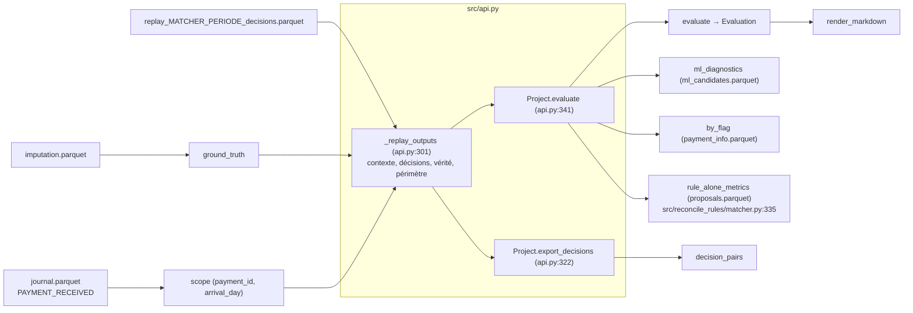
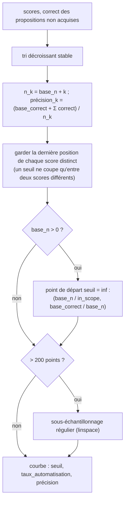

# Module `src/evaluation/` — étape 6 : évaluation

> **Résumé.** Le package `src/evaluation/` compare les décisions d'un rejeu aux imputations réellement
> prononcées. L'unité de mesure est le **paiement**. Une auto-validation est correcte si l'ensemble de factures
> décidé est **exactement** celui de l'historique, toutes dates confondues. `metrics.py` construit la vérité
> (avec le type de groupe 1↔1 / 1↔n / n↔1 / n↔n), retient une décision par paiement et calcule le résumé, la
> cascade, les tableaux par étape / règle / groupe / mois, la courbe automatisation-précision et les
> diagnostics ML. `report.py` rend le tout en markdown. `export.py` produit un fichier ligne à ligne
> (paiement, facture), joignable à la table d'imputation d'origine.

Conventions : références `chemin:ligne` relatives à la racine, vérifiées sur le code ; **[certain]** = lu dans
le code ; **[déduit]** = conclusion de lecture. Les définitions métier des indicateurs sont aussi décrites, du
point de vue de l'utilisateur, dans `RESULTATS.md` (§1, §6). Ce document part du code.

---

## 1. Rôle et responsabilités

### 1.1 Fichiers et symboles

| Fichier | Rôle | Symboles exposés |
|---|---|---|
| `src/evaluation/metrics.py` | vérité, décision retenue, métriques, courbe, diagnostics ML | `Evaluation`, `ground_truth`, `evaluate`, `precision_curve`, `automation_at_precision`, `ml_diagnostics`, `by_flag`, `GROUP_TYPES`, et deux fonctions « privées » réutilisées ailleurs : `_proposals` (par `export.py`), `_tuples_by_key` (par `src/allocation/evaluate.py:16`) |
| `src/evaluation/report.py` | rendu markdown d'une évaluation | `render_markdown` |
| `src/evaluation/export.py` | export des couples (paiement, facture) proposés ou manqués | `decision_pairs`, `EXPORT_COLUMNS`, `PROPOSED_REAL`, `PROPOSED_NOT_REAL`, `REAL_NOT_PROPOSED` |

`src/evaluation/__init__.py` est vide. Le package ne lit ni n'écrit aucun fichier : c'est `src/api.py` qui
charge les entrées et écrit les rapports (§5).

### 1.2 Principes (docstring de `src/evaluation/metrics.py:1-10`)

- **Unité** : le paiement. « Un paiement auto-validé est **correct** si l'ensemble des factures décidées est
  exactement celui des factures réellement imputées à ce paiement (toutes dates confondues). Un paiement sans
  imputation réelle qui est auto-validé compte comme une erreur. »
- **Périmètre** : « les paiements arrivés pendant la période évaluée. Les décisions sur des paiements arrivés
  avant (reliquat de démarrage) sont ignorées. » Le périmètre est fourni par l'appelant (`scope`), construit
  à partir des événements `PAYMENT_RECEIVED` du journal (`src/api.py:311-318`).
- **Une décision par paiement** : la première auto-validation, sinon la première mise en revue (`_proposals`).

### 1.3 Flux

Entrées attendues :
- `decisions` : sortie de `run_replay`, colonnes `DECISION_COLUMNS` (`payment_id, invoice_id, amount, action,
  step, rule_id, rule_version, score`, `src/timeline/loop.py:38`) plus `day` (ajouté par `_run_replay`,
  `src/timeline/loop.py:190`). Actions possibles : `"auto"`, `"review"`, `"reject"` (`src/timeline/loop.py:36`).
- `truth` : sortie de `ground_truth`.
- `scope` : `payment_id`, `arrival_day`.

---

## 2. `metrics.py`

### 2.1 Constantes et conteneur

- `GROUP_TYPES = ("1↔1", "1↔n", "n↔1", "n↔n", "sans imputation")` (`src/evaluation/metrics.py:23`) : ordre
  d'affichage de `by_group`.
- `_CURVE_POINTS = 200` (`src/evaluation/metrics.py:24`) : nombre maximal de points de la courbe.
- `@dataclass Evaluation` (`src/evaluation/metrics.py:27-40`) : `summary: dict`, `by_step`, `by_rule`, `by_group`,
  `by_month`, `curve`, `cascade` (DataFrames), `payments` (détail par paiement, hors `repr`). `tables()`
  renvoie les six tables, sans `payments`.

### 2.2 `_tuples_by_key(keys, values)` (`src/evaluation/metrics.py:43-49`)

Regroupe `values` par `keys` **déjà triées** en tuples, sans `groupby` Python par groupe. Retour :
`(clés uniques, liste de tuples)`. Utilisé par `ground_truth`, `_proposals` et l'évaluation de l'allocation
(`src/allocation/evaluate.py:16`, `:38`).

### 2.3 `ground_truth(imputation) -> pd.DataFrame` (`src/evaluation/metrics.py:52-76`)

Entrée : table d'imputation (seules `payment_id`, `invoice_id` sont lues ; NaN et doublons écartés).

Algorithme :
1. `factorize` des paiements et des factures ;
2. graphe biparti non orienté paiements–factures en `coo_matrix` de taille `(n_pay + n_inv)²` ;
3. `scipy.sparse.csgraph.connected_components` ;
4. pour chaque composante : nombre de paiements `k_pay` et de factures `k_inv` ;
5. type = `1↔1` si `k_pay = k_inv = 1`, sinon `1↔n` si `k_pay = 1`, sinon `n↔1` si `k_inv = 1`, sinon `n↔n`
   (`:67-68`) ;
6. tuples **triés** des factures de chaque paiement (`:69-71`).

Colonnes du retour : `payment_id`, `truth_invoices` (tuple trié), `n_invoices`, `group_type`.

Exemple (`tests/test_evaluation.py:19-28`) :

| Imputations | Composante | Type |
|---|---|---|
| P1–I1 | {P1, I1} | 1↔1 |
| P2–I2, P2–I3 | {P2, I2, I3} | 1↔n |
| P3–I4, P4–I4 | {P3, P4, I4} | n↔1 (pour P3 et P4) |
| P5–I5, P5–I6, P6–I6 | {P5, P6, I5, I6} | n↔n (pour P5 et P6) |

Le type porte sur la **composante connexe**, pas sur le paiement seul : P6 n'a qu'une facture mais il est n↔n,
parce que I6 est partagée avec P5, qui a aussi I5.

Appelants : `Project._replay_outputs` (`src/api.py:320`), `fit_ml` (`src/reconcile_ml/pipeline.py:413`),
`recalibrate_ml` (`src/reconcile_ml/pipeline.py:482`), tests.

### 2.4 `_proposals(decisions) -> pd.DataFrame` (`src/evaluation/metrics.py:79-96`)

« Une proposition par paiement : la première auto-validation, sinon la première mise en revue. »

1. garde les actions `auto` / `review`, retire les lignes sans `invoice_id`, dédoublonne
   (paiement, jour, auto, facture) ;
2. regroupe par **(paiement, jour, auto?)** : `invoices` = tuple trié de **toutes** les factures de ce groupe,
   `score` = max, `step` / `rule_id` / `rule_version` = première valeur après tri par facture ;
3. trie par (paiement, auto d'abord, jour) et garde la première ligne par paiement.

Colonnes : `payment_id, action, day, invoices, score, step, rule_id, rule_version`.

Exemple (`tests/test_evaluation.py:63-70`) : revue de P1 sur I2 le 05/03, puis auto-validation de P1 sur I1 le
07/03 → la décision retenue est l'auto-validation du 07/03, bien que la revue soit antérieure.

Appelants : `evaluate` (`:146`), `decision_pairs` (`src/evaluation/export.py:59`).

### 2.5 `_rate_table(df, key, in_scope=None) -> pd.DataFrame` (`src/evaluation/metrics.py:99-110`)

Par valeur de `key` (NaN inclus, tri croissant) : `paiements` (taille du groupe), `auto` (somme de
`is_auto`), `corrects` (somme de `correct`), `précision = corrects / auto` (NaN si `auto = 0`),
`taux_automatisation = auto / dénominateur`. Le dénominateur vaut `in_scope` s'il est fourni (tout le
périmètre), sinon le nombre de paiements **de la ligne**.

### 2.6 `precision_curve(scores, correct, in_scope, base_n=0, base_correct=0) -> pd.DataFrame` (`src/evaluation/metrics.py:113-135`)

Courbe obtenue en auto-validant les propositions par score décroissant. `base_n` / `base_correct` désignent
les décisions acquises quel que soit le seuil (les règles de l'étape 4).

Retour : colonnes `seuil`, `taux_automatisation` (= n / `in_scope`), `précision`. Courbe vide si `in_scope = 0`,
ou s'il n'y a ni score ni base.

Exemple (`tests/test_evaluation.py:81-85`) : scores (0,9 ; 0,9 ; 0,5), exactitude (vrai ; faux ; vrai),
périmètre 10. Points : seuil 0,9 → 2/10 = 0,2 de taux, précision 1/2 ; seuil 0,5 → 0,3, précision 2/3. Il n'y a
pas de point « 0,9 avec un seul paiement » : deux propositions de même score ne peuvent pas être séparées par
un seuil.

### 2.7 `automation_at_precision(curve, target) -> float` (`src/evaluation/metrics.py:138-140`)

Plus grand `taux_automatisation` parmi les points de précision ≥ `target` ; 0 si aucun.

### 2.8 `evaluate(decisions, truth, scope, target_precision, current_automation_rate=None) -> Evaluation` (`src/evaluation/metrics.py:143-220`)

Pas à pas :
1. `props = _proposals(decisions)` ; table `p` = `scope` ⟕ `truth` ⟕ `props` sur `payment_id` (`:146-149`) ;
2. `group_type` manquant → `"sans imputation"` ; `is_auto`, `is_review` (`:150-152`) ;
3. `correct_proposal` = vérité existante, décision existante et tuples identiques ;
   `correct = is_auto & correct_proposal` (`:153-157`) ;
4. `month` = mois d'**arrivée** (`:158`) ;
5. niveau paires (`:163-166`) : `decided` = couples (paiement, facture) des auto-validations, `real` = couples
   réels des paiements du périmètre ; `hits` = intersection ;
6. courbe (`:168-174`) : `base` = auto-validations des règles (`step == "rules"`), acquises ; `proposed` = tous
   les autres paiements ayant une décision retenue (auto-validations ML **et** revues), avec leur score (NaN → 0) ;
7. résumé, cascade, tableaux.

**Résumé** (`:178-192`) :

| Clé | Calcul |
|---|---|
| `paiements_périmètre` | `n = len(p)` |
| `avec_imputation_réelle` / `sans_imputation_réelle` | partition selon `truth_invoices` |
| `auto`, `auto_corrects`, `revue` | décompte des décisions retenues |
| `taux_automatisation` | `auto / n` |
| `précision` | `auto_corrects / auto` (NaN si 0) |
| `taux_automatisation_correct` | `auto_corrects / n` |
| `précision_cible` | paramètre `target_precision` |
| `cible_atteinte` | `auto == 0` **ou** `précision ≥ cible` |
| `taux_automatisation_à_précision_cible` | `automation_at_precision(curve, target)` |
| `précision_paires` | `hits / |decided|` |
| `rappel_paires` | `hits / |real|` |
| `taux_actuel_référence` | `current_automation_rate` |

**Cascade** (`:194-205`) : trois lignes, `niveau` ∈ {« Algorithme actuel », « Étape 4 — règles seules »,
« Étapes 4 + 5 — règles puis ML »}, avec `taux_automatisation`, `précision`, `gain_points =
100 × (taux − taux actuel)` (None tant que le taux actuel n'est pas renseigné). « Règles seules » = paiements
auto-validés par une règle **dans le même rejeu** que le ML. `RESULTATS.md` §6.3 signale l'écart possible avec
un rejeu `rules` seul : une facture prise par le ML n'est plus disponible pour les règles les jours suivants.

**Tableaux** (`:207-216`) :

| Table | Lignes | Dénominateur de `taux_automatisation` | Additionnable ? |
|---|---|---|---|
| `by_step` | auto-validations par `step` (`rules`, `ml`, `?` si vide) | périmètre `n` | oui : la somme donne le taux global |
| `by_rule` | auto-validations par `rule_id` (`—` si vide) : `R1_…`–`R5_…`, `ML_SINGLE`, `ML_SET`, `ML_PARTIAL` | périmètre `n` | oui |
| `by_group` | tous les paiements, par `group_type`, dans l'ordre `GROUP_TYPES` | paiements de la ligne | non |
| `by_month` | tous les paiements, par mois d'arrivée | paiements de la ligne | non |

Dans `by_step` et `by_rule`, la colonne `paiements` égale `auto`, puisque la table est construite sur les seules
auto-validations (`auto_rows`, `:207`).

Exemple chiffré (fictif) pour les dénominateurs, avec 1 000 paiements dans le périmètre, 600
auto-validations par les règles (590 correctes) et 100 par le ML (99 correctes) :
- `by_step` : `rules` → 600 / 1 000 = 60 %, précision 98,33 % ; `ml` → 10 %, précision 99 % ; somme 70 % = taux
  global ;
- `by_group`, ligne `1↔n` avec 200 paiements dont 64 auto-validés → 32 %. Ce taux est interne au groupe et ne
  s'additionne pas avec les autres lignes ;
- précision globale = (590 + 99) / 700 = 98,43 %, et non la moyenne des précisions des lignes.

**Détail** (`:218-220`) : `payments` = `payment_id, arrival_day, group_type, action, day, step, rule_id, score,
correct`.

Exemple complet (`tests/test_evaluation.py:36-60`) : 5 paiements dans le périmètre (P1…P4, P9).

| Paiement | Vérité | Décision | Résultat |
|---|---|---|---|
| P1 | {I1} | auto règles R2, {I1}, score 1 | correct (base de la courbe) |
| P2 | {I2, I3} | auto ML {I2}, score 0,9 | faux : ensemble incomplet |
| P3 | {I4} | revue ML {I4}, score 0,8 | proposition correcte, mais pas une auto-validation |
| P4 | {I5} | aucune | — |
| P9 | aucune | auto ML {I9}, score 0,7 | faux : pas d'imputation réelle |

Résultats : `auto = 3`, `auto_corrects = 1`, `revue = 1`, taux 3/5, précision 1/3. Paires : décidées {P1-I1,
P2-I2, P9-I9}, réelles {P1-I1, P2-I2, P2-I3, P3-I4, P4-I5} → précision paires 2/3, rappel 2/5. Courbe : départ
1/5 à 100 % ; puis 0,9 (faux) → 2/5 à 50 % ; 0,8 (juste) → 3/5 à 66,7 % ; 0,7 (faux) → 4/5 à 50 %. Le taux à
99,5 % vaut donc 1/5. Dans la cascade, « règles seules » = 1/5 ; avec un taux actuel de 0,2, `gain_points` = 0.

Appelants : `Project.evaluate` (`src/api.py:349-350`), tests.

### 2.9 `ml_diagnostics(candidates, truth, scope) -> tuple[dict, pd.DataFrame]` (`src/evaluation/metrics.py:223-250`)

Entrée `candidates` : `payment_id, invoice_id, p` (et `raw`) au **premier** passage en ML de chaque paiement :
c'est le fichier `replay_<m>_
_ml_candidates.parquet` produit par `PipelineMatcher._record_diag`
(`src/reconcile_ml/pipeline.py:264-273`), où `p` est la probabilité **calibrée**.

1. restreint aux paiements du périmètre **ayant une vérité** (`:228-230`) ;
2. `label` = le couple est réel (`:233-234`) ;
3. rang par `p` décroissant (tri `mergesort` stable) (`:235-236`) ;
4. `rappel_candidats` = part des paiements dont toutes les vraies factures sont candidates (`:237-238`) ;
5. `first` = rang du premier vrai candidat (NaN s'il n'y en a aucun) (`:239`) ;
6. calibration : 10 tranches de `p` ; `paires`, `score_moyen`, `taux_observé` (`:240-244`).

Retour : `({"paiements_en_ml", "rappel_candidats", "precision_at_1", "mrr"}, DataFrame[tranche, paires,
score_moyen, taux_observé])`. `precision_at_1 = mean(first == 1)` sur **tous** ces paiements, y compris ceux
sans vrai candidat (comptés 0) ; `mrr = mean(1/first)`, NaN → 0. `Project.evaluate` préfixe les clés par `ml_`
dans le résumé et ajoute la table `ml_calibration` (`src/api.py:357-360`).

### 2.10 `by_flag(evaluation_payments, flag, name) -> pd.DataFrame` (`src/evaluation/metrics.py:253-261`)

Découpe `Evaluation.payments` selon un indicateur booléen par paiement (`flag` : Series indexée par
`payment_id`, absent → False). Colonnes : `<name>`, `paiements`, `auto`, `corrects`, `précision`,
`taux_automatisation` (dénominateur : la ligne). Seul usage : `by_client_file` dans `Project.evaluate`
(`src/api.py:361-364`), avec `flag = client_file_id non nul` lu dans `payment_info` (client file rattaché **le
jour d'arrivée**, `src/reconcile_ml/pipeline.py:258-262`).

---

## 3. `report.py`

### 3.1 `_fmt(value) -> str` (`src/evaluation/report.py:10-15`)

`None` ou NaN → `"—"` ; flottant ≤ 1 → pourcentage à deux décimales (`0.995` → `99.50%`) ; flottant > 1 → deux
décimales ; autre → `str`. La règle s'applique à **toute** valeur flottante (voir §7).

### 3.2 `render_markdown(summary, tables, context) -> str` (`src/evaluation/report.py:18-34`)

- titre `# Évaluation — rapprocheur « {matcher} », période {period}`, ligne des dates et des 16 premiers
  caractères de `journal_sha256` (`context` = JSON du rejeu, `src/api.py:242-247`) ;
- tableau `| indicateur | valeur |` du résumé ;
- puis, dans cet ordre et s'ils existent : `cascade`, `by_group`, `by_step`, `by_rule`, `by_rule_alone`,
  `by_client_file`, `ml_calibration`, `by_month` ; une table vide est rendue `_(vide)_`.

La table `curve` n'est **pas** rendue en markdown, mais elle est écrite en CSV (`src/api.py:367-368`).

Appelant : `Project.evaluate` (`src/api.py:371`).

---

## 4. `export.py`

### 4.1 `decision_pairs(decisions, truth, scope) -> pd.DataFrame` (`src/evaluation/export.py:30-81`)

Docstring du module (`src/evaluation/export.py:1-11`) : fichier destiné aux statistiques hors du moteur,
joignable à la table d'imputation d'origine sur (payment_id, invoice_id). Il contient chaque couple proposé
(auto ou revue) et chaque couple **réellement imputé** non proposé, avec le même périmètre et la même vérité
que l'évaluation.

Pas à pas :
1. décisions du périmètre, avec facture, d'action `auto` / `review` (`:33-35`) ;
2. regroupement par (`payment_id, invoice_id, action, step, rule_id`) (`:36-42`) : `rule_version`,
   `montant_propose` (montant du premier jour), `score_premier_jour`, `score_max`, `premier_jour`,
   `dernier_jour`, `jours_proposee` ;
3. couples réels du périmètre (`:45-48`) ; `statut_paire` = `PROPOSED_REAL` (« proposée et réelle ») ou
   `PROPOSED_NOT_REAL` (« proposée non réelle ») (`:49-51`) ;
4. couples réels jamais proposés, quelle que soit l'action → `REAL_NOT_PROPOSED` (« réelle non proposée »)
   (`:52-55`) ;
5. décision retenue par l'évaluation (`_proposals`) ; `decision_retenue_exacte` = tuple retenu == vérité ;
   `decision_retenue` = le triplet (paiement, facture, action) fait partie de la décision retenue (`:59-66`) ;
6. jointures : `action_retenue_paiement` (`aucune` à défaut), `arrivee_paiement`, `type_groupe_reel`
   (`sans imputation` à défaut), `nb_factures_reelles` (0 à défaut), `paiement_avec_imputation_reelle`
   (`:67-76`) ;
7. types : `jours_proposee` en `Int64`, `decision_retenue_exacte` en `boolean` nullable, vide quand aucune
   décision n'est retenue (`:77-78`) ;
8. tri (paiement, statut, facture), colonnes `EXPORT_COLUMNS` (`src/evaluation/export.py:22-27`) (`:79-81`).

Colonnes de sortie : `payment_id, invoice_id, statut_paire, action, step, rule_id, rule_version,
montant_propose, score_premier_jour, score_max, premier_jour, dernier_jour, jours_proposee, decision_retenue,
action_retenue_paiement, decision_retenue_exacte, arrivee_paiement, paiement_avec_imputation_reelle,
type_groupe_reel, nb_factures_reelles`.

Comment retrouver les chiffres de l'évaluation (`RESULTATS.md` §6.11) : garder `decision_retenue` et
`action == "auto"`, puis compter les paiements distincts → `auto` ; parmi eux, ceux avec
`decision_retenue_exacte` → `auto_corrects`.

Appelant : `Project.export_decisions(period="test", matcher="pipeline", fmt="parquet")` (`src/api.py:322-339`),
qui écrit `reports/[synthetic/]decisions_<matcher>_<period>.<parquet|csv>`.

---

## 5. Orchestration et fichiers (dans `src/api.py`)

| Méthode | Lit | Écrit | Réf. |
|---|---|---|---|
| `_replay_outputs(period, matcher)` | `reports/replay_<m>_
.json` (contexte), `imputation.parquet`, `journal.parquet`, `replay/replay_<m>_
_decisions.parquet` | — ; refuse si le rejeu a été fait sur un autre journal (`journal_sha256`) | `src/api.py:301-320` |
| `evaluate(period="test", matcher="null")` | idem + `_proposals.parquet`, `_ml_candidates.parquet`, `_payment_info.parquet` s'ils existent | `reports/evaluation_<m>_
_<table>.csv` (une par table, `curve` comprise), `evaluation_<m>_
.json` (contexte + résumé, NaN → null via `_clean`), `evaluation_<m>_
.md` | `src/api.py:341-372` |
| `backtest(period="test", matcher="pipeline")` | — | `replay` puis `evaluate` | `src/api.py:374-377` |
| `report(matcher, period)` | relit JSON + CSV, sans recalcul | — | `src/api.py:379-385` |
| `export_decisions(period, matcher, fmt)` | `_replay_outputs` | `reports/decisions_<m>_
.<fmt>` | `src/api.py:322-339` |

Le périmètre est défini ainsi : `PAYMENT_RECEIVED` avec `ts ∈ [start, end + 1 jour)`, et `arrival_day = ts`
normalisé à minuit (`src/api.py:313-318`). Dans les tests, `arrival_day` n'est pas normalisé
(`tests/test_evaluation.py:126`), ce qui est sans effet sur le mois.

---

## 6. Tests

| Test | Couvre | Réf. |
|---|---|---|
| `test_ground_truth_group_types` | types 1↔1 / 1↔n / n↔1 / n↔n ; tuple trié | `tests/test_evaluation.py:19-28` |
| `test_evaluate_counts_precision_and_rate` | résumé, paires, courbe avec base, cascade, `by_group` | `:36-60` |
| `test_first_auto_decision_wins_over_earlier_review` | priorité de l'auto sur une revue antérieure | `:63-70` |
| `test_empty_decisions` | aucune décision : taux 0, précision NaN, cible « atteinte » | `:73-78` |
| `test_precision_curve_cuts_only_between_distinct_scores` | coupure entre scores distincts ; `automation_at_precision` | `:81-85` |
| `test_oracle_replay_is_fully_precise` | rejeu intégré avec un rapprocheur oracle : précision 1 | `:130-135` |
| `test_wrong_decisions_are_detected` | oracle qui omet une facture une fois sur deux : précision < 1, précision paires = 1 | `:138-143` |
| `test_null_replay_scores_zero` | `NullMatcher` : périmètre complet, 0 auto | `:146-150` |
| `test_decision_pairs` | export : statuts, revue répétée (2 jours, scores 0,4 → 0,6), décision retenue, auto incomplète, couples manqués, hors périmètre exclu | `tests/test_export.py:14-36` |

Non couverts directement **[certain]** : `ml_diagnostics`, `by_flag`, `render_markdown` / `_fmt`, le
sous-échantillonnage de la courbe au-delà de 200 points, `by_rule`, `by_month`. Les trois fichiers de tests
(ML, évaluation, export) passent : 21 tests en ~95 s.

---

## 7. ⚠️ Zones d'ombre

1. **Fusion des revues d'un même jour** (`src/evaluation/metrics.py:85-91`) : `_proposals` regroupe par
   (paiement, jour, auto) et fait l'**union** des factures. Si le `PipelineMatcher` émet le même jour une revue
   `ML_*` **et** une revue `ML_NN` pour un paiement (`src/reconcile_ml/pipeline.py:243-248`), la proposition
   retenue mélange les deux ensembles. Elle est alors presque toujours jugée inexacte (`correct_proposal`
   faux), et `rule_id` prend la première valeur après tri par facture. Vérifié par un script : revue
   `ML_SINGLE` {I1} et revue `ML_NN` {I2, I3} le même jour → `invoices = (I1, I2, I3)`, `rule_id = ML_SINGLE`.
   Effets : courbe (les revues y figurent), `decision_retenue` / `decision_retenue_exacte` de l'export.
2. **La courbe sous-estime le taux à précision cible au-delà de 200 points** (`src/evaluation/metrics.py:132-134`) :
   le sous-échantillonnage régulier peut éliminer le point optimal. Essai sur 5 000 scores aléatoires :
   `automation_at_precision` donne 0,0981 contre 0,0992 sur la courbe complète. Le résumé
   `taux_automatisation_à_précision_cible` est donc légèrement pessimiste quand le volume est grand
   **[certain]**.
3. **Ce que la courbe mesure** : un plafond a posteriori, à seuil unique, sur la période même. Il ne prend
   qu'**un score par paiement**, celui de la décision retenue : première auto-validation, ou première revue
   (le max du jour). Il ne simule donc ni le re-scorage quotidien ni le « premier franchissement » qu'utilise
   la calibration en ligne. Il mélange des scores bruts de types différents (`single`, `set`, `partial`, `NN`)
   et ignore la marge δ. Les paiements sans aucune proposition n'y entrent jamais. `RESULTATS.md` §6.9
   reconnaît le caractère optimiste ; les autres écarts sont **[déduits]**.
4. **`_fmt` formate en pourcentage tout flottant ≤ 1** (`src/evaluation/report.py:13-14`), y compris les
   valeurs négatives et les grandeurs qui ne sont pas des taux. Vérifié : `gain_points = -3.2` (points) →
   `"-320.00%"` ; `0.5` point → `"50.00%"` ; `2.5` → `"2.50"`, sans unité. `score_moyen` et
   `mrr` sont aussi affichés en pourcentage.
5. **Deux définitions de precision@1** : `ml_diagnostics` compte dans le dénominateur les paiements sans vrai
   candidat (`(first == 1).mean()` avec NaN → faux, `src/evaluation/metrics.py:248`), alors que `pair_metrics`
   (`src/reconcile_ml/model.py:163-168`) ne garde que les groupes ayant au moins un positif. Les deux chiffres
   (`ml_precision_at_1` à l'évaluation, `metrics.validation.precision_at_1` dans `model.json`) ne sont donc pas
   comparables. Le classement se fait sur la probabilité **calibrée** (plateaux isotoniques) ; les ex æquo
   suivent l'ordre des candidats (clés fortes d'abord), alors que la colonne `raw`, disponible, n'est pas
   utilisée **[certain]**.
6. **Calibration biaisée par le filtre de vérité** : `ml_diagnostics` exclut les paiements sans imputation
   réelle (`:230`). La table `ml_calibration` ignore donc tous leurs candidats, qui sont tous des négatifs : le
   `taux_observé` est surestimé par rapport à la population réellement scorée **[déduit]**.
7. **`cible_atteinte` vaut vrai quand rien n'est auto-validé** (`src/evaluation/metrics.py:187`). C'est un choix
   assumé par le test `test_empty_decisions` (`tests/test_evaluation.py:78`), mais il peut surprendre dans un
   rapport.
8. **Identifiants hétérogènes** : la comparaison de vérité repose sur l'égalité de tuples triés d'identifiants
   (`:153-155`). Elle suppose des `invoice_id` de même type dans la table d'imputation et dans les décisions
   (issues de `invoice.invoice_id`). Un identifiant numérique d'un côté et texte de l'autre rendrait toute
   décision fausse, sans erreur. Le tri de tuples d'objets de types mixtes lèverait une exception
   **[déduit]**.
9. **`decision_pairs` : « une ligne par couple et par type de décision »** (docstring, `RESULTATS.md` §6.11) :
   en réalité, la clé de regroupement inclut aussi `step` et `rule_id` (`src/evaluation/export.py:37`). Un
   couple proposé en revue par `ML_SINGLE` puis par `ML_NN` donne deux lignes `review`. `montant_propose` est
   vide pour `ML_NN` (montant non renseigné, `src/reconcile_ml/pipeline.py:248`). Les actions y sont des
   chaînes en dur (`"auto"`, `"review"`, `:35`), non les constantes `AUTO` / `REVIEW`.
10. **Vérité « toutes dates »** : `ground_truth` lit toute la table d'imputation. Le type de groupe et
    l'exactitude tiennent donc compte d'imputations prononcées bien après la période, par exemple au-delà de
    la rétention de 60 jours où le moteur ne peut plus décider. Les composantes n↔n peuvent aussi enchaîner
    beaucoup de paiements et de factures. C'est conforme à la docstring, mais à garder en tête pour les
    paiements tardifs **[déduit]**.
11. **`by_month` et `by_client_file`** : le dernier mois est souvent partiel (`RESULTATS.md` §6.7).
    `by_client_file` se fonde sur le rattachement **du jour d'arrivée** (`_record_info` ne lit que les
    nouveaux paiements). Un client file reçu plus tard, qui a pu débloquer le paiement, n'y est pas compté
    **[certain]**.
