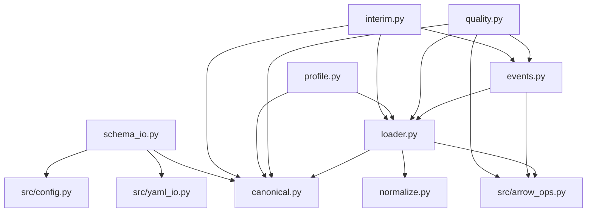
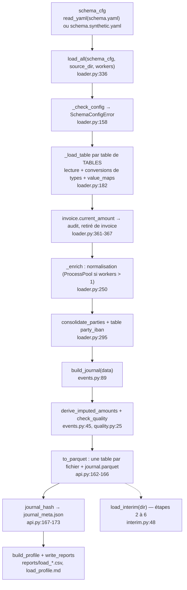
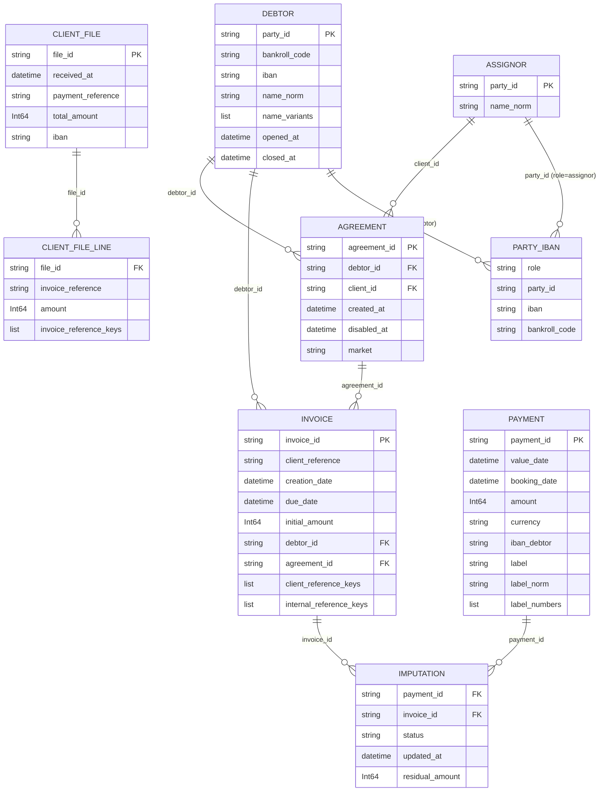
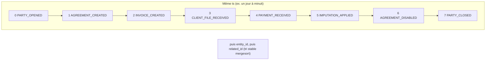

# Package `src/load/` : chargement, normalisation, journal d'événements (étape 1)

> **Résumé.** `src/load/` transforme les fichiers sources (CSV ou Parquet) en un **modèle canonique
> typé** : identifiants en chaînes, montants en entiers de centimes, dates en `datetime64[us]` UTC
> naïf. Le mapping vers les colonnes réelles vient de `config/schema.yaml` et n'est jamais deviné.
> Le package normalise ensuite libellés, références, noms et IBAN, et consolide les parties
> présentes sur plusieurs lignes. Puis il construit un **journal d'événements** ordonné de façon
> déterministe, avec une empreinte SHA-256. Il compte toutes les anomalies (contrôles qualité) sans
> rien corriger et produit un profil de chargement. Les sorties sont écrites en Parquet par
> `Project.load` et relues par les étapes suivantes via `load_interim`. À la relecture, les colonnes
> de listes restent en Arrow pour tenir en mémoire à 2 M de lignes.

---

## 1. Rôle et API publique

Le package réalise l'**étape 1** du brief (`CLAUDE.md` §3), dont le critère de fin est « un script
affiche volumes, plages de dates, champs manquants par table, et produit le journal ». Il n'a **pas
de point d'entrée propre** : l'orchestration est dans `Project.load` (`src/api.py:134-176`), et la
relecture dans `Project._state` (`src/api.py:180-185`) et `src/reconcile_ml/pipeline.py:369`, `:473`.
`src/load/__init__.py` est vide.

| Fichier | Responsabilité | API utilisée hors du fichier |
|---|---|---|
| `canonical.py` | Modèle de données canonique : tables, champs, types, champs requis, clés primaires | `TABLES`, `FieldType`, `Table`, `IMPUTATION_STATUSES` |
| `normalize.py` | Normalisation du texte, clés de référence, IBAN | `NORMALIZATION_VERSION`, `normalize_text`, `label_numbers`, `reference_keys`, `enrich_*`, `normalize_iban` |
| `loader.py` | Lecture des sources, conversions de types, normalisation des tables, consolidation des parties | `load_all`, `LoadedData`, `Issue`, `SchemaConfigError`, `DATETIME_DTYPE`, `consolidate_parties`, `_check_config` (UI), `_to_cents` et `_enrich` (tests) |
| `events.py` | Journal d'événements, montants imputés, empreinte | `build_journal`, `derive_imputed_amounts`, `journal_hash`, `payment_event_time`, `EventType`, `EVENT_RANK` |
| `quality.py` | Contrôles de cohérence, comptés et jamais corrigés | `check_quality` |
| `profile.py` | Profil de chargement (DataFrames, CSV, markdown) | `build_profile`, `write_reports` |
| `interim.py` | Relecture des sorties de l'étape 1, en mémoire réduite | `load_interim`, `InterimError` |
| `schema_io.py` | Lecture et écriture commentée de `config/schema.yaml` (UI) | `load_schema`, `save_schema`, `GLOBAL_KEYS`, `TABLE_NOTES`, `FIELD_NOTES`, `VALUE_MAP_FIELDS` |

### 1.1 Dépendances entre fichiers

### 1.2 Chaîne de chargement (`Project.load`, `src/api.py:134-176`)

Ce que `Project.load` écrit dans `interim_dir`, qui vaut `data/interim/` ou
`data/interim/synthetic/` (`src/api.py:87-93`) :
- `<table>.parquet` pour chaque table chargée, y compris `party_iban` ;
- `journal.parquet` ;
- `journal_meta.json`, avec les clés `normalization_version`, `journal_sha256`, `journal_events`,
  `source`, `mapped_fields` et `timings_s` (`src/api.py:169-173`).

Les rapports vont dans `reports_dir` (`write_reports`). La table d'audit
`invoice_current_amount` n'est **pas** persistée : l'audit des soldes n'a lieu qu'au chargement.

---

## 2. Conventions de sortie

Elles sont posées par la docstring de `src/load/loader.py:7-10` :

| Type canonique (`FieldType`) | dtype pandas en sortie | Conversion |
|---|---|---|
| `ID` | `string` (NA si vide) | `_to_id` : `astype("string").str.strip()`, chaîne vide → NA (`loader.py:64-66`) |
| `TEXT` | `string` | `_to_text` = `_to_id` (`loader.py:69-70`) |
| `DATE` | `datetime64[us]`, à minuit | `_to_date` (`loader.py:79-83`) |
| `TIMESTAMP` | `datetime64[us]`, UTC naïf | `_to_timestamp` (`loader.py:86-96`) |
| `AMOUNT` | `Int64`, en centimes | `_to_cents` (`loader.py:102-142`) |

`DATETIME_DTYPE = "datetime64[us]"` (`src/load/loader.py:28`) est réutilisé par `events.py` et par
les tests (`tests/conftest.py:11`).

---

## 3. `canonical.py` : le modèle canonique

La docstring (`src/load/canonical.py:1-9`) précise que ce sont les noms **internes**, ceux du brief et
de la spec §2. `required=True` signifie que la pipeline ne peut pas fonctionner sans le champ. Un
champ optionnel non mappé est ajouté vide et signalé dans le rapport.

### 3.1 Structures

- `class FieldType(str, Enum)` (`src/load/canonical.py:17`) : `ID`, `TEXT`, `DATE` (date sans
  heure), `TIMESTAMP` (converti en UTC naïf), `AMOUNT` (entier de centimes).
- `@dataclass(frozen=True) class Field` (`src/load/canonical.py:25`) : `name: str`,
  `type: FieldType`, `required: bool = True`.
- `@dataclass(frozen=True) class Table` (`src/load/canonical.py:32`) : `name`, `fields`,
  `required: bool = True` et `primary_key: tuple[str, ...] = ()`. La méthode
  `field(self, name: str) -> Field` (`:39`) lève `KeyError(f"{table}.{champ}")`, mais **aucun
  appelant** n'existe dans le dépôt.
- `TABLES: dict[str, Table]` (`src/load/canonical.py:175-181`) : les neuf tables, dans l'ordre
  payment, invoice, imputation, assignor, debtor, agreement, technical_account, client_file,
  client_file_line. **Cet ordre est celui du chargement** (`loader.py:354`) **et du gabarit YAML**
  (`schema_io.py:65`, `:102`).
- `IMPUTATION_STATUSES = ("FULL", "PARTIAL")` (`src/load/canonical.py:183`) est utilisé par
  `quality.py:69`.

### 3.2 Tables

Dans le tableau, **gras** signifie requis et *italique* optionnel. La colonne PK indique la clé
primaire contrôlée par `check_quality`.

| Table | Ligne | Requise | PK | Champs |
|---|---|---|---|---|
| `payment` | `:48` | oui | `payment_id` | **payment_id** (ID), **value_date** (DATE), *booking_date* (DATE), **amount** (AMOUNT, signé), **currency**, *iban_debtor*, *iban_creditor*, **label**, *channel*, *payment_type*, *bankroll_code* |
| `invoice` | `:68` | oui | `invoice_id` | **invoice_id**, **client_reference**, *internal_reference*, **creation_date**, **due_date**, **initial_amount**, *current_amount* (AMOUNT, audit seulement), **currency**, **debtor_id**, **agreement_id** |
| `imputation` | `:87` | oui | — | **payment_id**, **invoice_id**, **status** (TEXT), **updated_at** (TIMESTAMP), **residual_amount** (AMOUNT, solde **après** la ligne) |
| `assignor`, `debtor` | `:99-115` (`_party`) | oui | `party_id` | **party_id**, *bankroll_code*, *iban*, **name**, *opened_at* (DATE), *closed_at* (DATE) |
| `agreement` | `:117` | oui | `agreement_id` | **agreement_id**, **debtor_id**, **client_id** (→ assignor), *contract_number*, **created_at** (DATE), *disabled_at*, *market*, *product*, *recourse* |
| `technical_account` | `:134` | non | `iban` | **iban**, *bankroll_code*, *description* |
| `client_file` | `:147` | non | `file_id` | **file_id**, **received_at** (TIMESTAMP, pivot temporel), *source_format*, *payment_reference*, *total_amount* (AMOUNT), *payment_date* (DATE), *iban*, *issuer_name* |
| `client_file_line` | `:163` | non | — | **file_id**, *line_no* (ID), **invoice_reference**, *amount* (AMOUNT), *gap_reason* |

Commentaires porteurs de sens dans le code :
- `booking_date` (`canonical.py:53-55`) : « Si mappée, c'est elle qui ordonne le journal » (§3.5 du
  brief).
- `current_amount` (`canonical.py:77-79`) : « Restant dû *final* : fuite directe. Chargé uniquement
  pour l'audit de cohérence des imputations, retiré de la table `invoice` au chargement. »
- `client_file` (`canonical.py:145-146`) : « format réel à confirmer. Seule la voie tabulaire […]
  est branchée ici ». L'extraction LLM des client files non structurés (brief §3.2) n'est pas
  implémentée.

### 3.3 Schéma relationnel canonique, après chargement

`party_iban` est une table **dérivée**, produite par `consolidate_parties` (`loader.py:333`). Elle
n'est pas dans `TABLES`.

Colonnes **ajoutées par la normalisation**, vérifiées sur un petit jeu synthétique :

| Table | Colonnes ajoutées |
|---|---|
| `payment` | `label_norm`, `label_tokens`, `label_numbers` |
| `invoice` | `client_reference_norm`, `client_reference_keys`, `internal_reference_norm`, `internal_reference_keys` (et **plus de `current_amount`**) |
| `assignor`, `debtor` | `name_norm`, `name_tokens`, `name_variants` |
| `client_file` | `payment_reference_norm`, `payment_reference_tokens`, `payment_reference_numbers` |
| `client_file_line` | `invoice_reference_norm`, `invoice_reference_keys` |
| `party_iban` (nouvelle) | `role`, `party_id`, `iban`, `bankroll_code` |

---

## 4. `normalize.py` : normalisation et clés de référence

La docstring (`src/load/normalize.py:1-22`) pose trois principes :
- **Déterministe et versionnée** : toute modification doit incrémenter `NORMALIZATION_VERSION`
  (`normalize.py:34`, actuellement `"1.1.0"`) et relancer la chaîne depuis l'étape 1.
- Un **match de référence** est une intersection non vide entre `label_numbers` (côté paiement) et
  `reference_keys` (côté facture), calculées par la **même** fonction de variantes.
- **Volumétrie** : environ 2 M de paiements et 3 M de factures. La normalisation du texte est
  vectorisée (`normalize_series`), et c'est l'unique implémentation. Les vues à base de tokens sont
  calculées **une fois par valeur distincte**, en parallèle si un `Executor` est fourni.

### 4.1 Texte

**`normalize_series(series: pd.Series) -> pd.Series`** (`normalize.py:53`), pas à pas :
1. `series.astype("str").fillna("")`. Sous pandas 3 (verrouillé à 3.0.6 dans `uv.lock`), `None`
   et `NaN` restent manquants puis deviennent `""`. Un nombre devient sa représentation texte.
2. Remplacement de `ß` par `SS` **avant** la mise en majuscules (`_BEFORE_UPPER`, `normalize.py:43`) :
   la majuscule simple de `ß` n'est pas `SS`.
3. Décomposition `NFKD`, suppression des marques combinantes (`\p{M}+`), majuscules. La regex
   `\p{M}` n'est pas supportée par le module `re` de Python. Elle fonctionne parce que les chaînes
   pandas 3 sont adossées à pyarrow, dont le moteur est RE2 (voir la zone d'ombre Z1).
4. Remplacement des lettres que NFKD ne décompose pas, **après** la mise en majuscules
   (`_AFTER_UPPER`, `normalize.py:44`) : `Œ→OE`, `Æ→AE`, `Ø→O`, `Ð→D`, `Þ→TH`, `Ł→L`.
5. Tout ce qui n'est pas `[A-Z0-9]` devient un espace, avec les espaces compressés et rognés.

Exemples, vérifiés par test ou par exécution :
- `"  Règlement  fact. n°12/B – Œuvre  "` donne `"REGLEMENT FACT N 12 B OEUVRE"`
  (`tests/test_normalize.py:19`) ;
- `"Straße Œuvre Ærø fin"` donne `"STRASSE OEUVRE AERO FIN"` ;
- `None`, `pd.NA` et `NaN` donnent `""` (`tests/test_normalize.py:23-26`).

`normalize_text(value: Any) -> str` (`normalize.py:67`) est la version scalaire. Elle passe par
`normalize_series` sur une série d'un élément, pour garantir une implémentation unique.
`tokenize(value: Any) -> list[str]` (`normalize.py:72`) applique `normalize_text(value).split()` ;
elle n'est utilisée que par les tests.

### 4.2 Variantes d'un token numérique : `number_variants(token: str, swap: bool = False) -> set[str]` (`normalize.py:100`)

Pour un token normalisé contenant des chiffres :
1. le token lui-même ;
2. `without_prefix` : le token privé de son **préfixe alphabétique** (`lstrip` de A-Z) ;
3. `without_zeros` : ce dernier privé de ses zéros de tête, seulement s'il reste quelque chose ;
4. si `swap=True` et que le token est **exactement** `LETTRES+CHIFFRES` ou `CHIFFRES+LETTRES`
   (`_ALPHA_DIGITS` et `_DIGITS_ALPHA`, `normalize.py:45-46`, en `fullmatch`) : les variantes du
   token inversé, calculées récursivement sans `swap`.

Exemples :
- `FA0012345` donne `{FA0012345, 0012345, 12345}` (`tests/test_normalize.py:34`) ;
- `000` donne `{000}`, car `without_zeros` vide n'est pas ajouté (`:35`) ;
- `123FACT` avec `swap=True` donne `{123FACT, FACT123, 123}` ;
- `FA12B` avec `swap=True` donne `{FA12B, 12B}` : il n'y a pas d'inversion, le motif n'est pas en
  deux blocs.

### 4.3 Clés d'un libellé : `label_numbers(tokens: list[str], max_window: int = MAX_JOIN_WINDOW) -> list[str]` (`normalize.py:125`)

`MAX_JOIN_WINDOW = 3` (`normalize.py:39`). Le commentaire explique que le brief demande les paires
(inversion) et que la fenêtre de 3 couvre en plus les références découpées par la ponctuation :
`FA-2024-00123` devient `FA 2024 00123`. GUIDE.md §7 range cette fenêtre parmi les « écarts
assumés ».

Algorithme (`normalize.py:133-151`) :
1. `has_digit[i] = not t.isalpha()`. Les tokens normalisés étant `[A-Z0-9]+`, « contient un
   chiffre » équivaut à « n'est pas alphabétique ». S'il n'y a aucun chiffre, la liste est vide.
2. Pour chaque position `i` :
   - si le token contient un chiffre, on ajoute `number_variants(tok, swap=True)` ;
   - pour chaque taille de fenêtre de 2 à `max_window` : on ne concatène la fenêtre que si **au
     moins `size − 1` tokens** contiennent des chiffres (`normalize.py:144`). On ajoute alors
     `number_variants("".join(window))` ;
   - pour une paire (`size == 2`), on ajoute aussi les variantes de l'**ordre inverse**
     `window[1] + window[0]` (`normalize.py:148-150`). C'est l'inversion bloc lettres / bloc
     chiffres entre tokens : `123 FACT` ↔ `FACT123`.
3. Le résultat est **trié** (`sorted`), donc déterministe (`tests/test_normalize.py:84-88`).

Exemples exécutés :
- `"VIR 123 FACT FA-2024-0099"` donne
  `['0099', '00992024', '123', '123FACT', '123VIR', '2024', '20240099', '2024FA', '99', '992024', 'FA2024', 'FA20240099', 'FACT123', 'VIR123']`.
- `"VIR FA001 DUPONT"` donne
  `['001', '001DUPONT', '001FA', '001VIR', '1', '1DUPONT', '1FA', '1VIR', 'DUPONTFA001', 'FA001', 'FA001DUPONT', 'FA001VIR', 'VIRFA001']`.

Toute paire dont **un** token contient des chiffres est concaténée dans les deux ordres. Cela
produit des clés « bruit » comme `VIR123` ou `1DUPONT`, ainsi que des clés très courtes comme `1`.
Le filtrage se fait en aval : `min_key_length` vaut 4 (`src/allocation/allocator.py:113`,
`src/reconcile_rules/matcher.py:115`). Il s'y ajoute le plafond `max_debtors_per_key`, compté à D.

La règle « au moins `size − 1` tokens avec chiffres » empêche `SARL FACT 001887` de produire
`SARLFACT001887`, tout en gardant `FACT001887` (`tests/test_normalize.py:78-81`).

### 4.4 Clés d'une référence de facture : `reference_keys(reference: Any) -> list[str]` (`normalize.py:170`)

`_keys_of_compact(normalize_text(reference).replace(" ", ""))` (`normalize.py:162-167`) :
- une référence vide donne `[]` ;
- une référence **purement alphabétique** donne `[compact]`, par exemple `DUPONT` ;
- sinon : `sorted(number_variants(compact))`, **sans `swap`**.

Exemples :
- `FA-0012345` donne `["0012345", "12345", "FA0012345"]` (`tests/test_normalize.py:44`) ;
- `FA/2024/00123` donne `['202400123', 'FA202400123']`.

Le libellé `PAIEMENT FACT FA-2024-00123` retrouve cette dernière par la fenêtre de 3 tokens
(`tests/test_normalize.py:69`).

Cas de match couverts par les tests (`tests/test_normalize.py:50-75`) :
- référence exacte ;
- sans préfixe ni zéros (`VIR DUPONT 12345` ↔ `FA0012345`) ;
- inversion entre tokens et dans un token (`REGLEMENT 123 FACT` et `REGLEMENT 123FACT` ↔ `FACT123`) ;
- référence découpée ;
- non-match sur des nombres sans rapport (`VIR DUPONT 123456` ↔ `FA0012345`).

### 4.5 Parallélisation : `_map_unique(series, fn, executor=None) -> pd.Series` (`normalize.py:85`)

1. `pd.factorize(series, use_na_sentinel=False)` donne les codes et les valeurs distinctes.
2. Si un `executor` est fourni **et** qu'il y a au moins `PARALLEL_MIN_VALUES = 100_000` valeurs
   distinctes (`normalize.py:77`), la liste est découpée en blocs de `_CHUNK_SIZE = 50_000`
   (`:78`). Les blocs sont envoyés par `executor.map(_apply_chunk, ...)` et l'ordre est conservé.
   Sinon, le calcul est séquentiel.
3. Les résultats sont redistribués par code : `pd.Series([results[c] for c in codes], dtype=object)`.

`fn` doit être picklable, d'où les fonctions de module `_label_tokens_of_norm`,
`_label_numbers_of_norm` et `_keys_of_compact` (`normalize.py:154-167`). Le résultat ne dépend pas
du nombre de processus, ce que vérifient `tests/test_synthetic.py:39-47` (chargement complet
séquentiel vs parallèle, tables et empreinte du journal identiques) et `tests/test_synthetic.py:49-56`.

### 4.6 Fonctions d'enrichissement des tables

| Fonction | Ligne | Colonnes produites | Parallélisée |
|---|---|---|---|
| `enrich_label(series, prefix="label", executor=None) -> pd.DataFrame` | `normalize.py:178` | `{prefix}_norm`, `{prefix}_tokens` (tokens alphabétiques, `label_tokens`, `:121`), `{prefix}_numbers` | seulement `_numbers` |
| `enrich_reference(series, prefix, executor=None) -> pd.DataFrame` | `normalize.py:190` | `{prefix}_norm`, `{prefix}_keys` (sur la forme compacte sans espaces) | oui |
| `enrich_name(series, prefix="name") -> pd.DataFrame` | `normalize.py:199` | `{prefix}_norm`, `{prefix}_tokens` (`str.split`, **tous** les tokens, chiffres compris) | non |
| `normalize_iban(series) -> pd.Series` | `normalize.py:207` | IBAN normalisé sans espaces, vide → NA, dtype `string`. Exemple : `"fr76 3000-4000 0500"` donne `FR76300040000500` (`tests/test_normalize.py:91-95`). | — |

**Appelants.**
- `_enrich` (`loader.py:250-289`) appelle toutes ces fonctions.
- La page UI de chargement (`src/ui/views/load.py:6`, `:112-115`) appelle `label_numbers`,
  `normalize_text` et `reference_keys` pour un testeur interactif « libellé ↔ référence ».
- `NORMALIZATION_VERSION` est écrit dans `journal_meta.json` (`src/api.py:169`) et affiché par l'UI
  (`src/ui/app.py:44`, `src/ui/views/home.py:13`, `src/ui/views/load.py:63`).

---

## 5. `loader.py` : lecture et typage

### 5.1 Types exportés

- `class SchemaConfigError(ValueError)` (`loader.py:31`) porte un attribut `problems: list[str]`. Le
  message liste tous les problèmes, préfixé par `config/schema.yaml incomplet :`.
- `@dataclass class Issue` (`loader.py:39`) : `table: str`, `field: str | None`, `kind: str`,
  `count: int`, `detail: str = ""`. C'est le format **unique** des anomalies, pour le chargement, le
  journal et la qualité.
- `@dataclass class LoadedData` (`loader.py:48`) :
  - `tables: dict[str, pd.DataFrame]` ;
  - `mapped_fields: dict[str, list[str]]` : champs canoniques effectivement mappés ;
  - `issues: list[Issue]` ;
  - `audit: dict[str, pd.DataFrame]` : données « chargées pour contrôle uniquement, jamais exposées
    à la pipeline » ;
  - `has_table(name)` (`:57`) n'a **aucun appelant**.

`LoadedData` est le conteneur passé à `build_journal`, `check_quality`, `build_profile` et
`LedgerState` (`src/timeline/state.py:29`). Les tests en construisent à la main via `make_data`
(`tests/conftest.py:43-53`).

### 5.2 Conversion des montants en centimes : `_to_cents(s: pd.Series, unit: str, decimal_sep: str) -> tuple[pd.Series, int]` (`loader.py:102`)

Objectif (docstring, `loader.py:103-107`) : convertir en centimes **sans jamais passer par un
flottant pour le texte**. La fonction renvoie `(série Int64, nombre de valeurs non vides
invalides)`. Une valeur qui porte plus de décimales que l'unité n'en permet, hors zéros finaux, est
invalide.

`scale_digits` vaut 2 pour `units` (euros), 0 pour `cents`.

**Colonne numérique** (lecture Parquet typée, `loader.py:110-117`) :
- entier : `astype("Int64") * 10**scale_digits` ;
- flottant : multiplication puis arrondi, avec `ok = |scaled − round(scaled)| < 1e-6`. Une valeur
  hors tolérance devient NA et compte comme invalide : `0.125` en `units` est invalide
  (`tests/test_loader.py:49-50`). `0.29` donne bien 29.
- booléen : exclu du chemin numérique, il part dans le chemin texte et devient invalide (vérifié).

**Colonne texte** (`loader.py:119-142`), tout en `pyarrow.compute` :
1. Suppression des espaces, y compris l'espace insécable U+00A0 présent littéralement dans la regex
   `[\s ]+` (`loader.py:119`). Une chaîne vide devient NA.
2. Si `decimal_sep != "."` : les `.` sont supprimés (séparateurs de milliers), puis le séparateur
   décimal est remplacé par `.` (`loader.py:121-122`).
3. `pc.extract_regex` avec `_AMOUNT_PATTERN = ^(?P<sign>[+-]?)(?P<integer>[0-9]*)(?:\.(?P<frac>[0-9]*))?$`
   (`loader.py:99`).
4. Validité (`loader.py:126-133`) : le motif doit correspondre, il faut au moins un chiffre au total
   (`len(integer) + len(frac) > 0`), et les décimales au-delà de `scale_digits` doivent être des `0`.
5. Les décimales sont tronquées ou complétées à `scale_digits` (`utf8_rpad`), concaténées à la
   partie entière, puis converties en `int64`. Le signe est appliqué ensuite (`loader.py:134-138`).
6. La sortie est en `Int64` avec NA pour les invalides. `invalid` compte les valeurs non vides
   invalides (`loader.py:139-142`).

Exemples testés (`tests/test_loader.py:19-41`) ou exécutés :

| Entrée | unit / sep | Sortie |
|---|---|---|
| `"0.29"` | units / `.` | 29 (le piège flottant classique est évité) |
| `"1 234,56"`, `"1.234,56"` | units / `,` | 123456 |
| `"12.340"` | units / `.` | 1234 (zéro final toléré) |
| `".5"`, `"12."` | units / `.` | 50, 1200 |
| `"+5"` | units / `.` | 500 |
| `"150"` | cents | 150 |
| `"12.345"` (units), `"12.5"` (cents), `"abc"`, `"1-2"`, `"-"`, `"1e3"` | | invalide |
| `"1,234.56"` | units / `.` | **invalide** : la virgule de milliers n'est pas gérée avec `sep="."` |
| `"1 234,56"` (espace fine insécable) | units / `,` | **invalide** |
| `"(12,00)"`, `"12,00-"`, `"€12,00"` | units / `,` | invalide |

### 5.3 Dates et horodatages

- `_parse_datetime(s, fmt)` (`loader.py:73`) : une colonne déjà datetime est rendue telle quelle.
  Sinon `pd.to_datetime(s, format=fmt, errors="coerce")` : une valeur non parsable donne `NaT`,
  comptée comme `valeur_invalide`. Exemple : `31/02/2024`, `tests/test_loader.py:146-158`.
- `_to_date(s, fmt)` (`loader.py:79`) : si la valeur porte un fuseau, `tz_localize(None)` le
  supprime **sans conversion**, en gardant l'heure murale locale. La valeur est ensuite ramenée à
  minuit (`dt.normalize()`) puis convertie en `datetime64[us]`. `source_timezone` n'est **pas**
  appliqué aux dates. Exemple exécuté : `2024-03-05T23:30:00+02:00` donne `2024-03-05`.
- `_to_timestamp(s, fmt, source_tz)` (`loader.py:86`) :
  - si la valeur porte un fuseau, elle est convertie en UTC, puis rendue naïve ;
  - sinon, si `source_timezone` est défini, elle est localisée dans ce fuseau, convertie en UTC,
    puis rendue naïve. Une heure **ambiguë** (passage à l'heure d'hiver) donne `NaT`
    (`ambiguous="NaT"`). Une heure **inexistante** (passage à l'heure d'été) est décalée
    (`nonexistent="shift_forward"`) : `2024-03-31 02:30` Paris donne `01:00` UTC, et
    `2024-10-27 02:30` donne `NaT` (vérifié) ;
  - sinon, la valeur est considérée comme déjà en UTC.

  Ce comportement est vérifié par `tests/test_loader.py:138-143`.

### 5.4 Lecture d'une source : `_read_source(path: Path, read_options: dict[str, Any]) -> pd.DataFrame` (`loader.py:148`)

- `.parquet` : `pd.read_parquet(path, **read_options)`. Les types natifs sont conservés.
- `.csv`, `.txt` et `.tsv` : `pd.read_csv` avec par défaut `dtype=str`, `keep_default_na=False` et
  `na_values=[""]`. Tout est lu en texte, et seule la chaîne vide est manquante : `"NA"` et `"NULL"`
  restent des valeurs. `read_options` peut surcharger ces options.
- Toute autre extension lève `SchemaConfigError`.

### 5.5 Validation de la configuration : `_check_config(schema_cfg: dict[str, Any], base_dir: Path) -> list[str]` (`loader.py:158`)

La fonction renvoie la liste **complète** des problèmes, sans s'arrêter au premier :
- `amount_unit` absent ou différent de `cents`/`units` ;
- pour chaque table de `TABLES` :
  - si `source` est absent et que la table est optionnelle, on passe à la suivante sans autre
    contrôle ;
  - si `source` est absent et que la table est requise : problème `source non renseigné`, **et** les
    colonnes requises sont aussi listées ;
  - si le fichier est introuvable : problème ;
  - les clés de `columns` qui ne sont pas des champs canoniques : `champs canoniques inconnus` ;
  - chaque champ requis non mappé : `colonne réelle non renseignée`.

**Appelants** : `load_all` (`loader.py:346`) et la page Configuration de l'UI
(`src/ui/views/config.py:11`, `:152`), qui importe cette fonction privée pour afficher les points à
compléter (`tests/test_ui.py:58`).

### 5.6 Chargement d'une table : `_load_table(table, tcfg, schema_cfg, base_dir, issues) -> tuple[pd.DataFrame, list[str]]` (`loader.py:182`)

1. Lecture de la source. On garde les seules entrées non vides de `columns` (`loader.py:189-190`).
2. Une colonne mappée absente du fichier lève **immédiatement** `SchemaConfigError`
   (`loader.py:192-196`).
3. Paramètres :
   - l'unité et le séparateur viennent de la config globale ;
   - `date_format` et `timestamp_format` peuvent être **surchargés par table** (`tcfg.get(...) or
     schema_cfg.get(...)`, `loader.py:200-201`) ;
   - `source_timezone` est global.
4. Pour chaque champ canonique, dans l'ordre de `canonical.py` :
   - un champ non mappé donne une colonne vide typée (`_empty`, `loader.py:242-247`) : `NaT`, `Int64`
     NA ou `string` NA ;
   - un champ mappé est converti selon son `FieldType` ;
   - **`value_maps`** (`loader.py:225-231`) : la config a la forme `{valeur_canonique: valeur_réelle}`
     ou `{valeur_canonique: [valeurs réelles]}`. Elle est inversée en `{réelle: canonique}`. Une
     valeur non listée **passe telle quelle** et est attrapée plus tard par le contrôle
     `statut_inconnu`. Exemple : `status: {FULL: TOTAL, PARTIAL: PARTIEL}`
     (`config/schema.synthetic.yaml:46`) ;
   - `lost` = valeurs non nulles en entrée − valeurs non nulles en sortie. S'il est positif :
     `Issue(table, champ, "valeur_invalide", lost, ...)` (`loader.py:233-236`).
5. Renvoie le DataFrame, réindexé de 0 à n−1, et la liste triée des champs mappés.

### 5.7 Normalisation des tables : `_enrich(tables, executor=None) -> None` (`loader.py:250`)

La fonction modifie `tables` en place :

| Table | Traitement |
|---|---|
| `payment` | `iban_debtor` et `iban_creditor` passent par `normalize_iban`, puis `enrich_label(label)` est concaténé |
| `invoice` | `enrich_reference` sur `client_reference` et sur `internal_reference` |
| `assignor`, `debtor` | `normalize_iban(iban)` et `enrich_name(name)` |
| `technical_account` (si présente) | `normalize_iban(iban)` |
| `client_file` (si présente) | `normalize_iban(iban)` et `enrich_label(payment_reference, "payment_reference")` |
| `client_file_line` (si présente) | `enrich_reference(invoice_reference, "invoice_reference")` |

Les appelants sont `load_all` et `tests/test_timeline.py:11`.

### 5.8 Consolidation des parties : `consolidate_parties(tables: dict[str, pd.DataFrame], issues: list[Issue]) -> None` (`loader.py:295`)

**Pourquoi** (docstring, `loader.py:296-302`) : les sources peuvent contenir plusieurs lignes pour une
même partie (plusieurs comptes, plusieurs portefeuilles, historique). Or la suite suppose une ligne
par `party_id`.

Pour chaque rôle de `PARTY_ROLES = ("assignor", "debtor")` (`loader.py:292`) :
1. Les lignes sans `party_id` sont écartées, avec l'issue `identifiant_manquant` (« lignes
   ignorées », `loader.py:307-310`).
2. S'il y a des doublons de `party_id`, on émet l'issue `lignes_multiples_par_partie`. Son `count`
   est le nombre de parties concernées. Son `detail` donne le nombre de lignes consolidées et les
   colonnes qui varient entre lignes d'une même partie (`iban`, `bankroll_code`, `name_norm`,
   `opened_at`, `closed_at`), avec leur nombre (`loader.py:311-321`).
3. Tous les couples distincts `(party_id, iban, bankroll_code)` à IBAN non nul sont collectés avec
   leur `role` (`loader.py:322-323`).
4. Une ligne par partie (`loader.py:324-332`) :
   - `groupby.first()` prend la **première valeur non nulle de chaque colonne**, colonne par colonne :
     nom, IBAN, `bankroll_code`… ;
   - `opened_at` prend le **minimum** ;
   - `closed_at` prend le **maximum seulement si toutes les lignes sont fermées**
     (`count < size` signifie qu'au moins une ligne est encore ouverte, et donne alors NA) ;
   - `name_variants` reçoit la liste des `name_norm` distincts. Elle alimente l'index des noms de
     l'allocation (`src/allocation/indexes.py:209`).
5. Enfin `tables["party_iban"]`, avec les colonnes `role`, `party_id`, `iban` et `bankroll_code`
   (`loader.py:333`). L'allocation l'utilise pour le routage IBAN (`src/allocation/indexes.py:227-241`,
   `src/allocation/allocator.py:84`, `src/timeline/state.py:100`).

Tests : `tests/test_loader.py:161-183` (une ligne supplémentaire avec un autre IBAN, un autre
bankroll et un autre nom donne 2 variantes de nom, 2 IBAN dans `party_iban` et le bon détail
d'issue) et `tests/test_loader.py:186-199` (fermeture seulement si toutes les lignes sont fermées).

### 5.9 Point d'entrée : `load_all(schema_cfg: dict[str, Any], base_dir: str | Path | None = None, workers: int = 1) -> LoadedData` (`loader.py:336`)

1. `base = Path(base_dir or schema_cfg.get("base_dir") or ".")`. Attention : relatif au **répertoire
   courant**, pas à la racine du dépôt (voir Z6).
2. `_check_config` : s'il y a des problèmes, `SchemaConfigError(problems)`.
3. Pour chaque table de `TABLES` : sans `source`, on émet l'issue `table_non_configuree`
   (« table optionnelle absente ») et on passe. Sinon `_load_table`.
4. **Garde-fou anti-fuite** (`loader.py:361-367`, brief §4.1) :
   - si `current_amount` est mappé, `invoice[["invoice_id", "current_amount"]]` est copié dans
     `audit["invoice_current_amount"]` ;
   - la colonne est **toujours** retirée de `invoice` et de `mapped_fields`.

   Ce point est vérifié par `tests/test_loader.py:110-113`.
5. Normalisation : `_enrich` dans un `ProcessPoolExecutor(max_workers=workers)` si `workers > 1`,
   sinon en séquentiel.
6. `consolidate_parties`.

**Appelants** :
- `src/api.py:155`, avec `workers=settings.load.workers` ;
- les tests `tests/test_loader.py`, `tests/test_events.py`, `tests/test_timeline.py`,
  `tests/test_allocation.py`, `tests/test_evaluation.py`, `tests/test_ml.py` et
  `tests/test_synthetic.py`.

---

## 6. `events.py` : journal d'événements

### 6.1 Format

La docstring (`events.py:1-16`) décrit un journal **léger** : chaque ligne référence une entité par
son identifiant, et le détail reste dans les tables. `JOURNAL_COLUMNS` (`events.py:42`) :

| Colonne | dtype | Contenu |
|---|---|---|
| `seq` | int64 | Position 0..n−1 après tri |
| `ts` | `datetime64[us]` | Horodatage UTC naïf |
| `event_type` | chaîne | Valeur de `EventType` |
| `entity_id` | `string` | `payment_id`, `invoice_id`, `party_id`, `agreement_id` ou `file_id` |
| `related_id` | `string` | `invoice_id` pour une imputation, `"ASSIGNOR"`/`"DEBTOR"` pour une partie, sinon `""` |
| `amount` | `Int64` | Montant imputé (centimes) pour `IMPUTATION_APPLIED`, sinon NA |

### 6.2 Types et rang

`class EventType(str, Enum)` (`events.py:29-37`). Son **ordre de déclaration est le rang de
départage** : `EVENT_RANK = {e.value: i for i, e in enumerate(EventType)}` (`events.py:40`).

| Rang | Événement | Source (`build_journal`) | Horodatage |
|---|---|---|---|
| 0 | `PARTY_OPENED` | `assignor` et `debtor` (`events.py:94-98`) | `opened_at` |
| 1 | `AGREEMENT_CREATED` | `agreement` (`:105`) | `created_at` |
| 2 | `INVOICE_CREATED` | `invoice` (`:109`) | `creation_date` |
| 3 | `CLIENT_FILE_RECEIVED` | `client_file`, si présente (`:111-113`) | `received_at` |
| 4 | `PAYMENT_RECEIVED` | `payment` (`:116`) | `payment_event_time` = `booking_date`, sinon `value_date` |
| 5 | `IMPUTATION_APPLIED` | `imputation` enrichie (`:122-124`) | `updated_at` |
| 6 | `AGREEMENT_DISABLED` | `agreement` (`:106`) | `disabled_at` |
| 7 | `PARTY_CLOSED` | `assignor` et `debtor` (`:98`) | `closed_at` |

Comme le dit `events.py:14-15`, le rang place, à horodatage égal, ce qui ouvre avant ce qui l'utilise
et ce qui ferme en dernier. `EVENT_RANK` est aussi la table de codes de `LedgerState`
(`src/timeline/state.py:28`, `:32`, `:145`) : changer l'ordre de l'enum change l'état rejoué.

### 6.3 Montant imputé : `derive_imputed_amounts(imputation: pd.DataFrame, invoice: pd.DataFrame) -> pd.DataFrame` (`events.py:45`)

**Pourquoi** (docstring, `events.py:46-54`, et GUIDE.md §3.6) : la table `imputation` n'a pas de
montant imputé. `residual_amount` est le solde de la facture **après** la ligne (interprétation du
brief §3.5, qui prime sur la spec). On a donc `montant imputé = solde avant − solde après`.

Pas à pas :
1. Le tri se fait par `invoice_id`, `updated_at`, **résidu décroissant** (`_neg_residual`, en
   `Float64`), puis `payment_id`, en mergesort stable (`events.py:57-60`). Le résidu décroissant
   départage deux lignes de même horodatage : dans le cas nominal, le solde ne fait que baisser.
   C'est vérifié par `tests/test_events.py:47-55` : à même heure, PZ (résidu 700) passe avant PA
   (résidu 0).
2. `prev` est le `residual_amount` de la ligne précédente de la même facture (`groupby.shift(1)`).
3. `first` vaut `initial_amount` de la facture, obtenu par `lookup` (`src/arrow_ops.py:30`).
4. `balance_before = prev.fillna(first)`, puis `imputed_amount = balance_before − residual_amount`.
5. La fonction renvoie la table avec `balance_before` et `imputed_amount`, **dans l'ordre d'origine**
   (`sort_index()`).

Chaque ligne n'utilise que les lignes qui la précèdent (`events.py:51`). La fonction est donc sans
fuite. Une imputation sur une facture inconnue a un `imputed_amount` NA.

**Appelants** :
- `build_journal` (`events.py:122`) ;
- `Project.load` (`src/api.py:159`), dont le résultat est passé à `check_quality` pour éviter de le
  recalculer ;
- `check_quality` (`quality.py:78`), en repli ;
- `tests/test_timeline.py:255`.

Tests : `tests/test_events.py:36-55`.

### 6.4 `_events(...)` et `payment_event_time`

- `_events(ts, event_type, entity_id, related_id="", amount=None) -> pd.DataFrame` (`events.py:68`)
  construit un bloc d'événements typé. Les lignes **sans horodatage sont supprimées**
  (`df[df["ts"].notna()]`, `events.py:81`) : une partie sans `opened_at` n'a pas de
  `PARTY_OPENED`, un contrat sans `disabled_at` pas de `AGREEMENT_DISABLED`, etc.
- `payment_event_time(payment: pd.DataFrame) -> pd.Series` (`events.py:84`) renvoie
  `booking_date.fillna(value_date)` : la **date de connaissance** du paiement. Appelants :
  `build_journal`, `quality.py:84` et `tests/test_timeline.py:202`. `Project.split` refait la même
  opération en ligne (`src/api.py:191`).

### 6.5 `build_journal(data: LoadedData) -> tuple[pd.DataFrame, list[Issue]]` (`events.py:89`)

1. Il construit les blocs du tableau §6.2. Les issues émises sont :
   - `sans_evenement_ouverture` pour chaque rôle ayant des parties sans `opened_at`, avec le
     commentaire « partie considérée active depuis toujours » (`events.py:99-102`) ;
   - `repli_sur_value_date` si `booking_date` est **mappée** mais vide sur certaines lignes
     (`events.py:117-120`).
2. Concaténation, puis colonne temporaire `_rank` = `EVENT_RANK[event_type]`.
3. **Tri stable** (`kind="mergesort"`) sur `["ts", "_rank", "entity_id", "related_id"]`
   (`events.py:128-130`). La clé est complète, si bien que l'ordre ne dépend pas de l'ordre des
   lignes en entrée. C'est vérifié par `tests/test_events.py:101-111` : avec les tables mélangées,
   l'empreinte est identique.
4. `seq = range(n)` inséré en première colonne. La fonction renvoie `journal[JOURNAL_COLUMNS]` et
   les issues.

**Appelants** : `src/api.py:157`, et dans les tests `tests/test_events.py`, `tests/test_timeline.py:10`,
`tests/test_evaluation.py:10`, `tests/test_ml.py:76` et `tests/test_synthetic.py:7`.

Tests d'ordonnancement :
- `tests/test_events.py:60-72` : départage par type puis identifiant ;
- `:75-81` : `PARTY_CLOSED` après `PAYMENT_RECEIVED` le même jour ;
- `:84-88` : `booking_date` ordonne le paiement ;
- `:91-96` : l'imputation porte son montant ;
- `:114-123` : comptes par type, `ts` croissant, et aucune anomalie de qualité sur le jeu synthétique.

### 6.6 Empreinte : `journal_hash(journal: pd.DataFrame) -> str` (`events.py:135`)

**Pourquoi** (docstring, `events.py:136-140`) : l'empreinte doit être stable entre exécutions **et
entre versions de pandas**. Elle est donc calculée colonne par colonne sur une représentation
binaire explicite, plutôt que sur une sérialisation CSV.

Construction SHA-256 (`events.py:142-149`), dans cet ordre :
1. `f"{len(journal)}|seq,ts,event_type,entity_id,related_id,amount"` ;
2. `seq` en int64 little-endian ;
3. `ts` en `datetime64[us]`, vu comme int64 (microsecondes) ;
4. pour `event_type`, `entity_id` et `related_id` : les valeurs en `str`, NA remplacé par `""`,
   jointes par le séparateur **US** (`\x1f`) et encodées en UTF-8 ;
5. `amount` en `Int64`, NA remplacé par la sentinelle `-(2**63)`, en int64 little-endian.

L'empreinte est stockée sous la clé `journal_sha256` dans `journal_meta.json` (`src/api.py:167-170`).
Elle est **vérifiée à la relecture** (`interim.py:58`). Elle est recopiée dans les résumés de rejeu
(`src/api.py:243`), de mesure d'allocation (`:276`), dans la clé du jeu d'entraînement ML et dans les
métadonnées du modèle (`src/reconcile_ml/pipeline.py:327`, `:436`, `:475`). L'UI signale les
incohérences (`src/ui/views/*.py`, par exemple `src/ui/views/split.py:112`).

---

## 7. `quality.py` : contrôles qualité

La docstring (`quality.py:1-5`) pose le principe : **rien n'est corrigé ni supprimé**. Chaque
anomalie est comptée et remontée dans le rapport, pour décision.

`check_quality(data: LoadedData, imputation_derived: pd.DataFrame | None = None) -> list[Issue]`
(`quality.py:25`). L'argument `imputation_derived` est la sortie de `derive_imputed_amounts`,
recalculée si elle est absente. La fonction n'ajoute une issue que si son compte est non nul (`add`,
`quality.py:30-32`). Les helpers sont `_count(mask)`, qui somme un masque avec NA à False
(`quality.py:17`), et `_orphans(child, parent)`, qui compte les clés enfants non nulles absentes du
parent via `isin` (`quality.py:21`).

Codes d'anomalies (`kind`) par famille :

| Famille | `table.champ` | `kind` | Condition | Ligne |
|---|---|---|---|---|
| Clés | chaque table de `TABLES` avec PK | `cle_dupliquee` | PK dupliquée (`keep=False` : toutes les lignes du doublon comptent) | `quality.py:35-38` |
| Intégrité | `invoice.debtor_id`, `invoice.agreement_id`, `agreement.debtor_id`, `agreement.client_id`, `imputation.payment_id`, `imputation.invoice_id`, `client_file_line.file_id` | `orphelin` | Clé absente de la table parente | `:41-50` |
| Facture | `invoice.debtor_id` | `debiteur_different_du_contrat` | Débiteur de la facture ≠ débiteur du contrat | `:53-55` |
| | `invoice.due_date` | `echeance_avant_creation` | `due_date < creation_date` | `:56` |
| | `invoice.initial_amount` | `montant_non_positif` | `≤ 0` | `:57` |
| Paiements hors périmètre v1 | `payment.amount` | `montant_negatif_hors_perimetre`, `montant_nul` | `< 0`, `== 0` | `:60-61` |
| | `payment.currency` | `devise_minoritaire` | Devise ≠ la plus fréquente (le détail cite la devise principale) | `:62-65` |
| Imputations | `imputation.status` | `statut_inconnu` | Hors `FULL`/`PARTIAL` après `value_maps` | `:68-70` |
| | `imputation.residual_amount` | `full_avec_residu_non_nul`, `partial_avec_residu_nul` | Incohérence statut / résidu | `:71-74` |
| | `imputation.payment_id,invoice_id` | `lignes_multiples_meme_paire` | Paire paiement-facture répétée | `:75-76` |
| | `imputation.imputed_amount` | `montant_impute_negatif` | Le solde remonte : il faut revoir l'interprétation de `residual_amount` | `:79-80` |
| | | `montant_impute_nul` | | `:81` |
| Chronologie | `imputation.updated_at` | `avant_date_de_valeur_du_paiement` | `updated_at < value_date` | `:85-86` |
| | | `avant_connaissance_du_paiement` | `updated_at <` date de `PAYMENT_RECEIVED` | `:87-89` |
| | | `avant_creation_facture` | `updated_at < creation_date` | `:90-91` |
| Audit | `invoice.current_amount` | `solde_reconstruit_different` | `initial_amount − Σ imputed_amount ≠ current_amount` final, seulement si `audit` présent | `:94-102` |
| Parties | `assignor`/`debtor.closed_at` | `fermeture_avant_ouverture` | | `:105-107` |
| Contrats | `agreement.disabled_at` | `desactivation_avant_creation` | | `:108-109` |

S'y ajoutent les codes émis **ailleurs**, dans le même format `Issue` :

| `kind` | Émis par |
|---|---|
| `valeur_invalide` | `_load_table` (`loader.py:233-236`) |
| `table_non_configuree` | `load_all` (`loader.py:357`) |
| `identifiant_manquant`, `lignes_multiples_par_partie` | `consolidate_parties` (`loader.py:309`, `:319`) |
| `sans_evenement_ouverture`, `repli_sur_value_date` | `build_journal` (`events.py:101`, `:120`) |

**Contrôle d'audit pas à pas** (`quality.py:94-102`). L'audit vérifie l'interprétation de
`residual_amount` (GUIDE.md §3.6) : si le contrôle échoue sur les données réelles, l'interprétation
est à revoir.
1. Somme des `imputed_amount` par facture.
2. Report sur `invoice` par `lookup`, avec 0 si la facture n'a aucune imputation.
3. `rebuilt = initial_amount − total`.
4. Comparaison avec `current_amount`, relu dans `data.audit` et non dans la table `invoice`.

**Appelant** : `src/api.py:160`. Les issues sont concaténées dans l'ordre chargement, puis journal,
puis qualité. Tests : `tests/test_events.py:128-153` (orphelin, FULL avec résidu, imputation
antérieure à la date de valeur, audit des soldes dans les deux sens) et `tests/test_events.py:123`
(jeu synthétique propre : `check_quality(data) == []`).

---

## 8. `profile.py` : profil de chargement

C'est le critère « fini quand » de l'étape 1 (docstring, `profile.py:1-2`).

- `build_profile(data: LoadedData, journal: pd.DataFrame, issues: list[Issue]) -> dict[str, pd.DataFrame]`
  (`profile.py:16`) renvoie cinq DataFrames :
  - `volumes` : `table`, `rows`, pour **toutes** les tables, y compris `party_iban` ;
  - `missing_fields` : par champ canonique présent, `required`, `mapped`, `rows`, `null` et
    `null_pct` ;
  - `date_ranges` : `min` et `max` des champs DATE et TIMESTAMP **mappés** ;
  - `issues` : la liste des `Issue` en DataFrame (`asdict`) ;
  - `events` : `count`, `first_ts` et `last_ts` par `event_type`.
- `_md_table(df) -> str` (`profile.py:56`) : tableau markdown minimal. Une table vide donne
  `_(vide)_` et NA donne une cellule vide.
- `render_profile_markdown(profile, meta) -> str` (`profile.py:67`) : titre « Profil de chargement —
  étape 1 », les métadonnées en liste, puis les sections Volumes, Plages de dates, Champs non mappés
  ou incomplets (filtre `~mapped | null > 0`), Anomalies et Journal d'événements.
- `write_reports(profile, meta, reports_dir: Path) -> Path` (`profile.py:82`) écrit
  `load_volumes.csv`, `load_missing_fields.csv`, `load_date_ranges.csv`, `load_issues.csv`,
  `load_events.csv` et `load_profile.md`, puis renvoie le chemin du markdown.

**Appelant** : `Project.load` (`src/api.py:174-175`). Les DataFrames sont aussi renvoyés à
l'appelant de `load()` pour affichage (`src/api.py:176`). Il n'y a pas de test unitaire direct ; le
module est couvert par `tests/test_ui.py:105` (`test_load_page_runs_step_1`).

---

## 9. `schema_io.py`

Lecture et écriture **commentée** de `config/schema.yaml`. La docstring (`schema_io.py:1-5`)
explique que le fichier est régénéré à partir du modèle canonique, pour que les commentaires (champs
requis, rôle de chaque clé) survivent à une sauvegarde depuis l'UI.

| Élément | Ligne | Rôle |
|---|---|---|
| `GLOBAL_KEYS` | `schema_io.py:17` | Clés globales et leur commentaire : `amount_unit`, `decimal_separator`, `source_timezone`, `date_format`, `timestamp_format`, `base_dir` |
| `TABLE_NOTES` | `:26` | Notes des tables optionnelles |
| `FIELD_NOTES` | `:32` | Notes par `(table, champ)`, par exemple `invoice.current_amount` : « audit uniquement, jamais utilisé par la pipeline » |
| `VALUE_MAP_FIELDS` | `:44` | `{"imputation": ["status"]}` |
| `_HEADER` | `:46` | En-tête du fichier |
| `empty_schema() -> dict[str, Any]` | `:62` | Gabarit complet à `None` : chaque table a `source: None`, `read_options: {}`, toutes les colonnes canoniques et, si besoin, `value_maps` |
| `normalize_schema(cfg: dict[str, Any]) -> dict[str, Any]` | `:74` | Complète un schéma partiel. Il part d'`empty_schema()` et recopie les clés globales connues, `source`, `read_options`, les colonnes (y compris **inconnues**), les `value_maps` (copie profonde) et les `date_format`/`timestamp_format` par table. Les tables **inconnues** sont ignorées silencieusement. |
| `dump_schema(cfg: dict[str, Any]) -> str` | `:96` | Normalise, puis écrit l'en-tête, les clés globales commentées, puis chaque table : note éventuelle, `source`, `read_options`, formats éventuels, `columns` avec le commentaire `# (requis) <note>`, `value_maps`. Seuls les champs de `canonical.py` sont écrits : une colonne inconnue disparaît. |
| `load_schema(path: str \| Path = DEFAULT_SCHEMA_PATH) -> dict[str, Any]` | `:124` | `normalize_schema(read_yaml(p) if p.exists() else {})` |
| `save_schema(cfg: dict[str, Any], path: str \| Path = DEFAULT_SCHEMA_PATH) -> None` | `:129` | Écrit `dump_schema(cfg)` |

**Appelants** : uniquement la page Configuration de l'UI (`src/ui/views/config.py:12`, `:40`,
`:162`). `Project.load` lit le schéma par `read_yaml` brut (`src/api.py:150`), sans passer par
`load_schema`. `dump_schema(load_schema())` reproduit `config/schema.yaml` à l'identique (vérifié).

---

## 10. `interim.py` : relecture des sorties de l'étape 1

La docstring tient en une ligne : « Relecture des sorties de l'étape 1 (tables normalisées + journal)
pour les étapes suivantes » (`interim.py:1`).

### 10.1 Constantes

- `UNUSED_COLUMNS` (`interim.py:17-22`) : colonnes produites au chargement mais lues par **aucune**
  étape suivante, donc non relues pour économiser la mémoire :
  - `payment.label_tokens` ;
  - `client_file.payment_reference_tokens` et `client_file.payment_reference_numbers` ;
  - `debtor.name_tokens` et `assignor.name_tokens`.
- `ARROW_LIST_TABLES = {"payment", "invoice", "client_file", "client_file_line"}`
  (`interim.py:24`) : tables dont les colonnes de listes restent en Arrow.
- `class InterimError(RuntimeError)` (`interim.py:27`).

### 10.2 `read_table(path: Path, name: str, lean: bool = True) -> pd.DataFrame` (`interim.py:31`)

Avec `lean=False`, la fonction appelle simplement `pd.read_parquet(path)`. Avec `lean=True` :
1. Lecture du **schéma** Parquet (`pq.read_schema`), sans les données.
2. `columns` : toutes les colonnes moins `UNUSED_COLUMNS[name]`.
3. `lists` : les colonnes de type `list` ou `large_list`, si la table est dans `ARROW_LIST_TABLES`.
4. Les colonnes scalaires sont lues par `pd.read_parquet(columns=...)`. Les colonnes de listes sont
   lues par `pq.read_table(path, columns=lists)` et enveloppées dans
   `pd.arrays.ArrowExtensionArray`. Leur dtype est `list<element: string>[pyarrow]` (vérifié).
5. La fonction renvoie `df[columns]`, ce qui restaure l'ordre d'origine des colonnes.

**Pourquoi** (`src/arrow_ops.py:47-50`, GUIDE.md §8) : une liste Python avec un objet chaîne par
élément coûte environ 8 fois plus qu'une liste Arrow. Les consommateurs passent par
`src/arrow_ops.py` (`flatten_lists`, `list_lengths`, `list_take`), qui accepte les deux formes.

Pour les parties, qui sont petites, `name_variants` est relu par `pd.read_parquet` classique. Il
arrive en **`numpy.ndarray`** par cellule, et non en liste Python comme le dit le commentaire de
`interim.py:23` (vérifié). `src/allocation/indexes.py:209` le consomme.

### 10.3 `load_interim(directory: str | Path, verify: bool = True, lean: bool = True) -> tuple[LoadedData, pd.DataFrame, dict]` (`interim.py:48`)

1. Si `journal_meta.json` est absent : `InterimError("aucune sortie de l'étape 1 dans … : lancer
   d'abord le chargement")`.
2. Lecture de chaque `<nom>.parquet` **existant** pour `[*TABLES, "party_iban"]`.
3. Lecture de `journal.parquet`, toujours complet, sans mode `lean`.
4. Si `verify` et que `journal_hash(journal) != meta["journal_sha256"]` : `InterimError("le journal
   ne correspond pas à son empreinte : relancer l'étape 1")`.
5. `mapped_fields` vient de `meta["mapped_fields"]`. À défaut, il est **reconstruit** : les champs
   canoniques présents et non entièrement nuls (`interim.py:60-63`). Ce repli sert à
   `tests/test_ml.py:87`, dont le `journal_meta.json` ne contient que l'empreinte.
6. La fonction renvoie `(LoadedData(tables, mapped_fields), journal, meta)`, **sans `issues` ni
   `audit`**.

**Appelants** : `Project._state` (`src/api.py:181-183`, donc `replay`, `measure_allocation`,
`backtest`…), `fit_ml` (`src/reconcile_ml/pipeline.py:369`) et la fonction de
`src/reconcile_ml/pipeline.py:473`.

---

## 11. Tests qui couvrent le package

| Fichier | Couverture |
|---|---|
| `tests/test_normalize.py` | Normalisation du texte, valeurs manquantes, `label_tokens`, `number_variants`, `reference_keys`, tous les cas de match (exact, sans préfixe/zéros, inversions, référence découpée, non-match), fenêtre de 3, tri déterministe, `normalize_iban` |
| `tests/test_loader.py` | `_to_cents` (texte, numérique, invalides) ; gabarit vide → liste complète des manques ; mapping requis manquant ; colonne absente du fichier ; renommage de colonnes réelles + `read_options` ; types et conventions ; `current_amount` en audit seulement ; champ ou table optionnels absents ; conversion UTC ; valeurs invalides signalées ; consolidation des parties |
| `tests/test_events.py` | `derive_imputed_amounts` (chaîne, ex æquo) ; départage du journal ; événements de fermeture en dernier ; `booking_date` ; montant d'imputation ; déterminisme et indépendance à l'ordre des lignes (empreinte) ; cohérence du journal synthétique ; contrôles qualité et audit |
| `tests/test_synthetic.py:39-56` | Normalisation parallèle = séquentielle (tables et empreinte) ; `_map_unique` avec exécuteur |
| `tests/test_timeline.py` | Tests anti-fuite : tables tronquées via `payment_event_time` (`tests/test_timeline.py:202`) ; `_enrich` sur données construites à la main |
| `tests/test_ml.py:72-91` | Écriture manuelle d'un dossier intermédiaire puis `load_interim` (repli `mapped_fields`, vérification d'empreinte) |
| `tests/test_ui.py` | `Project.load` de bout en bout (fixture `ui_env`), page Chargement, page Configuration (`_check_config`, `load_schema`/`save_schema`) |
| `tests/conftest.py` | Fixtures `synthetic_dir` (5 000 paiements, seed 7) et `synthetic_schema` ; `make_data`, qui construit un `LoadedData` typé à la main, **sans normalisation** et **sans `current_amount`** |

Les quatre premiers fichiers de tests du package (`test_normalize`, `test_arrow_ops`, `test_loader`
et `test_events`) passent : 55 tests en 4 s. Aucun test direct ne couvre `profile.py`,
`schema_io.dump_schema`, ni le mode `lean` de `read_table`, ce dernier n'étant couvert
qu'indirectement.

---

## ⚠️ Zones d'ombre

- **Z1. La normalisation dépend de pandas 3 et des chaînes pyarrow (déduit et vérifié en partie).**
  - `normalize_series` utilise la regex `\p{M}` (`src/load/normalize.py:61`). Elle n'est valide
    qu'avec le moteur RE2 de pyarrow, sur le dtype `str` de pandas 3.
  - Sur une série `object`, le module `re` lève `bad escape \p` (vérifié par exécution).
  - Sous pandas 2.x, `astype("str")` produit en outre `"None"` pour `None`.
  - Or `pyproject.toml` autorise `pandas>=2.2`. Seul `uv.lock` (pandas 3.0.6) garantit le bon
    comportement.
- **Z2. Les bases temporelles sont mélangées.**
  - Les horodatages (`updated_at`, `received_at`) sont convertis de `source_timezone` vers UTC
    (`loader.py:90-95`).
  - Les dates (`value_date`, `creation_date`…) restent des jours calendaires locaux, sans conversion
    (`loader.py:81-83`).
  - Une imputation saisie à 00 h 30 heure de Paris le jour D devient 22 h 30 UTC à D−1. Elle passe
    alors avant le `PAYMENT_RECEIVED` du jour D (minuit) dans le journal, et le contrôle
    `avant_date_de_valeur_du_paiement` la signale (`quality.py:85-86`). À valider sur données
    réelles.
  - Une heure ambiguë au passage à l'heure d'hiver devient `NaT` (`loader.py:92`) et l'événement
    disparaît du journal (`events.py:81`).
- **Z3. L'empreinte ne couvre que le journal.**
  - `journal_hash` ignore les tables : libellés, `label_numbers`, références, noms, IBAN.
  - Après un changement de `NORMALIZATION_VERSION` ou une modification de la normalisation, la
    vérification de `load_interim` passe, et `dataset_key` (`src/reconcile_ml/pipeline.py:323-332`)
    ne contient pas la version de normalisation. `train(reuse_dataset=True)` peut alors réutiliser
    un jeu d'entraînement construit sur une normalisation périmée.
  - `load_interim` ne compare jamais `meta["normalization_version"]` à `NORMALIZATION_VERSION`.
- **Z4. Parquets périmés dans `interim_dir`.**
  - `Project.load` écrit les tables présentes sans supprimer les anciennes (`src/api.py:162-166`).
  - `load_interim` relit tout `<table>.parquet` existant (`interim.py:56`).
  - Si une table optionnelle (`client_file`, `technical_account`) disparaît de la config entre deux
    chargements, son ancien fichier est relu avec le nouveau journal, et l'empreinte ne le détecte
    pas (déduit).
- **Z5. « Liste complète » en partie seulement.** `_check_config` liste tous les problèmes de
  configuration. En revanche, une colonne mappée absente du fichier lève une erreur **à la première
  table fautive** (`loader.py:192-196`).
- **Z6. Deux sémantiques pour `base_dir`.**
  - Le commentaire du schéma et `Project.load` le résolvent par rapport à la racine du dépôt
    (`src/api.py:151`, `resolve_path`).
  - `load_all` appelé directement avec `base_dir=None` le résout par rapport au **répertoire
    courant** (`loader.py:345`).
- **Z7. Formats de montants non gérés.**
  - `_to_cents` refuse `1,234.56` quand `decimal_separator="."`, car la virgule de milliers n'est
    retirée que dans l'autre sens (`loader.py:121-122`).
  - Il refuse l'espace fine insécable U+202F, séparateur de milliers français courant dans les
    exports, et la notation comptable `(12,00)` ou `12,00-`.
  - Ces valeurs sont comptées `valeur_invalide` et mises à NA, sans blocage.
- **Z8. Clés « bruit » nombreuses.**
  - `label_numbers` concatène dans les deux ordres toute paire dont un seul token contient des
    chiffres. Cela produit `VIR123`, `1DUPONT`, `DUPONTFA001` et des clés d'un caractère (exemple
    §4.3).
  - La pertinence dépend entièrement des filtres en aval : `min_key_length=4`,
    `max_debtors_per_key`.
  - Une référence de facture **purement alphabétique** ne peut jamais matcher un libellé, car toutes
    les clés de libellé contiennent un chiffre (déduit de `normalize.py:133-151` et `:165-166`).
- **Z9. `cle_dupliquee` est inopérant sur les parties.** `check_quality` s'exécute après
  `consolidate_parties`, qui a déjà dédoublonné `assignor` et `debtor`. Leurs doublons ne sont
  visibles que via `lignes_multiples_par_partie`. Les lignes sans `party_id` sont **supprimées**
  (`loader.py:310`) malgré le principe « rien n'est supprimé » de `quality.py:3-4`.
- **Z10. Consolidation colonne par colonne.** `groupby.first()` (`loader.py:325`) prend la première
  valeur non nulle de **chaque** colonne indépendamment. L'`iban` et le `bankroll_code` d'une partie
  consolidée peuvent donc venir de lignes différentes. Ce n'est pas bloquant, car le routage IBAN
  utilise `party_iban`, qui garde les couples d'origine.
- **Z11. Événements silencieusement absents.** `_events` supprime toute ligne sans horodatage
  (`events.py:81`). Un paiement à `value_date` invalide ou une facture sans `creation_date`
  n'apparaissent jamais dans le journal. Seule l'issue `valeur_invalide` du chargement en garde la
  trace, et `profile.events` ne compare pas les comptes aux volumes.
- **Z12. Ex æquo totaux dans le journal.** Deux lignes d'imputation de même
  `(updated_at, payment_id, invoice_id)` mais de montants différents gardent l'ordre d'entrée. Le
  tri ne départage pas sur `amount` (`events.py:128-130`). L'empreinte peut alors dépendre de l'ordre
  des lignes sources. Le cas est signalé par `lignes_multiples_meme_paire`.
- **Z13. Empreinte : séparation entre colonnes.** Les colonnes texte sont jointes par `\x1f` à
  l'intérieur d'une colonne, mais il n'y a ni séparateur ni longueur entre deux colonnes
  (`events.py:146-147`). Une collision est théoriquement possible, mais sans portée pratique.
- **Z14. Code mort ou documentation inexacte.**
  - `Table.field()` (`canonical.py:39`), `LoadedData.has_table()` (`loader.py:57`) et
    `tokenize()` (`normalize.py:72`, tests seulement) ne sont pas utilisés par la pipeline.
  - Les colonnes `label_tokens`, `name_tokens` et `payment_reference_tokens/_numbers` sont calculées
    à chaque chargement, puis jamais relues (`interim.py:17-22`).
  - Le commentaire `interim.py:23` (« listes Python ») est inexact : ce sont des `numpy.ndarray`.
  - La page Configuration importe la fonction privée `_check_config` (`src/ui/views/config.py:11`).
- **Z15. Client files : voie tabulaire uniquement.** L'extraction LLM des client files non
  structurés (brief §3.2) n'existe pas (`canonical.py:145-146`), et le format réel reste « à
  confirmer ».
- **Z16. Copie dans `single/`.** `single/reconciliation.py` reprend ces modules en un seul fichier,
  par exemple `single/reconciliation.py:1505` pour `loader.py`. Une correction dans `src/load/` doit
  y être reportée (déduit).
