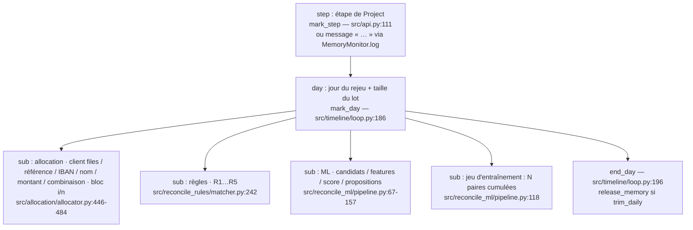
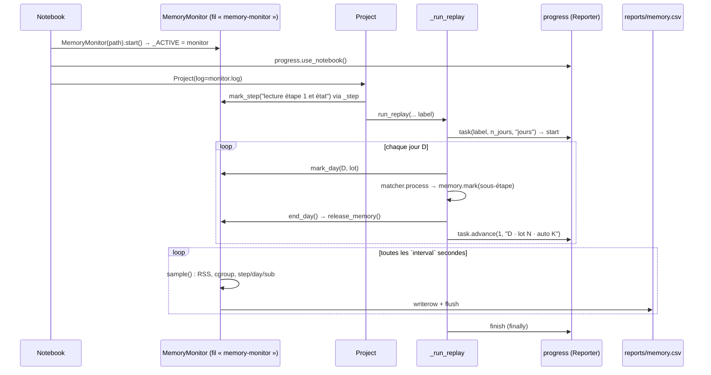

# Modules `src/memory.py` et `src/progress.py` — suivi mémoire et progression

> **Résumé.** Deux modules d'instrumentation, sans effet sur les résultats, pensés pour un notebook
> Jupyter sur un pod à mémoire et CPU limités (~2 M de paiements par an). `src/memory.py` relève chaque
> seconde, dans un fil d'arrière-plan, la RSS du processus et la mémoire du conteneur (cgroup v1/v2), et
> l'écrit immédiatement dans un CSV, avec la phase en cours posée par `mark_step` / `mark_day` / `mark`.
> Il fournit aussi `available_cpus` (quota cgroup) et `release_memory` (`malloc_trim`). `src/progress.py`
> affiche l'avancement des tâches longues (rejeux jour par jour, itérations LightGBM) dans un journal
> ou en barres de notebook. Sans moniteur ni afficheur actif, les deux sont des no-ops.

---

## 1. Rôle et branchements

| Module | Exposé | Branché dans |
|---|---|---|
| `src/memory.py` | `MemoryMonitor`, `mark`, `mark_step`, `mark_day`, `end_day`, `available_cpus`, `release_memory`, `process_rss`, `pod_memory`, `read_history`, `by_phase`, `chart` | `src/api.py:111` (`Project._step`), `src/timeline/loop.py:186,196`, `src/allocation/allocator.py:446-484`, `src/reconcile_rules/matcher.py:242`, `src/reconcile_ml/pipeline.py:67,69,118,152,157`, `src/reconcile_ml/model.py:30,66` (`available_cpus`), notebook (`tools/make_notebook.py:59-62,161-162`) |
| `src/progress.py` | `task`, `Task`, `Reporter`, `LogReporter`, `NotebookReporter`, `use_notebook`, `use_log`, `chosen`, `disable`, `active`, `lightgbm_callback` | `src/api.py:74-75` (`Project.__post_init__`), `src/timeline/loop.py:175-176,197`, `src/reconcile_ml/model.py:74-75`, notebook (`tools/make_notebook.py:61`) |

Les deux reposent sur un **singleton de module** : `_ACTIVE` (`src/memory.py:42`) et `_REPORTER`
(`src/progress.py:20`). Le code de la pipeline appelle des fonctions de module (`memory.mark(...)`,
`progress.task(...)`) sans connaître l'instance, ce qui évite de faire circuler un objet de suivi dans
toutes les signatures.

### 1.1 Hiérarchie des phases mémoire



`mark_step` remet `day` et `sub` à vide ; `mark_day` remet `sub` à vide ; `mark` ne touche que `sub`
(`src/memory.py:141-156`).

### 1.2 Un jour de rejeu vu par l'instrumentation



---

## 2. `src/memory.py`

Docstring `src/memory.py:1-21` : le CSV est **écrit et vidé à chaque relevé** pour survivre à un arrêt
brutal du noyau (OOM) ; `by_phase(path)` / `chart(path)` relus dans un nouveau noyau montrent la phase
où la mémoire a explosé ; `tail -f` donne un suivi en direct ; « `mark*` ne coûtent rien sans moniteur
actif. Aucun appel réseau. »

### 2.1 Constantes

| Nom | Ligne | Valeur |
|---|---|---|
| `GB` | `src/memory.py:36` | `2 ** 30` |
| `COLUMNS` | `src/memory.py:37-38` | `time, elapsed_s, rss_gb, rss_peak_gb, pod_used_gb, pod_anon_gb, pod_limit_gb, step, day, sub` |
| `_START` | `src/memory.py:40` | `"<démarrage du suivi>"`, ligne séparatrice de sessions écrite dans la colonne `step` |
| `_ACTIVE` | `src/memory.py:42` | moniteur actif ou `None` |

### 2.2 Relevés

- `process_rss() -> int` (`src/memory.py:47-61`) : RSS en octets via `psutil` s'il est installé, sinon
  `VmRSS` de `/proc/self/status` (Linux), sinon `0`.
- `_read_int(path) -> int | None` (`:64-69`) : entier d'un fichier, `None` si illisible, vide ou `"max"`.
- `_stat(path, key) -> int | None` (`:72-80`) : valeur d'une clé d'un fichier `memory.stat`.
- `pod_memory() -> dict[str, int | None]` (`:83-95`) :
  - cgroup v2 si `/sys/fs/cgroup/memory.current` existe : `used = memory.current`, `anon = memory.stat:anon`,
    `limit = memory.max` ;
  - sinon cgroup v1 (`/sys/fs/cgroup/memory/`) : `used = memory.usage_in_bytes`,
    `anon = memory.stat:total_rss`, `limit = memory.limit_in_bytes` sauf valeur ≥ 2⁶⁰ (« illimité »,
    commentaire `:94`) ;
  - sinon `None` partout (hors conteneur, Windows).
  La mémoire **anonyme** est mise en avant car c'est « ce que l'OOM killer compte réellement, hors cache
  disque » (docstring `:11-12`).

### 2.3 `available_cpus() -> int` (`src/memory.py:98-121`)

Pourquoi (docstring `:99-103`) : dans un conteneur, `os.cpu_count()` et OpenMP voient tous les cœurs
du nœud ; lancer autant de threads sur un pod limité à quelques CPU les fait brider à tour de rôle
(« 10 à 100 fois plus lent »).

Calcul : `min(os.cpu_count(), len(sched_getaffinity(0)))` (l'affinité n'existe pas sous Windows :
`AttributeError` ignorée), puis quota cgroup v2 (`/sys/fs/cgroup/cpu.max`, `"max"` = pas de quota) ou, si
ce fichier est absent ou illisible, v1 (`cpu.cfs_quota_us / cpu.cfs_period_us`, quota > 0). Résultat
`min(n, max(1, int(quota)))` : un quota fractionnaire est arrondi **vers le bas** (1,5 CPU → 1).

Appelants : `src/reconcile_ml/model.py:63-66` (`threads(requested)` : `requested` s'il est > 0, sinon
`available_cpus()`), utilisé pour `num_threads` de LightGBM (`:57-61`) et pour `PairModel.threads`
(`:89`) ; `MemoryMonitor.start` l'affiche (`src/memory.py:217`). Commit associé : `790dab7` « LightGBM :
threads limités aux CPU du pod (quota cgroup), réglables ».

### 2.4 `release_memory() -> None` (`src/memory.py:124-136`)

`gc.collect()` puis, sous Linux, `ctypes.CDLL("libc.so.6").malloc_trim(0)` (erreurs ignorées).
Pourquoi (docstring `:125-128`) : sans `malloc_trim`, la mémoire libérée par pandas / numpy reste
réservée au processus, la RSS ne redescend pas d'un jour à l'autre et le pod finit par être tué.
Seul appelant : `end_day` (`:162`).

### 2.5 Marqueurs de phase (`src/memory.py:141-162`)

| Fonction | Effet si un moniteur est actif | Appelants |
|---|---|---|
| `mark(sub: str)` | `sub = …` | `src/allocation/allocator.py:446,472,475,479,482,484` ; `src/reconcile_rules/matcher.py:242` ; `src/reconcile_ml/pipeline.py:67,69,118,152,157` ; `tests/test_memory.py:14,43` |
| `mark_step(step: str)` | `step = …`, `day = sub = ""` | `src/api.py:111` ; `MemoryMonitor.log` (`src/memory.py:272`) ; `tests/test_memory.py:12,32` |
| `mark_day(day, batch: int)` | `day = "AAAA-MM-JJ (lot N)"`, `sub = ""` | `src/timeline/loop.py:186` ; `tests/test_memory.py:13,44` |
| `end_day()` | `release_memory()` si `trim_daily` | `src/timeline/loop.py:196` ; `tests/test_memory.py:45` |

Sans moniteur (`_ACTIVE is None`), chacune se réduit à un test de `None` : c'est ce qui permet de les
laisser dans les boucles chaudes.

### 2.6 `MemoryMonitor` (`src/memory.py:171-294`)

```python
def __init__(self, path: str | Path = "reports/memory.csv", interval: float = 1.0, trim_daily: bool = True,
             warn_ratio: float = 0.85, echo: Callable[[str], None] = print):
```

- `trim_daily` : rendre la mémoire au système à la fin de chaque jour de rejeu ;
- `warn_ratio` : part de la limite du pod au-delà de laquelle les messages portent une alerte
  (docstring `:174-175`) ;
- `echo` : fonction d'affichage (par défaut `print`).
- État : `step`, `day`, `sub`, `peak` (pic de RSS), `last` (dernier relevé), `_stop` (`Event`),
  `_lock`, `_thread`, `_file`, `_t0`, `_live` (`:180-193`).

**`start(self) -> MemoryMonitor`** (`:197-218`), pas à pas :

1. Si un autre moniteur est actif, l'arrête (`:199-200`) : un seul moniteur à la fois.
2. Crée le dossier ; ouvre le CSV en **ajout** (`"a"`), écrit l'en-tête seulement si le fichier est vide
   ou absent (`:201-206`).
3. Écrit une ligne séparatrice `[horodatage, "", "", "", "", "", "", _START, "", ""]` (`:207`) : c'est
   elle qui permet de distinguer les sessions successives dans un même fichier.
4. `_ACTIVE = self`, premier relevé synchrone, démarre le fil démon `memory-monitor` (`:208-213`).
5. Affiche via `echo` le chemin, la limite du pod (ou « non détectée (hors conteneur ?) ») et les CPU
   utilisables vs machine (`:214-217`). Renvoie `self` (chaînage `MemoryMonitor(...).start()`).

**`stop(self)`** (`:220-229`) : signale l'arrêt, attend le fil (5 s max), ferme le fichier sous verrou,
remet `_ACTIVE` à `None` si c'est lui.

**`_run(self)`** (`:231-238`) : boucle `while not _stop.wait(interval)` → `sample()` puis mise à jour de
la pastille si `live()` a été appelé ; **toute exception est avalée** (commentaire `:237` : « le suivi
ne doit jamais interrompre la pipeline »).

**`sample(self) -> dict`** (`:240-253`) : RSS, pic, mémoire du pod, convertis en Go arrondis
(`_gb`, `:167-168`), plus `step` / `day` / `sub` courants ; écrit la ligne et fait `flush()` sous verrou.

**Affichage** :

- `status(self) -> str` (`:257-267`) : `"RSS x Go (pic y) · pod u/l Go, anonyme a"` et
  `" ⚠ PROCHE DE LA LIMITE"` si la mémoire anonyme (sinon consommée) dépasse `warn_ratio × limite`.
- `log(self, message: str) -> None` (`:269-273`) : **à passer comme `log` de `Project`**. Si le message
  commence par `"… "`, il devient la nouvelle étape (`mark_step(message[2:])`) ; puis le message est
  affiché suivi de `[status]`. C'est ainsi que les messages `self.log("… …")` de `Project._step`
  (`src/api.py:112`), de `Project.replay` (`src/api.py:226`) ou de `fit_ml`
  (`src/reconcile_ml/pipeline.py:386`, « … rejeu … pour construire le jeu d'entraînement »)
  deviennent des phases du CSV.
- `_badge(self)` (`:275-278`) et `live(self)` (`:280-283`) : pastille HTML IPython mise à jour en place
  par le fil d'arrière-plan (`display(..., display_id=True)`).

**Analyse** : `history()`, `by_phase()`, `chart()` (`:287-294`) délèguent aux fonctions de module sur
`self.path`.

### 2.7 Analyse après coup (`src/memory.py:299-343`)

Utilisable **sans moniteur actif**, dans un nouveau noyau après un OOM.

- `read_history(path="reports/memory.csv") -> pd.DataFrame` (`:299-307`) : lit tout en chaînes,
  `session = cumsum(step == _START)`, retire les lignes séparatrices, convertit `*_gb` et `elapsed_s` en
  numériques.
- `_session(df, session)` (`:310-313`) : `None` → toutes ; sinon indexe la liste des sessions
  (`-1` = dernière).
- `by_phase(path=…, session=-1) -> pd.DataFrame` (`:316-326`) : mesure = `pod_anon_gb` si elle existe,
  sinon `rss_gb` ; groupement par `(step, sub)` **dans l'ordre d'exécution** (`sort=False`) avec premier
  et dernier horodatage et nombre de relevés ; jointure avec la ligne de pic de chaque groupe (tri stable
  décroissant puis `drop_duplicates`), qui apporte le **jour du pic**. Colonnes renommées en français :
  `étape`, `sous-étape`, `début`, `fin`, `relevés`, `pic_<mesure>`, `jour_du_pic`.
- `chart(path=…, session=-1)` (`:329-343`) : courbe Altair des mesures disponibles en fonction de
  `elapsed_s`, infobulle `step/day/sub`, limite du pod en pointillé rouge.

Format du CSV (exemple de ligne, déduit des colonnes) :

| time | elapsed_s | rss_gb | rss_peak_gb | pod_used_gb | pod_anon_gb | pod_limit_gb | step | day | sub |
|---|---|---|---|---|---|---|---|---|---|
| 14:02:11 | 523.4 | 6.812 | 7.104 | 9.120 | 7.011 | 16.0 | rejeu test du … (pipeline) | 2024-11-03 (lot 8123) | ML · score (41230 paires) |

### 2.8 Utilisation prévue (notebook)

Cellule générée par `tools/make_notebook.py:59-62` (et présente dans `notebooks/pipeline.ipynb:79-81`) :

```python
monitor = memory.MemoryMonitor(MEMORY_LOG, interval=1.0, trim_daily=True).start()
monitor.live()                                     # pastille mise à jour chaque seconde
progress.use_notebook()                            # barres de progression (rejeux, apprentissage)
project = Project(dataset="synthetic", log=monitor.log)
```

avec `MEMORY_LOG = ROOT / "reports" / "memory.csv"` (`tools/make_notebook.py:33`, dans la cellule
d'imports) et, en fin de notebook, `display(memory.by_phase(MEMORY_LOG)); memory.chart(MEMORY_LOG)`
(`tools/make_notebook.py:161-162`). Le texte du notebook recommande aussi `MALLOC_ARENA_MAX=2`
(`tools/make_notebook.py:58`) et de redémarrer le noyau après l'étape 1 (`tools/make_notebook.py:65`).

---

## 3. `src/progress.py`

Docstring `src/progress.py:1-11` : chaque tâche affiche avancement, temps écoulé, temps restant estimé
et un détail ; sans afficheur choisi, `Project` journalise la progression par son `log` ; sans afficheur
actif, les tâches ne coûtent rien.

### 3.1 `_duration(seconds: float) -> str` (`src/progress.py:23-31`)

`"N s"`, `"M min SS s"` ou `"H h MM min"`.

### 3.2 `Task` (`src/progress.py:34-72`)

`__init__(self, label: str, total: int, unit: str)` : `total` borné à ≥ 0, `done = 0`, `detail = ""`,
`started`, `finished = False`.

| Membre | Lignes | Sens |
|---|---|---|
| `elapsed` | `:44-46` | secondes depuis le début |
| `remaining` | `:48-52` | `elapsed / done × (total − done)` ; `None` si rien de fait, total nul ou tâche finie |
| `fraction` | `:54-56` | `1.0` si finie, sinon `min(done / total, 1)` |
| `advance(self, n: int = 1, detail: str \| None = None)` | `:58-63` | incrémente, met à jour le détail, notifie `_REPORTER.update` |
| `text(self) -> str` | `:65-72` | `"label : done/total unité (p %) · temps · détail"` |

### 3.3 `task(label: str, total: int, unit: str = "") -> Iterator[Task]` (`src/progress.py:75-85`)

Gestionnaire de contexte : crée la `Task`, `_REPORTER.start(t)`, `yield`, puis dans un `finally`
`finished = True` et `_REPORTER.finish(t)`.

Appelants : `src/timeline/loop.py:175-176` (une unité par jour rejoué, détail
`"AAAA-MM-JJ · lot N · auto K"` à `:197`) et `src/reconcile_ml/model.py:74` (une unité par itération
LightGBM, `total = num_boost_round`). Libellés effectivement produits : `rejeu <période> (<matcher>)`
(`src/api.py:228`), `allocation <période>` (`src/api.py:265`), `jeu d'entraînement (rejeu train +
validation)` (`src/reconcile_ml/pipeline.py:388`), `calibration des seuils (rejeu validation)`
(`src/reconcile_ml/pipeline.py:459`), `LightGBM passe 1`, `LightGBM passe 1, pli k/n (scores hors
échantillon)`, `LightGBM passe 2` (`src/reconcile_ml/model.py:115,123-124,129`), suffixés de
`(<N> paires)`.

### 3.4 Afficheurs

- `Reporter` (`:90-93`) : interface vide `start` / `update` / `finish`.
- `LogReporter(log, every=30.0)` (`:96-115`) : `"▶ label (total unité)"` au début, `"  " + text()` au
  plus toutes les `every` secondes (horodatage du dernier message par `id(task)`), `"✓ " + text()` à la
  fin.
- `NotebookReporter(every=0.5)` (`:118-148`) : une barre HTML par tâche (bleue en cours, verte finie),
  `display(..., display_id=True)` puis `handle.update(...)` au plus toutes les 0,5 s ; mise à jour finale
  forcée.

### 3.5 Choix de l'afficheur (`src/progress.py:151-179`)

| Fonction | Effet |
|---|---|
| `use_notebook()` | `_REPORTER = NotebookReporter()` |
| `use_log(log=print, every=30.0, automatic=False)` | `_REPORTER = LogReporter(log, every)` et attribut dynamique `automatic` |
| `chosen() -> bool` | vrai si un afficheur existe **et** n'est pas « automatique » (`getattr(..., "automatic", False)`, donc vrai pour `NotebookReporter`) |
| `disable()` | `_REPORTER = None` |
| `active() -> bool` | `_REPORTER is not None` — **aucun appelant** (Grep) |

Mécanique « automatique » (docstring `:160-161`) : `Project.__post_init__` appelle
`use_log(self.log, automatic=True)` si `chosen()` est faux (`src/api.py:74-75`). Ainsi la progression suit
le journal du **dernier `Project` créé**, sauf si l'utilisateur a choisi explicitement un afficheur, qui
n'est jamais remplacé (commit `7dae7fd` : « La progression par défaut suit le journal du dernier Project
créé »).

### 3.6 `lightgbm_callback(t: Task)` (`src/progress.py:184-191`)

Renvoie un callback LightGBM qui, à chaque itération, fait `t.advance(1, "itération i · <métrique> <valeur> …")`
à partir de `env.evaluation_result_list` (tuples `(jeu, métrique, valeur, …)`, seul le nom de métrique
est affiché). `callback.order = 5` : LightGBM trie les callbacks selon cet attribut ; `early_stopping`
ayant un ordre plus élevé (30, vérifié avec LightGBM 4.7.0 installé localement), la progression est notifiée avant un éventuel arrêt
anticipé. Seul appelant : `src/reconcile_ml/model.py:75`.

---

## 4. Tests

| Test | Vérifie |
|---|---|
| `tests/test_memory.py:7` `test_monitor_writes_samples_with_phases` | relevés écrits, `rss_gb > 0`, phase `step/day/sub` retrouvée par `by_phase` avec `jour_du_pic`, `log` suffixe l'état mémoire, `_ACTIVE` remis à `None` après `stop` |
| `tests/test_memory.py:28` `test_sessions_are_separated` | deux `start()` sur le même fichier → deux sessions ; `by_phase` ne garde que la dernière |
| `tests/test_memory.py:41` `test_marks_without_monitor_are_noops` | `mark`, `mark_day`, `end_day` sans moniteur |
| `tests/test_memory.py:48` `test_available_cpus_is_bounded_by_machine` | `1 ≤ available_cpus() ≤ os.cpu_count()` |
| `tests/test_progress.py:15` `test_replay_and_training_report_progress` | `run_replay` (3 jours) et `_train` LightGBM (10 itérations) produisent `▶`, lignes intermédiaires et `✓ … (100 %)` via `LogReporter(every=0)` |
| `tests/test_progress.py:32` `test_tasks_are_silent_without_reporter` | tâche sans afficheur |

Les quatre fichiers `test_timeline`, `test_split`, `test_memory`, `test_progress` passent (26 tests, 15 s,
exécution locale sous Windows). Le `rss_gb > 0` sous Windows suppose `psutil` installé (`/proc` n'existe
pas) — déduit du succès du test.

---

## 5. ⚠️ Zones d'ombre

1. **`malloc_trim` quotidien conditionné au moniteur.** `end_day` n'appelle `release_memory` que si un
   `MemoryMonitor` est actif avec `trim_daily` (`src/memory.py:159-162`). Les tâches lancées par
   l'interface (`run_task`, `src/api.py:388-398`) et tout usage sans moniteur ne rendent donc **jamais** la
   mémoire au système en fin de journée, alors que la docstring de `release_memory` présente ce point
   comme ce qui évite l'OOM. Une optimisation mémoire est ainsi couplée à un outil d'observation.
2. **Les phases dépendent de `log=monitor.log`.** Hors `_step`, les messages `"… "` (début du rejeu dans
   `Project.replay`, `src/api.py:226` ; étapes de `fit_ml`) ne deviennent des phases que si `Project` a
   reçu `monitor.log`. Avec un autre journal, la phase reste par exemple « préparation du rapprocheur »
   pendant tout le rejeu. `train()` / `calibrate()` n'utilisent pas `_step` du tout.
3. **`progress.task` marque « ✓ terminé » même en cas d'exception** : `finished = True` et
   `finish` sont dans le `finally` (`src/progress.py:81-85`) ; `LogReporter.finish` écrit `"✓ …"` sans
   distinguer l'échec.
4. **Arrêt anticipé LightGBM** : `total = num_boost_round` mais `early_stopping(30)`
   (`src/reconcile_ml/model.py:74-77`) peut arrêter plus tôt ; la tâche finie affiche alors
   `"k/total itérations (100 %)"` (`fraction` vaut 1 si `finished`, `src/progress.py:56`), et le temps
   restant estimé pendant l'exécution est surévalué.
5. **Double `start()` du même moniteur** : `start` n'arrête que les **autres** moniteurs
   (`src/memory.py:199-200`) ; rappeler `start()` sur une instance déjà démarrée ouvre un second
   descripteur sans fermer le premier et lance un second fil (déduit).
6. **Chemins relatifs au répertoire courant.** `MemoryMonitor` et les fonctions d'analyse ont pour défaut
   `"reports/memory.csv"` relatif au `cwd` (`src/memory.py:178,299,316,329`), contrairement au reste du
   projet qui résout depuis `REPO_ROOT`. Le notebook contourne en passant `ROOT / "reports" / "memory.csv"`.
   Ce fichier n'est pas suffixé par le jeu de données (`reports/synthetic/…`).
7. **Lecture concurrente des phases sans verrou** : `mark*` écrit `step/day/sub` depuis le fil principal,
   `sample` les lit depuis le fil du moniteur (`src/memory.py:141-156,247`). Sous le GIL, au pire une ligne
   associe un relevé à la phase voisine ; sans conséquence sur les résultats.
8. **`available_cpus` arrondit le quota vers le bas** (`int(quota)`, `src/memory.py:120`) et n'interroge
   pas cgroup v1 si cgroup v2 répond `"max"` (`:111-118`) ; sur un pod à 1,5 CPU, LightGBM n'utilise
   qu'un thread.
9. **`chart` sans aucune mesure** : si aucune colonne mémoire n'est renseignée, `melt` reçoit une liste
   vide (`src/memory.py:333-335`) et le graphique est vide ou échoue (déduit, non testé).
10. **Code inutilisé** : `progress.active()` (`src/progress.py:178-179`) n'a aucun appelant ; l'attribut
    `automatic` est ajouté dynamiquement à `LogReporter` (`:165`) au lieu d'être déclaré.
11. **Exceptions avalées** dans `_run` (`src/memory.py:237-238`) : une erreur persistante de relevé
    (permissions cgroup, IPython absent pour `live`) passe inaperçue ; le CSV cesse simplement d'être
    alimenté.
