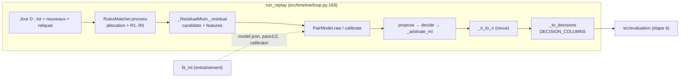
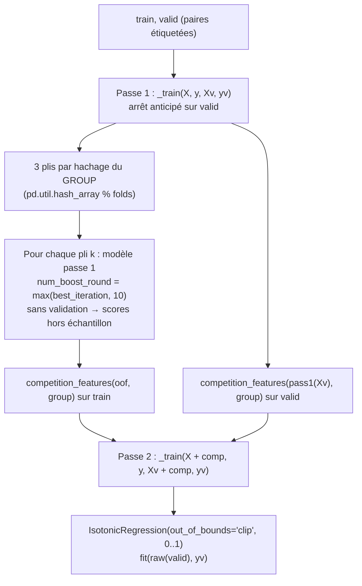
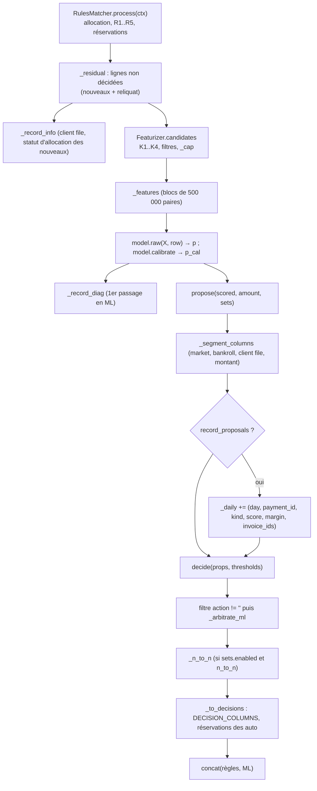
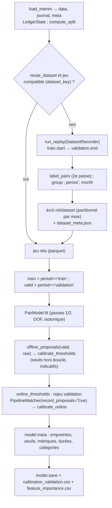

# Module `src/reconcile_ml/` — étape 5 : réconciliation ML

> **Résumé.** Le package `src/reconcile_ml/` traite le **résiduel** des règles de l'étape 4. Pour chaque
> paiement non résolu, il génère des factures candidates (quatre « clés » : débiteur, référence, montant,
> client file), calcule 54 features par paire (paiement, facture), puis les score avec un LightGBM binaire en
> deux passes, calibré par régression isotonique. Il assemble ensuite des propositions (facture seule,
> partiel, ensemble, n↔n) et décide par seuils (auto / revue / rien), avec des seuils calibrés « en ligne »
> sur un rejeu de la validation. `fit_ml` construit le jeu d'entraînement en rejouant la boucle quotidienne,
> entraîne, calibre et sauvegarde un modèle versionné. `PipelineMatcher` est le rapprocheur complet (règles
> puis ML) branché dans `run_replay`.

Conventions de ce document :
- les références `chemin:ligne` sont relatives à la racine du dépôt et ont été vérifiées sur le code ;
- **[certain]** = lu dans le code ; **[déduit]** = conclusion tirée de la lecture, non testée directement ;
- « row » = position d'un paiement **dans le lot du jour** ; « pos » = position du paiement dans la table
  `payment` ; « inv » = position de la facture dans la table `invoice`. Ces trois espaces d'indices coexistent
  partout dans le module.

---

## 1. Rôle et responsabilités

### 1.1 Les quatre fichiers

| Fichier | Rôle | Symboles exposés (utilisés hors du fichier) |
|---|---|---|
| `src/reconcile_ml/features.py` | génération des candidats et calcul des features | `Featurizer`, `active_features`, `FEATURIZATION_VERSION`, `COMPETITION`, `CATEGORICAL`, `CANDIDATE_PAIR_BUDGET` (monkeypatché en test) |
| `src/reconcile_ml/model.py` | modèle de paires LightGBM 2 passes + calibration, persistance, métriques | `PairModel`, `GROUP`, `competition_features`, `threads`, `pair_metrics`, `calibration_table`, `fingerprint`, `_train` (utilisé par `tests/test_progress.py:9`) |
| `src/reconcile_ml/decision.py` | propositions (ensembles), seuils, décision | `propose`, `decide`, `calibrate_thresholds`, `calibrate_online`, `segment_keys` |
| `src/reconcile_ml/pipeline.py` | rapprocheur complet, enregistreur du jeu, entraînement, recalibration | `PipelineMatcher`, `DatasetRecorder`, `fit_ml`, `recalibrate_ml`, `online_thresholds`, `MODEL_DIRNAME`, `FEATURE_BLOCK_PAIRS` |

`src/reconcile_ml/__init__.py` est vide. Une copie « portable » de tout ce code existe dans
`single/reconciliation.py` (ex. `FEATURIZATION_VERSION` à `single/reconciliation.py:4947`,
`calibrate_online` à `single/reconciliation.py:5664`) ; elle est vraisemblablement générée par
`tools/build_bundle.py` **[déduit]**. Ce document décrit `src/`.

### 1.2 Où se place le module

Le brief (`CLAUDE.md` §7) demande : candidats (§7.1), scoring de paires LightGBM avec négatifs non
échantillonnés, deux passes et calibration isotonique (§7.2), dataset construit par rejeu et étiqueté dans
une seconde passe (§7.3), ensembles par DFS borné (§7.4), décision par seuils `τ_high` / `τ_low` / marge `δ`
(§7.5). Le §7.6 (LLM) n'est **pas** implémenté (voir §8).

Points d'entrée publics, tous via `src/api.py` :

| Appelant | Appelle | Référence |
|---|---|---|
| `Project.train(reuse_dataset)` | `fit_ml` | `src/api.py:284-292` |
| `Project.calibrate()` | `recalibrate_ml` | `src/api.py:294-297` |
| `Project._matcher("pipeline", …)` | `PipelineMatcher(state, settings, rules, PairModel.load(model_dir))` | `src/api.py:209-214` |
| `Project.model_dir` | `MODEL_DIRNAME` → `models/<jeu>/pair_model` | `src/api.py:100-102` |
| `Project.replay` | `m.side_outputs()` du `PipelineMatcher` → parquets `replay_<m>_
_{proposals,ml_candidates,payment_info}` | `src/api.py:236-241` |
| `src/ui/views/ml.py` | lit `model.json`, `calibration_validation.csv`, `feature_importance.csv` | `src/ui/views/ml.py:67-101` |

### 1.3 Idées structurantes

- **Une seule implémentation pour l'entraînement et la production** **[certain]** : `DatasetRecorder` et
  `PipelineMatcher` héritent tous deux de `_ResidualMixin` (`src/reconcile_ml/pipeline.py:51`), lui-même
  sous-classe de `RulesMatcher` (`src/reconcile_rules/matcher.py:57`). Les candidats et features sont donc
  produits par le même code dans les deux cas.
- **Aucune lecture du futur** : toutes les lectures d'état passent par `LedgerState` avec `as_of = ctx.as_of`
  (minuit du jour D, `src/timeline/loop.py:51-54`). Les agrégats comportementaux viennent de
  `LedgerState.debtor_stats` (`src/timeline/state.py:348`), fenêtre `[as_of − window, as_of)`.
- **Réservations partagées** : `RulesMatcher` tient `_claimed` (montant réservé par facture) et `_claims`
  (paiement → [(facture, montant)]) (`src/reconcile_rules/matcher.py:72-73`). Le ML déduit `_claimed` du
  restant dû de chaque candidat (`src/reconcile_ml/features.py:210`, `:227`) et y ajoute ses propres
  auto-validations (`src/reconcile_ml/pipeline.py:239-242`). Les réservations sont libérées quand
  l'imputation réelle du paiement arrive (`_release_realised`, `src/reconcile_rules/matcher.py:80-87`).
- **Score brut pour décider, score calibré pour mesurer** : la décision s'appuie sur le score brut de passe 2
  (`p = raw`, `src/reconcile_ml/pipeline.py:153-154`), la probabilité calibrée (`p_cal`) ne sert qu'aux
  diagnostics. Le docstring de `decision.py` (`src/reconcile_ml/decision.py:3-5`) et `GUIDE.md` (étape 5,
  « subtilités », point 2) l'expliquent : la régression isotonique crée des **plateaux** (beaucoup de scores
  à exactement 1,0 mêlant justes et faux) où aucun seuil ne peut couper ; le score brut a le même ordre sans
  plateaux.
- **Volumétrie bornée** : deux budgets coupent un lot quotidien en blocs (`CANDIDATE_PAIR_BUDGET = 2_000_000`,
  `src/reconcile_ml/features.py:66` ; `FEATURE_BLOCK_PAIRS = 500_000`, `src/reconcile_ml/pipeline.py:40`),
  avec la garantie (testée) que le résultat est identique à un passage unique.

---

## 2. `features.py` — candidats et features

### 2.1 Constantes

| Constante | Valeur | Rôle | Réf. |
|---|---|---|---|
| `FEATURIZATION_VERSION` | `"1.1.0"` | version de la featurisation, stockée dans `model.json` et dans la clé du jeu (`dataset_key`) | `src/reconcile_ml/features.py:25` |
| `SRC_DEBTOR, SRC_REFERENCE, SRC_AMOUNT, SRC_CLIENT_FILE` | `1, 2, 4, 8` | bits des sources d'un candidat (OR-ées si une facture vient de plusieurs clés) | `src/reconcile_ml/features.py:26` |
| `ROUTES` | `("DEBTOR_DIRECT", "ASSIGNOR", "TECHNICAL_ACCOUNT", "UNKNOWN")` | vocabulaire figé de `iban_route` | `src/reconcile_ml/features.py:27` |
| `FAMILIES` | dict famille → liste de features | activables par `reconcile_ml.features.<famille>` | `src/reconcile_ml/features.py:29-44` |
| `BASE` | 6 features toujours actives | sources + `n_candidates` + `amount_rank_in_payment` | `src/reconcile_ml/features.py:45` |
| `COMPETITION` | `["rank_in_payment", "score_margin", "score_best_other"]` | features de passe 2 (calculées dans `model.py`) | `src/reconcile_ml/features.py:46` |
| `CATEGORICAL` | `["iban_route", "channel", "bankroll_code", "market", "product", "recourse"]` | déclarées catégorielles à LightGBM | `src/reconcile_ml/features.py:47` |
| `CANDIDATE_PAIR_BUDGET` | `2_000_000` | paires examinées par bloc avant plafonnement | `src/reconcile_ml/features.py:66` |

`active_features(ml: MLSettings) -> list[str]` (`src/reconcile_ml/features.py:50-53`) renvoie
`BASE + [features des familles dont le booléen est vrai dans ml.features]`. Avec les réglages par défaut, 54
features (6 + 10 + 4 + 6 + 4 + 8 + 3 + 9 + 4, vérifié par exécution). Appelée par `DatasetRecorder.__init__`
(`src/reconcile_ml/pipeline.py:100`) ; la liste est ensuite figée dans le modèle (`PairModel.features`).

Fonctions utilitaires :
- `_codes(values, categories)` (`src/reconcile_ml/features.py:56-57`) : codes entiers d'un `pd.Categorical`
  sur un vocabulaire donné, en `float32` ; valeur hors vocabulaire ou manquante → `-1`.
- `_group_starts(keys)` (`src/reconcile_ml/features.py:60-61`) : indices de début de chaque groupe de clés
  consécutives.
- `_row_blocks(load, budget)` (`src/reconcile_ml/features.py:69-75`) : découpe **consécutive** des lignes ;
  le bloc d'une ligne est `(charge cumulée avant elle) // budget`. Une ligne dont la charge dépasse à elle
  seule le budget forme un bloc à elle seule ; aucun bloc n'est jamais vide. Entrée vide → `[(0, 0)]`.

### 2.2 `Featurizer.__init__` — attributs statiques

Signature : `Featurizer(state: LedgerState, allocator: Allocator, ml: MLSettings, min_key_length: int,
categories: dict[str, list] | None = None)` (`src/reconcile_ml/features.py:81-82`).

Construit **une fois** (par rapprocheur) des tableaux numpy indexés par position, qui ne dépendent pas du
temps :

| Attribut | Contenu | Réf. |
|---|---|---|
| `inv_debtor` | débiteur (position) de chaque facture | `:90` |
| `inv_due`, `inv_created` | échéance / création en numéro de jour (`_days`) | `:91-92` |
| `inv_initial` | `initial_amount` (NaN → 0) | `:93` |
| `inv_agr` | position du contrat (−1 si aucun) | `:94` |
| `pay_amount` | `amount` (NaN → −1) | `:95` |
| `pay_value` | date de valeur en jours | `:96` |
| `inv_ccy`, `pay_ccy` | codes de devise sur l'union triée des devises factures + paiements | `:97-99` |
| `categories` | vocabulaires figés des 6 catégorielles (voir §2.7) | `:100-107` |
| `pay_channel`, `pay_bankroll` | codes du canal / bankroll du paiement | `:108-109` |
| `inv_market`, `inv_product`, `inv_recourse` | codes du contrat de la facture, −1 sans contrat | `:110-114` |
| `pay_label_len`, `pay_no_alpha`, `pay_n_numbers` | longueur de `label_norm`, absence de lettre `[A-Z]`, nombre de `label_numbers` | `:115-120` |
| `inv_client_keys`, `inv_internal_keys` | `Postings` facture → codes de clés de sa référence client / interne, dans le vocabulaire de l'index de références | `:122-123`, `_inv_keys` `:127-132` |
| `inv_full_key` | code de la référence client compactée (sans espaces), −1 si absente du vocabulaire | `:124-125` |

Le commentaire de `src/reconcile_ml/features.py:118-119` justifie `pay_n_numbers` : on compte les clés du
libellé lui-même, et non celles retrouvées dans le vocabulaire des références, « qui dépend des factures
futures » (le vocabulaire `allocator.ref.vocab` est construit sur **toutes** les factures,
`src/allocation/indexes.py:158-172`).

### 2.3 `Featurizer.candidates` — génération des candidats

Signature : `candidates(self, rows: np.ndarray, pos: np.ndarray, alloc: Allocation, scope: pd.DataFrame,
as_of, claimed: np.ndarray) -> tuple[pd.DataFrame, pd.DataFrame]` (`src/reconcile_ml/features.py:136-137`).

- `rows` : lignes du lot à traiter (le résiduel des règles) ; `pos` : positions des paiements de **tout** le
  lot ; `alloc` : sortie de l'allocation du jour ; `scope` : couples (row, debtor, rank) de l'allocation
  (`RulesMatcher._scopes(...)[0]`, `src/reconcile_rules/matcher.py:94-105`) ; `claimed` : réservations du
  moteur par facture.
- Retour : `(c, cited)` avec `c` = colonnes `row, inv, src, balance` (une ligne par candidat, triée par `row`)
  et `cited` = colonnes `row, inv, line_amount, inv_cited` (factures citées par le client file rattaché).
- Appelée par `_ResidualMixin._residual` (`src/reconcile_ml/pipeline.py:68`).

#### Découpage en blocs

`candidates` calcule d'abord une **charge** par ligne (`_pair_load`, `src/reconcile_ml/features.py:153-176`),
majorant du nombre de paires examinées avant plafonnement :
- clé débiteur : nombre de factures ouvertes de chaque débiteur alloué de rang ≤ `max_debtors` (avant fenêtre
  d'échéance) ;
- clé référence : nombre de factures portant chaque clé du libellé (`key_invoices.lengths`, sans filtre de
  longueur ni d'ouverture) ;
- clé montant : nombre de factures ouvertes dont le restant dû (sans déduction des réservations) égale le
  montant (deux `searchsorted` sur les soldes triés).

Puis `_row_blocks(load, CANDIDATE_PAIR_BUDGET)`. S'il n'y a qu'un bloc, appel direct de `_candidates_rows` ;
sinon un appel par bloc, concaténation et tri stable par `row` (`src/reconcile_ml/features.py:145-151`). Le
plafond est appliqué **par paiement**, donc le résultat ne dépend pas du découpage ; c'est vérifié par
`tests/test_ml.py:145-153` (budget forcé à 500, décisions identiques jour par jour).

Le commentaire `src/reconcile_ml/features.py:64-65` en donne la raison : « les gros débiteurs, les références
et montants fréquents produisent des milliers de paires par paiement ».

#### Les quatre clés (`_candidates_rows`, `src/reconcile_ml/features.py:178-232`)

| Clé | Condition (réglage `reconcile_ml.candidates.*`) | Construction | Réf. |
|---|---|---|---|
| K1 débiteur, `SRC_DEBTOR` | `allocated_debtors` | débiteurs de l'allocation de rang ≤ `max_debtors` (3) ; leurs factures ouvertes à D (`debtor_open_invoices_at`, `src/timeline/state.py:402`) ; échéance dans `[valeur − debtor_window_before_days (180), valeur + debtor_window_after_days (30)]` | `:184-196` |
| K2 référence, `SRC_REFERENCE` | `reference_no_window` | clés du libellé (`ref.payment_keys`) de longueur ≥ `min_key_length` (= `allocation.signals.reference.min_key_length`, 4) ; toutes les factures portant la clé (`ref.key_invoices`), **sans fenêtre** | `:197-207` |
| K3 montant, `SRC_AMOUNT` | `amount_exact` | factures ouvertes dont `restant dû − réservé` = montant du paiement (paiement > 0) ; création à ± `amount_window_days` (90) de la date de valeur | `:208-215` |
| K4 client file, `SRC_CLIENT_FILE` | `client_file_cited` | factures citées par les lignes du client file rattaché au paiement (`_client_file_invoices`) | `:216-219` |

Notes :
- `cited` est calculé **même si** `client_file_cited` est faux (`src/reconcile_ml/features.py:216`) : il sert
  aussi aux features `invoice_cited_in_client_file` et `client_file_line_amount_diff`.
- K2 ne filtre pas les factures futures ni soldées à ce stade : c'est le filtre dur suivant qui le fait
  (`open_balance_at` rend 0 pour une facture pas encore créée, `src/timeline/state.py:397-400`).

#### Union et filtres durs

1. `_or_sources` (`src/reconcile_ml/features.py:262-266`) : tri stable par (row, inv) puis
   `np.bitwise_or.reduceat` : une seule ligne par couple, `src` = OU des bits. Exemple : une facture trouvée
   par la référence (2) et par le montant (4) a `src = 6`.
2. Filtres (`src/reconcile_ml/features.py:226-231`) :
   - `balance = open_balance_at(inv, as_of) − claimed[inv]` doit être **> 0** (facture ouverte, réservations
     du moteur déduites) ;
   - même code de devise que le paiement ;
   - contrat actif à D (`agreement_active_at`, `src/timeline/state.py:417`) **ou facture sans contrat**
     (`agr < 0`).
3. Plafond par paiement : `_cap(c, pos, cfg.max_per_payment)`.

Si aucune clé ne produit rien, retour d'un `DataFrame` vide typé `int64` (`src/reconcile_ml/features.py:220-223`).

#### Le plafond `_cap` (`src/reconcile_ml/features.py:234-259`)

But (docstring) : « clés précises (référence, montant, client file) d'abord ; puis, parmi les factures du
débiteur, l'union des plus proches en montant et des échéances les plus proches de la date de valeur parmi
celles qui peuvent entrer dans le paiement (paiements groupés) ».

Pas à pas :
1. `strong` = le candidat a au moins un bit autre que `SRC_DEBTOR` (`:241`).
2. `gap = |balance − amount| / max(amount, 1)` : écart relatif de montant (`:242`).
3. `fits = balance ≤ amount + max(500, 0,03 × amount)` : la facture peut entrer dans le paiement (`:243`).
4. `due_gap = |valeur − échéance|`, mis à `+inf` si la facture ne « rentre » pas (`:244-245`).
5. `rank_by(key)` : rang 0-based dans le paiement, ex æquo départagés par `inv` (`:247-252`).
6. `half = cap // 3` ; on garde `strong` **ou** `rang(gap) < half` **ou** (`rang(due_gap) < cap − half` et
   `fits`) (`:254-255`).
7. Tri final (row, forts d'abord, `gap`, `inv`) et coupe aux `cap` premiers par paiement (`:256-259`).

Exemple chiffré : avec `max_per_payment = 50` (valeur de `config/settings.yaml:125` ; défaut du code 60,
`src/settings.py:145`), `half = 16`. Pour un paiement de 10 000 € d'un débiteur ayant 400 factures ouvertes
dans la fenêtre : toutes les factures trouvées par référence/montant/client file passent d'abord ; puis les
16 factures les plus proches de 10 000 € ; puis les 34 factures d'échéance la plus proche **parmi celles
≤ 10 300 €** ; enfin coupe à 50 par ordre (forts, écart de montant). Les rangs `rank_by` sont calculés sur
**tous** les candidats du paiement, forts compris.

Le « pourquoi » est dans `GUIDE.md` (étape 5) : « trier uniquement par proximité de montant élimine les vraies
factures des paiements groupés (chacune bien plus petite que le paiement). 92 % des candidats manquants
venaient de là. »

### 2.4 `_client_file_invoices` (`src/reconcile_ml/features.py:268-290`)

Pour les lignes ayant un `client_file_id` dans `alloc.payments` :
1. lignes des fichiers **déjà reçus** à D (`LedgerState.client_file_lines`, `src/timeline/state.py:333-340`) ;
2. clés de référence de chaque ligne (`invoice_reference_keys`) → codes du vocabulaire, longueur
   ≥ `min_key_length` ;
3. toutes les factures portant ces clés (`key_invoices.gather`) ;
4. `line_amount` = `amount` de la ligne (converti en float, erreurs → NaN), `inv_cited = True` ;
5. dédoublonnage sur (row, inv).

Retour : `row, inv, line_amount, inv_cited`. Le lien fichier → row passe par
`pd.Series(rows[has], index=files[has])` puis `reindex` (`:276`, `:288`) — voir zones d'ombre.

### 2.5 `Featurizer.features` — liste exhaustive des features

Signature : `features(self, c: pd.DataFrame, pos: np.ndarray, alloc: Allocation, batch_ids: np.ndarray, as_of,
cited: pd.DataFrame | None = None) -> pd.DataFrame` (`src/reconcile_ml/features.py:294-295`). Une ligne par
candidat, **même ordre que `c`**. Toutes les colonnes sont converties en `float32` (`:388`) ; les booléens
deviennent 0/1 ; les catégorielles de code < 0 (inconnues) deviennent `NaN` (`:389-390`).

Notations : `amount` = montant du paiement (centimes), `balance` = restant dû effectif du candidat (centimes,
réservations déduites), `diff = amount − balance`, `gap_rel = (balance − amount) / max(balance, 1)`,
`value` = date de valeur (jours).

| Famille | Feature | Construction | Réf. |
|---|---|---|---|
| base | `src_debtor`, `src_reference`, `src_amount`, `src_client_file` | bit correspondant de `src` | `:306-309` |
| base | `n_candidates` | nombre de candidats du paiement (après plafond) | `:310` |
| base | `amount_rank_in_payment` | rang 1-based de `abs(diff)` croissant dans le paiement (ex æquo : ordre d'entrée) | `:311-315` |
| amount | `amount_diff` | `diff / 100` (euros) | `:317` |
| amount | `amount_diff_rel` | `diff / max(balance, 1)` | `:318` |
| amount | `amount_exact` | `diff == 0` | `:319` |
| amount | `payment_covers` | `amount ≥ balance` | `:320` |
| amount | `amount_ratio` | `amount / max(balance, 1)` | `:321` |
| amount | `is_typical_discount` | `0,005 ≤ gap_rel ≤ 0,03` (paiement inférieur de 0,5 à 3 % : escompte) | `:322` |
| amount | `is_bank_fee_gap` | `500 ≤ balance − amount ≤ 4000` (5 à 40 € manquants : frais) | `:323` |
| amount | `is_retention_gap` | `0,04 ≤ gap_rel ≤ 0,06` (retenue de garantie) | `:324` |
| amount | `ratio_to_initial` | `amount / max(initial_amount, 1)` | `:325` |
| amount | `balance_is_partial` | `balance < initial_amount` (facture déjà partiellement réglée ou réservée) | `:326` |
| temporal | `days_to_due` | `value − due` (positif = payé après l'échéance) | `:329` |
| temporal | `days_since_creation` | `value − creation` | `:330` |
| temporal | `is_before_creation` | `value < creation` | `:331` |
| temporal | `days_to_due_zscore` | `(days_to_due − debtor_mean_payment_delay) / max(nan_to_num(debtor_std_payment_delay, nan=1), 1)` ; NaN si pas d'historique | `:374-375` |
| textual | `ref_full_in_label` | la référence client compactée de la facture est une clé du libellé | `_text`, `:410-412` |
| textual | `ref_key_in_label` | au moins une clé de la référence client figure au libellé | `:407-409` |
| textual | `internal_ref_in_label` | au moins une clé de la référence interne figure au libellé | `:407-409` |
| textual | `label_length` | longueur de `label_norm` | `:334` |
| textual | `label_has_no_alpha` | `label_norm` sans lettre | `:335` |
| textual | `n_label_numbers` | nombre d'éléments de `label_numbers` | `:336` |
| identity | `iban_route` (cat.) | route IBAN de l'allocation (`alloc.payments.iban_route`), codée sur `ROUTES` | `:359-360` |
| identity | `iban_matches_invoice_debtor` | route = `DEBTOR_DIRECT` **et** le débiteur de la facture a le signal IBAN pour ce paiement | `:361` |
| identity | `channel` (cat.) | canal du paiement | `:362` |
| identity | `bankroll_code` (cat.) | bankroll du paiement | `:363` |
| behavioral | `debtor_mean_payment_delay`, `debtor_std_payment_delay`, `debtor_partial_payment_rate`, `debtor_grouping_rate`, `debtor_ref_citation_rate`, `debtor_payment_count`, `debtor_open_invoice_count`, `debtor_open_invoice_amount` | colonnes de `LedgerState.debtor_stats(débiteurs, as_of)` pour le débiteur de la facture ; `open_invoice_amount` divisé par 100 | `:366-373` |
| contract | `market`, `product`, `recourse` (cat.) | codes du contrat de la facture, NaN sans contrat | `:364` |
| allocation | `alloc_rank` | rang du débiteur de la facture dans l'allocation du paiement ; NaN s'il n'y figure pas | `:347` |
| allocation | `alloc_score` | score d'allocation (0 si absent) | `:348` |
| allocation | `debtor_in_allocation` | le débiteur de la facture est dans la liste d'allocation | `:349` |
| allocation | `alloc_sig_client_file`, `alloc_sig_reference`, `alloc_sig_iban`, `alloc_sig_name`, `alloc_sig_amount` | le libellé des signaux (`"reference+iban"`, `src/allocation/allocator.py:53`) contient le nom du signal | `:350-352` |
| allocation | `alloc_is_firm_debtor` | le débiteur de la facture est le débiteur ferme de l'allocation | `:353-358` |
| client_file | `has_client_file` | un client file est rattaché au paiement | `:378` |
| client_file | `client_file_total_matches_payment` | **copie de `has_client_file`** (commentaire : « le rattachement du client file exige l'égalité du montant total et du paiement ») | `:379-380` |
| client_file | `invoice_cited_in_client_file` | la facture est dans `cited` pour ce paiement | `:381-383`, défaut `:386` |
| client_file | `client_file_line_amount_diff` | `(line_amount − balance) / 100` ; NaN si non citée | `:384`, défaut `:387` |

Les features de la famille « allocation » sont obtenues par une jointure gauche (row, débiteur de la facture)
avec `alloc.candidates` (`src/reconcile_ml/features.py:339-349`). La feature temporelle `days_to_due_zscore`
dépend des statistiques comportementales, qui sont calculées dans tous les cas, même si la famille
« behavioral » est désactivée. `Featurizer.features` calcule toujours **toutes** les features ; c'est la
sélection `X[features]` (dans `DatasetRecorder` et `PairModel.raw`) qui retient les familles actives.

Familles du brief non implémentées **[certain]** : `debtor_client_file_rate` (brief §7.2) n'existe pas.

#### `_text` (`src/reconcile_ml/features.py:393-413`)

Pour les paiements uniques du bloc, récupère leurs clés de libellé ; pour chaque candidat, récupère les clés
de la facture (`inv_client_keys` / `inv_internal_keys` / `inv_full_key`) et fait une jointure sur
(paiement unique, clé). `hits` marque les candidats ayant au moins une correspondance.

### 2.6 Garanties de non-fuite

- Toutes les lectures datées (`debtor_open_invoices_at`, `open_invoice_positions`, `open_balance_at`,
  `agreement_active_at`, `client_file_lines`, `debtor_stats`) passent `as_of` et sont contrôlées par
  `LedgerState._check`.
- `tests/test_ml.py:134-142` rejoue le `PipelineMatcher` sur un journal complet et sur un journal tronqué
  après le 18/11/2024 : les décisions (hachées jour par jour) sont identiques jusqu'à la coupure.

### 2.7 Catégories figées

`categories` (`src/reconcile_ml/features.py:100-107`) : si `None` (entraînement), vocabulaires triés construits
sur les valeurs **de toutes les lignes** des tables `payment` (canal, bankroll) et `agreement` (market,
product, recourse) ; `iban_route` = `ROUTES`. Ils sont sauvegardés dans `model.json` sous `categories`
(`src/reconcile_ml/pipeline.py:424`, `:441`) et repassés à l'inférence (`PipelineMatcher.__init__` →
`_setup_ml(settings, model.meta.get("categories"))`, `src/reconcile_ml/pipeline.py:135`). Une valeur inconnue
du vocabulaire figé donne `-1`, puis `NaN` (traité comme manquant par LightGBM). Le docstring
(`src/reconcile_ml/features.py:83-84`) le résume : « vocabulaires figés du modèle (inférence) ; à
l'entraînement, construits sur les données disponibles puis sauvegardés avec le modèle ».

### 2.8 `FEATURIZATION_VERSION`

Valeur `"1.1.0"`. Utilisée à deux endroits :
- `dataset_key` (`src/reconcile_ml/pipeline.py:327`) : un jeu d'entraînement sauvegardé n'est repris que si la
  version est identique ;
- `model.meta["featurization_version"]` (`src/reconcile_ml/pipeline.py:436`), affiché par l'interface
  (`src/ui/views/ml.py:84`).

Elle n'est **pas** vérifiée au chargement du modèle par `PipelineMatcher` ni par `recalibrate_ml` (voir §8).
Elle doit être incrémentée à la main à chaque changement de featurisation (consigne du brief §10) **[déduit]**.

---

## 3. `model.py` — scoring des paires

### 3.1 `competition_features(scores, group) -> pd.DataFrame` (`src/reconcile_ml/model.py:37-54`)

Pour chaque ligne, au sein de son groupe (paiement) :
- `rank_in_payment` : rang 1-based par score décroissant ;
- `score_best_other` : meilleur score **des autres** candidats (pour le premier : le second ; pour les autres :
  le premier ; groupe d'un seul candidat : 0) ;
- `score_margin` = `score − score_best_other`.

Exemple (`tests/test_ml.py:65-68`) : scores `[0.2, 0.9, 0.5, 0.7]`, groupes `[a, a, a, b]`.

| ligne | groupe | score | rang | best_other | marge |
|---|---|---|---|---|---|
| 0 | a | 0,2 | 3 | 0,9 | −0,7 |
| 1 | a | 0,9 | 1 | 0,5 | +0,4 |
| 2 | a | 0,5 | 2 | 0,9 | −0,4 |
| 3 | b | 0,7 | 1 | 0 (seul) | +0,7 |

Appelée par `PairModel.raw` (`:97`) et `PairModel.fit` (`:126`, `:128`).

### 3.2 `_params`, `threads`, `_train`

- `_params(cfg: TrainingSettings) -> dict` (`src/reconcile_ml/model.py:57-60`) : `objective="binary"`,
  `learning_rate`, `num_leaves`, `min_data_in_leaf` (réglages), `feature_fraction=0.9` (codé en dur), `seed`,
  `deterministic=True`, `force_row_wise=True`, `verbosity=-1`, `num_threads=threads(cfg.num_threads)`.
  Les deux options `deterministic` / `force_row_wise` servent la reproductibilité exigée par le brief
  (§4.3, « deux exécutions… exactement le même résultat ») **[déduit]**.
- `threads(requested: int = 0) -> int` (`src/reconcile_ml/model.py:63-66`) : `requested` s'il est > 0, sinon
  `available_cpus()` (`src/memory.py:98`), qui lit l'affinité et le quota cgroup. Docstring : jamais les cœurs
  du nœud, que LightGBM prendrait avec `num_threads=0` (« threads bridés, calcul très ralenti »).
- `_train(X, y, Xv, yv, cfg, label="LightGBM") -> lgb.Booster` (`src/reconcile_ml/model.py:69-79`) : déclare
  les colonnes `CATEGORICAL` présentes ; `free_raw_data=True` ; si une validation est fournie, arrêt anticipé
  à 30 itérations sans progrès (`lgb.early_stopping(30)`, codé en dur) ; rapporte la progression via
  `progress.lightgbm_callback`.

### 3.3 `PairModel`

`@dataclass PairModel(features: list[str], pass1: lgb.Booster, pass2: lgb.Booster | None,
calibrator: IsotonicRegression | None, meta: dict = {}, threads: int = threads())`
(`src/reconcile_ml/model.py:82-89`).

| Méthode | Effet | Réf. |
|---|---|---|
| `raw(X, group) -> np.ndarray` | score de passe 1 sur `X[features]` ; si `pass2`, ajoute `competition_features(s1, group)` et renvoie le score de passe 2 | `:93-99` |
| `calibrate(raw) -> np.ndarray` | `calibrator.predict(raw)` ou `raw` | `:101-102` |
| `predict(X, group)` | `calibrate(raw(X, group))` | `:104-106` |
| `fit(train, valid, features, cfg, second_pass=True, calibration=True, folds=3)` (classmethod) | entraînement complet (§3.4) | `:110-134` |
| `save(directory)` | écrit `pass1.txt`, `pass2.txt` (si passe 2), `calibrator.pkl` (pickle, si calibrée), `model.json` (= `meta` + `features`) | `:138-147` |
| `load(directory)` (classmethod) | relit ces fichiers ; `meta` = contenu de `model.json` | `:149-155` |

`group` est l'identifiant de groupe pour les features de compétition : `payment_id` à l'entraînement
(`ds[GROUP] = ds["payment_id"]`, `src/reconcile_ml/pipeline.py:393`), `row` du lot à l'inférence
(`src/reconcile_ml/pipeline.py:153`). `GROUP = "group"` (`src/reconcile_ml/model.py:34`).

### 3.4 `PairModel.fit` pas à pas

1. Passe 1 sur les features actives, arrêt anticipé sur la validation (`src/reconcile_ml/model.py:115`).
2. Si `second_pass` : plis `fold = hash(GROUP) % folds` (`:119`) — tous les candidats d'un paiement tombent dans
   le même pli ; pour chaque pli, un modèle passe 1 est entraîné sur les autres plis avec un nombre
   d'itérations fixe `max(pass1.best_iteration, 10)` (`:121-125`) et score le pli exclu. Le docstring
   (`src/reconcile_ml/model.py:5-7`) et `GUIDE.md` expliquent pourquoi : sans scores hors échantillon, « la
   passe 2 apprend sur des scores trop optimistes ».
3. Features de compétition : hors échantillon pour train (`:126`), score du modèle passe 1 complet pour la
   validation (`:127-128`), comme à l'inférence.
4. Passe 2 avec arrêt anticipé sur la validation (`:129`).
5. Si `calibration` : isotonique sur `raw(valid)` contre `yv` (`:131-133`).

Paramètres venant des réglages : `second_pass` et `calibration` = `reconcile_ml.second_pass` /
`reconcile_ml.calibration` (`src/reconcile_ml/pipeline.py:407-408`). `folds` (3) n'est pas réglable.

### 3.5 Métriques et empreinte

- `pair_metrics(df, score) -> dict` (`src/reconcile_ml/model.py:158-170`) : sur les paires, tri par
  (`group`, score décroissant), rang. Retour `{"auc", "precision_at_1", "mrr", "groupes_avec_positif"}`.
  `auc` = `roc_auc_score` (None si une seule classe) ; `precision_at_1` = part des groupes **ayant au moins un
  positif** dont le premier positif est au rang 1 ; `mrr` = moyenne de 1 / rang du premier positif sur ces
  mêmes groupes. Appelée par `fit_ml` avec la probabilité **calibrée** de la validation
  (`src/reconcile_ml/pipeline.py:429`).
- `calibration_table(y, p, bins=10) -> pd.DataFrame` (`src/reconcile_ml/model.py:173-179`) : 10 tranches de
  largeur 0,1 ; colonnes `tranche` (ex. `"0.0–0.1"`), `paires`, `score_moyen`, `taux_observé`. Seules les
  tranches non vides apparaissent. Écrite dans `calibration_validation.csv` (`src/reconcile_ml/pipeline.py:444`).
- `fingerprint(obj) -> str` (`src/reconcile_ml/model.py:182-183`) : 16 premiers caractères hexadécimaux du
  SHA-256 de `json.dumps(obj, sort_keys=True, default=str)`.

---

## 4. `decision.py` — propositions et seuils

### 4.1 `propose(scored, amount, cfg: SetSettings) -> pd.DataFrame` (`src/reconcile_ml/decision.py:30-77`)

Entrée : `scored` = (`row, inv, balance, p`) ; `amount[row]` = montant du paiement. Sortie : **au plus une
proposition par row**, colonnes `PROPOSAL_COLUMNS = ["row", "invoices", "amounts", "score", "margin", "kind"]`
(`src/reconcile_ml/decision.py:26`) ; `invoices` / `amounts` sont des tuples de positions de facture / de
centimes ; `kind ∈ {"single", "partial", "set"}`.

Pour chaque paiement (candidats triés par `p` décroissant, puis `inv`) :
1. `tol = max(tolerance_abs_cents (500), tolerance_rel (0,03) × amount)` (`:43`).
2. **Facture seule** (si `single_candidate` ou si les ensembles sont désactivés) : parmi les candidats qui
   *absorbent* le paiement (`amount ≤ balance + tol`, `:46`), les **deux premiers** en score (`:48`). Si
   `|amount − balance| ≤ tol` → `single`, montant imputé = `balance` (la facture est soldée) ; sinon →
   `partial`, montant imputé = `amount` (`:49-51`).
3. **Ensembles** (si `enabled`, `near_sum`, ≥ 2 candidats, et que le meilleur candidat n'est pas une facture
   seule de montant **exactement** égal, `:54-55`) : `near_subsets` (`src/reconcile_rules/subset.py:79`) sur les
   `max_candidates` (25) meilleurs, cible `amount`, tolérance `tol`, `max_size = max_invoices` (5),
   `node_budget`, `max_solutions=20`, `min_size` par défaut 2 (`:56-58`). Solutions classées par (cardinalité,
   −score moyen) ; sont proposées les deux premières + la première « exacte » (`|écart| ≤ 500` centimes)
   (`:59-64`). Score d'un ensemble = moyenne des `p` (`:63`).
4. Classement par (−score, cardinalité) ; la meilleure l'emporte ; **marge** = score de la meilleure − score de
   la meilleure proposition **d'ensemble de factures différent** ; sans concurrente, marge = score lui-même
   (`:67-70`).
5. **Ambiguïté explicite** (`:71-75`) : si la meilleure est `single` avec un écart > 500 centimes (escompte,
   pas seulement des frais) et qu'un `set` concurrent explique le paiement à ≤ 500 centimes près → marge
   forcée à 0 (donc pas d'auto-validation).

Le commentaire `:52-53` justifie la recherche d'ensembles même quand une facture seule approche : « un groupe
exact entre alors en concurrence (marge faible → revue plutôt qu'une auto-validation hasardeuse) ».

Exemples (tests) :

| Test | Paiement | Candidats (balance, p) | Résultat |
|---|---|---|---|
| `tests/test_ml.py:22-29` | 1 000 € | I1 (1 000, 0,9), I2 (800, 0,2) | `tol = 30 €` ; I2 n'absorbe pas (1 000 > 830) ; I1 `single`, montant exact → pas d'ensembles ; marge = 0,9 (pas de concurrente) |
| idem | 2 000 € | I3 (5 000, 0,8) | I3 absorbe mais l'écart dépasse 60 € → `partial`, montant imputé 2 000 € |
| `tests/test_ml.py:32-37` | 1 500 € | I1 (1 000, 0,95), I2 (500, 0,9), I3 (300, 0,1) | aucune facture seule n'absorbe ; ensemble {I1, I2} = 1 500 € ; `set`, score 0,925 |
| `tests/test_ml.py:40-45` | 980 € | I1 (1 000, 0,9), I2 (900, 0,88), I3 (80, 0,87) | `tol = 29,40 €` ; I1 `single` (écart 20 € ≤ tol), score 0,9 ; ensemble {I2, I3} = 980 € exact, score 0,875 ; marge brute 0,025, puis **forcée à 0** (I1 n'explique qu'à 20 € près, l'ensemble exactement) |

Appelée par `PipelineMatcher.process` (`src/reconcile_ml/pipeline.py:158`) et `offline_proposals`
(`src/reconcile_ml/pipeline.py:313`).

### 4.2 `segment_keys(frame, dims, edges) -> np.ndarray` (`src/reconcile_ml/decision.py:80-94`)

Clé texte par ligne : valeurs des dimensions jointes par `|`. `amount_bucket` = `np.digitize(payment_amount,
edges)` (quartiles calculés par `fit_ml`, `src/reconcile_ml/pipeline.py:417`) ; une dimension absente du frame
est ignorée ; aucune dimension → `"global"`.

### 4.3 `calibrate_thresholds(proposals, correct, target, cfg, amount_edges=None) -> dict` (`src/reconcile_ml/decision.py:97-133`)

Calibration **hors boucle** (une proposition par paiement). Fonction interne `one(scores, ok)` (`:101-109`) :
tri par score décroissant, précision cumulée ; parmi les positions où la précision cumulée ≥ `target` **et**
qui sont la dernière occurrence de leur score (un seuil ne coupe qu'entre scores distincts), on prend la
**dernière**, donc le plus petit seuil admissible.

Exemple : scores (0,99 ; 0,98 ; 0,97 ; 0,96), exactitude (1 ; 1 ; 0 ; 1), cible 0,75. Précisions cumulées
(1 ; 1 ; 0,667 ; 0,75) → positions admissibles 0, 1, 3 → τ = 0,96 (bien que τ = 0,97 soit sous la cible).

Seules les propositions de marge ≥ `min_margin` sont éligibles (`:111`). Retour :
`{"tau_high", "tau_low" (= review_min_score), "min_margin", "kinds", "segments", "segment_dims", "amount_edges"}`.
`tau_high` global (1,01 si aucun seuil ne tient la cible) ; `kinds[kind]` = seuil par type si ≥
`MIN_KIND_VOLUME = 20` propositions éligibles (`src/reconcile_ml/decision.py:27`), sinon 1,01 (`:119-123`) ;
`segments` seulement si `segmented_thresholds` (faux par défaut) et ≥ `min_segment_volume` (1000) propositions
(`:124-133`). Le commentaire `:117-118` justifie le seuil par type : « un partiel peut masquer un n↔n ».

Appelée par `fit_ml` uniquement (`src/reconcile_ml/pipeline.py:418-419`).

### 4.4 `decide(proposals, thresholds) -> np.ndarray` (`src/reconcile_ml/decision.py:136-151`)

Action par proposition : `"auto"`, `"review"` ou `""`.
1. `tau` = `tau_high` global ;
2. si `thresholds["kinds"]` est non vide : `tau` = seuil du type, **1,01 pour un type absent** (le global
   n'est alors plus utilisé du tout) (`:141-143`) ;
3. si `thresholds["segments"]` est non vide : le seuil du segment remplace celui du type quand il existe
   (`:144-147`) ;
4. `auto = score ≥ tau et margin ≥ min_margin` ; `review = non auto et score ≥ tau_low` (`:148-151`).

Exemple (`tests/test_ml.py:48-51`) : seuils `single = 0,9`, `set = 0,95`, `min_margin = 0,05`,
`tau_low = 0,3` ; (0,99, marge 0,5, single) → auto ; (0,99, marge 0,01, single) → revue ; (0,5, marge 0,5,
set) → revue.

### 4.5 `calibrate_online(records, correct, target, cfg, grid=2000) -> dict` (`src/reconcile_ml/decision.py:154-187`)

Calibration sur la **boucle réelle** de validation. `records` : une ligne par (jour, paiement) avec `day`,
`payment_id`, `kind`, `score`, `margin` ; `correct` : la proposition du jour est-elle exactement la vérité.

Le docstring (`:158-163`) pose le principe : « En production, un paiement en attente est rescoré chaque jour :
il est auto-validé le premier jour où son score franchit τ. Pour τ donné, la proposition retenue est donc
celle du jour qui porte, pour la première fois, le maximum courant du score au-dessus de τ. » `GUIDE.md`
donne la raison empirique : calibrer sur le seul jour d'arrivée « surestimait la précision (96,5 % observés
pour 99,5 % visés) ».

Algorithme, **par type de proposition** (`:167-186`) :
1. `s` = score si marge ≥ δ, sinon −∞ ;
2. tri par (paiement, jour) ; `prev` = maximum courant des jours **précédents** (−∞ au premier) ;
3. ne restent que les jours qui portent un nouveau maximum (`s > prev`) : seuls eux peuvent être un « premier
   franchissement » ;
4. moins de 20 lignes → type à 1,01 ;
5. grille des seuils candidats = scores distincts finis, décroissants, sous-échantillonnés à `grid` (2000)
   valeurs si besoin ;
6. pour chaque τ (du plus strict au plus permissif), les lignes retenues sont celles où `prev < τ ≤ s` —
   exactement le premier jour où le maximum courant atteint τ. Si au moins 20 lignes et précision ≥ cible,
   `best = τ`. Le dernier τ admissible (le plus petit) est retenu.

Retour : `{"tau_high": 1.01, "tau_low", "min_margin", "kinds": {...}, "segments": {}, "segment_dims": [],
"amount_edges": None, "method": "online"}` (`:164-165`). Pas de seuils par segment.

Exemple « premier franchissement » (`tests/test_ml.py:54-62`, 40 copies de chaque cas) : paiement A, jour 1
score 0,6 (faux), jour 2 score 0,95 (juste) ; paiement B, jour 1 score 0,9 (faux). Cible 0,99.

| τ | lignes retenues (`prev < τ ≤ s`) | précision | admissible |
|---|---|---|---|
| 0,95 | A-jour 2 (prev 0,6) | 40/40 = 100 % | oui |
| 0,90 | A-jour 2 (prev 0,6 < 0,9 ≤ 0,95), B-jour 1 | 40/80 = 50 % | non |
| 0,60 | A-jour 1, B-jour 1 | 0 % | non |

→ `kinds["single"] = 0,95`. Une calibration « jour d'arrivée » aurait vu A à 0,6 et B à 0,9.

Appelée par `online_thresholds` (`src/reconcile_ml/pipeline.py:467`).

---

## 5. `pipeline.py` — rapprocheur complet et entraînement

### 5.1 `_sampled(payment_ids, share)` (`src/reconcile_ml/pipeline.py:43-48`)

Échantillon déterministe : `hash_array(payment_id) % 10 000 < share × 10 000`. `share ≥ 1` → tout. Utilisé
par `DatasetRecorder` avec `reconcile_ml.training.payment_sample` (0,5) : on échantillonne des **paiements
entiers**, jamais les négatifs (brief §7.2).

### 5.2 `_ResidualMixin(RulesMatcher)` (`src/reconcile_ml/pipeline.py:51-89`)

- `_setup_ml(settings, categories=None)` (`:54-57`) : `self.ml`, `self.featurizer = Featurizer(state,
  allocator, ml, min_key_length, categories)`, `self._pay_value`.
- `_residual(ctx, rules_decisions, rows_filter=None)` (`:59-71`) : positions du lot ; lignes non décidées par
  les règles (et, si fourni, `rows_filter`) ; allocation du jour = `self.last_allocation` (posée par
  `RulesMatcher.process`, `src/reconcile_rules/matcher.py:235`) ; `scope = _scopes(alloc, batch_ids)[0]` ;
  `featurizer.candidates(...)` avec `self._claimed` ; features si candidats. Retour
  `(batch_ids, pos, alloc, cands, X)` (`X = None` sans candidat).
- `_features(cands, pos, alloc, batch_ids, as_of, cited)` (`:73-89`) : si ≤ `FEATURE_BLOCK_PAIRS` paires,
  appel direct ; sinon coupe aux **débuts de paiement** les plus proches de chaque multiple de 500 000
  (`starts[searchsorted(starts, arange(0, n, 500 000), "right") − 1]`), de sorte qu'aucun paiement n'est coupé
  en deux — indispensable puisque `n_candidates` et `amount_rank_in_payment` sont calculés par paiement.
  `cited` est filtré aux paiements du bloc. Équivalence vérifiée par `tests/test_ml.py:156-163`.

### 5.3 `DatasetRecorder` (`src/reconcile_ml/pipeline.py:92-122`)

`DatasetRecorder(state, settings, rules)`, `name = "dataset"`. `process(ctx)` :
1. décisions des règles (`super().process(ctx)`) — elles réservent les factures comme en production ;
2. `rows_filter = is_new & _sampled(...)` : seuls les paiements **arrivés ce jour-là** (état avant les
   événements du jour) et échantillonnés ;
3. pour leurs candidats : `X[self.features]` + `payment_id`, `invoice_id`, `balance`, `payment_amount`, `day`
   (`:110-116`) ;
4. renvoie les décisions des règles seules : le ML ne décide rien pendant la construction du jeu.

`dataset()` concatène les blocs (`:121-122`). Utilisé uniquement par `fit_ml`.

### 5.4 `PipelineMatcher` (`src/reconcile_ml/pipeline.py:125-284`)

Signature : `PipelineMatcher(state: LedgerState, settings: Settings, rules: RulesConfig, model: PairModel,
record_proposals: bool = False)`, `name = "pipeline"`.

Initialisation (`:130-143`) : catégories figées du modèle ; `model.threads` = `threads(settings…num_threads)` ;
`self.thresholds = model.meta["thresholds"]` ; en mode `record_proposals` (calibration), seuils neutralisés
`{"tau_high": 2.0, "tau_low": 0.0, "min_margin": 0.0, "kinds": {}, "segments": {}}` (`:139`) : aucune
auto-validation ML possible, toute proposition devient une revue (score brut ≥ 0).

#### La journée D (`process`, `:145-172`)

Détails des étapes :

- **`_segment_columns`** (`:176-185`) : ajoute `payment_amount`, `market` (code du contrat de la **première**
  facture de la proposition, en texte, −1 si inconnu), `has_client_file` (0/1), `bankroll_code` (code entier,
  −1 si inconnu). Ces colonnes ne servent qu'aux seuils par segment.
- **`_arbitrate_ml`** (`:187-203`) : auto-validations triées par score décroissant ; restant dû disponible =
  `open_balance_at − _claimed` (qui inclut les réservations des règles du jour) ; une proposition est
  acceptée si chacune de ses factures a encore assez de restant dû, et le décompte est mis à jour ; sinon elle
  est **ramenée en revue**. C'est l'application ML de la consigne du brief « une facture n'est bloquée que si
  elle est soldée totalement ».
- **`_n_to_n`** (`:205-231`) : paiements scorés **non auto-validés** dont l'allocation est ferme, groupés par
  débiteur ferme. Un groupe est retenu s'il a ≥ 2 paiements et que l'écart entre dates de valeur est ≤
  `max(n_to_n_window_hours // 24, 1)` jours (72 h → 3 jours) — sinon **tout le groupe** est ignoré. Pool = les
  candidats de ces paiements, dédoublonnés par facture, `max_candidates` meilleurs par `p` ; cible = somme des
  montants ; tolérance = `max(500, 3 % × cible)` ; `near_subsets(..., max_size = 2 × max_invoices, min_size=2,
  max_solutions=2)`. Il faut **exactement une** solution : chaque paiement du groupe reçoit alors la même liste
  de factures, score = moyenne des `p`. Toujours en revue (`GUIDE.md` : « heuristique, précision insuffisante
  pour l'auto-validation »).
- **`_to_decisions`** (`:233-254`) : une ligne par (paiement, facture) : `amount` = montant de la proposition
  (centimes), `action`, `step = "ml"`, `rule_id = f"ML_{kind.upper()}"` (`ML_SINGLE`, `ML_PARTIAL`, `ML_SET`),
  `score` = **score brut** de la proposition, `rule_version` vide. Pour une auto-validation : enregistrement
  dans `_claims` et ajout dans `_claimed` (`:239-242`). Les propositions n↔n donnent `rule_id = "ML_NN"`,
  `action = "review"`, `amount` vide, sauf pour les paiements auto-validés le jour même (`:243-248`).
  Colonnes finales = `DECISION_COLUMNS` (`src/timeline/loop.py:38`).

#### Diagnostics et sorties annexes

| Méthode | Contenu | Réf. |
|---|---|---|
| `_record_info` | pour les **nouveaux** paiements du jour : `payment_id`, `client_file_id`, `allocation_status` | `:258-262` |
| `_record_diag` | au **premier** passage en ML de chaque paiement : tous ses candidats, `payment_id`, `invoice_id`, `p` (= probabilité **calibrée**), `raw` | `:264-273` |
| `daily_proposals()` | propositions quotidiennes (mode calibration) : `day, payment_id, kind, score, margin, invoice_ids` (tuple trié d'identifiants) | `:275-276` |
| `side_outputs()` | `{"proposals": RulesMatcher.proposals(), "ml_candidates": …, "payment_info": … (dédoublonné)}` | `:278-284` |

`Project.replay` écrit ces sorties en `data/interim/[synthetic/]replay/replay_pipeline_<période>_<nom>.parquet`
(`src/api.py:231-241`) ; `Project.evaluate` les relit (`src/api.py:352-364`).

### 5.5 Étiquetage et diagnostics hors boucle

- `label_pairs(dataset, imputation) -> np.ndarray` (`src/reconcile_ml/pipeline.py:290-294`) : seconde passe,
  séparée du rejeu (brief §7.3) : 1 si (payment_id, invoice_id) figure dans `imputation`, sinon 0 ; `int8`.
- `candidate_recall(dataset, truth) -> float | None` (`src/reconcile_ml/pipeline.py:297-304`) : part des
  paiements du jeu (ayant une vérité) dont **toutes** les vraies factures sont candidates.
- `offline_proposals(frame, scores, settings) -> tuple[pd.DataFrame, pd.Series]`
  (`src/reconcile_ml/pipeline.py:307-320`) : reconstruit les propositions sur un jeu étiqueté (validation) :
  `row`/`inv` = codes `factorize` des identifiants ; `propose(...)` ; ajoute `payment_id`, `invoice_ids`
  (tuple trié), `payment_amount`, et `market`, `has_client_file`, `bankroll_code` (première valeur **non
  nulle** du paiement via `groupby().first()`, convertie `astype(int).astype(str)`, ou `"0"` si la colonne
  est absente). C'est ici que naît le `RuntimeWarning: invalid value encountered in cast`
  (`src/reconcile_ml/pipeline.py:319`), observé lors de `pytest tests/test_ml.py` dans
  `test_fit_produces_versioned_model` et `test_training_resumes_from_saved_dataset` (voir §8).

### 5.6 Reprise du jeu d'entraînement

- `dataset_key(journal_sha256, settings, rules) -> dict` (`src/reconcile_ml/pipeline.py:323-332`) :
  `{"journal_sha256", "featurization_version", "settings_fingerprint"}`, l'empreinte couvrant les réglages
  `allocation`, `split`, `candidates`, `features`, `llm_labels`, `payment_sample` et `rules`. Docstring : pas
  les réglages du modèle ni de la décision (ils ne changent pas le jeu).
- `_saved_dataset(out_dir, key, log)` (`src/reconcile_ml/pipeline.py:335-356`) :
  - pas de `out_dir/dataset` → `None` (reconstruction) ;
  - `dataset_meta.json` présent mais différent → `RuntimeError("le jeu enregistré ne correspond plus (…)")`
    (testé : `tests/test_ml.py:175-178`) ;
  - pas de métadonnées (ancien code) → avertissement et réutilisation telle quelle ;
  - relit le parquet, `month` en `str`, supprime les doublons (payment_id, invoice_id) laissés par
    d'anciennes écritures partitionnées.

### 5.7 `fit_ml` (`src/reconcile_ml/pipeline.py:359-448`)

Signature : `fit_ml(interim_dir: Path, model_dir: Path, settings: Settings, rules: RulesConfig,
log: Callable[[str], None] = print, reuse_dataset: bool = False) -> dict`. Retourne `model.meta`.

Étapes et fichiers :
1. Préparation (`:367-374`) : `load_interim`, `LedgerState(data, journal, behavioral_window_days)`, plage des
   paiements, `compute_split`, périodes train / validation.
2. Jeu (`:376-401`) : `DatasetRecorder` toujours construit (sa liste `features` et ses catégories servent même
   en reprise) ; sinon rejeu **de train.start à validation.end** (les jours de purge entre les deux sont
   rejoués mais leurs lignes ont `period = "purge"` et ne sont utilisées ni en train ni en validation,
   `assign_period`, `src/timeline/split.py:82-92`). Étiquettes, `group = payment_id`, `period`, `month`.
   Réécriture complète : `shutil.rmtree` puis `to_parquet(partition_cols=["month"])` ; commentaire `:396` :
   « une écriture partitionnée ajoute des fichiers sans effacer les anciens ».
3. Entraînement (`:405-409`).
4. Seuils hors boucle (`:411-420`) : `raw_valid`, `p_valid`, vérité (`ground_truth`), propositions hors
   boucle, exactitude (tuple trié == vérité), quartiles des montants, `calibrate_thresholds`, puis
   `decide` pour l'estimation indicative `auto_validation`.
5. Seuils en ligne (`:422-427`) : `model.meta` provisoire `{"thresholds": offline, "categories": …}` ;
   `online_thresholds(...)` ; `thresholds["offline"] = {tau_high, kinds}` hors boucle, pour comparaison.
6. Métriques (`:428-434`) : `validation` (`pair_metrics` sur la proba calibrée), `rappel_candidats_validation`,
   `résiduel_validation_paiements`, `auto_validation`, `précision_auto_validation`.
7. Méta définitive (`:435-442`) : `journal_sha256`, `featurization_version`, `rules_version`,
   `settings_fingerprint` (empreinte de **tout** `reconcile_ml`), `settings`, `periods`, `thresholds`,
   `metrics`, `timings_s`, `categories`.
8. Écritures (`:443-447`).

| Fichier écrit | Par | Réf. |
|---|---|---|
| `<interim>/ml/dataset/month=YYYY-MM/*.parquet` | `fit_ml` | `:399` |
| `<interim>/ml/dataset_meta.json` | `fit_ml` | `:400` |
| `<interim>/ml/validation_daily_proposals.parquet` | `online_thresholds` | `:465-466` |
| `<model_dir>/pass1.txt`, `pass2.txt`, `calibrator.pkl`, `model.json` | `PairModel.save` | `src/reconcile_ml/model.py:138-147` |
| `<model_dir>/calibration_validation.csv` | `fit_ml` | `:444` |
| `<model_dir>/feature_importance.csv` (gain de la **passe 1** seulement) | `fit_ml` | `:445-447` |

Avec `Project`, `<interim>` = `data/interim` (ou `data/interim/synthetic`) et `<model_dir>` =
`models/<jeu>/pair_model` (`src/api.py:87-102`).

### 5.8 `online_thresholds` et `recalibrate_ml`

- `online_thresholds(data, journal, model, settings, rules, valid_p, truth, log, out_dir) -> dict`
  (`src/reconcile_ml/pipeline.py:451-467`) : **nouvel** état, `PipelineMatcher(record_proposals=True)`, rejeu
  de la validation ; propositions quotidiennes ; exactitude par comparaison au tuple de vérité ; écrit
  `validation_daily_proposals.parquet` (avec `correct`, `invoice_ids` en liste) ; `calibrate_online`. Si
  aucune proposition : renvoie une copie de `model.meta["thresholds"]` (les seuils hors boucle).
- `recalibrate_ml(interim_dir, model_dir, settings, rules, log=print) -> dict`
  (`src/reconcile_ml/pipeline.py:470-488`) : charge le modèle, refuse s'il a été entraîné sur un autre journal
  (`RuntimeError("modèle entraîné sur un autre journal : réentraîner")`), relance `online_thresholds` sur la
  validation, conserve `thresholds["offline"]`, ajoute `timings_s["recalibration"]`, **réécrit** le modèle.
  Usage : changement de `decision` ou de `target_precision` sans réentraîner (docstring `:472`).

Conséquence **[certain]** : `tau_low` et `min_margin` utilisés en production sont ceux figés dans
`model.json` au moment de la calibration (`calibrate_online` les recopie, `:164`), pas ceux du
`settings.yaml` courant ; modifier `reconcile_ml.decision` exige `project.calibrate()`.

---

## 6. Qui appelle quoi (synthèse)

| Fonction | Appelée par | Appelle |
|---|---|---|
| `Featurizer.candidates` | `_ResidualMixin._residual` (`pipeline.py:68`) | `_pair_load`, `_row_blocks`, `_candidates_rows` → `_or_sources`, `_cap`, `_client_file_invoices` ; `LedgerState.*_at` |
| `Featurizer.features` | `_ResidualMixin._features` (`pipeline.py:78`, `:87`) | `_text`, `LedgerState.debtor_stats` |
| `competition_features` | `PairModel.raw`, `PairModel.fit` | — |
| `PairModel.fit` | `fit_ml` (`pipeline.py:407`) | `_train`, `competition_features`, `IsotonicRegression` |
| `PairModel.load` | `Project._matcher` (`api.py:214`), `recalibrate_ml`, tests | — |
| `propose` | `PipelineMatcher.process`, `offline_proposals`, tests | `near_subsets` |
| `decide` | `PipelineMatcher.process`, `fit_ml`, tests | `segment_keys` |
| `calibrate_thresholds` | `fit_ml` | `segment_keys` |
| `calibrate_online` | `online_thresholds`, tests | — |
| `fit_ml` | `Project.train` (`api.py:290-292`), tests | `DatasetRecorder`, `run_replay`, `label_pairs`, `PairModel.fit`, `offline_proposals`, `online_thresholds`, `pair_metrics`, `candidate_recall`, `calibration_table` |
| `recalibrate_ml` | `Project.calibrate` (`api.py:296-297`) | `online_thresholds` |
| `ground_truth` (évaluation) | `fit_ml` (`pipeline.py:413`), `recalibrate_ml` (`:482`) | — |

---

## 7. Tests

`tests/test_ml.py` (21 tests passés au total avec `test_evaluation.py` et `test_export.py`, ~95 s) :

| Test | Couvre | Réf. |
|---|---|---|
| `test_single_exact_and_partial` | `propose` : facture seule exacte, partiel, marge sans concurrente | `tests/test_ml.py:22-29` |
| `test_set_beats_incomplete_single` | `propose` : ensemble quand aucune facture n'absorbe | `:32-37` |
| `test_discount_single_competes_with_exact_set` | `propose` : marge forcée à 0 (escompte vs ensemble exact) | `:40-45` |
| `test_decide_by_kind` | `decide` : seuils par type, marge | `:48-51` |
| `test_online_calibration_counts_first_crossing` | `calibrate_online` : premier franchissement | `:54-62` |
| `test_competition_features` | rang et marge | `:65-68` |
| fixture `trained` | `fit_ml` complet sur un petit jeu synthétique (`payment_sample = 1`, 60 arbres) | `:73-91` |
| `test_fit_produces_versioned_model` | méta (empreinte, version), types de seuils ⊆ {single, partial, set}, AUC validation > 0,9 | `:97-101` |
| `test_model_roundtrip` | `save` / `load` → mêmes prédictions | `:104-110` |
| `test_pipeline_runs_without_leak` | décisions ML présentes ; identiques jour par jour avec un journal tronqué | `:134-142` |
| `test_candidates_in_blocks_match_single_pass` | `CANDIDATE_PAIR_BUDGET = 500` → mêmes décisions | `:145-153` |
| `test_features_in_blocks_match_single_pass` | `FEATURE_BLOCK_PAIRS = 300` → mêmes décisions | `:156-163` |
| `test_training_resumes_from_saved_dataset` | `reuse_dataset=True` : pas de rejeu, mêmes métriques ; refus si `payment_sample` change | `:166-178` |

`tests/test_progress.py:9` importe `_train` pour vérifier le suivi de progression.

Non couverts directement **[certain]** : `calibrate_thresholds`, `segment_keys`, `_arbitrate_ml`, `_n_to_n`,
`recalibrate_ml`, `offline_proposals`, `candidate_recall`, `pair_metrics`, `calibration_table`, le mode
`record_proposals` hors de son usage dans `fit_ml`.

---

## 8. ⚠️ Zones d'ombre

1. **`RuntimeWarning: invalid value encountered in cast` dans `offline_proposals`** (`src/reconcile_ml/pipeline.py:319`,
   reproduit par `pytest -W default tests/test_ml.py`). Les colonnes `market` et `bankroll_code` du jeu sont
   des features catégorielles où « inconnu » vaut `NaN` (`src/reconcile_ml/features.py:389-390`) ;
   `groupby().first()` rend `NaN` quand toutes les valeurs du paiement sont nulles, et `astype(int)` produit
   alors un entier arbitraire (typiquement `-9223372036854775808`). Par ailleurs `first()` prend la première
   valeur **non nulle** parmi les candidats du paiement, pas le contrat de la facture proposée, alors que
   `_segment_columns` (`src/reconcile_ml/pipeline.py:180-185`) utilise la première facture de la proposition
   et code l'inconnu en `-1`. Les clés de segment hors boucle et en ligne sont donc incohérentes. Impact
   **[déduit]** limité : seuls les seuils par segment hors boucle (désactivés par défaut) et la métrique
   indicative `auto_validation` en dépendent.
2. **Les seuils par segment ne s'appliquent jamais en production** **[certain]** : les seuils retenus sont ceux
   de `calibrate_online`, qui renvoie toujours `"segments": {}` (`src/reconcile_ml/decision.py:164-165`). Seul
   le repli « aucune proposition quotidienne » (`src/reconcile_ml/pipeline.py:461-462`) peut ramener des
   segments hors boucle. Activer `segmented_thresholds` ne modifie donc que les seuils hors boucle stockés
   dans `thresholds.offline`, qui ne gardent d'ailleurs que `tau_high` et `kinds` (`:426`). `GUIDE.md` §11.5
   (« implémentés, désactivés par défaut ; à activer ») est trompeur.
3. **Calibration en ligne par type, indépendante** (`src/reconcile_ml/decision.py:167-186`) : un paiement
   dont le type de proposition change d'un jour à l'autre (ex. `partial` puis `set`) est traité séparément
   dans chaque type, alors qu'en production le premier franchissement se joue entre plusieurs seuils. Le rejeu
   de calibration ne simule ni les réservations des auto-validations ML ni les rétrogradations de
   `_arbitrate_ml` (aucune auto-validation en mode `record_proposals`). Écart à la production **[déduit]**.
4. **La même validation sert à tout** : arrêt anticipé des passes 1 et 2 (`src/reconcile_ml/model.py:115`,
   `:129`), calibration isotonique (`:131-133`), seuils hors boucle et en ligne. Les métriques de validation
   de `model.json` sont donc optimistes. Seule la période de test est indépendante **[déduit]**.
5. **Complétude du DFS ignorée** : `propose` et `_n_to_n` jettent le drapeau « parcours complet » de
   `near_subsets` (`sols, _ = …`, `src/reconcile_ml/decision.py:57`, `src/reconcile_ml/pipeline.py:224`). Si le
   budget de nœuds est épuisé, un ensemble concurrent peut manquer : la marge est alors surestimée, ou une
   solution n↔n est jugée « unique » à tort. Le réglage `node_budget` annonce pourtant « au-delà → revue »
   (`src/settings.py:172`), ce que le code ne fait pas **[certain]**.
6. **n↔n** (`src/reconcile_ml/pipeline.py:217-219`) : la fenêtre s'applique au **groupe entier** des paiements
   non résolus du débiteur ferme, reliquat de 60 jours compris. Un seul vieux paiement en attente suffit à
   bloquer le n↔n pour les nouveaux paiements du débiteur. Les paiements qui reçoivent aussi une revue
   `ML_*` le même jour ont **deux** propositions en revue, que l'évaluation fusionne (voir
   `evaluation.md`, zones d'ombre).
7. **Features douteuses ou manquantes** : `client_file_total_matches_payment` est une copie exacte de
   `has_client_file` (`src/reconcile_ml/features.py:380`) ; `debtor_client_file_rate` (brief §7.2) n'existe pas.
   `RESULTATS.md` §7.2 annonce « nombre de candidats du paiement » parmi les features de compétition, mais
   `COMPETITION` ne contient que rang, marge et meilleur concurrent (`src/reconcile_ml/features.py:46`) ;
   `n_candidates` est une feature de base, aussi en passe 1. Le commentaire de `GROUP`
   (« paiement × jour de scoring », `src/reconcile_ml/model.py:34`) ne correspond pas à l'usage :
   `group = payment_id` (`src/reconcile_ml/pipeline.py:393`), ce qui revient au même car chaque paiement n'est
   enregistré qu'à son jour d'arrivée.
8. **Vocabulaires calculés sur toutes les données** : catégories (`src/reconcile_ml/features.py:100-107`),
   devises (`:97`) et vocabulaire des références (`src/allocation/indexes.py:158-172`) incluent les lignes
   futures. Ce n'est pas une fuite d'étiquette, mais le codage d'une feature dépend de données postérieures
   à D. Le test anti-fuite le tolère parce qu'il compare des décisions, et le vocabulaire figé du modèle
   est chargé tel quel **[déduit]**.
9. **Versionnement incomplet** : `dataset_key` n'inclut pas `NORMALIZATION_VERSION`, et `journal_hash` ne
   hache que `seq`, `ts`, types, identifiants et montants (`src/load/events.py:135-149`), pas les libellés
   normalisés. Une modification de la normalisation pourrait donc laisser `reuse_dataset=True` reprendre un
   jeu périmé. De plus, ni `PipelineMatcher` ni `recalibrate_ml` ne vérifient `featurization_version` ;
   seule l'interface avertit d'un changement de journal ou de réglages (`src/ui/views/ml.py:72-75`). Le nom
   `settings_fingerprint` désigne deux empreintes différentes : réglages du jeu dans `dataset_meta.json`
   (`src/reconcile_ml/pipeline.py:328`), tout `reconcile_ml` dans `model.json` (`:437`).
10. **Hypothèses d'unicité non vérifiées** : dans `_client_file_invoices`, `row_of_file.reindex(...)`
    (`src/reconcile_ml/features.py:276`, `:288`) lèverait une erreur si un même `client_file_id` était
    rattaché à deux paiements du lot. Dans `features`, la jointure gauche sur `alloc.candidates`
    (`:346`) dupliquerait des lignes, et désalignerait les features, si un couple (paiement, débiteur) y
    figurait deux fois. Aucune de ces garanties n'est assurée dans ce module **[déduit]**.
11. **Filtres durs permissifs** : une devise manquante des deux côtés donne le code −1 = −1 et passe le filtre
    (`src/reconcile_ml/features.py:98-99`, `:229`). Une facture sans contrat passe le filtre « contrat actif »
    (`:230`). Le brief demande « agreement actif » sans préciser le cas de l'absence de contrat.
12. **Décalage entraînement / production** : le jeu ne contient que des paiements à leur jour d'arrivée
    (`is_new`, `src/reconcile_ml/pipeline.py:107`), alors qu'en production le reliquat est re-scoré chaque
    jour (jusqu'à 60 jours), avec des factures dont l'état a évolué. La calibration en ligne compense en
    partie ce décalage au niveau des seuils, pas au niveau du modèle **[déduit]**.
13. **Étiquettes toutes dates** : `label_pairs` (`src/reconcile_ml/pipeline.py:290-294`) utilise toutes les
    imputations, y compris celles prononcées après la fin de la validation. C'est conforme à la définition
    de la vérité de l'évaluation, mais ce sont des informations postérieures à la période **[déduit]**.
14. **Métriques de validation sur la probabilité calibrée** (`src/reconcile_ml/pipeline.py:429`) : l'AUC et
    la precision@1 sont calculées sur une sortie isotonique à plateaux. Les ex æquo y sont départagés par
    l'ordre du jeu (tri `mergesort`, `src/reconcile_ml/model.py:161`), et non par le score brut qui sert à
    décider.
15. **Divers** :
    - le plafond par paiement vaut 50 dans `config/settings.yaml:125`, mais 60 par défaut dans le code
      (`src/settings.py:145`) et dans `GUIDE.md` ;
    - `reconcile_ml.llm_labels` entre dans `dataset_key` (`src/reconcile_ml/pipeline.py:331`) alors qu'aucun
      code ne l'utilise : l'étape LLM (brief §7.6) n'est pas implémentée ;
    - `PairModel.fit` échouerait sur une validation vide, cas que `fit_ml` ne contrôle pas : il ne vérifie
      que `ds.empty` ;
    - la ligne `src/reconcile_ml/pipeline.py:139` contient une longue suite d'espaces au milieu d'une
      expression, un artefact de mise en forme probable ;
    - `feature_fraction`, la patience d'arrêt anticipé (30) et le nombre de plis (3) sont codés en dur
      (`src/reconcile_ml/model.py:59`, `:77`, `:112`).
