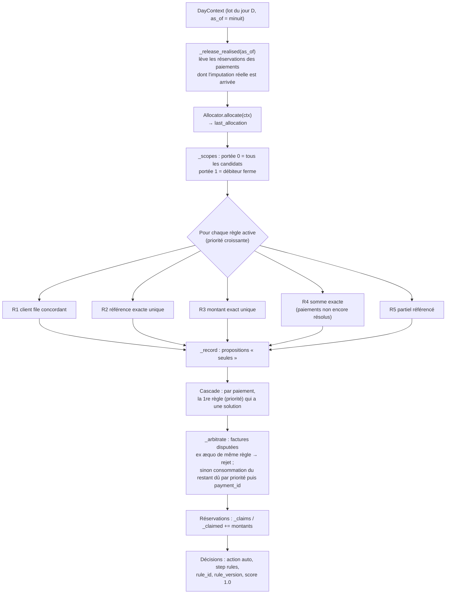

# Module `src/reconcile_rules/` — réconciliation algorithmique par règles (étape 4)

> **Résumé.** Chaque jour, `RulesMatcher` alloue le lot (étape 3). Il applique ensuite les règles
> déterministes actives de `config/rules.yaml`, R1 à R5, sur les factures **ouvertes à D** des
> débiteurs alloués. Une règle ne propose rien si sa solution n'est pas **unique**. La règle de plus
> haute priorité l'emporte (cascade). Un arbitrage au niveau du lot empêche deux paiements de solder
> la même facture. Un registre de **réservations** (`_claimed`) évite qu'une facture déjà soldée par
> le moteur soit réattribuée avant l'arrivée de l'imputation réelle. Chaque règle est aussi mesurée
> « seule ». Le module fournit la recherche bornée de sous-ensembles (`subset.py`), utilisée par R4
> et par l'étape 5.

Fichiers couverts :

| Fichier | Lignes | Contenu |
|---|---|---|
| `src/reconcile_rules/subset.py` | 118 | `exact_subset` (somme exacte unique, DFS borné), `near_subsets` (sommes proches, étape 5) |
| `src/reconcile_rules/matcher.py` | 348 | `RulesMatcher` (R1–R5, portées, cascade, arbitrage, réservations, propositions), `rule_alone_metrics` |
| `config/rules.yaml` | 52 | jeu de règles déclaratif et versionné |
| `src/reconcile_rules/__init__.py` | 0 | vide |

Le modèle Pydantic du YAML est dans `src/settings.py:244-299` (`RuleConfig`, `RulesConfig`). Il est
décrit au §4.

Conventions : *certain* = lu dans le code (référence `fichier:ligne`) ; *déduit* = interprétation,
signalée comme telle. Montants en **centimes entiers**.

> `single/reconciliation.py` contient une copie portable du même code (`exact_subset` à
> `single/reconciliation.py:4491`, `RulesMatcher` à `single/reconciliation.py:4634`). Ce document
> décrit `src/`.

---

## 1. Rôle et responsabilités

Le brief (`CLAUDE.md` §6) demande de résoudre par des règles auditables tout ce qui peut l'être,
sans apprentissage. Ces règles constituent la **baseline** à battre par le ML. Le docstring de
`matcher.py` (`src/reconcile_rules/matcher.py:1-20`) résume le fonctionnement :

1. allocation (étape 3) : débiteurs candidats, allocation ferme éventuelle, client file ;
2. règles actives par priorité croissante, sur les factures ouvertes à D de ces débiteurs. « La
   première qui trouve une solution **unique** l'emporte » ;
3. arbitrage au niveau du lot : « une facture n'est bloquée que si elle est soldée totalement ; deux
   paiements soldant la même facture par la même règle sont rejetés ».

Ce qui n'est pas résolu part à l'étape 5. Chaque décision porte l'identifiant et la version de la
règle.

### 1.1 Ce qui est exposé et qui l'utilise

| Nom | Où | Appelé par |
|---|---|---|
| `RulesMatcher` | `src/reconcile_rules/matcher.py:57` | `src/api.py:207-208` (`Project._matcher("rules")`, utilisé par `replay`/`backtest`), `src/reconcile_ml/pipeline.py:51` (`_ResidualMixin(RulesMatcher)`, base de `DatasetRecorder` et `PipelineMatcher`), `tests/test_rules.py:55` |
| `R1`…`R5` | `src/reconcile_rules/matcher.py:35` | `process`, tests |
| `RulesMatcher.proposals()` | `:329` | `src/api.py:236-237` (sorties annexes du rejeu → `replay_<matcher>_<période>_proposals.parquet`), `src/reconcile_ml/pipeline.py:279` |
| `RulesMatcher.last_allocation`, `_scopes`, `_claimed`, `_claims` | `:76`, `:94`, `:72-73` | réutilisés par l'étape 5 : `src/reconcile_ml/pipeline.py:65-68, 193, 241-242` |
| `rule_alone_metrics` | `:335` | `src/api.py:353-356` (`Project.evaluate`, table `by_rule_alone`) |
| `exact_subset`, `UNIQUE`/`NONE`/`AMBIGUOUS`/`BUDGET`, `SubsetResult` | `src/reconcile_rules/subset.py:18-76` | `src/reconcile_rules/matcher.py:30, 219`, `tests/test_rules.py:10, 136` |
| `near_subsets` | `src/reconcile_rules/subset.py:79` | `src/reconcile_ml/decision.py:23, 57` (ensembles « somme proche »), `src/reconcile_ml/pipeline.py:31, 224` (agrégats n↔n) |

### 1.2 Une journée de `RulesMatcher`



Toutes les règles sont **calculées** sur le lot. R4 ne porte que sur les paiements non résolus par
les règles qui la précèdent. La cascade choisit ensuite. Cette séparation permet la mesure « seule »
(§3.9).

---

## 2. `subset.py` — sous-ensembles à somme bornée

Docstring (`src/reconcile_rules/subset.py:1-10`) : parcours en profondeur sur les montants
**triés**, avec quatre élagages. La somme courante dépasse la cible (montants croissants). La cible
est hors d'atteinte même avec les plus grands montants restants. La profondeur dépasse `max_size`.
Le budget de nœuds est épuisé, ce qui donne un résultat « indéterminé ». « On s'arrête dès la
deuxième solution : l'unicité est tout ce qui compte pour valider. »

### 2.1 Statuts et résultat — `src/reconcile_rules/subset.py:18-25`

```python
UNIQUE, NONE, AMBIGUOUS, BUDGET = "unique", "none", "ambiguous", "budget"

@dataclass(frozen=True)
class SubsetResult:
    status: str
    indices: tuple[int, ...] = ()     # indices dans le tableau d'entrée (si unique)
    nodes: int = 0
```

### 2.2 `exact_subset` — `src/reconcile_rules/subset.py:28-76`

```python
def exact_subset(amounts: np.ndarray, target: int, max_size: int = 5, min_size: int = 1,
                 node_budget: int = 100_000) -> SubsetResult:
```

Il cherche un sous-ensemble **unique** de `amounts` (entiers > 0) qui somme exactement à `target`.

Pas à pas :

1. Tri stable des montants. `order` mémorise les indices d'origine (`:31-33`). Cible ≤ 0 ou entrée
   vide : `NONE` (`:35-36`).
2. `top[k]` = somme des `k` plus grands montants (`:39-41`). C'est un majorant de ce que `k`
   éléments de plus peuvent apporter. Le commentaire (`:37-38`) note qu'un tableau « par position »
   n'est pas nécessaire : le majorant global reste valide, simplement moins serré.
3. `dfs(start, total)` (`:46-67`) parcourt `i` croissant :
   - `nodes += 1`. Au-delà de `node_budget`, interruption (`:51-53`) ;
   - `s = total + a[i]`. Si `s > target`, **`break`** : les suivants sont plus grands (`:54-56`) ;
   - si `s == target` et la taille ≥ `min_size`, une solution est enregistrée. Dès la **deuxième**
     solution, interruption (`:58-61`) ;
   - sinon, si la profondeur le permet et que `s + top[restants] ≥ target`, récursion sur `i + 1`
     (`:62-65`).
4. Statut final (`:69-76`), dans cet ordre :
   - ≥ 2 solutions → `AMBIGUOUS` ;
   - parcours interrompu → `BUDGET`, **même si une solution a été trouvée**. Le résultat est
     conservateur : sans parcours complet, l'unicité n'est pas prouvée ;
   - aucune solution → `NONE` ;
   - sinon `UNIQUE`, avec `indices` = indices **d'origine** triés.

Deux montants égaux forment deux sous-ensembles distincts : `[100, 100, 300]` pour 400 donne
`AMBIGUOUS`. C'est voulu : rien ne permet de choisir entre deux factures de même montant.

**Exemple** (vérifié, cas de `tests/test_rules.py:129`) : `amounts = [100, 250, 400, 50]`, cible 650.
Montants triés : `[50, 100, 250, 400]`.

```text
50 → 50+100 → 50+100+250=400 → 50+100+250+400=800 > 650 (break)
             → 50+100+400=550 → (plus rien)
   → 50+250=300 → 50+250+400=700 > 650 (break)
   → 50+400=450
100 → 100+250=350 → 100+250+400=750 (break) ; 100+400=500
250 → 250+400=650 ✔ (solution 1)
400 → …
→ UNIQUE, indices d'origine (1, 2) [250, 400], 15 nœuds
```

### 2.3 `near_subsets` — `src/reconcile_rules/subset.py:79-118`

```python
def near_subsets(amounts: np.ndarray, target: int, tolerance: int, max_size: int = 5, min_size: int = 2,
                 node_budget: int = 100_000, max_solutions: int = 20) -> tuple[list[tuple[int, ...]], bool]:
```

Variante pour l'étape 5. Elle rend les sous-ensembles dont la somme est dans
`[target − tolerance, target + tolerance]`, avec un **minimum de 2 éléments** par défaut. Retour :
`(solutions en indices d'origine triés, parcours complet ?)`. Différences avec `exact_subset` :

- elle ne s'arrête pas à la deuxième solution, mais à `max_solutions` (`:109-110`) ;
- après une solution, elle **continue** à descendre si la tolérance le permet (`:111`) ;
- les solutions sont triées par **cardinalité croissante** (`:117`). Le docstring (`:83-84`)
  l'explique : « la parcimonie évite les combinaisons fortuites ».

Appelants : `src/reconcile_ml/decision.py:57` (somme proche sur les candidats les mieux scorés d'un
paiement) et `src/reconcile_ml/pipeline.py:224` (agrégats n↔n, `max_solutions=2`, une solution
exigée). Les deux ignorent le booléen « complet » (`sols, _ = …`).

---

## 3. `matcher.py` — `RulesMatcher`

### 3.1 Utilitaires — `src/reconcile_rules/matcher.py:35-54`

- `R1, R2, R3, R4, R5` (`:35`) : `"R1_CLIENT_FILE"`, `"R2_REFERENCE_UNIQUE"`, `"R3_AMOUNT_UNIQUE"`,
  `"R4_EXACT_SUM"`, `"R5_PARTIAL_REFERENCED"`. Ce sont les `id` de `config/rules.yaml`.
- Format commun des propositions d'une règle : `_PROPOSAL_COLUMNS = ["row", "inv", "amount"]`
  (`:36`). `row` est l'indice du paiement dans le lot, `inv` la position de la facture, `amount` le
  montant à imputer. `_no_proposal()` (`:39-40`) donne le cadre vide.
- `_first_two(frame, by)` (`:43-47`) garde **au plus deux lignes par groupe**. Docstring : « les
  règles exigent une facture unique par paiement, deux factures suffisent à établir l'ambiguïté.
  Évite de développer les milliers de factures d'une clé fréquente ou d'un montant rond. » C'est la
  principale protection mémoire des règles.
- `_unique_per_row(pairs)` (`:50-54`) garde les paiements pour lesquels **une seule facture
  distincte** ressort.

### 3.2 Construction — `RulesMatcher.__init__` — `src/reconcile_rules/matcher.py:60-76`

```python
class RulesMatcher:
    name = "rules"
    def __init__(self, state: LedgerState, settings: Settings, rules: RulesConfig,
                 allocator: Allocator | None = None):
```

| Attribut | Contenu |
|---|---|
| `allocator` | allocateur fourni ou `Allocator(state, settings.allocation)` (`:63`) |
| `ref` | `allocator.ref`, l'index de références partagé avec l'allocation (`:64`) |
| `rules` | `rules.active()` : règles `enabled`, triées par `priority` (`:65`, `src/settings.py:296-297`) |
| `version` | `rules.version`, tracée dans chaque décision (`:66`) |
| `min_key_length` | repris de `settings.allocation.signals.reference.min_key_length` (`:67`) |
| `_inv_ids`, `_inv_debtor`, `_pay_amount` | tableaux statiques (`:69-71`) |
| `_claimed` | `int64[n_factures]` : montants **réservés par le moteur** (`:72`) |
| `_claims` | `dict` paiement → `[(facture, montant)]` (`:73`) |
| `_proposed`, `_proposals` | registre des propositions « seules » (`:74-75`) |
| `last_allocation` | dernière `Allocation` calculée, réutilisée par l'étape 5 (`:76`) |

### 3.3 Registre des réservations — `_release_realised`, `_effective` — `src/reconcile_rules/matcher.py:80-90`

*Pourquoi* (docstring `:13-15` et GUIDE.md §3.5) : en rejeu, l'état suit les **imputations
réelles**. Les décisions du moteur ne modifient pas l'état. Sans registre, une facture soldée par le
moteur le jour D resterait ouverte le lendemain et pourrait être attribuée une seconde fois.

- `_effective(inv, balance)` (`:89-90`) : restant dû effectif = `balance − _claimed[inv]`. Il est
  utilisé par toutes les règles et par l'arbitrage.
- `_release_realised(as_of)` (`:80-87`), appelé en tête de `process`. Pour chaque paiement qui a des
  réservations, si `state.payment_imputed_at(p, as_of)` est vrai (au moins une imputation réelle
  appliquée avant D, `src/timeline/state.py:459-462`), toutes ses réservations sont retirées de
  `_claimed`. L'état a alors intégré l'imputation réelle : garder la réservation la compterait deux
  fois.
- Les réservations sont **créées** en fin de `process` pour les décisions acceptées (`:272-275`,
  `np.add.at`). L'étape 5 alimente le même registre (`src/reconcile_ml/pipeline.py:241-242`) :
  « Règles et ML partagent ce registre » (GUIDE.md §3.5).

Exemple (test `test_claim_released_when_real_imputation_arrives`, `tests/test_rules.py:98-105`) :

| Jour | Événement | Restant dû état | `_claimed` | Effectif |
|---|---|---|---|---|
| 05/03 | P1 (400, cite FA0000001) → R5 partiel sur I1 (1 000) | 1 000 | 400 | 600 |
| 06/03 | imputation réelle de P1 appliquée (posée le 05/03 à 10 h) ; `_release_realised` lève la réservation | 600 | 0 | 600 |
| 07/03 | PZ (600, cite FA0000001) → R2 sur I1 (restant 600 = montant) | 600 | 600 | 0 |

Sans la levée, l'effectif du 07/03 serait 600 − 400 = 200 et PZ ne serait pas résolu.
`test_engine_claims_prevent_double_settlement` (`:90-95`) vérifie le cas inverse : P1 solde I1 le
05/03, PY (même référence, même montant) n'obtient rien le 06/03.

### 3.4 Portées — `_scopes`, `_in_scope` — `src/reconcile_rules/matcher.py:94-108`

```python
def _scopes(self, alloc, batch_ids: np.ndarray) -> dict[int, pd.DataFrame]:
```

Retour : `{0: DataFrame(row, debtor, rank), 1: DataFrame(row, debtor, rank)}`.

- portée **0** : tous les candidats de l'allocation (au plus `max_candidates` par paiement) ;
- portée **1** : seulement le débiteur de l'**allocation ferme** (`rank = 1`).

Les lignes dont le débiteur est inconnu (position −1) sont retirées (`:104`). Chaque règle choisit
sa portée par le paramètre `firm_only` (`:243`). `_default_rules` le commente
(`src/settings.py:254-255`) : « firm_only = 1 : la règle ne porte que sur le débiteur d'une
allocation ferme ; 0 : sur tous les débiteurs candidats de l'allocation ». GUIDE.md §4 (étape 4)
donne la raison : « les règles "montant" ne portent que sur une allocation ferme, sinon les
collisions de montants entre débiteurs créeraient des erreurs ». `_in_scope(pairs, scope)`
(`:106-108`) est une jointure sur `(row, debtor)`.

`_scopes(...)[0]` est réutilisé comme portée des candidats ML (`src/reconcile_ml/pipeline.py:66`).

### 3.5 Factures référencées — `_referenced` — `src/reconcile_rules/matcher.py:112-130`

Base commune de R2 et R5. Retour : `DataFrame(row, inv, balance)`, les factures ouvertes des
débiteurs de la portée **citées par le libellé**.

1. Clés du libellé de longueur ≥ `min_key_length` (`:114-116`). Ce sont les mêmes que pour le
   signal référence de l'allocation.
2. Clés distinctes → factures (`key_invoices.gather`). Restant dû **effectif à D** :
   `_effective(inv, open_balance_at(inv, as_of))`, puis `> 0` (`:119-122`). Une facture future vaut
   0 et disparaît.
3. `_first_two` par **(clé, débiteur)** (`:123-124`) : deux factures au plus, assez pour voir
   l'ambiguïté.
4. **Portée d'abord** (`:125-128`, commentaire « Portée d'abord (quelques débiteurs par paiement),
   puis factures par (clé, débiteur) ») : (ligne, clé) × débiteurs de la portée, puis jointure sur
   (clé, débiteur). On ne joint jamais une ligne avec toutes les factures d'une clé.

Le résultat est mis en cache par valeur de `firm_only` dans `process` (`referenced[key]`,
`:247-249`). R2 et R5 le partagent.

### 3.6 Les cinq règles

Le tableau ci-dessous résume les règles. Les montants proposés sont ceux qui entreront dans la
décision.

| Règle | Méthode | Portée par défaut | Condition d'unicité | Montant proposé |
|---|---|---|---|---|
| R1 client file concordant | `_r1`, `:132-170` | 0 | chaque ligne du fichier → une seule facture ; toutes les lignes résolues ; aucune facture en double ; montants concordants ; somme des lignes = paiement (± `tolerance_abs_cents`) | montant de la ligne (restant dû si la ligne n'a pas de montant) |
| R2 référence exacte unique | `_r2`, `:172-177` | 0 | une seule facture référencée ouverte ; `|paiement − restant| ≤ tolerance_abs_cents` | **restant dû** (solde total) |
| R3 montant exact unique | `_r3`, `:185-195` | 1 | une seule facture ouverte du débiteur au restant dû **exactement** égal | montant du paiement |
| R4 somme exacte | `_r4`, `:197-224` | 1 | `exact_subset` → `UNIQUE` parmi ≤ `max_open_invoices` factures ≤ paiement | restants dus des factures du sous-ensemble |
| R5 partiel référencé | `_r5`, `:179-183` | 0 | une seule facture référencée ; `0 < paiement < restant` | montant du paiement (imputation partielle) |

#### R1 — `_r1(pos, amount, alloc, as_of, scope, params)` — `:132-170`

1. Paiements ayant un `client_file_id` dans l'allocation (`:133-136`). L'allocation ne rattache
   qu'un fichier **reçu** avant D et sans ambiguïté (voir `allocation.md` §3.9).
2. Lignes de ces fichiers, **filtrées sur les fichiers reçus** par
   `state.client_file_lines(files, as_of)` (`:138`, `src/timeline/state.py:333-340`).
3. Clés de référence de chaque ligne (`invoice_reference_keys`), traduites dans le vocabulaire et
   filtrées sur `min_key_length` (`:141-146`). Ensuite factures, restant dû effectif > 0, débiteur
   (`:147-151`). Les candidats sont restreints à la portée (`_in_scope`) et dédoublonnés par (ligne,
   facture) (`:153`).
4. Une ligne est **résolue** si elle mène à une seule facture (`:154-155`). Montant de la ligne :
   valeur du fichier, **ou restant dû si la ligne n'a pas de montant** (`:156-157`). Concordance :
   `|montant − restant| ≤ tolerance_abs_cents + tolerance_rel × restant` (`:158-160`).
5. Par paiement (`:163-169`), le groupe est validé **en entier** si toutes ces conditions tiennent :
   - le nombre de lignes résolues égale le nombre de lignes du fichier ;
   - toutes les lignes sont concordantes ;
   - aucune facture n'est citée deux fois ;
   - `|Σ montants − paiement| ≤ tolerance_abs_cents`.

   Sinon le paiement n'a pas de proposition R1.

#### R2 et R5 — `_r2`, `_r5` — `:172-183`

Les deux partent de `_unique_per_row(referenced)`, donc d'une **seule** facture citée parmi toutes
les clés du libellé. Un libellé qui cite deux factures ouvertes n'est donc résolu ni par R2 ni par
R5. R4 peut prendre le relais si l'allocation est ferme.

- R2 : écart ≤ `tolerance_abs_cents` (0) → solde de la facture, `amount = balance` (`:174-177`).
- R5 : `0 < paiement < restant` → `amount = paiement` (`:181-183`). Avec la tolérance 0 de R2, les
  deux règles sont exclusives.

#### R3 — `_r3(amount, as_of, scope)` — `:185-195`

1. Toutes les factures ouvertes à D (`open_invoice_positions(as_of)`) au restant dû effectif > 0
   (`:186-189`).
2. `_first_two` par **(montant, débiteur)** (`:189`).
3. Jointure **portée d'abord** : (ligne, débiteur de la portée, montant du paiement) avec (montant,
   débiteur) (`:190-193`). Le commentaire le dit : « pas de jointure sur le seul montant ».
4. Unicité par paiement (`:194`).

Exemple (cas figé P3, `tests/test_rules.py:35`) : D2 a deux factures ouvertes de 701 (I4, I5).
`_first_two` en garde deux, il n'y a pas d'unicité, et R3 ne propose rien. Le paiement part à
l'étape 5.

#### R4 — `_r4(rows, amount, as_of, scope, params)` — `:197-224`

1. Seulement sur `rows` : les paiements qu'aucune règle précédente de la boucle n'a résolus
   (`np.flatnonzero(~decided)`, `:254`). Le docstring (`:17-19`) indique que R4, coûteuse, est
   mesurée « sur le résiduel des règles de priorité inférieure » (numéro de priorité plus petit).
2. Factures ouvertes à D des débiteurs de la portée (`debtor_open_invoices_at`), au restant dû
   effectif > 0 (`:201-205`), regroupées par débiteur dans un dictionnaire (`:206`).
3. Par paiement (`:209-223`) : réunion des factures de ses débiteurs de portée, **filtrée sur
   restant ≤ paiement** (`:215-216`). Le paiement est abandonné s'il ne reste aucune facture ou s'il
   en reste plus de `max_open_invoices` (30) (`:217-218`). Sinon
   `exact_subset(bals, montant, max_size=max_invoices (5), node_budget=100 000)`, retenu seulement
   si `UNIQUE`.

Comme `exact_subset` est appelé avec `min_size=1`, R4 peut aussi trouver une facture **seule**. R3,
placée avant, a en général déjà traité ce cas. Avec deux factures de même montant, R4 rend
`AMBIGUOUS`, comme R3.

Exemple (cas figé P4, `tests/test_rules.py:36`) : l'IBAN direct de D3 donne une allocation ferme.
Factures de D3 : 777, 300, 5 000 ; paiement 1 077. 5 000 est filtrée (> 1 077), et {777, 300} est
l'unique somme → R4 sur (I3, I6).

### 3.7 La journée — `process(ctx)` — `src/reconcile_rules/matcher.py:228-281`

```python
def process(self, ctx: DayContext) -> pd.DataFrame:
```

1. `_release_realised(as_of)` (`:230`).
2. Positions et montants du lot. `alloc = allocator.allocate(ctx)`, mémorisé dans
   `last_allocation` (`:231-235`). Portées (`:236`).
3. **Boucle des règles actives** (`:241-258`) avec `memory.mark(f"règles · {rule.id}")`. Une règle
   d'`id` inconnu lève `ValueError` (`:255-256`). Après chaque règle, ses paiements sont marqués
   `decided` (`:258`), ce qui ne sert qu'à restreindre R4.
4. `_record(by_rule, …)` (`:259`) : enregistrement des propositions de **chaque** règle, avant
   cascade et arbitrage (§3.9).
5. **Cascade** (`:261-268`) : règles parcourues par priorité. Chaque règle prend les paiements
   qu'aucune règle plus prioritaire n'a pris (`taken`). La colonne `prio` est l'**indice** de la
   règle dans `self.rules` (0 = plus prioritaire), pas la valeur `priority` du YAML. Le résultat ne
   change pas, car `self.rules` est trié par `priority`.
6. `_arbitrate` (`:271`), puis création des réservations (`:272-275`).
7. Sortie (`:276-281`) au format `DECISION_COLUMNS` (`src/timeline/loop.py:38`), une ligne par
   (paiement, facture) :

| Colonne | Valeur |
|---|---|
| `payment_id`, `invoice_id` | identifiants |
| `amount` | montant imputé (`Int64`) |
| `action` | `"auto"` (`AUTO`) |
| `step` | `"rules"` |
| `rule_id` | identifiant de la règle retenue |
| `rule_version` | `rules.version` (`Int64`) |
| `score` | `1.0` |

`run_replay` vérifie ensuite ces décisions (`_validate`, `src/timeline/loop.py:147-166`) : paiement
du lot, factures existantes à D, sinon `LeakError`. Les paiements auto-validés sortent du reliquat
(`it.resolve`, `src/timeline/loop.py:188`).

### 3.8 Arbitrage des factures disputées — `_arbitrate` — `src/reconcile_rules/matcher.py:283-308`

```python
def _arbitrate(self, props: pd.DataFrame, batch_ids: np.ndarray, as_of) -> pd.DataFrame:
```

Docstring : « Une facture n'est bloquée que si elle est soldée totalement ; ex æquo de même règle →
rejet. »

1. Une facture est **disputée** si plusieurs paiements la proposent (`:286-287`). Sans facture
   disputée, tout est accepté.
2. Restant dû effectif de chaque facture disputée (`:290-291`).
3. **Ex æquo** (`:293-297`) : parmi les propositions qui **soldent** une facture disputée
   (`amount ≥ restant`), si plusieurs paiements la soldent par la **même règle** (même `prio`),
   **tous** sont rejetés. GUIDE.md §4 parle de « doublons de paiement ».
4. **Consommation séquentielle** (`:298-307`) : les groupes (`prio`, `payment_id`) sont parcourus
   par priorité de règle croissante, puis par `payment_id` **lexicographique**. Le paiement est
   accepté si chacune de ses factures disputées a encore assez de restant dû, qui est alors décrémenté.
   Sinon le paiement est rejeté.
5. Un paiement rejeté perd **toutes** ses propositions (`:308`), y compris sur des factures non
   disputées. Un groupe R1 ou R4 est donc accepté ou rejeté en entier.

Exemples (vérifiés en exécutant le moteur sur le jeu de `tests/test_rules.py`, facture I1 de 1 000) :

| Lot | Propositions | Résultat | Raison |
|---|---|---|---|
| P1 « VIR FA0000001 » 1 000 ; PX idem | R2 solde I1 ×2 | **aucune décision** | ex æquo de même règle (test `test_same_rule_tie_on_one_invoice_rejects_both`, `:84-87`) |
| P1 1 000 ; P2 « FACT FA0000001 » 400 | P1 R2 (solde), P2 R5 (partiel) | P1 accepté, P2 rejeté | R2 passe d'abord et met le restant à 0 ; 400 > 0 |
| P1 400 ; P2 300 | R5 et R5 | les deux acceptés | 400 + 300 ≤ 1 000 : la facture n'est pas soldée, donc pas bloquée |
| P1 700 ; P2 400 | R5 et R5 | P1 accepté, P2 rejeté | 700 + 400 > 1 000 ; départage par `payment_id` |

### 3.9 Mesure « seule » — `_record`, `proposals`, `rule_alone_metrics` — `src/reconcile_rules/matcher.py:312-347`

Le brief (`CLAUDE.md` §6) demande que chaque règle soit « mesurée seule (précision, couverture) ».

- `_record(by_rule, batch_ids, pos, day)` (`:312-327`) : pour chaque règle et chaque paiement, il
  enregistre la **première** proposition (jour où la règle propose pour la première fois ce
  paiement). Le registre `_proposed` contient des couples (règle, position de paiement). Une
  proposition est un tuple de `invoice_id` **ordonné par position de facture** (`sort_values(["row",
  "inv"])`, `:316`).
- `proposals()` (`:329-332`) : `DataFrame(payment_id, rule_id, invoices, day)`. Le test
  `test_proposals_record_each_rule_alone` (`tests/test_rules.py:118-123`) vérifie que R2 et R3
  proposent toutes deux I1 pour P1, alors que la cascade retient R2.
- `rule_alone_metrics(proposals, truth, scope, rules)` (`:335-347`) :

```python
def rule_alone_metrics(proposals: pd.DataFrame, truth: pd.DataFrame, scope: pd.DataFrame,
                       rules: list[RuleConfig]) -> pd.DataFrame:
```

  - `truth` : sortie de `ground_truth` (`src/evaluation/metrics.py:52`), colonne `truth_invoices`
    (tuple trié par `invoice_id`) ;
  - `scope` : paiements arrivés dans la période (`src/api.py:315-318`) ;
  - une proposition est **correcte** si `truth_invoices == tuple(invoices)` (égalité exacte
    d'ensembles ordonnés) ;
  - sortie, une ligne par règle (y compris désactivée) : `rule_id`, `règle`, `propositions`,
    `correctes`, `précision` (`None` si aucune proposition), `couverture` (= propositions /
    paiements du périmètre).

La mesure « en cascade » (ce que chaque règle décide effectivement) est calculée par l'évaluation
générale (`src/evaluation/metrics.py`). L'interface affiche les deux côte à côte
(`src/ui/views/rules.py:98-106`).

---

## 4. `config/rules.yaml` et son modèle

```yaml
version: 2            # config/rules.yaml:5  — tracée dans chaque décision
min_precision: 0.995  # config/rules.yaml:8
rules:                # config/rules.yaml:11
```

| id (ligne) | priority | params |
|---|---|---|
| `R1_CLIENT_FILE` (`:12`) | 1 | `tolerance_abs_cents: 0`, `tolerance_rel: 0.0`, `firm_only: 0` |
| `R2_REFERENCE_UNIQUE` (`:21`) | 2 | `tolerance_abs_cents: 0`, `firm_only: 0` |
| `R3_AMOUNT_UNIQUE` (`:29`) | 3 | `firm_only: 1` |
| `R4_EXACT_SUM` (`:36`) | 4 | `max_invoices: 5`, `node_budget: 100000`, `max_open_invoices: 30`, `firm_only: 1` |
| `R5_PARTIAL_REFERENCED` (`:46`) | 5 | `firm_only: 0` |

Modèle Pydantic (`src/settings.py`) :

- `RuleConfig` (`:244-250`) : `id`, `name`, `description`, `enabled=True`, `priority ≥ 1`,
  `params: dict[str, int | float]`. Les paramètres ne sont **pas typés par règle** : le code les lit
  avec `params.get(clé, défaut)`.
- `RulesConfig` (`:278-297`) : `version` (défaut 1), `min_precision` (défaut 0,995), `rules` (défaut
  `_default_rules()`, `:253-275`, identique au YAML). Le validateur `_unique` (`:286-294`, décoré `model_validator`) refuse les
  `id` ou `priority` dupliqués. `active()` (`:296-297`) renvoie les règles actives triées par
  priorité.
- Lecture et écriture : `load_rules` / `save_rules` (`:322-328`). Un fichier absent donne les
  défauts.

**Désactivation d'une règle.** Le brief dit « une règle sous le seuil de précision est désactivée par
config ». Dans le code, `min_precision` n'est lu **que par l'interface** (`src/ui/views/rules.py:106-121`).
L'interface compare la précision « seule » au seuil, affiche un avertissement et propose un bouton
« Désactiver ces règles ». Ce bouton met `enabled: false` et incrémente `version`. Rien n'est
automatique dans la pipeline. `test_rules_save_bumps_version` (`tests/test_ui.py:87-95`) couvre
l'incrément de version.

---

## 5. Garanties transverses

### 5.1 Anti-fuite

| Lecture | Accesseur daté | Ligne |
|---|---|---|
| restant dû des factures citées | `open_balance_at(inv, as_of)` | `matcher.py:121, 148` |
| factures ouvertes (R3) | `open_invoice_positions(as_of)` | `matcher.py:186` |
| factures ouvertes d'un débiteur (R4) | `debtor_open_invoices_at(debtors, as_of)` | `matcher.py:202` |
| lignes de client file reçues | `client_file_lines(files, as_of)` | `matcher.py:138` |
| levée des réservations | `payment_imputed_at(payments, as_of)` | `matcher.py:84` |
| restant dû à l'arbitrage | `open_balance_at(contested, as_of)` | `matcher.py:291` |

Toutes passent par `LedgerState._check` (`src/timeline/state.py:274-278`). Les débiteurs viennent de
l'allocation, elle-même datée. La boucle vérifie enfin les décisions (`_validate`).

### 5.2 Bornes mémoire

GUIDE.md §8 : « Règles R2/R3/R5. La jointure se fait d'abord avec la portée (quelques débiteurs par
paiement), puis au plus deux factures par (clé ou montant, débiteur), ce qui suffit à établir
l'ambiguïté. »

| Risque | Mesure | Ligne |
|---|---|---|
| clé fréquente | clés distinctes, `_first_two` par (clé, débiteur), portée d'abord | `matcher.py:119, 123-128` |
| montant rond | `_first_two` par (montant, débiteur), portée d'abord | `matcher.py:189-193` |
| gros débiteur (R4) | factures ≤ paiement, abandon au-delà de 30, DFS borné à 5 éléments et 100 000 nœuds | `matcher.py:215-220` |
| explosion combinatoire | arrêt dès la 2ᵉ solution, budget de nœuds | `subset.py:52, 60` |

---

## 6. Tests

`tests/test_rules.py` : jeu figé de non-régression (`CASES`, `:32-40`) sur 5 débiteurs et 9
factures (`:16-29`), plus un client file F1 (`:50-52`). Tous les tests passent
(`python -m pytest tests/test_allocation.py tests/test_rules.py -q` → `37 passed`).

| Test | Ligne | Ce qu'il vérifie |
|---|---|---|
| `test_frozen_case` (×7) | `:72-74` | P1→R2 (I1) ; P2→R3 (I2, IBAN ferme) ; P3→aucune (deux 701) ; P4→R4 (I3, I6) ; P5→R5 (I8) ; P6→R1 (I9 via F1) ; P7→aucune |
| `test_decisions_carry_rule_and_version` | `:77` | `rule_version`, `step == "rules"`, `action == "auto"`, montant partiel = montant payé |
| `test_same_rule_tie_on_one_invoice_rejects_both` | `:84` | ex æquo de même règle → rejet des deux |
| `test_engine_claims_prevent_double_settlement` | `:90` | réservation : pas de double solde le lendemain |
| `test_claim_released_when_real_imputation_arrives` | `:98` | levée de la réservation à l'arrivée de l'imputation réelle |
| `test_disabled_rule_falls_through_to_next` | `:108` | R2 désactivée → R3 prend le relais |
| `test_proposals_record_each_rule_alone` | `:118` | mesure « seule » : R2 et R3 proposent, la cascade retient R2 |
| `test_exact_subset` (×5) | `:128-137` | `UNIQUE`, `AMBIGUOUS` (doublons), `NONE`, `max_size`, `BUDGET` |

`near_subsets` n'a **pas de test unitaire direct**. Il n'est couvert qu'indirectement, par les tests
de l'étape 5. `tests/test_ui.py:168-172` lance le backtest « règles » depuis l'interface.

---

## 7. ⚠️ Zones d'ombre

1. **`rule_alone_metrics` peut compter faux les groupes à plusieurs factures (certain sur le
   mécanisme, effet dépendant des données).** Les propositions sont des tuples ordonnés par
   **position** de facture (`matcher.py:316, 320`). La vérité est triée par **`invoice_id`**
   (`src/evaluation/metrics.py:69`). La comparaison est une égalité de tuples (`matcher.py:344`). Si
   l'ordre de la table `invoice` ne suit pas l'ordre lexicographique des identifiants, une
   proposition R1 ou R4 correcte est comptée fausse. L'évaluation en cascade n'est pas touchée :
   elle retrie par `invoice_id`, `src/evaluation/metrics.py:87`.
2. **Désactivation « par config » non automatique (certain).** `min_precision` n'est utilisé que par
   l'interface (`src/ui/views/rules.py:106-121`). Une règle sous le seuil reste active tant qu'un
   humain ne l'a pas désactivée.
3. **Réservations qui ne sont jamais levées (déduit).** Une réservation n'est levée que lorsque le
   **paiement** reçoit une imputation réelle (`matcher.py:84`). Un paiement auto-validé par le
   moteur mais jamais imputé en réalité (remboursé, imputé hors historique) bloque sa facture pour
   le moteur jusqu'à la fin du rejeu. À l'inverse, la levée intervient dès la **première** ligne
   d'imputation (`_pay_lines > 0`, `src/timeline/state.py:462`), même si les autres lignes du groupe
   arrivent plus tard. La façon dont ces réservations seraient tenues en production n'est pas décrite.
4. **Départage par `payment_id` (certain).** À même priorité de règle, l'arbitrage sert les paiements
   dans l'ordre **lexicographique** de leur identifiant (`matcher.py:298`). Ce critère n'a pas de sens
   métier (ni date, ni montant). Il est seulement déterministe.
5. **R2 avec tolérance > 0 impute le restant dû, pas le montant payé (certain).** `amount =
   balance` (`matcher.py:176-177`). Avec `tolerance_abs_cents > 0`, un paiement légèrement inférieur
   serait enregistré comme soldant la facture pour un montant supérieur au paiement. Même remarque
   pour R1 : le montant de la ligne est retenu (`:157`) et peut différer du restant dû dans la
   tolérance. Une ligne de client file **sans montant** prend le restant dû et est toujours
   concordante (`:157`). La somme R1 n'utilise que la tolérance absolue (`:167`), pas `tolerance_rel`.
6. **`RulesMatcher` exige l'index de références (certain).** `self.ref = self.allocator.ref`
   (`matcher.py:64`) vaut `None` si les signaux référence **et** client file de l'allocation sont
   désactivés (`src/allocation/allocator.py:80`). R1, R2 et R5 lèveraient alors une `AttributeError`.
7. **Coûts journaliers non bornés par lot (déduit).** R3 parcourt **toutes** les factures ouvertes
   à chaque jour (`open_invoice_positions`, `_first_two` sur l'ensemble, `matcher.py:186-189`).
   `client_file_lines` filtre toute la table des lignes par `isin` (`src/timeline/state.py:340`). La
   mémoire est bornée par le nombre de factures ouvertes, mais pas le temps. R1 et R4 contiennent
   aussi des boucles Python par paiement (`:163`, `:209`).
8. **`near_subsets` : parcimonie partielle (déduit).** La recherche s'arrête à `max_solutions`
   (`subset.py:109-110`) dans l'ordre du DFS, qui descend d'abord en profondeur sur les petits
   montants. Le tri par cardinalité (`:117`) ne porte que sur les solutions trouvées : si le plafond
   est atteint, une solution de plus petite cardinalité peut manquer. Le booléen « complet » est
   ignoré par les deux appelants (`src/reconcile_ml/decision.py:57`, `src/reconcile_ml/pipeline.py:224`).
9. **Propositions « seules » ≠ indépendance totale (certain).** R4 n'est évaluée que sur le résiduel
   des règles qui la précèdent (`matcher.py:254`). Toutes les règles voient les restants dus
   **après** les réservations des jours précédents, qui dépendent de la cascade. Une seule
   proposition, la première, est gardée par (règle, paiement) (`:321-325`).
10. **`priority` et `prio` (certain, sans effet).** La cascade et l'arbitrage utilisent l'indice
    dans la liste active (`matcher.py:263, 267`), pas `RuleConfig.priority`. C'est équivalent tant
    que `active()` trie par priorité, mais deux concepts portent des noms proches.
11. **Paramètres non validés (certain).** `params: dict[str, int | float]` (`src/settings.py:250`) :
    une faute de frappe dans une clé (`firm_onyl`) est ignorée silencieusement, et le défaut
    `params.get(..., 0)` s'applique. Pour `firm_only`, ce défaut est la portée la plus large.
