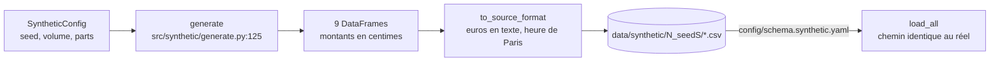

# Module `src/synthetic/` — générateur de données de test

> **Résumé.** `src/synthetic/generate.py` fabrique un jeu de données complet, déterministe (seed
> fixe), au **format source** : des CSV qui passent par le même chargeur que les données réelles,
> via `config/schema.synthetic.yaml`. Il produit les 9 tables à l'échelle réelle (environ 2 M de
> paiements par défaut) et y injecte les situations métier difficiles : groupements, partiels,
> escomptes, frais, retenues, n↔n, références bruitées, orphelins, doublons, client files. Il sert
> **aux tests et à la démonstration, jamais à mesurer une performance réelle** (docstring
> `src/synthetic/generate.py:1-5`).

---

## 1. Rôle et usages

| Usage | Où |
|---|---|
| Tests (jeu de 5 000 paiements, seed 7) | fixture `synthetic_dir`, `tests/conftest.py:14-21` |
| Démonstration et développement | `Project(dataset="synthetic").load(n_payments=...)` → `Project._synthetic_source` (`src/api.py:120`) |
| Page Chargement de l'interface | volume, seed, régénération (`src/ui/views/load.py`) |

Le jeu est écrit dans `data/synthetic/<n_payments>_seed<seed>/`, un dossier par variante. Il est
réutilisé tant que `regenerate=False`. Le module est **absent de la version portable** (`single/`) :
le code qui l'utilise y est retiré par les marqueurs `<synthétique>`.

---

## 2. `SyntheticConfig` (`src/synthetic/generate.py:54`)

| Champ | Défaut | Rôle |
|---|---|---|
| `seed` | 42 | graine de `numpy.random.default_rng` |
| `start`, `n_days` | 2024-01-01, 365 | période couverte |
| `n_payments` | 2 000 000 | volume visé (± quelques %) |
| `debtors_per_payment` | 0,025 | soit 50 000 débiteurs pour 2 M de paiements |
| `assignors_per_payment` | 0,001 | soit 2 000 cédants |
| `n_technical_accounts` | 20 | comptes techniques (comptes de liaison) |
| `invoices_per_payment` | 1,47 | factures générées par paiement visé |
| `orphan_share` | 0,03 | paiements sans facture, jamais imputés |
| `duplicate_share` | 0,003 | paiements payés deux fois ; le doublon n'est jamais imputé |

---

## 3. `generate(cfg)` (`src/synthetic/generate.py:125`), étape par étape

Tout est vectorisé (numpy / pandas) pour atteindre 2 M de paiements en environ une minute.

| Étape | Lignes | Ce qui est produit |
|---|---|---|
| Cédants | `:131` | identifiants `A…`, nom, IBAN, bankroll (`BR_STD` / `BR_SP`), ouverture ; jamais fermés |
| Débiteurs et comportements | `:144-159` | identifiants `D…`, raison sociale synthétique (`_companies`, patronymes à syllabes, environ 30 000 combinaisons), IBAN (absent pour 10 %), bankroll, ouverture. Comportements cachés : **poids** Pareto(1,2) plafonné (tailles très inégales), taux de citation de référence (5 % à 95 %), délai moyen N(5, 15) j, propension à grouper |
| Comptes techniques | `:161-165` | 20 IBAN de liaison |
| Contrats | `:167` | 1 à 3 par débiteur, marché, produit, recours, désactivation éventuelle |
| Factures | `:192` | réparties selon le poids du débiteur ; montant, création, échéance |
| Références | `:207` | numérotation **propre à chaque cédant**, donc réutilisée d'un cédant à l'autre, dans l'un des 5 styles de référence |
| Lots de paiement | `:222-246` | factures payées, triées par débiteur et échéance, regroupées en lots de 1 à 4 (paiements 1↔n) |
| Scénarios par lot | `:247-284` | partiel en deux fois (n↔1) ; retenue de garantie BTP (5 % payés des mois plus tard, ou jamais) ; **n↔n** (lot de 3–4 factures payé en deux virements de montants arbitraires) ; `booking_date` = date de valeur + 0 à 2 j ; route IBAN (voir §4) |
| Vérité des imputations | `:285-303` | allocation paiement → factures ; en n↔n, le premier virement solde dans l'ordre des échéances, le second continue |
| Libellés | `:304-337` | au plus 3 références citées, de façon bruitée (sans préfixe, sans zéros, inversées). **Bruit** : faute de frappe sur un chiffre (2 %, `_typo`), référence d'une autre facture (1,5 %) |
| Écarts de montant | `:338-363` | escompte (0,5–3 %) ou frais SWIFT (5–40 €) ; l'imputation solde quand même la facture |
| Orphelins | `:364-381` | 3 % de paiements sans facture, jamais imputés |
| Doublons | `:382-422` | 0,3 % de paiements en double, jamais imputés ; statuts d'imputation `TOTAL` / `PARTIEL` |
| Client files | `:423-450` | pour 40 % des paiements groupés (hors partiels) : un fichier (total, date, IBAN, émetteur) et ses lignes |

Retour : un `dict` de 9 DataFrames, montants en centimes, dates en `datetime64` (`:451-455`).

---

## 4. Routage IBAN simulé

`src/synthetic/generate.py:278-283` :

| Tirage | Part | IBAN du paiement |
|---|---|---|
| route < 0,75 et débiteur avec IBAN | ≈ 67 % | IBAN propre du débiteur → `DEBTOR_DIRECT` |
| route < 0,90 (sinon) | ≈ 23 % | un des 20 comptes techniques → `TECHNICAL_ACCOUNT` |
| route ≥ 0,90 | 10 % | IBAN aléatoire inconnu → `UNKNOWN` |

---

## 5. Écriture au format source

- **`to_source_format`** (`src/synthetic/generate.py:480`) : montants en euros sous forme de texte
  `1234.56` (`_format_amount`, `:464`) ; dates `AAAA-MM-JJ` ; horodatages en **heure de Paris sans
  fuseau** (`_format_datetime`, `:471`). Le but est d'exercer les conversions du chargeur
  (docstring `:19-21`).
- **`write_synthetic(cfg, out_dir)`** (`src/synthetic/generate.py:492`) : un CSV par table, retourne
  le nombre de lignes par table.
- **`config/schema.synthetic.yaml`** : le mapping correspondant (`amount_unit: units`,
  `source_timezone: Europe/Paris`, formats de date, `value_maps` `TOTAL`/`PARTIEL` → `FULL`/`PARTIAL`).

---

## 6. Tests

`tests/test_synthetic.py` :
- génération déterministe (`test_generation_is_deterministic`) ;
- volume atteint ;
- vérité cohérente (`test_generated_ground_truth_is_consistent`) ;
- normalisation parallèle identique à la séquentielle.

Le jeu sert aussi de base aux tests de chargement, de journal, d'allocation (rappel ≥ 99 %) et de ML.

---

## ⚠️ Zones d'ombre et limites de réalisme

Comparaison avec ce que le reste du code doit gérer sur données réelles :

1. **Une ligne et un IBAN par partie.** Le générateur ne produit ni parties sur plusieurs lignes, ni
   IBAN partagé par plusieurs débiteurs. `consolidate_parties`, `party_iban` et
   `max_debtors_per_iban` ne sont donc pas exercés à l'échelle.
2. **Pas de distributions extrêmes.** Il n'y a pas de références génériques partagées par des
   milliers de factures, pas de montants ronds massifs, pas de très gros débiteurs à dizaines de
   milliers de factures ouvertes. Ce sont ces cas qui ont fait exploser la mémoire sur données
   réelles ; ils n'ont été reproduits qu'avec des scripts de stress hors dépôt.
3. **Pas de `bankroll_code` sur les paiements**, et pas d'IBAN à la fois débiteur et cédant :
   l'arbitrage par bankroll de `Allocator._iban` n'est pas exercé.
4. **Débiteurs jamais fermés** : les événements `PARTY_CLOSED` des débiteurs n'apparaissent pas.
5. **Délais d'imputation courts** : le reliquat reste petit, alors que sur données réelles des
   imputations manuelles tardives peuvent le faire grossir fortement (re-scorage quotidien, mémoire).
6. **Ordre des identifiants = ordre des positions** (`_ids` numérote séquentiellement) : cela masque
   le bug B1 de [08](../08_zones_dombre_et_dette.md) (`by_rule_alone`).
7. **Vérité parfaite** : chaque paiement lié à des factures est imputé exactement ; il n'y a ni
   erreur de gestionnaire, ni imputation corrigée ou annulée.
