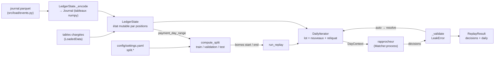
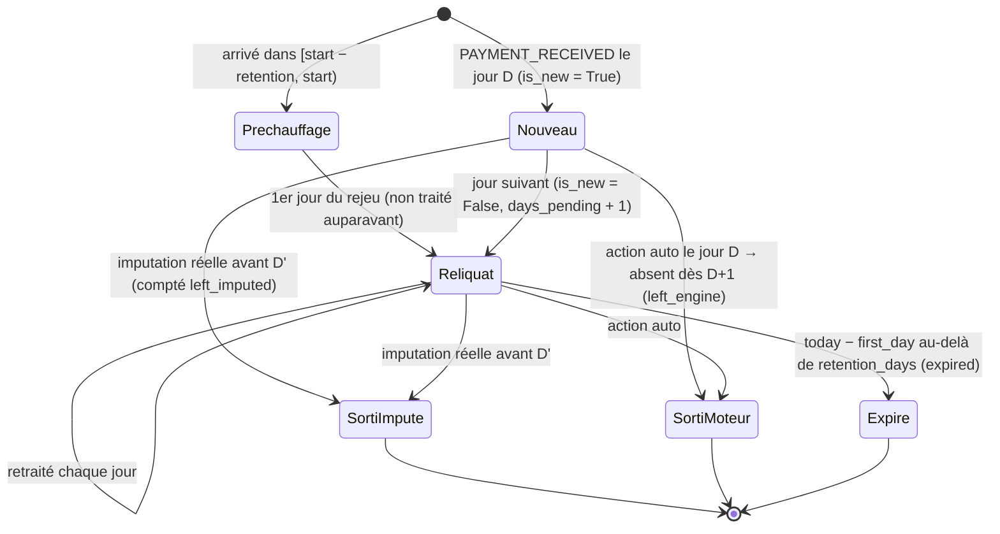

# Module `src/timeline/` — état daté, découpage temporel, boucle quotidienne

> **Résumé.** `src/timeline/` est le socle anti-fuite de la pipeline (étape 2 du brief).
> `state.py` convertit le journal d'événements en tableaux numpy et maintient un `LedgerState` qui ne
> répond qu'à l'instant exact `as_of` auquel il a été avancé (événements **strictement antérieurs**),
> sans jamais reculer. `split.py` découpe l'historique en périodes train / validation / test ancrées sur
> la fin des données, séparées par une purge. `loop.py` fournit `DailyIterator` (lot du jour = nouveaux
> paiements + reliquat retraité pendant `retention_days`) et `run_replay`, qui branche n'importe quel
> rapprocheur, contrôle ses décisions (`LeakError`) et journalise des statistiques quotidiennes.

`src/timeline/__init__.py` est vide (0 ligne) : rien n'est réexporté, les imports se font module par
module (`from src.timeline.state import LedgerState`, etc.).

---

## 1. Rôle et responsabilités

| Fichier | Responsabilité | Exposé (utilisé hors du module) |
|---|---|---|
| `src/timeline/state.py` | Rejouer le journal dans des tableaux numpy, répondre aux questions datées du moteur | `LedgerState`, `TemporalError`, `DAY_US`, `_to_us`, `_days` (ces deux derniers « privés » mais importés par d'autres packages) |
| `src/timeline/split.py` | Périodes train / validation / test et purge | `compute_split`, `assign_period`, `Split`, `Period`, `SplitError`, `PERIODS`, `PURGE`, `OUTSIDE` |
| `src/timeline/loop.py` | Boucle jour par jour, reliquat, contrôle des décisions | `DailyIterator`, `run_replay`, `ReplayResult`, `DayContext`, `Matcher`, `NullMatcher`, `empty_decisions`, `LeakError`, `AUTO`/`REVIEW`/`REJECT`, `ACTIONS`, `DECISION_COLUMNS` |

Les garanties annoncées par la docstring de `src/timeline/state.py:1-17` :

- toute lecture exige un `as_of` **égal** à l'instant de l'état, sinon `TemporalError` ;
- l'état ne recule jamais (`advance_to` refuse un instant passé) ;
- une facture n'est visible qu'après son `INVOICE_CREATED`, un client file après son `CLIENT_FILE_RECEIVED` ;
- le restant dû est reconstruit par les imputations (`invoice.current_amount` n'est pas chargé).

### 1.1 Vue d'ensemble



### 1.2 Une journée de rejeu

```mermaid
sequenceDiagram
    autonumber
    participant RR as run_replay / _run_replay
    participant IT as DailyIterator.__iter__
    participant LS as LedgerState
    participant M as Rapprocheur (Matcher)
    participant MEM as src.memory / src.progress

    Note over IT,LS: Avant le 1er jour : advance_to(start − retention) puis<br/>payments_arriving(warm, start) = reliquat initial
    RR->>IT: next(it)
    IT->>LS: advance_to(D)  (événements avant minuit de D, par blocs d'un jour)
    LS-->>LS: _apply(...) jour par jour, puis _expire(fenêtre)
    IT->>LS: payments_arriving(D, D+1)  → nouveaux du jour (lu dans le journal)
    IT->>LS: payment_imputed_at(reliquat, D)
    IT-->>IT: retire imputés / auto-validés / expirés
    IT->>LS: payments_frame(positions)  → lot + is_new, first_day, days_pending
    IT-->>RR: DayContext(day=D, batch, state)
    RR->>MEM: memory.mark_day(D, len(batch))
    RR->>M: process(ctx)
    M->>LS: lectures datées (as_of = D) : open_balance_at, debtor_open_invoices_at...
    M-->>RR: DataFrame DECISION_COLUMNS
    RR->>LS: _validate → state.invoices(cited, D)
    alt facture inconnue à D ou paiement hors lot
        RR-->>RR: raise LeakError
    end
    RR->>IT: resolve(paiements en action auto)
    RR->>MEM: memory.end_day() ; task.advance(1, détail)
    RR-->>RR: on_day(ctx, row) si fourni
```

### 1.3 Cycle de vie d'un paiement dans le reliquat



Priorité des motifs de sortie (certain, `src/timeline/loop.py:118-121`) : imputé réel > moteur > expiré
(un paiement à la fois imputé et auto-validé est compté `left_imputed`).

---

## 2. `src/timeline/state.py` — `LedgerState`

### 2.1 Constantes et utilitaires

| Élément | Ligne | Rôle |
|---|---|---|
| `DAY_US = 86_400_000_000` | `src/timeline/state.py:31` | Un jour en microsecondes : l'horodatage interne est un `int64` en µs depuis l'epoch, le numéro de jour est `ts // DAY_US`. Importé par `loop.py:34` et `src/allocation/allocator.py:33`. |
| `_CODE` | `src/timeline/state.py:32` | `EventType → rang` (`EVENT_RANK` de `src/load/events.py:40`), pour comparer des `int8`. |
| `_ROLES = ("assignor", "debtor")` | `src/timeline/state.py:33` | Index de rôle stocké dans `Journal.pos2` pour les événements de partie. |
| `_W_PAYMENTS … _W_DELAY_SQ`, `_N_WIN = 8` | `src/timeline/state.py:36-37` | Colonnes de la matrice `_win` des agrégats glissants (voir §2.7). |
| `INVOICE_COLUMNS` | `src/timeline/state.py:39-42` | Colonnes statiques renvoyées par `open_invoices` / `invoices`. |
| `TemporalError(RuntimeError)` | `src/timeline/state.py:45-46` | Lecture ou avance incompatible avec l'instant de l'état. |
| `_to_us(t)` | `src/timeline/state.py:49-50` | `pd.Timestamp(t).as_unit("us")` → `int`. Accepte chaîne, `Timestamp`, `datetime64`. Importé par `loop.py:34`. |
| `_days(values)` | `src/timeline/state.py:53-58` | Série de dates → numéro de jour `int64` ; `NaT` → `iinfo(int64).min // 2` (sentinelle très basse, pour que les différences restent calculables sans débordement). Importé par `allocator.py:33`, `features.py:23`, `pipeline.py:35`. |

#### `_Positions` (`src/timeline/state.py:61-72`)

Table de hachage identifiant → position dans une table, construite **une fois** (`pd.Index` sur des
`object`). `__call__(ids)` renvoie un tableau `int64` des positions, `-1` pour un identifiant inconnu
(`Index.get_indexer`). C'est ce qui permet de travailler ensuite exclusivement en positions numpy.
Instances publiques sur l'état : `inv_pos`, `pay_pos`, `agr_pos`, `party_pos[role]`, `cf_pos`
(`src/timeline/state.py:102-106`). Utilisées hors de l'état par `loop.py:98`,
`src/reconcile_rules/matcher.py:97,232`, `src/reconcile_ml/pipeline.py:61,240`,
`src/reconcile_ml/features.py:94,341`, `src/allocation/allocator.py:442`.

#### `Journal` (`src/timeline/state.py:75-86`)

Dataclass gelée : le journal converti en cinq tableaux alignés, un événement par ligne, dans l'ordre
du journal.

| Champ | Type | Contenu |
|---|---|---|
| `ts` | `int64` µs | horodatage |
| `code` | `int8` | rang du type d'événement |
| `pos` | `int64` | position de l'entité dans sa table (paiement pour une imputation), `-1` si inconnue |
| `pos2` | `int64` | position de la facture (imputation) ou index de rôle (partie), sinon `-1` |
| `amount` | `int64` | montant imputé en centimes (imputation), sinon 0 |

### 2.2 Construction : `LedgerState.__init__(self, data: LoadedData, journal: pd.DataFrame, window_days: int = 180)`

`src/timeline/state.py:90-138`.

1. **Tables statiques** (`:91-100`) : `invoice`, `payment`, `agreement`, `assignor`, `debtor`, et si
   présentes `client_file`, `client_file_line`, `technical_account`, `party_iban`, toutes
   `reset_index(drop=True)` pour que l'index pandas coïncide avec la position.
2. **Index identifiant → position** (`:102-107`).
3. **Attributs statiques numpy** (`:111-114`) : `_inv_initial` (montant initial, `NaN → 0`),
   `_inv_debtor` (position du débiteur de chaque facture, `-1` si inconnu), `_inv_due_day`,
   `_pay_value_day`.
4. **Index CSR débiteur → factures** (`:116-118`) : `order = argsort(_inv_debtor, stable)` et
   `_debtor_offsets = searchsorted(_inv_debtor[order], arange(n_deb + 1))`. Les factures du débiteur `d`
   sont `_by_debtor[_debtor_offsets[d]:_debtor_offsets[d+1]]`. Les factures sans débiteur connu
   (`-1`) sont triées en tête et hors de toute tranche. C'est ce qui évite toute boucle sur toutes les
   factures (règle du brief §10).
5. **État mutable** (`:121-136`) :

| Attribut | Forme | Sens |
|---|---|---|
| `_cursor` | int | prochain événement du journal à appliquer |
| `_as_of` | int µs ou `None` | instant de l'état ; `None` tant que `advance_to` n'a pas été appelé |
| `_inv_created` | bool[n_inv] | facture créée avant `as_of` |
| `_balance` | int64[n_inv] | restant dû reconstruit (`initial − Σ imputations`) |
| `_pay_received` | bool[n_pay] | `PAYMENT_RECEIVED` appliqué |
| `_pay_imputed` | int64[n_pay] | Σ montants imputés par paiement (**jamais lu**, voir Zones d'ombre) |
| `_pay_lines` | int64[n_pay] | nombre de lignes d'imputation par paiement |
| `_agr_active` | bool[n_agr] | contrat actif |
| `_party_active[role]` | bool | partie active ; initialisé à `True` si `opened_at` est vide (« active depuis toujours », `:129-130`) |
| `_party_known[role]` | bool | partie ayant existé (ouverte, même fermée depuis) |
| `_cf_received` | bool[n_cf] | client file reçu |
| `_open_count`, `_open_amount` | int64[n_deb] | encours instantané par débiteur (nombre, montant ≥ 0) |
| `_win` | float64[n_deb, 8] | agrégats comportementaux de la fenêtre glissante |
| `_contrib` | `deque[(jour, débiteurs, valeurs)]` | contributions datées à retirer quand elles sortent de la fenêtre |

6. **Encodage du journal** : `self.journal = self._encode(journal)` (`:138`).

`window_days` vient de `settings.reconcile_ml.features.behavioral_window_days` (180 par défaut,
`src/settings.py:156`) chez tous les appelants de production : `src/api.py:184`,
`src/reconcile_ml/pipeline.py:370,456,477`. Les tests construisent l'état via
`tests/test_timeline.py:27-29` (`ledger(data, window_days=180)`).

### 2.3 `_encode(self, journal) -> Journal` (`src/timeline/state.py:142-170`)

Pas à pas :

1. `code` = rang de `event_type` (`:145`).
2. `fill(types, positions)` (`:150-154`) remplit `pos` pour les lignes des types donnés via l'index
   identifiant → position adéquat. Appliqué à `INVOICE_CREATED` (factures), `PAYMENT_RECEIVED`
   (paiements), `AGREEMENT_CREATED/DISABLED` (contrats), `CLIENT_FILE_RECEIVED` (client files, si la
   table existe ; sinon `positions=None` et `pos` reste à `-1`) (`:156-159`).
3. Imputations (`:160-161`) : `pos` = position du **paiement**, `pos2` = position de la **facture**
   (`related_id`).
4. Parties (`:162-166`) : pour chaque rôle, les lignes `PARTY_OPENED/CLOSED` dont `related_id` vaut
   `"ASSIGNOR"` / `"DEBTOR"` reçoivent la position dans la table du rôle, et `pos2 = index du rôle`.
5. `ts` en µs (`:167`) ; **contrôle de tri** : si `diff(ts) < 0` quelque part → `ValueError("journal non trié
   par horodatage")` (`:168-169`). `advance_to` repose sur `searchsorted`, d'où cette exigence.
6. `amount = journal["amount"].fillna(0)` (`:170`) ; ce montant est le montant imputé dérivé par
   `derive_imputed_amounts` (`src/load/events.py:45-65`) à partir de `residual_amount`.

### 2.4 Avance : `advance_to(self, as_of) -> None` (`src/timeline/state.py:178-192`)

Applique tous les événements d'horodatage **strictement antérieur** à `as_of`.

1. `target = _to_us(as_of)` ; si `target < self._as_of` → `TemporalError("l'état est au …, il ne peut
   pas revenir au …")` (`:180-182`). Un `target` égal est accepté (no-op).
2. `hi = searchsorted(ts, target, side="left")` : index du premier événement `≥ target` (`:184`).
3. Boucle (`:186-190`) : tant que `_cursor < hi`, calcule la fin du jour UTC de l'événement courant
   (`day_end = (ts[cursor] // DAY_US + 1) * DAY_US`), prend `nxt = min(hi, searchsorted(ts, day_end))`,
   applique le bloc `[cursor, nxt)` par `_apply`, avance le curseur. **Pourquoi** (commentaire `:185`) :
   `_apply` traite un bloc comme un ensemble (ordre fixe par type, voir §2.5) ; découper par jour rend
   le résultat indépendant de la taille des sauts (avancer de 1 jour 30 fois = avancer de 30 jours).
4. `self._as_of = target` puis `_expire(target // DAY_US − window_days)` (`:191-192`).

Appelants : `DailyIterator.__iter__` (`src/timeline/loop.py:105,110`) et les tests
(`tests/test_timeline.py:40-87,95-98,261`). Aucun autre code de production n'avance l'état.

### 2.5 Application d'un bloc : `_apply(self, lo, hi)` (`src/timeline/state.py:194-235`)

Tout est vectorisé ; `sel(event)` (`:200-201`) sélectionne les lignes du type avec `pos >= 0`
(entité connue). Ordre d'application **fixe à l'intérieur du bloc**, indépendamment des heures :

1. Parties (`:203-208`) : `PARTY_OPENED` → actif + connu ; puis `PARTY_CLOSED` → inactif.
2. Contrats (`:209-210`) : `AGREEMENT_CREATED` → actif ; puis `AGREEMENT_DISABLED` → inactif.
3. Client files reçus, paiements reçus (`:211-212`).
4. Factures et imputations (`:214-232`) :
   - `created` = factures créées dans le bloc ; `imp` = imputations dont **paiement et facture** sont
     connus (`sel(...) & (pos2 >= 0)`, `:215`) ; `touched` = union unique des deux.
   - Avant : `before` = restant dû positif des factures touchées déjà créées, `was_open` =
     créée et solde > 0 (`:218-219`).
   - Création : `_inv_created = True`, `_balance = _inv_initial` (`:221-222`).
   - Imputations : `np.subtract.at(_balance, imp_inv, amount)`, `np.add.at` sur `_pay_imputed` et
     `_pay_lines` (`:223-225`). `ufunc.at` gère correctement plusieurs imputations sur la même facture
     dans le bloc.
   - Après : `after`, `is_open` (`:227-228`) ; mise à jour **différentielle** de l'encours par débiteur :
     `_open_count += is_open − was_open`, `_open_amount += after − before` (`:229-232`). C'est ce qui
     rend `debtor_stats` instantané sans reparcourir les factures.
5. Si des imputations existent : `_add_window(day[imp], pos[imp], imp_inv)` (`:234-235`).

Conséquences (certaines, vérifiées par `tests/test_timeline.py:38-61`) :

- une facture créée le jour D n'est visible qu'à l'état du jour D+1 (`advance_to(D)` exclut les
  événements de D) ;
- une imputation du 6 mars à 10 h n'est reflétée qu'à l'état du 7 mars.

### 2.6 Fenêtres glissantes : `_add_window` et `_expire`

`_add_window(self, day, pay, inv)` (`src/timeline/state.py:237-265`) calcule, pour chaque ligne
d'imputation dont la facture a un débiteur connu, un vecteur de 8 valeurs :

| Colonne | Valeur par ligne d'imputation | Ligne |
|---|---|---|
| `_W_PAYMENTS` | 1 si première ligne du couple (jour, paiement, débiteur) | `:245,254` |
| `_W_LINES` | 1 | `:255` |
| `_W_PARTIAL` | 1 si la facture reste ouverte (`_balance > 0`) **après** les imputations du bloc | `:256` |
| `_W_GROUPED` | 1 si le paiement impute plusieurs factures distinctes le même jour | `:244,257` |
| `_W_CITED` | 1 si un nombre du libellé du paiement (`label_numbers`) est une clé de la référence client de la facture (`client_reference_keys`) | `:249-252,258` |
| `_W_DELAY_N` | 1 si le délai est calculable (dates présentes) | `:247,259` |
| `_W_DELAY_SUM` | délai = jour de valeur du paiement − échéance de la facture | `:246,260` |
| `_W_DELAY_SQ` | délai² | `:261` |

Le test `abs(delay) < 1e6` (`:247`) écarte les délais construits sur la sentinelle `NaT` de `_days`.
Les valeurs sont ajoutées à `_win[débiteur]` (`np.add.at`, `:262`) **et** empilées dans `_contrib`
par jour d'imputation (`:263-265`).

`_expire(self, first_kept_day)` (`src/timeline/state.py:267-270`) dépile les contributions des jours
`< first_kept_day` et les soustrait de `_win`. Appelé avec `target // DAY_US − window_days`
(`:192`) : à l'état du jour T (minuit), la fenêtre contient les imputations des jours
`[T − window_days, T)`, soit exactement `window_days` jours, **strictement antérieurs**.
Vérifié par `tests/test_timeline.py:75-81` (fenêtre de 10 jours : imputation du 6 → comptée du 7 au 16,
expirée le 17).

**Pourquoi** une `deque` de contributions et non un recalcul : la spec (§8.2,
`spec_rapprochement_automatique.md:377`) demande des agrégats incrémentaux pour qu'un rejeu d'un an
reste exploitable.

### 2.7 Lectures datées

`_check(self, as_of)` (`src/timeline/state.py:274-278`) lève `TemporalError` si l'état n'a jamais été
avancé (`"l'état n'a pas encore été avancé"`) ou si `_to_us(as_of) != self._as_of` (égalité exacte à la
microseconde). Toutes les méthodes ci-dessous l'appellent en premier.

#### Lectures par identifiants (API « métier »)

| Méthode (signature exacte) | Lignes | Retour | Appelants |
|---|---|---|---|
| `open_invoices(self, debtor_ids, as_of) -> pd.DataFrame` | `:285-298` | factures créées et de solde > 0 des débiteurs, colonnes `INVOICE_COLUMNS` + `open_amount` (`Int64`), triées par position | tests seulement : `tests/test_timeline.py:41,44,58,184` |
| `invoices(self, invoice_ids, as_of) -> pd.DataFrame` | `:300-305` | factures demandées **déjà créées** (ouvertes ou non) ; les inconnues/futures sont ignorées | `src/timeline/loop.py:161` (contrôle anti-fuite), `tests/test_evaluation.py:106` |
| `open_amount(self, invoice_ids, as_of) -> pd.Series` | `:307-314` | restant dû (`Int64`, **non borné à 0**), `NA` si la facture n'existe pas encore ; index repris si l'entrée est une `Series` | tests : `tests/test_timeline.py:42-70,186,265` |
| `party_active(self, role: str, party_ids, as_of) -> np.ndarray` | `:316-319` | booléens, `False` si inconnu | tests : `tests/test_timeline.py:188-189` |
| `agreement_active(self, agreement_ids, as_of) -> np.ndarray` | `:321-324` | booléens | tests : `tests/test_timeline.py:187` |
| `client_files(self, as_of) -> pd.DataFrame` | `:326-331` | client files reçus (DataFrame vide si pas de table) | tests : `tests/test_timeline.py:96,99,190` |
| `client_file_lines(self, file_ids, as_of) -> pd.DataFrame` | `:333-340` | lignes des fichiers demandés **déjà reçus** | `src/reconcile_rules/matcher.py:138`, `src/reconcile_ml/features.py:277`, `tests/test_timeline.py:97,100` |
| `payment_imputed(self, payment_ids, as_of) -> np.ndarray` | `:342-346` | le paiement a-t-il ≥ 1 ligne d'imputation antérieure | **aucun appelant** (voir Zones d'ombre) |
| `debtor_stats(self, debtor_ids, as_of) -> pd.DataFrame` | `:348-374` | agrégats (ci-dessous) | `src/reconcile_ml/features.py:367`, tests |

`debtor_stats` renvoie, par débiteur demandé (zéros / `NaN` pour un débiteur inconnu) :
`open_invoice_count`, `open_invoice_amount` (instantanés), `payment_count`, `imputation_count`
(arrondis `np.rint` car `_win` est en flottants), `mean_payment_delay`, `std_payment_delay`
(variance `E[x²] − E[x]²` bornée à 0, `:361`), `partial_payment_rate`, `grouping_rate`,
`ref_citation_rate` (rapportés au nombre de lignes, `NaN` si aucune ligne).

**Calcul vectorisé des tranches CSR** (`open_invoices`, `:291-294`, et `debtor_open_invoices_at`,
`:407-413`) : avec `starts`, `ends`, `lengths` par débiteur demandé,
`idx = repeat(ends − cumsum(lengths), lengths) + arange(Σ lengths)` produit d'un coup les indices
`starts[k] + 0 … starts[k] + lengths[k] − 1` de chaque tranche (car `ends[k] − cumsum[k] =
starts[k] − Σ_{j<k} lengths[j]`). Aucune boucle Python par débiteur.

#### Lectures par positions (API interne des index)

Commentaire `src/timeline/state.py:377-378` : les attributs statiques ne dépendent pas du temps ; ce qui
en dépend passe par des lectures contrôlées.

| Méthode | Lignes | Retour | Appelants |
|---|---|---|---|
| `invoice_debtor_positions` (propriété, **sans** `as_of`) | `:380-382` | `_inv_debtor` (statique) | `src/allocation/allocator.py:75`, `src/reconcile_rules/matcher.py:70`, `src/reconcile_ml/features.py:90` |
| `invoice_created_at(self, positions, as_of)` | `:384-386` | bool | **aucun appelant** |
| `party_known_at(self, role, positions, as_of)` | `:388-391` | bool (ouverte à un moment, même fermée depuis) | `src/allocation/allocator.py:177,180,230` |
| `known_party_count(self, role, as_of) -> int` | `:393-395` | nombre de parties connues (dénominateur IDF de l'allocation) | `src/allocation/allocator.py:224` |
| `open_balance_at(self, positions, as_of)` | `:397-400` | solde, 0 pour une facture non créée | `src/allocation/allocator.py:132`, `src/reconcile_rules/matcher.py:121,148,291`, `src/reconcile_ml/features.py:227`, `src/reconcile_ml/pipeline.py:193` |
| `debtor_open_invoices_at(self, debtor_positions, as_of)` | `:402-415` | triplet `(index du débiteur demandé, facture, solde)` des factures ouvertes | `src/allocation/allocator.py:287`, `src/reconcile_rules/matcher.py:202`, `src/reconcile_ml/features.py:165,190` |
| `agreement_active_at(self, positions, as_of)` | `:417-419` | bool | `src/reconcile_ml/features.py:230` |
| `open_invoice_positions(self, as_of)` | `:421-425` | `(positions, soldes)` de **toutes** les factures ouvertes (`flatnonzero`) | `src/allocation/allocator.py:341`, `src/reconcile_rules/matcher.py:186`, `src/reconcile_ml/features.py:172,209` |
| `client_files_received_at(self, as_of)` | `:427-430` | positions des fichiers reçus | `src/allocation/allocator.py:408` |
| `payment_imputed_at(self, positions, as_of)` | `:459-462` | bool (≥ 1 ligne d'imputation antérieure) | `src/timeline/loop.py:115`, `src/reconcile_rules/matcher.py:84` |

#### Accès non datés (pas de `_check`)

| Méthode | Lignes | Usage |
|---|---|---|
| `table(self, name: str) -> pd.DataFrame` | `:432-436` | Tables statiques (docstring : « toute lecture d'existence passe par les accesseurs datés »). Appelants : `src/allocation/allocator.py:72-73,84,88,96`, `src/reconcile_rules/matcher.py:68`, `src/reconcile_ml/features.py:88-89,367`, `src/reconcile_ml/pipeline.py:57`. |
| `payments_frame(self, positions) -> pd.DataFrame` | `:440-441` | Lignes de la table `payment` aux positions données. Appelant : `loop.py:125`. |
| `payments_arriving(self, start, end)` | `:443-451` | `(positions, numéros de jour)` des `PAYMENT_RECEIVED` de `[start, end)`, **lu dans le journal** (docstring : « c'est l'arrivée du lot, pas une lecture d'état »). Appelant : `loop.py:106,112`. |
| `payment_day_range(self)` | `:453-457` | Premier et dernier jour d'arrivée de paiement dans **tout** le journal. Appelants : `src/api.py:196`, `src/reconcile_ml/pipeline.py:371,478`. |
| `as_of` (propriété) | `:174-176` | Instant courant en `Timestamp`, `None` avant la première avance. |

---

## 3. `src/timeline/split.py` — découpage en périodes

Docstring `src/timeline/split.py:1-7` : découpage sur les jours, jamais aléatoire, **ancré sur la fin de
l'historique** ; `purge_days` jours exclus entre deux blocs ; bornes inclusives.

### 3.1 Types

- `PERIODS = ("train", "validation", "test")`, `PURGE = "purge"`, `OUTSIDE = "hors période"`
  (`src/timeline/split.py:19-21`) — aussi importés par l'interface (`src/ui/views/split.py:9`).
- `SplitError(ValueError)` (`:24-25`).
- `Period(name, start, end)` gelée, propriété `days = (end − start).days + 1` (`:28-36`).
- `Split(periods, warnings=())` gelée ; `period(name)` renvoie la période par nom via
  `next(...)` **sans valeur par défaut** (`:39-45`).

### 3.2 `compute_split(cfg: SplitSettings, data_start: date, data_end: date) -> Split` (`:53-79`)

Paramètres lus dans `SplitSettings` (`src/settings.py:47-59`) : `test_months` (2), `validation_months`
(2), `train_months` (`None` = tout l'historique), `purge_days` (5), `anchor_end` (`None` = dernier jour
des données), `retention_days` (60, utilisé par la boucle, pas par le découpage).

Pas à pas :

1. Plage vide → `SplitError` (`:54-55`).
2. `end = anchor_end or data_end` ; hors de `[data_start, data_end]` → `SplitError` (`:56-58`).
3. `gap = purge_days + 1` jours (`:59`) : la fin d'un bloc et le début du suivant sont séparés de
   `gap` jours, donc exactement `purge_days` jours exclus entre eux.
4. Test = `[_months_before(end, test_months), end]` (`:61`). `_months_before(end, months)`
   (`:48-50`) = `end + 1 jour − months mois` : la période couvre `months` mois calendaires se terminant
   le jour `end` (ex. `2024-12-31`, 2 mois → `2024-11-01`).
5. Validation = `[_months_before(val_end, validation_months), val_end]` avec
   `val_end = test.start − gap` (`:62-63`).
6. Train = `[train_start, validation.start − gap]`, `train_start = data_start` ou, si `train_months`,
   `max(data_start, _months_before(train_end, train_months))` (`:64-70`). Train vide → `SplitError`.
7. Avertissement (pas d'erreur) si `train_months` est demandé mais que l'historique est plus court
   (`:72-76`).
8. Validation commençant avant les données → `SplitError` (`:77-78`).

Exemple vérifié (`tests/test_split.py:10-17`) sur 2024 complet, réglages par défaut :
test `11-01 → 12-31`, validation `08-27 → 10-26`, train `01-01 → 08-21`.

**Pourquoi la purge** : `SplitSettings.purge_days` (`src/settings.py:54-55`) « pour éviter qu'un groupe
d'imputations chevauche deux blocs ».

Appelants : `src/api.py:192` (`Project.split`), `src/api.py:199` (`Project._period`),
`src/reconcile_ml/pipeline.py:372,479`, `src/ui/views/split.py:49`, `tests/test_split.py`.

### 3.3 `assign_period(days: pd.Series, split: Split) -> pd.Series` (`:82-92`)

Étiquette chaque date (normalisée au jour) : `"hors période"` par défaut, `"purge"` pour tout jour
entre le début du premier bloc et la fin du dernier, puis écrasé par le nom de la période qui le
contient. Appelants : `src/reconcile_ml/pipeline.py:394` (colonne `period` du jeu d'entraînement : les
jours de purge rejoués entre train et validation y sont étiquetés `purge` et donc exclus des deux
jeux), `src/ui/views/split.py:56,58`, `tests/test_split.py:49-53`.

---

## 4. `src/timeline/loop.py` — boucle quotidienne

Docstring `src/timeline/loop.py:1-20` (à retenir) : un seul code pour le rejeu et la production ; l'état
est avancé à D (événements < D, « l'état figé à la veille ») ; le lot = paiements arrivés le jour D +
reliquat ; en rejeu, **l'état suit le journal réel** : les décisions du moteur ne modifient pas les
soldes, elles sont comparées aux imputations réelles à l'évaluation. (Le double règlement par le moteur
est empêché ailleurs, par le registre de réservations `RulesMatcher._claimed`,
`src/reconcile_rules/matcher.py:72,84-90` ; voir `GUIDE.md` §3.5.)

### 4.1 Constantes et format des décisions

- `AUTO, REVIEW, REJECT = "auto", "review", "reject"`, `ACTIONS` (`src/timeline/loop.py:36-37`).
- `DECISION_COLUMNS = ["payment_id", "invoice_id", "amount", "action", "step", "rule_id", "rule_version",
  "score"]` (`:38`) : une ligne par couple paiement × facture. Importé par
  `src/reconcile_rules/matcher.py:32`, `src/reconcile_ml/pipeline.py:33`, tests.
- `empty_decisions()` (`:74-80`) : DataFrame vide typé (`string`, `Int64`, `float64`). Utilisé par
  `NullMatcher`, `_run_replay` (`:200`), `src/allocation/evaluate.py:50`, `tests/test_allocation.py:191`.

### 4.2 `LeakError(RuntimeError)` (`:41-42`)

« Une décision utilise une information non disponible au jour D. » Levée uniquement par `_validate`.

### 4.3 `DayContext` (`:45-54`)

Dataclass : `day` (`Timestamp` minuit), `batch` (paiements + `is_new`, `first_day`, `days_pending`),
`state` (`LedgerState`). Propriété `as_of` = `day` : l'instant de lecture de l'état est **minuit du jour
D**. Tous les rapprocheurs lisent l'état avec `ctx.as_of`.

### 4.4 `Matcher` (protocole, `:57-62`) et `NullMatcher` (`:65-71`)

Un rapprocheur expose `name: str` et `process(self, ctx: DayContext) -> pd.DataFrame` (colonnes
`DECISION_COLUMNS`). Implémentations : `NullMatcher` (`name = "null"`, ne décide rien ; « sert de
référence et de test du harnais »), `RulesMatcher` (`src/reconcile_rules/matcher.py:58`),
`DatasetRecorder` et `PipelineMatcher` (`src/reconcile_ml/pipeline.py:95,128`), `AllocationProbe`
(`src/allocation/evaluate.py:25`), et des sondes de test (`Recorder`, `Snapshot`, `Oracle`…).
`NullMatcher` est instancié par `src/api.py:205` et par les tests (`tests/test_timeline.py:145,196`,
`tests/test_evaluation.py:76,148`, `tests/test_progress.py:20`).

### 4.5 `DailyIterator` (`:83-132`)

`__init__(self, state: LedgerState, start: date, end: date, retention_days: int = 60)` (`:84-94`) :
`ValueError` si `start > end`. Attributs : `_pending` (positions des paiements du reliquat),
`_first_day` (jour d'arrivée, numéro de jour), `_resolved` (`set` de positions auto-validées),
`last_counts` (compteurs du dernier jour).

`resolve(self, payment_ids) -> None` (`:96-99`) : convertit les identifiants en positions et les ajoute
à `_resolved`. Appelé par `_run_replay` (`:188`) avec les paiements ayant au moins une décision `auto`.

`__iter__(self) -> Iterator[DayContext]` (`:101-132`), pas à pas :

1. **Préchauffage** (`:103-106`) : `warm = start − retention_days` ; `state.advance_to(warm)` ;
   reliquat initial = paiements arrivés dans `[warm, start)` avec leur jour d'arrivée réel.
2. Pour chaque jour `day` de `start` à `end` inclus (`:108-132`) :
   - `state.advance_to(day)` (`:110`) — l'état reflète les événements < minuit de D ;
   - `today` = numéro de jour ; `new` = paiements dont `PAYMENT_RECEIVED ∈ [D, D+1)` (`:111-112`) ;
   - sur le reliquat : `imputed = payment_imputed_at(pend, day)` (imputation réelle prononcée avant
     D), `engine = isin(pend, _resolved)`, `expired = (today − first) > retention_days`,
     `keep = ~(imputed | engine | expired)` (`:114-118`) ;
   - `last_counts` = `new`, `carried`, `left_imputed`, `left_engine`, `expired` (`:119-121`) ;
   - lot = `pend[keep]` (dans l'ordre précédent) **puis** `new` (ordre du journal) ; `first_days`
     correspondants (`:123-124`) ;
   - `batch = payments_frame(positions)` + colonnes `is_new`, `first_day` (datetime), `days_pending`
     (`today − first_day`) (`:125-128`) ;
   - le lot complet devient le nouveau reliquat (`:129`) ; `yield DayContext(...)` (`:131`).

Points certains, vérifiés par `tests/test_timeline.py:130-154` :

- un paiement imputé le 7 à 10 h est encore dans le lot du 7 et sort le 8 ;
- avec `retention_days = 2`, un paiement arrivé le 5 est traité les 5, 6 et 7 puis sort : il est
  donc traité `retention_days + 1` jours ;
- une décision `auto` le 5 retire le paiement du lot du 6.

Appelants directs : `_run_replay` (`:182`) et `tests/test_allocation.py:73`.

### 4.6 `ReplayResult` (`:136-144`)

Dataclass : `decisions` (décisions validées + colonne `day`), `daily` (une ligne par jour), `matcher`
(nom), `start`, `end`, `seconds`, `extra` (dict, **jamais rempli** dans le dépôt).

### 4.7 `_validate(decisions, ctx) -> pd.DataFrame` (`:147-166`) — la garde anti-fuite

1. Colonnes manquantes parmi `DECISION_COLUMNS` → `ValueError` (`:148-150`) ; ne garde que ces colonnes
   (`:151`) ; lot vide → retour immédiat.
2. Action hors `ACTIONS` → `ValueError("actions inconnues …")` (`:154-156`).
3. Paiement absent du lot du jour → `LeakError("… décision(s) sur des paiements hors du lot du …")`
   (`:157-159`).
4. Factures citées (hors `NA`) : `ctx.state.invoices(cited, ctx.as_of)` ne renvoie que celles **déjà
   créées à D** ; toute autre → `LeakError("… facture(s) inconnue(s) au … citées par le rapprocheur, ex. …")`
   (`:160-165`).

Ce qui n'est **pas** contrôlé (certain, par lecture) : que la facture soit encore ouverte, que le montant
soit cohérent, l'unicité des lignes. La garde vise l'**accès au futur**, pas la justesse.
Tests : `tests/test_timeline.py:157-166`.

### 4.8 `run_replay(...)` et `_run_replay(...)` (`:169-203`)

Signature exacte :

```python
def run_replay(state: LedgerState, matcher: Matcher, start: date, end: date, retention_days: int = 60,
               on_day: Callable[[DayContext, dict], None] | None = None, label: str | None = None) -> ReplayResult:
```

- Ouvre une tâche de progression `progress.task(label or f"rejeu {matcher.name}", nb_jours, "jours")`
  (`:175-176`) puis délègue à `_run_replay`.
- `_run_replay` (`:180-203`) : crée le `DailyIterator` ; pour chaque `ctx` :
  `memory.mark_day(ctx.day, len(ctx.batch))` (`:186`) → `matcher.process(ctx)` → `_validate` (`:187`)
  → `it.resolve(paiements auto)` (`:188`) → accumulation des décisions avec `day` (`:189-190`) → ligne
  `daily` : `day`, `batch`, les 5 compteurs de `last_counts`, `auto` et `review` (nombre de **paiements
  distincts**), `seconds` (`:191-195`) → `memory.end_day()` (`:196`) → `task.advance(1, "<jour> · lot N ·
  auto K")` (`:197`) → `on_day(ctx, row)` si fourni (`:198-199`).
- Retour : `ReplayResult(decisions concaténées ou vides typées, DataFrame(daily), nom, start, end,
  durée)` (`:200-203`).

Appelants : `src/api.py:227` (`Project.replay`), `src/api.py:264` (`Project.measure_allocation`),
`src/reconcile_ml/pipeline.py:387` (construction du jeu d'entraînement, train + validation d'un seul
tenant), `src/reconcile_ml/pipeline.py:458` (calibration des seuils sur la validation), et les tests
(`tests/test_timeline.py`, `tests/test_rules.py`, `tests/test_evaluation.py`, `tests/test_allocation.py`,
`tests/test_ml.py`, `tests/test_progress.py`).

Le paramètre `on_day` n'est passé par **aucun** appelant du dépôt.

---

## 5. Tests couvrant le module

| Test | Ce qu'il vérifie |
|---|---|
| `tests/test_timeline.py:38` `test_invoice_visible_only_after_creation_day` | facture invisible à D, visible à D+1 |
| `tests/test_timeline.py:48` `test_imputation_applies_from_next_day_and_closes_invoice` | solde reconstruit, encours, taux partiel |
| `tests/test_timeline.py:64` `test_reads_require_matching_as_of_and_state_never_goes_back` | `TemporalError` (non avancé, autre date, recul) |
| `tests/test_timeline.py:75` `test_behavioral_window_is_strictly_prior_and_expires` | fenêtre glissante, délai moyen |
| `tests/test_timeline.py:90` `test_client_file_visible_after_reception` | visibilité des client files |
| `tests/test_timeline.py:130,144,150` | composition du lot, reliquat, rétention, sortie après `auto` |
| `tests/test_timeline.py:157,163` | `LeakError` (facture future, paiement hors lot) |
| `tests/test_timeline.py:231` `test_removing_events_after_d_changes_nothing_computed_up_to_d` | **test obligatoire du brief §4.3** : troncature du jeu synthétique (`truncate`, `:199-214`) → empreintes SHA-256 de tout ce qu'une sonde `Snapshot` (`:171-196`) peut lire identiques jusqu'à D, et différentes le lendemain (contrôle du test lui-même) |
| `tests/test_timeline.py:245` `test_two_runs_on_same_journal_are_identical` | **test obligatoire** : déterminisme |
| `tests/test_timeline.py:253` `test_open_amount_matches_reference_formula` | `initial − Σ imputations antérieures` à trois dates sur le synthétique |
| `tests/test_split.py` (6 tests) | ancrage, purge, `train_months`, `anchor_end`, avertissement, erreurs, `assign_period` |
| `tests/test_allocation.py:202`, `tests/test_ml.py:134` | troncature appliquée à l'allocation et au rapprocheur complet (réutilisent `truncate`) |
| `tests/test_progress.py:15` | `run_replay` alimente la progression |

Exécution locale : `python -m pytest tests/test_timeline.py tests/test_split.py tests/test_memory.py
tests/test_progress.py -q` → 26 tests passés (15 s).

---

## 6. ⚠️ Zones d'ombre

1. **Imputation antérieure à la création de sa facture : montant perdu** (vérifié par un script sur un
   jeu construit à la main). `_apply` fait `_balance[created] = _inv_initial[created]`
   (`src/timeline/state.py:222`) : si une imputation sur la facture a été appliquée un jour **antérieur**
   (solde alors négatif sur une facture non créée), elle est écrasée à la création. Exemple : facture
   créée le 10 (1 000), imputation de 600 le 6 → `open_amount` au 12 = 1 000 au lieu de 400. Le contrôle
   qualité compte ce cas (`avant_creation_facture`, `src/load/quality.py:91`) mais l'état ne le corrige
   pas. Le test de formule de référence (`tests/test_timeline.py:253`) ne le détecte pas car le
   synthétique ne le produit vraisemblablement pas (déduit).
2. **Imputation dont le paiement est inconnu ignorée.** `imp = sel(IMPUTATION_APPLIED) & (pos2 >= 0)`
   (`src/timeline/state.py:215`) exige aussi `pos >= 0` (paiement présent dans la table) : une
   imputation orpheline côté paiement ne diminue pas le solde de la facture, alors qu'elle l'a
   réellement diminué. Le solde reconstruit diverge alors du réel (déduit).
3. **Identifiants dupliqués = plantage.** `_Positions` repose sur `pd.Index.get_indexer`
   (`src/timeline/state.py:65-69`), qui lève `InvalidIndexError` sur un index non unique (vérifié avec
   pandas). Le chargeur consolide les parties (`src/load/loader.py:311-333`) mais ne dédoublonne ni
   `invoice`, ni `payment`, ni `agreement`, ni `client_file` (il les compte seulement, `src/load/quality.py:38`) :
   un doublon de clé sur données réelles ferait échouer la construction de `LedgerState` (déduit).
4. **Ordre intra-journée ignoré.** `_apply` applique un jour entier comme un ensemble dans un ordre fixe
   par type (`src/timeline/state.py:203-235`). Un contrat désactivé à 9 h puis recréé à 10 h le même jour
   finit inactif ; une partie fermée puis rouverte le même jour finit fermée. De plus, l'invariance « taille
   des sauts » (`:185`) n'est garantie que si les cibles d'`advance_to` sont des minuits : une cible en
   milieu de journée coupe un jour en deux blocs (aucun appelant ne le fait aujourd'hui).
5. **Code mort / inutilisé.** `_pay_imputed` est mis à jour (`src/timeline/state.py:126,224`) mais jamais
   lu ; `payment_imputed` (`:342-346`) et `invoice_created_at` (`:384-386`) n'ont aucun appelant ;
   `ReplayResult.extra` (`src/timeline/loop.py:144`) et le paramètre `on_day` (`:170`) ne sont jamais
   utilisés. `open_invoices`, `open_amount`, `party_active`, `agreement_active`, `client_files` ne servent
   qu'aux tests (sonde `Snapshot`).
6. **Le test de troncature de `test_timeline.py` ne sonde pas les accesseurs par positions.** `Snapshot`
   (`tests/test_timeline.py:180-196`) hache les lectures par identifiants ; les accesseurs réellement
   utilisés par le moteur (`open_balance_at`, `debtor_open_invoices_at`, `open_invoice_positions`…) sont
   couverts indirectement par les tests de troncature de l'allocation et du ML
   (`tests/test_allocation.py:202`, `tests/test_ml.py:134`), pas par celui de l'état.
7. **Accès non datés.** `table()`, `invoice_debtor_positions`, `payments_frame` et `payment_day_range`
   contournent `_check`. `payment_day_range` lit le **dernier** paiement de tout le journal pour fixer
   les bornes du découpage (`src/api.py:196`, `src/reconcile_ml/pipeline.py:371`) : c'est une
   méta-information sur le futur, acceptable en rejeu mais à revoir pour la production. La discipline
   « attribut statique seulement » repose sur les appelants.
8. **`debtor_open_invoices_at` ne tolère pas `-1`.** Une position de débiteur `-1` indexe
   `_debtor_offsets[-1]` (dernier élément) et donne une longueur négative → `ValueError: negative
   dimensions are not allowed` (vérifié). Les appelants filtrent en amont (déduit), mais aucune garde.
9. **Rétention effective = `retention_days + 1` jours de traitement** (`(today − first) > retention_days`,
   `src/timeline/loop.py:117`), alors que `RESULTATS.md` §4 dit « sortis après 60 jours ».
10. **Reliquat initial non traité par le moteur.** Les paiements du préchauffage (`src/timeline/loop.py:103-106`)
    n'ont jamais été vus par le rapprocheur : aucun n'est dans `_resolved`. Rejouer `[a, b]` puis
    `[b+1, c]` ne donne donc pas exactement le même lot que rejouer `[a, c]` (déduit) ; l'évaluation
    limite son périmètre aux paiements arrivés dans la période (`src/api.py:315-318`).
11. **Un `LedgerState` ne sert qu'à une avance monotone.** `DailyIterator` appelle `advance_to(warm)` :
    réutiliser un état déjà avancé au-delà lève `TemporalError`. D'où la reconstruction d'un état neuf à
    chaque méthode (`src/api.py:184`, `src/reconcile_ml/pipeline.py:456,477`), qui coûte un rechargement
    complet.
12. **Coût croissant de `resolve`.** `_resolved` n'est jamais purgé et `np.fromiter(self._resolved)` est
    reconstruit chaque jour (`src/timeline/loop.py:116`) : coût O(nombre total d'auto-validations) par jour.
13. **Nouveaux paiements non filtrés.** Seul le reliquat est confronté à `payment_imputed_at`. Un paiement
    dont l'imputation précède son `PAYMENT_RECEIVED` (anomalie comptée par `src/load/quality.py:89`) entre
    quand même dans le lot du jour (déduit).
14. **`Split.period(name)` avec un nom inconnu lève `StopIteration`** et non une erreur explicite
    (`src/timeline/split.py:44-45`).
15. **Ce que compte `payment_count`** : une ligne par couple (jour, paiement, débiteur)
    (`src/timeline/state.py:245`) ; un paiement imputé sur plusieurs jours compte plusieurs fois.
    `_W_CITED` n'utilise que `client_reference_keys`, pas `internal_reference_keys` (`:250`).
