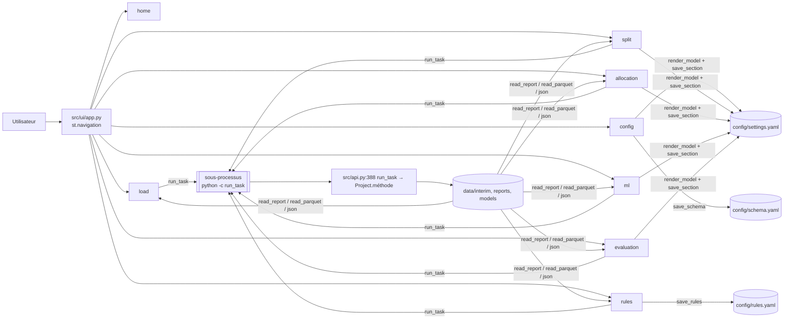
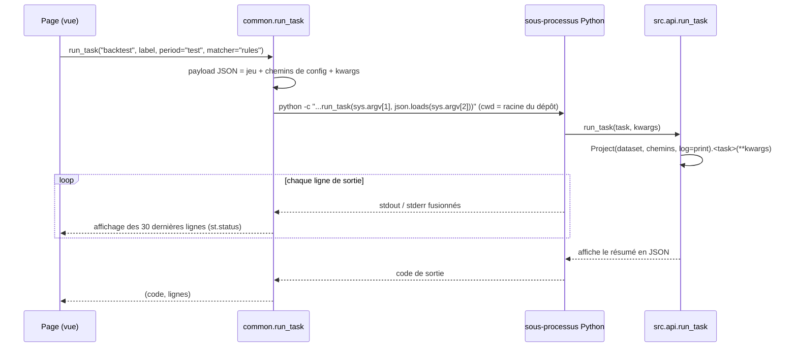

# Module `src/ui/` — interface Streamlit

> **Résumé.** L'interface est une application Streamlit multipage : une page par étape du brief,
> plus une vue d'ensemble. Elle **ne calcule rien elle-même**. Elle édite les fichiers de
> configuration au moyen de formulaires générés depuis les modèles pydantic, puis lance les méthodes
> de `Project` dans un **sous-processus Python**, dont elle affiche le journal en direct. Enfin, elle
> relit les rapports écrits sur disque. Elle sert à piloter la pipeline sans écrire de code ; le
> notebook reste le chemin principal.

---

## 1. Rôle et architecture

| Fichier | Rôle |
|---|---|
| `src/ui/app.py` | point d'entrée : chemin du dépôt dans `sys.path`, configuration de la page, navigation, choix du jeu de données dans la barre latérale |
| `src/ui/common.py` | registre des étapes, chemins, formulaires générés, sauvegarde des réglages, exécution en sous-processus, lecture des sorties |
| `src/ui/views/*.py` | une page par étape, exécutée comme script par Streamlit |

Lancement : `python -m streamlit run src/ui/app.py` (docstring `src/ui/app.py:1-6`). La configuration
Streamlit (`.streamlit/config.toml`) impose l'écoute locale et désactive la télémétrie.

---

## 2. `src/ui/app.py`

- Ajoute la racine du dépôt à `sys.path` (`src/ui/app.py:12-14`), pour que `src.*` soit importable
  même si Streamlit est lancé depuis un autre dossier.
- `st.navigation` regroupe les pages en quatre sections : vue d'ensemble, « Préparation » (config,
  load, split), « Rapprochement » (allocation, rules, ml), « Mesure » (evaluation)
  (`src/ui/app.py:30-35`).
- La barre latérale permet de choisir le jeu (`synthétique` / `réel`, clé de session `dataset`) et
  affiche le dernier chargement à partir de `journal_meta.json` (`src/ui/app.py:37-45`).

---

## 3. `src/ui/common.py`

### 3.1 Registre des étapes

`STEPS` (`src/ui/common.py:54`) : pour chaque étape, une `Step` (clé, titre, icône, statut, résumé).
Toutes sont au statut `DONE`. `step_header(key)` (`src/ui/common.py:72`) affiche le titre, le badge de
statut et le résumé en tête de page.

### 3.2 Chemins

| Fonction | Retour |
|---|---|
| `settings_path` (`src/ui/common.py:88`), `schema_path` (`:92`), `rules_path` (`:96`) | chemins des YAML, surchargeables par `RECON_SETTINGS`, `RECON_SCHEMA`, `RECON_RULES` (utilisé par les tests pour isoler la configuration) |
| `current_settings()` (`:100`) | `load_settings(settings_path())` |
| `dataset()` (`:104`) | jeu choisi dans la barre latérale ; défaut `synthétique` ; `réel` dans la version portable (marqueur `portable:`) |
| `interim_dir()`, `reports_dir()` (`:108`, `:113`) | chemins de réglages + `synthetic/` pour le jeu synthétique, comme `Project._dir` |
| `load_meta()` (`:118`) | `journal_meta.json` ou `None` |
| `require_loaded_data()` (`:123`) | avertit si l'étape 1 n'a pas été lancée |

### 3.3 Formulaires générés depuis pydantic

- **`render_model(model, key, disabled, skip)`** (`src/ui/common.py:142`) parcourt les champs du
  modèle pydantic. Il crée un widget par champ (libellé = description pydantic, aide = clé YAML),
  descend récursivement dans les sous-modèles, et grise les champs d'un bloc dont `enabled` est
  désactivé.
- **`field_widget`** (`:165`) choisit le widget selon le type annoté :

  | Type annoté | Widget |
  |---|---|
  | `bool` | interrupteur |
  | optionnel | case « définir » + valeur |
  | `list` | sélection multiple |
  | `int` / `float` | saisie numérique |
  | `date` | sélecteur de date |
  | autre | texte |

- **`save_section(settings, section, values, key)`** (`src/ui/common.py:206`) affiche deux boutons :
  - **Enregistrer** : valide toute la configuration avec `Settings.model_validate`, affiche les
    erreurs pydantic formatées (`validation_errors`), puis écrit avec `save_settings` ;
  - **Valeurs par défaut** : remet la section à ses valeurs par défaut.

**Pourquoi** : l'interface et la pipeline lisent les mêmes modèles, avec la même validation. Un
nouveau réglage ajouté dans `src/settings.py` apparaît automatiquement dans l'interface.

### 3.4 Exécution en sous-processus — `run_task(task, label, **kwargs)` (`src/ui/common.py:230`)

- **Pourquoi un sous-processus** (docstring) : l'interface reste réactive, et la mémoire des
  traitements (2 M de lignes) ne s'accumule pas dans le processus Streamlit.
- **Environnement** : `PYTHONIOENCODING=utf-8`, `PYTHONUNBUFFERED=1` (`src/ui/common.py:241`).
- **Côté `src/api.py`** : `run_task` (`src/api.py:388`) reconfigure stdout et stderr en UTF-8,
  construit `Project` avec `log=print`, appelle la méthode, puis affiche son `summary` en JSON.

### 3.5 Lecture des sorties

- `read_parquet(path, columns)` (`src/ui/common.py:267`) : lecture mise en cache par `st.cache_data`,
  invalidée par la date de modification du fichier.
- `read_report(name)` (`:272`) : CSV de `reports_dir()`, ou `None` s'il est absent.

---

## 4. Les pages (`src/ui/views/`)

| Page | Affiche | Édite | Lance | Lit |
|---|---|---|---|---|
| `home.py` | jeu courant, nombre d'événements, version de normalisation, liste des étapes et statuts | — | — | `journal_meta.json` |
| `config.py` | formulaire du **mapping** `schema.yaml` (clés globales, sources, colonnes, `value_maps`), avec aperçu des colonnes des fichiers sources ; réglages `paths` et `load` | `config/schema.yaml` (`load_schema` / `save_schema`, `src/load/schema_io.py`) ; `settings.yaml` | — | en-têtes des fichiers sources (`src/ui/views/config.py:29`) |
| `load.py` | jeu synthétique : volume, seed, régénération ; réel : rappel du schéma utilisé. Puis volumes, anomalies, champs manquants, plages de dates, événements, échantillon de libellés normalisés, **testeur de normalisation** (libellé + référence → clés et correspondance) | — | `load` (`src/ui/views/load.py:39`) | `reports/load_*.csv`, `payment.parquet` |
| `split.py` | réglages `split` ; **aperçu du découpage** sur les données chargées, recalculé à la saisie (tableau des périodes, graphique) ; résultats du rejeu vide (taille des lots, reliquat) | `settings.yaml` (`split`) | `replay(period, "null")` (`src/ui/views/split.py:102`) | `payment.parquet`, `imputation.parquet`, `replay_null_
.json`, `_daily.csv` |
| `allocation.py` | signaux et paramètres ; rappel comparé à la cible (vert ou rouge), tableaux par route, statut et signal, paiements manqués ; alertes si la mesure date d'un autre journal ou d'autres réglages | `settings.yaml` (`allocation`) | `measure_allocation(period)` (`src/ui/views/allocation.py:43`) | `allocation_
.json` et CSV associés |
| `rules.py` | règles (activation, priorité, paramètres) ; cascade par règle et précision « seule » ; bouton **« Désactiver ces règles »** pour les règles sous `min_precision` | `config/rules.yaml` (`save_rules`, version incrémentée à chaque enregistrement) | `backtest(period, "rules")` (`src/ui/views/rules.py:77`) | `evaluation_rules_
.json`, `_by_rule.csv`, `_by_rule_alone.csv` |
| `ml.py` | onglets candidats, features, scoring, ensembles, décision, LLM ; puis état du modèle : empreinte, version, seuils τ_high par type, calibration, importance des features. Alertes si le modèle date d'un autre journal ou d'autres réglages ML | `settings.yaml` (`reconcile_ml`) | `train`, `calibrate` et `backtest("test", "pipeline")` (boutons, `src/ui/views/ml.py:48-60`) | `models/<jeu>/pair_model/*` |
| `evaluation.py` | cible et chiffres de référence ; synthèse, cascade, types de groupe, courbe automatisation / précision (altair), diagnostics ML, onglets par étape, règle, mois, client file, rapport markdown | `settings.yaml` (`evaluation`) | `backtest(period, matcher)` (`src/ui/views/evaluation.py:30-31`) | `evaluation_<m>_
.*` |

Chaque page de résultat compare l'empreinte de journal du rapport à celle du dernier chargement. En
cas d'écart, elle affiche « calculé sur un autre journal : relancer ». L'interface fait donc un
contrôle que l'API ne fait pas au chargement du modèle (voir [08](../08_zones_dombre_et_dette.md), F4).

---

## 5. Tests

`tests/test_ui.py` (14 tests, Streamlit `AppTest`, dans un environnement isolé construit par la
fixture `ui_env`, `tests/test_ui.py:17-30`) vérifie :
- que chaque page s'affiche sans exception (`test_every_page_renders`, paramétré) ;
- la navigation ;
- les champs non mappés de la page Configuration ;
- l'aperçu du découpage et sa sauvegarde, le découpage impossible ;
- l'alerte sans signal d'allocation ;
- l'enregistrement des règles et l'incrément de version ;
- l'enregistrement d'un interrupteur ML ;
- **les pages qui lancent des tâches** : chargement, rejeu, évaluation, mesure de l'allocation,
  baseline des règles. Elles exécutent réellement `Project` en sous-processus sur un petit jeu.

---

## ⚠️ Zones d'ombre

1. **Docstring périmée** : `src/ui/common.py:6` parle de « même CLI qu'en ligne de commande », alors
   que la CLI a été retirée. C'est `src.api.run_task` qui est appelé.
2. **Pas de suivi mémoire dans les tâches de l'interface.** Le sous-processus n'active pas
   `MemoryMonitor` : aucune libération mémoire en fin de journée (`end_day`), aucun relevé de phase.
3. **Pas d'accès à l'export des décisions** (`Project.export_decisions`) ni à la reprise de
   l'apprentissage (`train(reuse_dataset=True)`) : uniquement depuis le notebook ou l'API.
4. **Statuts d'étape figés** : `STEPS` déclare toutes les étapes `DONE` en dur, sans lien avec les
   fichiers produits.
5. **Le choix du jeu de données n'est pas persistant** : clé de session Streamlit seulement. Il
   revient à « synthétique » à chaque nouvelle session (dépôt complet).
6. **« Valeurs par défaut » réécrit tout le fichier** `settings.yaml`, comme toute sauvegarde : les
   commentaires manuels sont perdus (`save_settings`).
7. **Annulation impossible** : un traitement lancé tourne jusqu'au bout. Rien n'interrompt le
   sous-processus depuis l'interface, hors arrêt de Streamlit.
